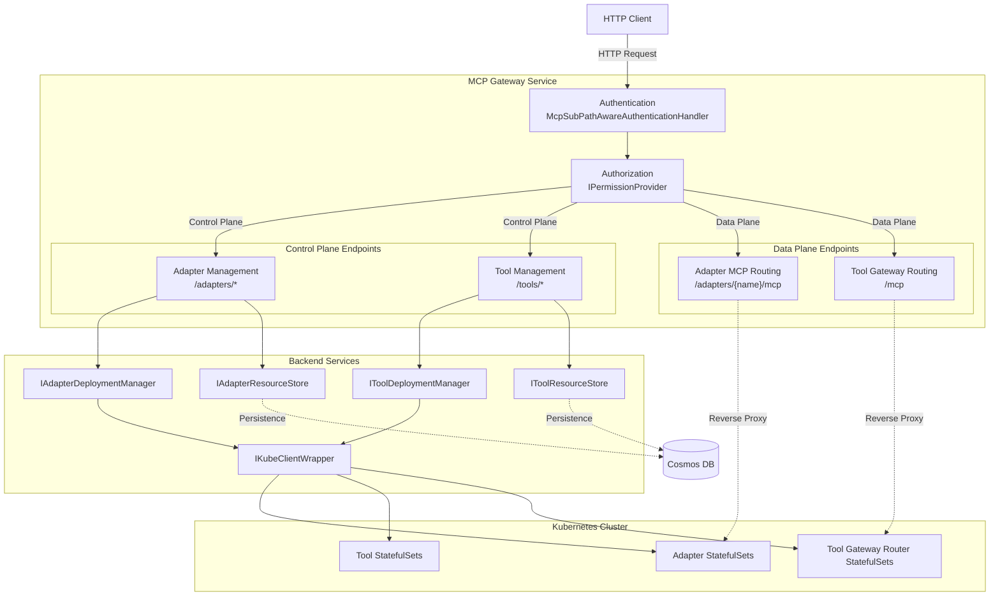
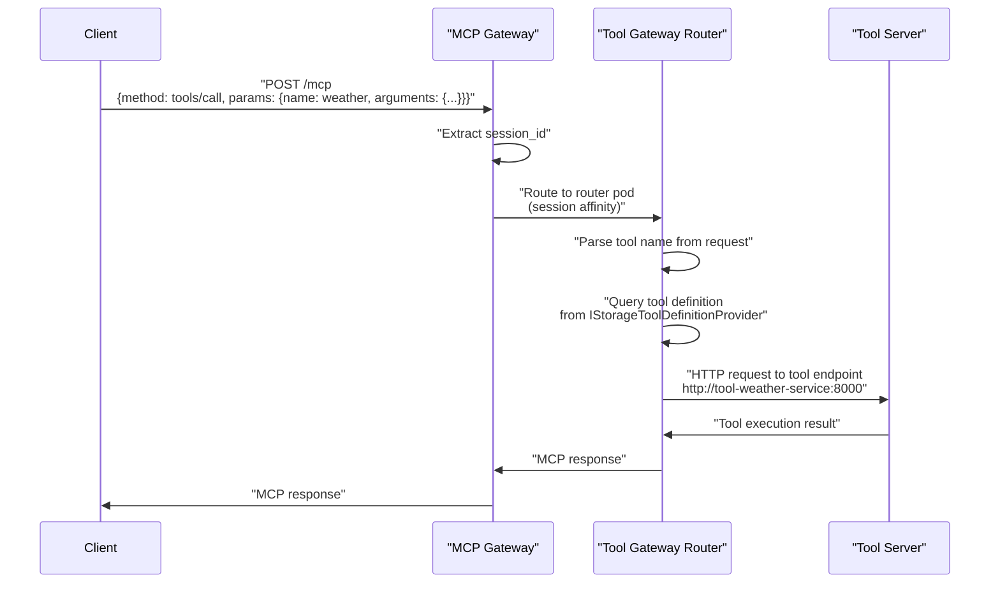
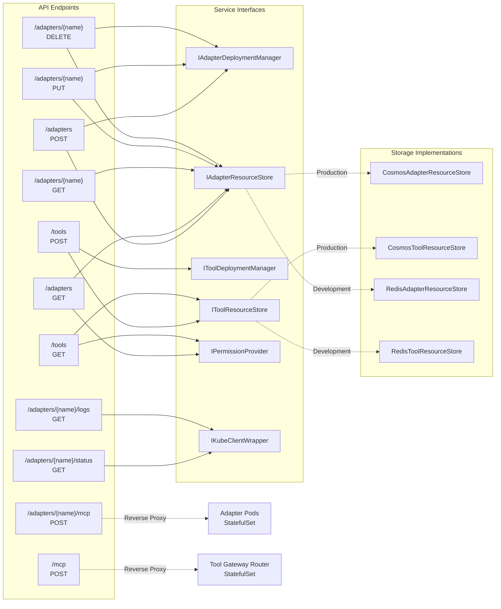

<!-- source: DeepWiki mcp.deepwiki.com · repo microsoft/mcp-gateway · page 5.1 REST API Endpoints · fetched 2026-10-26 -->

# REST API Endpoints

<details>
<summary>Relevant source files</summary>

The following files were used as context for generating this wiki page:

- [README.md](README.md)
- [dotnet/Microsoft.McpGateway.Management/src/Store/CosmosAdapterResourceStore.cs](dotnet/Microsoft.McpGateway.Management/src/Store/CosmosAdapterResourceStore.cs)
- [dotnet/Microsoft.McpGateway.Service/src/appsettings.json](dotnet/Microsoft.McpGateway.Service/src/appsettings.json)
- [openapi/mcp-gateway.openapi.json](openapi/mcp-gateway.openapi.json)

</details>


This page documents all HTTP REST API endpoints exposed by the MCP Gateway service. These endpoints fall into two main categories: **Control Plane APIs** for managing adapter and tool lifecycles, and **Data Plane APIs** for routing MCP protocol traffic. For information about the data contracts used by these endpoints, see [Data Contracts](#5.2). For service interfaces that implement the backend logic, see [Service Interfaces](#5.3).

## Endpoint Overview

The MCP Gateway exposes three functional groups of endpoints:

| Endpoint Group | Base Path | Purpose | Plane |
|----------------|-----------|---------|-------|
| Adapter Management | `/adapters` | CRUD operations for MCP server adapters | Control Plane |
| Tool Management | `/tools` | CRUD operations for MCP tools with definitions | Control Plane |
| MCP Routing | `/adapters/{name}/mcp`, `/mcp` | Session-aware routing to MCP servers and tool gateway | Data Plane |

All control plane endpoints require authentication and authorization. Data plane endpoints also require authentication when deployed to Azure. For details on authentication mechanisms, see [Authentication Flow](#7.1).

**Sources:** [README.md:119-149](), [openapi/mcp-gateway.openapi.json:18-494]()

## Endpoint Summary Table

| HTTP Method | Path | Description | Returns |
|-------------|------|-------------|---------|
| `POST` | `/adapters` | Deploy and register a new MCP server | `AdapterResource` |
| `GET` | `/adapters` | List all accessible adapters | `AdapterResource[]` |
| `GET` | `/adapters/{name}` | Retrieve adapter metadata | `AdapterResource` |
| `PUT` | `/adapters/{name}` | Update adapter deployment | `AdapterResource` |
| `DELETE` | `/adapters/{name}` | Remove adapter | `204 No Content` |
| `GET` | `/adapters/{name}/status` | Check deployment status | Status object |
| `GET` | `/adapters/{name}/logs` | Fetch server logs | `text/plain` |
| `POST` | `/tools` | Register and deploy a tool | `ToolResource` |
| `GET` | `/tools` | List all accessible tools | `ToolResource[]` |
| `GET` | `/tools/{name}` | Retrieve tool metadata | `ToolResource` |
| `PUT` | `/tools/{name}` | Update tool deployment | `ToolResource` |
| `DELETE` | `/tools/{name}` | Remove tool | `204 No Content` |
| `GET` | `/tools/{name}/status` | Check tool deployment status | Status object |
| `GET` | `/tools/{name}/logs` | Fetch tool server logs | `text/plain` |
| `POST` | `/adapters/{name}/mcp` | Direct MCP server connection | MCP protocol response |
| `POST` | `/mcp` | Tool gateway router connection | MCP protocol response |

**Sources:** [openapi/mcp-gateway.openapi.json:18-494]()

## Request Flow Architecture



**Sources:** [README.md:30-115](), [openapi/mcp-gateway.openapi.json:1-700]()

## Adapter Management Endpoints

Adapter endpoints manage the lifecycle of MCP server deployments. Each adapter represents a deployed MCP server instance in the Kubernetes cluster.

### POST /adapters

Deploys and registers a new MCP server adapter.

**Request Body:**
```json
{
  "name": "string",
  "imageName": "string",
  "imageVersion": "string",
  "description": "string",
  "environmentVariables": {},
  "replicaCount": 1,
  "useWorkloadIdentity": false,
  "requiredRoles": []
}
```

**Response:** `200 OK` with `AdapterResource` object

**Key Fields:**
- `name`: Unique identifier for the adapter (used in routing path)
- `imageName`: Container image name (pulled from configured registry)
- `imageVersion`: Image tag/version
- `replicaCount`: Number of StatefulSet replicas (default: 1)
- `useWorkloadIdentity`: Enable Azure Workload Identity for the pods
- `requiredRoles`: Application roles required for read access

**Backend Flow:**
1. Validates request data
2. Creates `AdapterResource` with metadata
3. Calls `IAdapterDeploymentManager.DeployAsync()` to create Kubernetes resources
4. Stores adapter metadata via `IAdapterResourceStore.UpsertAsync()`

**Sources:** [openapi/mcp-gateway.openapi.json:19-62](), [README.md:123]()

### GET /adapters

Lists all adapters accessible to the authenticated user based on authorization rules.

**Response:** `200 OK` with array of `AdapterResource` objects

**Authorization Logic:**
- Returns adapters created by the user
- Returns adapters with roles matching the user's assigned roles
- Returns all adapters if user has `mcp.admin` role

**Implementation:** Queries `IAdapterResourceStore.ListAsync()` and filters results through `IPermissionProvider.CheckAccessAsync()`.

**Sources:** [openapi/mcp-gateway.openapi.json:64-81](), [dotnet/Microsoft.McpGateway.Management/src/Store/CosmosAdapterResourceStore.cs:80-92]()

### GET /adapters/{name}

Retrieves metadata for a specific adapter.

**Path Parameters:**
- `name`: Adapter identifier

**Response:** `200 OK` with `AdapterResource` object

**Errors:**
- `404 Not Found`: Adapter does not exist
- `403 Forbidden`: User lacks read access

**Implementation:** Calls `IAdapterResourceStore.TryGetAsync()` followed by authorization check.

**Sources:** [openapi/mcp-gateway.openapi.json:83-107](), [dotnet/Microsoft.McpGateway.Management/src/Store/CosmosAdapterResourceStore.cs:35-51]()

### PUT /adapters/{name}

Updates an existing adapter deployment.

**Path Parameters:**
- `name`: Adapter identifier

**Request Body:** Complete `AdapterResource` object with modifications

**Response:** `200 OK` with updated `AdapterResource`

**Authorization:** Requires write access (creator or `mcp.admin` role)

**Backend Flow:**
1. Validates existing adapter exists
2. Checks write permissions
3. Updates Kubernetes StatefulSet via `IAdapterDeploymentManager.UpdateAsync()`
4. Updates metadata via `IAdapterResourceStore.UpsertAsync()`

**Sources:** [openapi/mcp-gateway.openapi.json:109-142]()

### DELETE /adapters/{name}

Removes an adapter and its associated Kubernetes resources.

**Path Parameters:**
- `name`: Adapter identifier

**Response:** `204 No Content`

**Authorization:** Requires write access

**Backend Flow:**
1. Deletes Kubernetes StatefulSet and Service via `IAdapterDeploymentManager.DeleteAsync()`
2. Removes metadata via `IAdapterResourceStore.DeleteAsync()`

**Sources:** [openapi/mcp-gateway.openapi.json:144-161](), [dotnet/Microsoft.McpGateway.Management/src/Store/CosmosAdapterResourceStore.cs:65-78]()

### GET /adapters/{name}/status

Retrieves the deployment status of an adapter from Kubernetes.

**Path Parameters:**
- `name`: Adapter identifier

**Response:** `200 OK` with status object
```json
{
  "readyReplicas": 1,
  "updatedReplicas": 1,
  "availableReplicas": 1,
  "image": "localhost:5000/mcp-example:1.0.0",
  "replicaStatus": "Ready"
}
```

**Implementation:** Queries Kubernetes StatefulSet status via `IKubeClientWrapper`.

**Sources:** [openapi/mcp-gateway.openapi.json:163-205]()

### GET /adapters/{name}/logs

Fetches runtime logs from the adapter's pod.

**Path Parameters:**
- `name`: Adapter identifier

**Response:** `200 OK` with `text/plain` log output

**Implementation:** Retrieves pod logs from Kubernetes via `IKubeClientWrapper.GetLogsAsync()`.

**Sources:** [openapi/mcp-gateway.openapi.json:207-232]()

## Tool Management Endpoints

Tool endpoints manage registered MCP tools with their definitions. Tools are deployed as separate services and routed through the Tool Gateway Router.

### POST /tools

Registers and deploys a new tool with MCP tool definition metadata.

**Request Body:**
```json
{
  "name": "string",
  "imageName": "string",
  "imageVersion": "string",
  "description": "string",
  "toolDefinition": {
    "tool": {
      "name": "string",
      "title": "string",
      "description": "string",
      "type": "http",
      "inputSchema": {
        "type": "object",
        "properties": {},
        "required": []
      },
      "annotations": {}
    },
    "port": 8000
  },
  "environmentVariables": {},
  "replicaCount": 1,
  "useWorkloadIdentity": false,
  "requiredRoles": []
}
```

**Response:** `201 Created` with `ToolResource` object

**Key Fields:**
- `toolDefinition`: Complete MCP tool definition including execution endpoint
- `toolDefinition.tool.name`: Must match the top-level `name` field
- `toolDefinition.port`: Port where the tool server listens (default: 8000)
- `toolDefinition.tool.inputSchema`: JSON Schema defining tool parameters

**Backend Flow:**
1. Validates tool definition matches tool name
2. Creates `ToolResource` with metadata
3. Deploys tool server via `IToolDeploymentManager.DeployAsync()`
4. Stores tool metadata and definition via `IToolResourceStore.UpsertAsync()`

**Sources:** [openapi/mcp-gateway.openapi.json:234-262](), [README.md:132-139]()

### GET /tools

Lists all tools accessible to the authenticated user.

**Response:** `200 OK` with array of `ToolResource` objects

**Authorization:** Same rules as adapter list endpoint (creator, required roles, or admin).

**Sources:** [openapi/mcp-gateway.openapi.json:264-281]()

### GET /tools/{name}

Retrieves metadata and tool definition for a specific tool.

**Path Parameters:**
- `name`: Tool identifier

**Response:** `200 OK` with `ToolResource` object including full `toolDefinition`

**Errors:**
- `404 Not Found`: Tool does not exist

**Sources:** [openapi/mcp-gateway.openapi.json:283-310]()

### PUT /tools/{name}

Updates a tool deployment and its definition.

**Path Parameters:**
- `name`: Tool identifier

**Request Body:** Complete `ToolData` object with modifications

**Response:** `200 OK` with updated `ToolResource`

**Authorization:** Requires write access

**Backend Flow:**
1. Updates Kubernetes StatefulSet
2. Updates tool definition in storage
3. Tool Gateway Router picks up updated definition automatically

**Sources:** [openapi/mcp-gateway.openapi.json:312-351]()

### DELETE /tools/{name}

Removes a registered tool and its deployment.

**Path Parameters:**
- `name`: Tool identifier

**Response:** `204 No Content`

**Authorization:** Requires write access

**Sources:** [openapi/mcp-gateway.openapi.json:353-373]()

### GET /tools/{name}/status

Checks the deployment status of a tool server.

**Path Parameters:**
- `name`: Tool identifier

**Response:** `200 OK` with status object (same structure as adapter status)

**Sources:** [openapi/mcp-gateway.openapi.json:375-420]()

### GET /tools/{name}/logs

Fetches runtime logs from a tool server pod.

**Path Parameters:**
- `name`: Tool identifier

**Query Parameters:**
- `instance` (optional): Pod instance index (0-based) for multi-replica deployments (default: 0)

**Response:** `200 OK` with `text/plain` log output

**Sources:** [openapi/mcp-gateway.openapi.json:422-460]()

## Data Plane MCP Routing Endpoints

These endpoints handle MCP protocol traffic routing with session affinity.

### POST /adapters/{name}/mcp

Establishes a streamable HTTP connection to a specific MCP server adapter.

**Path Parameters:**
- `name`: Adapter identifier (must exist)

**Request Body:** MCP protocol JSON payload (protocol-specific)

**Response:** MCP protocol response (streaming supported)

**Session Routing:**
- Extracts `session_id` from MCP request
- Routes to same pod instance for subsequent requests with matching `session_id`
- Uses headless Kubernetes service for pod-specific addressing

**Authentication:**
- Azure AD Bearer token required in production
- User identity forwarded to backend via `ForwardedIdentityHeaders`

**Error Codes:**
- `401 Unauthorized`: Missing or invalid token
- `403 Forbidden`: Insufficient permissions
- `404 Not Found`: Adapter does not exist
- `503 Service Unavailable`: No healthy pods available

**Sources:** [README.md:145-146](), [openapi/mcp-gateway.openapi.json:462-494]()

### POST /mcp

Routes requests to the Tool Gateway Router, which dynamically dispatches to registered tools.

**Request Body:** MCP protocol JSON payload

**Response:** MCP protocol response from tool execution

**Routing Flow:**


**Key Characteristics:**
- No adapter name in path (routes to tool gateway router system)
- Router instances maintain tool definition cache
- Dynamic routing based on tool name in MCP `tools/call` requests
- Multiple router instances behind gateway for high availability

**Sources:** [README.md:148-149](), [openapi/mcp-gateway.openapi.json:462-494]()

## Endpoint-to-Code Mapping



**Sources:** [dotnet/Microsoft.McpGateway.Management/src/Store/CosmosAdapterResourceStore.cs:1-95](), [README.md:119-149]()

## Authentication and Authorization

All endpoints require authentication when deployed to Azure. The authentication flow involves:

1. **OAuth 2.0 Protected Resource Metadata Discovery**
   - Endpoints: `GET /.well-known/oauth-protected-resource` (served at gateway root and under each adapter path)
   - Returns metadata document with authorization server information

2. **Bearer Token Validation**
   - Token source: Azure AD (Entra ID)
   - Token validation: JWT signature and claims verification
   - Implementation: `McpSubPathAwareAuthenticationHandler`

3. **Authorization Check**
   - Service: `IPermissionProvider.CheckAccessAsync()`
   - Read access: Creator, users with required roles, or `mcp.admin` role
   - Write access: Creator or `mcp.admin` role

For local development, authentication can be bypassed using `DevelopmentAuthenticationHandler`.

**Sources:** [README.md:152-158](), [dotnet/Microsoft.McpGateway.Service/src/appsettings.json:9-14]()

## Configuration

Base URL configuration varies by environment:

| Environment | Base URL | Configuration Source |
|-------------|----------|---------------------|
| Local Development | `http://localhost:8000` | Port forwarding or direct access |
| Azure Production | `http://<resourceLabel>.<location>.cloudapp.azure.com` | Application Gateway public DNS |

Registry endpoint for container images:

| Environment | Registry Endpoint | Configuration Key |
|-------------|-------------------|-------------------|
| Local | `localhost:5000` | `ContainerRegistrySettings:Endpoint` |
| Azure | `<registry-name>.azurecr.io` | `ContainerRegistrySettings:Endpoint` |

**Sources:** [dotnet/Microsoft.McpGateway.Service/src/appsettings.json:23-26](), [openapi/mcp-gateway.openapi.json:8-16]()

## Error Responses

Standard HTTP error codes are used across all endpoints:

| Status Code | Meaning | Common Causes |
|-------------|---------|---------------|
| `400 Bad Request` | Invalid request data | Missing required fields, invalid JSON, validation errors |
| `401 Unauthorized` | Authentication required | Missing or invalid Bearer token |
| `403 Forbidden` | Insufficient permissions | User lacks required roles or ownership |
| `404 Not Found` | Resource not found | Adapter/tool name does not exist |
| `500 Internal Server Error` | Server-side error | Kubernetes API failure, storage failure |
| `503 Service Unavailable` | Service not ready | No healthy backend pods available |

**Sources:** [openapi/mcp-gateway.openapi.json:18-494]()

---

