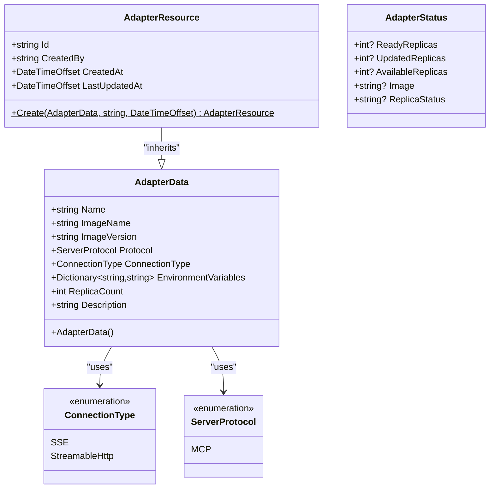
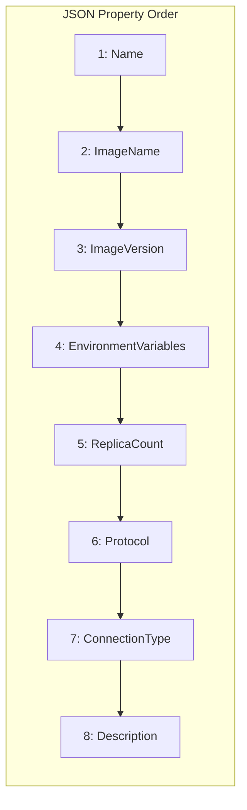
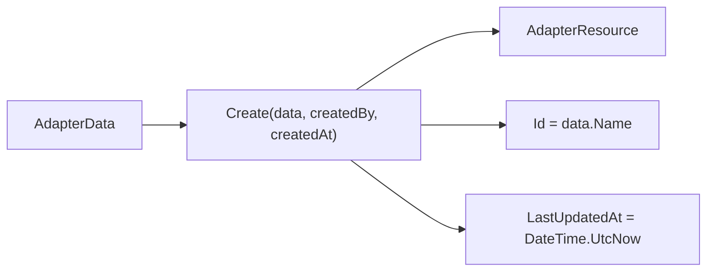
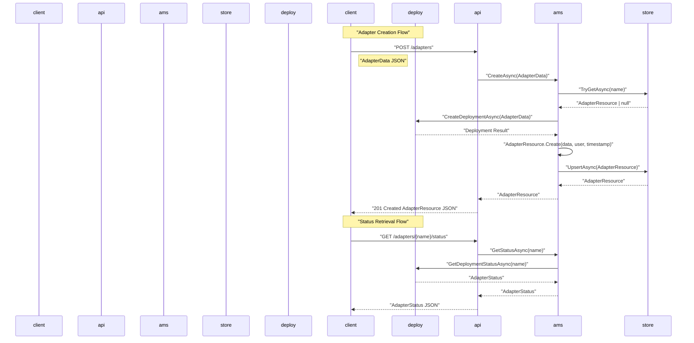

<!-- source: DeepWiki mcp.deepwiki.com · repo microsoft/mcp-gateway · page 5.2 Data Contracts · fetched 2026-10-26 -->

# Data Contracts

Relevant source files

The following files were used as context for generating this wiki page:

- [dotnet/Microsoft.McpGateway.Management/src/Contracts/AdapterData.cs](dotnet/Microsoft.McpGateway.Management/src/Contracts/AdapterData.cs)
- [dotnet/Microsoft.McpGateway.Management/src/Contracts/AdapterResource.cs](dotnet/Microsoft.McpGateway.Management/src/Contracts/AdapterResource.cs)

## Purpose and Scope

This document defines the data transfer objects (DTOs) and entity models used throughout the MCP Gateway adapter management system. These contracts establish the structure for adapter configuration data, persistence entities, and operational status information.

For information about the service interfaces that consume these contracts, see [Service Interfaces](#4.2). For details about the API endpoints that expose these contracts, see [Control Plane](#2.2).

## Contract Overview

The MCP Gateway uses three primary data contracts that work together to manage the complete adapter lifecycle:

**Sources:** [dotnet/Microsoft.McpGateway.Management/src/Contracts/AdapterData.cs:1-102](), [dotnet/Microsoft.McpGateway.Management/src/Contracts/AdapterResource.cs:1-58](), [dotnet/Microsoft.McpGateway.Management/src/Contracts/AdapterStatus.cs:1-21]()

## AdapterData Contract

The `AdapterData` class serves as the primary input contract for adapter creation and updates. It defines the configuration parameters required to deploy an MCP server adapter.

### Core Properties

| Property | Type | Purpose | Validation |
|----------|------|---------|------------|
| `Name` | `string` | Unique identifier for the adapter | Regex: `^[a-z0-9-]+$` |
| `ImageName` | `string` | Container image name | Required |
| `ImageVersion` | `string` | Container image version/tag | Required |
| `Protocol` | `ServerProtocol` | Communication protocol | Default: `MCP` |
| `ConnectionType` | `ConnectionType` | Connection mechanism | Default: `StreamableHttp` |
| `EnvironmentVariables` | `Dictionary<string,string>` | Container environment variables | Default: empty |
| `ReplicaCount` | `int` | Number of pod replicas | Default: 1 |
| `Description` | `string` | Human-readable description | Default: empty |

### JSON Serialization

The contract uses `JsonPropertyOrder` attributes to ensure consistent serialization order:

**Sources:** [dotnet/Microsoft.McpGateway.Management/src/Contracts/AdapterData.cs:17-61]()

### Enumeration Types

The contract defines two supporting enumerations with JSON string conversion:

- **ConnectionType**: `SSE`, `StreamableHttp` [dotnet/Microsoft.McpGateway.Management/src/Contracts/AdapterData.cs:91-95]()
- **ServerProtocol**: `MCP` [dotnet/Microsoft.McpGateway.Management/src/Contracts/AdapterData.cs:98-101]()

## AdapterResource Contract

The `AdapterResource` class extends `AdapterData` to represent the persistent entity stored in the resource store. It adds metadata fields required for tracking and auditing.

### Additional Properties

| Property | Type | Purpose |
|----------|------|---------|
| `Id` | `string` | Primary key (same as Name) |
| `CreatedBy` | `string` | User identifier who created the adapter |
| `CreatedAt` | `DateTimeOffset` | Creation timestamp |
| `LastUpdatedAt` | `DateTimeOffset` | Last modification timestamp |

### Factory Method

The static `Create` method provides a convenient way to convert from `AdapterData` to `AdapterResource`:

**Sources:** [dotnet/Microsoft.McpGateway.Management/src/Contracts/AdapterResource.cs:39-54]()

## AdapterStatus Contract

The `AdapterStatus` class provides operational status information about deployed adapters, typically retrieved from the Kubernetes deployment.

### Status Properties

| Property | Type | Purpose |
|----------|------|---------|
| `ReadyReplicas` | `int?` | Number of ready pod replicas |
| `UpdatedReplicas` | `int?` | Number of updated pod replicas |
| `AvailableReplicas` | `int?` | Number of available pod replicas |
| `Image` | `string?` | Currently deployed container image |
| `ReplicaStatus` | `string?` | Overall replica status description |

All properties are nullable to handle cases where status information is unavailable.

**Sources:** [dotnet/Microsoft.McpGateway.Management/src/Contracts/AdapterStatus.cs:9-20]()

## Data Flow Through System

The contracts flow through the MCP Gateway system following this pattern:

**Sources:** [dotnet/Microsoft.McpGateway.Management/src/Contracts/AdapterData.cs:1-102](), [dotnet/Microsoft.McpGateway.Management/src/Contracts/AdapterResource.cs:1-58](), [dotnet/Microsoft.McpGateway.Management/src/Contracts/AdapterStatus.cs:1-21]()

## Validation and Constraints

The data contracts implement validation through multiple mechanisms:

### Name Validation
The `Name` property uses a regular expression constraint to ensure Kubernetes compatibility:
- Pattern: `^[a-z0-9-]+$`
- Allows only lowercase letters, numbers, and dashes
- Prevents invalid Kubernetes resource names

### Required Fields
Constructor validation ensures critical fields are not null or empty:
- `Name`: Must not be null or empty
- `ImageName`: Must not be null or empty  
- `ImageVersion`: Must not be null or empty

### Default Values
The contracts provide sensible defaults for optional configuration:
- `ReplicaCount`: Defaults to 1
- `Protocol`: Defaults to `ServerProtocol.MCP`
- `ConnectionType`: Defaults to `ConnectionType.StreamableHttp`
- `EnvironmentVariables`: Defaults to empty dictionary
- `Description`: Defaults to empty string

**Sources:** [dotnet/Microsoft.McpGateway.Management/src/Contracts/AdapterData.cs:17-18](), [dotnet/Microsoft.McpGateway.Management/src/Contracts/AdapterData.cs:73-75]()

---

