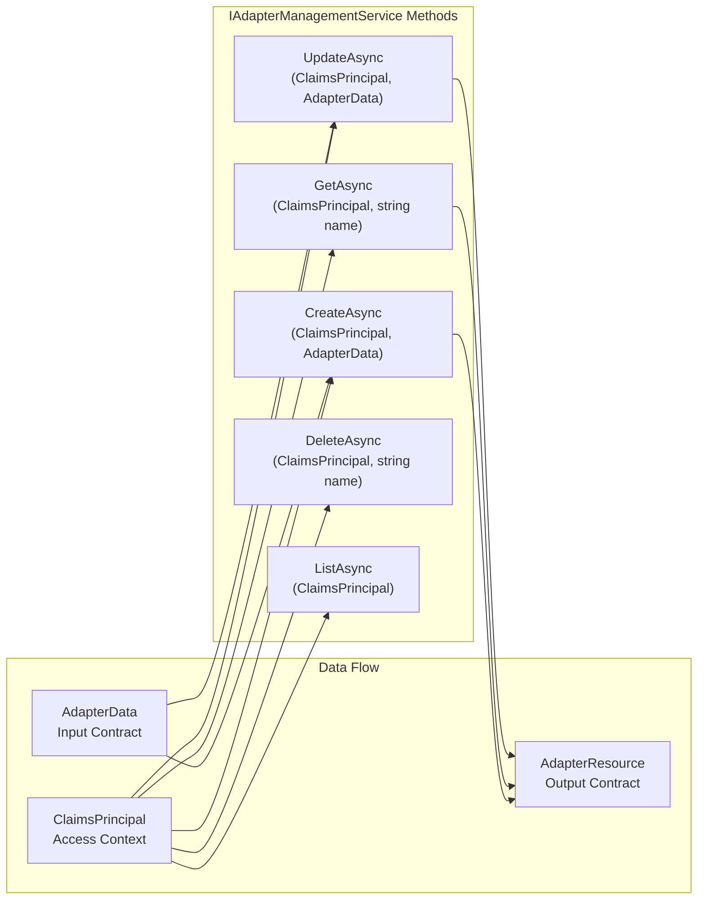
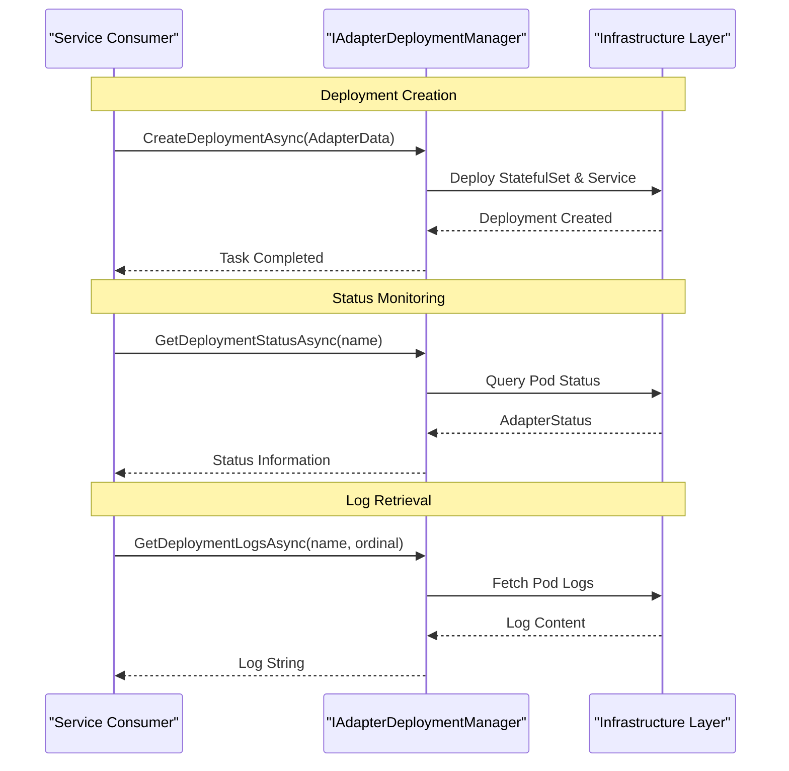
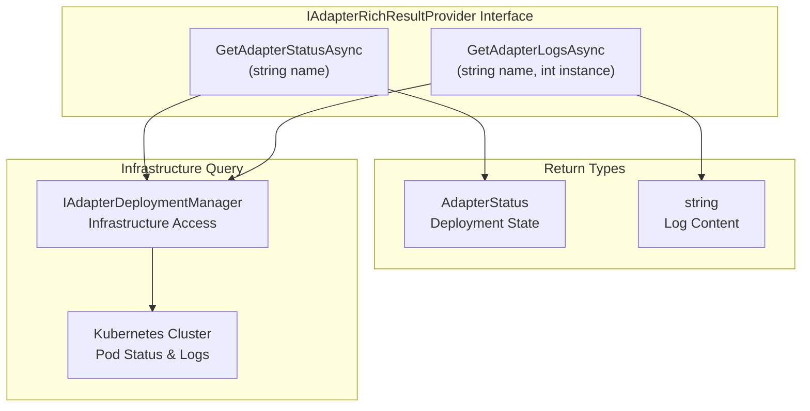

<!-- source: DeepWiki mcp.deepwiki.com · repo microsoft/mcp-gateway · page 5.3 Service Interfaces · fetched 2026-10-26 -->

# Service Interfaces

<details>
<summary>Relevant source files</summary>

The following files were used as context for generating this wiki page:

- [dotnet/Directory.Packages.props](dotnet/Directory.Packages.props)
- [dotnet/Microsoft.McpGateway.Management/src/Deployment/IAdapterDeploymentManager.cs](dotnet/Microsoft.McpGateway.Management/src/Deployment/IAdapterDeploymentManager.cs)
- [dotnet/Microsoft.McpGateway.Management/src/Store/IAdapterResourceStore.cs](dotnet/Microsoft.McpGateway.Management/src/Store/IAdapterResourceStore.cs)
- [dotnet/Microsoft.McpGateway.Management/src/Store/InMemoryAdapterResourceStore.cs](dotnet/Microsoft.McpGateway.Management/src/Store/InMemoryAdapterResourceStore.cs)
- [dotnet/Microsoft.McpGateway.Management/test/KubernetesAdapterDeploymentManagerTests.cs](dotnet/Microsoft.McpGateway.Management/test/KubernetesAdapterDeploymentManagerTests.cs)

</details>


This page documents the key service interfaces that define the contracts for dependency injection and testing within the MCP Gateway system. These interfaces provide abstraction layers that enable clean architecture patterns, testability, and flexible implementation strategies.

For information about the concrete implementations of these interfaces, see [Core Components](#3). For details about the data contracts used by these interfaces, see [Data Contracts](#4.1).

## Interface Overview

The MCP Gateway system is built around three primary service interfaces that form the core abstraction layer:

- **IAdapterManagementService**: Primary orchestration service for adapter lifecycle management
- **IAdapterDeploymentManager**: Abstraction for deployment operations and infrastructure management  
- **IAdapterRichResultProvider**: Service for retrieving operational data such as status and logs

These interfaces enable dependency injection, facilitate unit testing, and provide clear contracts for system integration.

```mermaid
graph TB
    subgraph "Service Interface Layer"
        IAdapterMgmt["IAdapterManagementService<br/>Primary Orchestration"]
        IDeployMgr["IAdapterDeploymentManager<br/>Infrastructure Operations"]  
        IRichProvider["IAdapterRichResultProvider<br/>Operational Data"]
    end
    
    subgraph "Implementation Layer"
        AdapterMgmtSvc["AdapterManagementService<br/>Business Logic"]
        K8sDeployMgr["KubernetesAdapterDeploymentManager<br/>K8s Integration"]
        RichProvider["AdapterRichResultProvider<br/>Status & Logs"]
    end
    
    subgraph "Infrastructure Layer"
        ResourceStore["IAdapterResourceStore<br/>Persistence Abstraction"]
        KubeWrapper["IKubeClientWrapper<br/>K8s Client Abstraction"]
    end
    
    IAdapterMgmt <|.. AdapterMgmtSvc
    IDeployMgr <|.. K8sDeployMgr
    IRichProvider <|.. RichProvider
    
    AdapterMgmtSvc --> IDeployMgr
    AdapterMgmtSvc --> ResourceStore
    RichProvider --> IDeployMgr
    K8sDeployMgr --> KubeWrapper
```

**Interface Abstraction Architecture**

Sources: [dotnet/Microsoft.McpGateway.Management/src/Service/IAdapterManagementService.cs:1-58](), [dotnet/Microsoft.McpGateway.Management/src/Deployment/IAdapterDeploymentManager.cs:1-50](), [dotnet/Microsoft.McpGateway.Management/src/Service/IAdapterRichResultProvider.cs:1-27]()

## Core Service Interface: IAdapterManagementService

The `IAdapterManagementService` interface serves as the primary orchestration service for adapter lifecycle management. It includes comprehensive access control through `ClaimsPrincipal` integration and supports full CRUD operations.

### Interface Contract

| Method | Purpose | Access Control | Return Type |
|--------|---------|----------------|-------------|
| `CreateAsync` | Creates new adapter deployment | ✓ ClaimsPrincipal | `Task<AdapterResource>` |
| `GetAsync` | Retrieves adapter metadata | ✓ ClaimsPrincipal | `Task<AdapterResource?>` |
| `UpdateAsync` | Updates adapter configuration | ✓ ClaimsPrincipal | `Task<AdapterResource>` |
| `DeleteAsync` | Removes adapter deployment | ✓ ClaimsPrincipal | `Task` |
| `ListAsync` | Lists accessible adapters | ✓ ClaimsPrincipal | `Task<IEnumerable<AdapterResource>>` |

### Method Signatures and Responsibilities



**IAdapterManagementService Method Contracts**

The interface enforces access control at every operation level, ensuring that all adapter management operations are performed within the context of authenticated and authorized users.

Sources: [dotnet/Microsoft.McpGateway.Management/src/Service/IAdapterManagementService.cs:14-57]()

## Deployment Management Interface: IAdapterDeploymentManager

The `IAdapterDeploymentManager` interface abstracts infrastructure deployment operations, primarily targeting Kubernetes but designed to support multiple deployment strategies through implementation variation.

### Interface Operations

| Method | Purpose | Parameters | Return Type |
|--------|---------|------------|-------------|
| `CreateDeploymentAsync` | Deploy new adapter instance | `AdapterData`, `CancellationToken` | `Task` |
| `DeleteDeploymentAsync` | Remove deployment | `string name`, `CancellationToken` | `Task` |
| `GetDeploymentStatusAsync` | Retrieve deployment status | `string name`, `CancellationToken` | `Task<AdapterStatus>` |
| `GetDeploymentLogsAsync` | Retrieve pod logs | `string name`, `int ordinal`, `CancellationToken` | `Task<string>` |
| `UpdateDeploymentAsync` | Update deployment configuration | `AdapterData`, `CancellationToken` | `Task` |

### Deployment Lifecycle Flow



**IAdapterDeploymentManager Operation Flow**

Sources: [dotnet/Microsoft.McpGateway.Management/src/Deployment/IAdapterDeploymentManager.cs:11-49]()

## Rich Result Provider Interface: IAdapterRichResultProvider

The `IAdapterRichResultProvider` interface provides operational data retrieval capabilities, focusing on runtime status and diagnostic information for deployed adapters.

### Interface Methods

The interface exposes two primary operations for operational data access:

- **GetAdapterStatusAsync**: Retrieves current deployment status including pod states, replica counts, and health information
- **GetAdapterLogsAsync**: Retrieves log output from specific adapter instances with support for multi-instance deployments

### Operational Data Access Pattern



**Rich Result Provider Data Flow**

The interface design supports instance-specific log retrieval through the `instance` parameter, enabling diagnostic access to individual pods within multi-replica adapter deployments.

Sources: [dotnet/Microsoft.McpGateway.Management/src/Service/IAdapterRichResultProvider.cs:8-26]()

## Interface Dependencies and Relationships

The service interfaces form a layered architecture where higher-level services depend on lower-level abstractions through dependency injection:

### Dependency Graph

```mermaid
graph TB
    subgraph "Application Layer"
        Controllers["REST API Controllers<br/>/adapters endpoints"]
    end
    
    subgraph "Service Layer Interfaces"
        IAdapterMgmt["IAdapterManagementService<br/>Primary Orchestration"]
        IRichProvider["IAdapterRichResultProvider<br/>Operational Queries"]
    end
    
    subgraph "Infrastructure Interfaces"
        IDeployMgr["IAdapterDeploymentManager<br/>Deployment Operations"]
        IResourceStore["IAdapterResourceStore<br/>Persistence Operations"]
    end
    
    subgraph "Infrastructure Implementations"
        K8sManager["KubernetesAdapterDeploymentManager"]
        CosmosStore["CosmosAdapterResourceStore"]
        InMemoryStore["InMemoryAdapterResourceStore"]
    end
    
    Controllers --> IAdapterMgmt
    Controllers --> IRichProvider
    
    IAdapterMgmt --> IDeployMgr
    IAdapterMgmt --> IResourceStore
    IRichProvider --> IDeployMgr
    
    IDeployMgr <|.. K8sManager
    IResourceStore <|.. CosmosStore
    IResourceStore <|.. InMemoryStore
```

**Service Interface Dependency Architecture**

### Dependency Injection Configuration

The interfaces enable flexible dependency injection configurations supporting:

- **Production**: Kubernetes deployment manager with Cosmos DB storage
- **Development**: Kubernetes deployment manager with in-memory storage  
- **Testing**: Mock implementations for all interfaces

This design pattern ensures loose coupling between service layers and enables comprehensive unit testing through interface mocking.

Sources: [dotnet/Microsoft.McpGateway.Management/src/Service/IAdapterManagementService.cs:1-58](), [dotnet/Microsoft.McpGateway.Management/src/Deployment/IAdapterDeploymentManager.cs:1-50](), [dotnet/Microsoft.McpGateway.Management/src/Service/IAdapterRichResultProvider.cs:1-27]()

---

