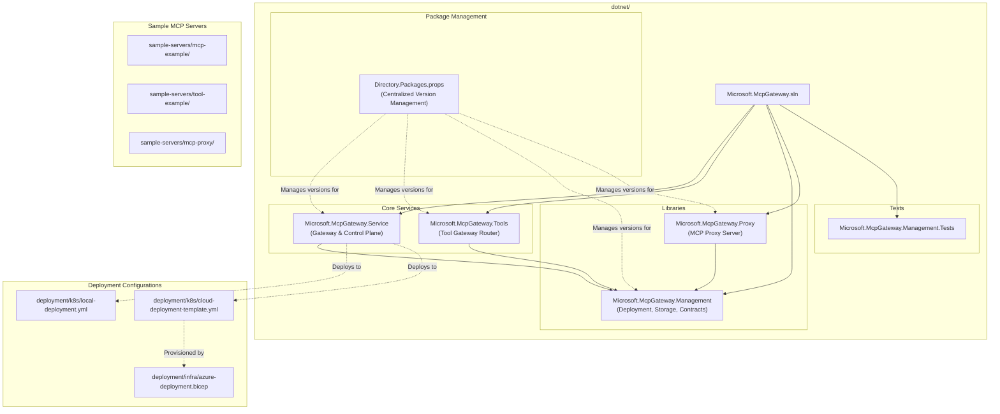
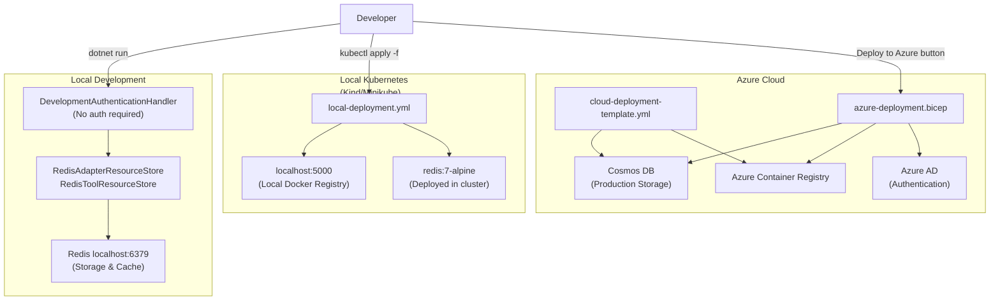
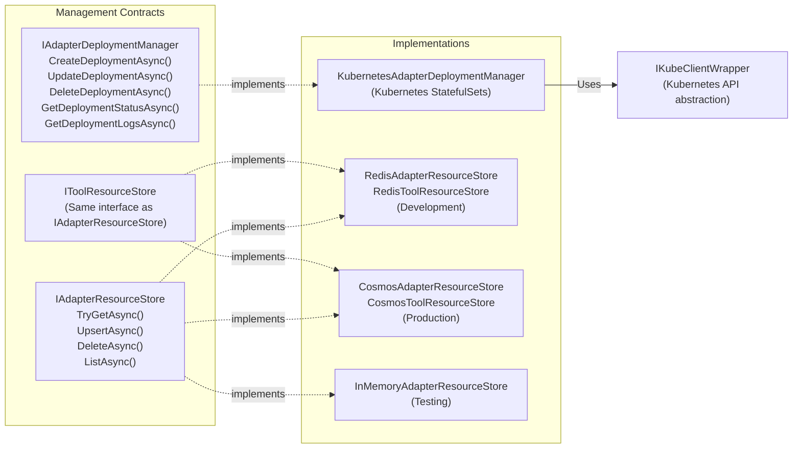
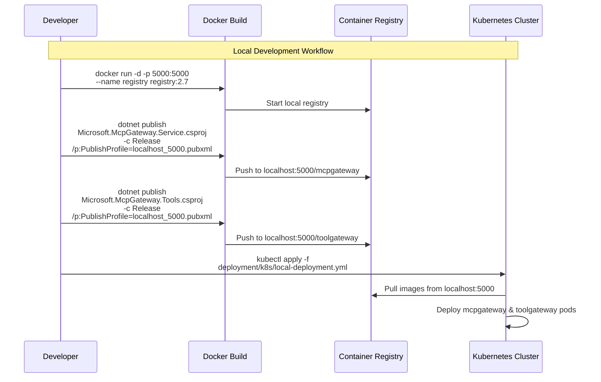
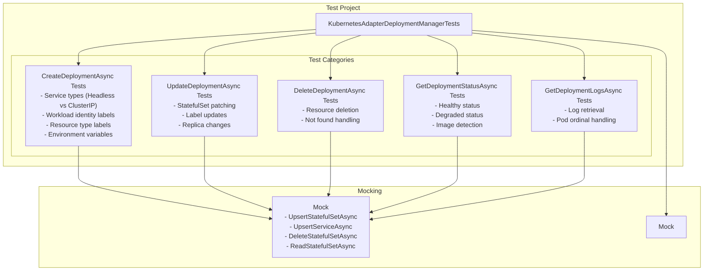
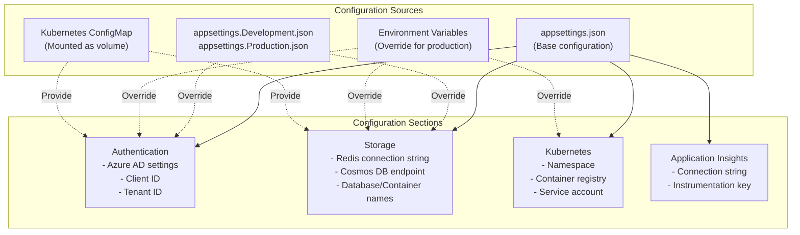

<!-- source: DeepWiki mcp.deepwiki.com · repo microsoft/mcp-gateway · page 6 Development Guide · fetched 2026-10-26 -->

# Development Guide

<details>
<summary>Relevant source files</summary>

The following files were used as context for generating this wiki page:

- [README.md](README.md)
- [dotnet/Directory.Packages.props](dotnet/Directory.Packages.props)
- [dotnet/Microsoft.McpGateway.Management/src/Deployment/IAdapterDeploymentManager.cs](dotnet/Microsoft.McpGateway.Management/src/Deployment/IAdapterDeploymentManager.cs)
- [dotnet/Microsoft.McpGateway.Management/src/Store/IAdapterResourceStore.cs](dotnet/Microsoft.McpGateway.Management/src/Store/IAdapterResourceStore.cs)
- [dotnet/Microsoft.McpGateway.Management/src/Store/InMemoryAdapterResourceStore.cs](dotnet/Microsoft.McpGateway.Management/src/Store/InMemoryAdapterResourceStore.cs)
- [dotnet/Microsoft.McpGateway.Management/test/KubernetesAdapterDeploymentManagerTests.cs](dotnet/Microsoft.McpGateway.Management/test/KubernetesAdapterDeploymentManagerTests.cs)

</details>


This page provides an overview of development workflows, codebase organization, and common development tasks for the MCP Gateway project. It serves as an entry point for developers who want to contribute to or extend the system.

For detailed setup instructions, see [Getting Started](#6.1). For build and deployment details, see [Build and CI/CD](#6.3). For authentication and authorization implementation details, see [Authentication Flow](#7.1) and [Authorization and RBAC](#7.2).

## Solution Structure

The MCP Gateway codebase is organized as a multi-project .NET 8 solution with clear separation of concerns between management, gateway services, and tooling components.



**Sources:** [dotnet/Directory.Packages.props:1-22](), [README.md:1-617]()

### Project Descriptions

| Project | Purpose | Key Components |
|---------|---------|----------------|
| `Microsoft.McpGateway.Service` | Main gateway service hosting control plane APIs and data plane routing | Program.cs, Controllers, Authentication handlers |
| `Microsoft.McpGateway.Tools` | Tool gateway router for dynamic tool routing | StorageToolDefinitionProvider, HttpToolExecutor |
| `Microsoft.McpGateway.Management` | Shared library for deployment and resource management | IAdapterDeploymentManager, IAdapterResourceStore, KubeClientWrapper |
| `Microsoft.McpGateway.Proxy` | MCP proxy server implementation | Supports proxying local and remote MCP servers |

**Sources:** [README.md:15-21]()

## Development Environments

The MCP Gateway supports three primary development environments, each with different infrastructure requirements and authentication mechanisms.



**Sources:** [README.md:191-346](), [README.md:347-573]()

### Environment Comparison

| Feature | Local Development | Local Kubernetes | Azure Cloud |
|---------|------------------|------------------|-------------|
| Authentication | Development handler (bypass) | Optional | Azure AD (required) |
| Storage | Redis (localhost) | Redis (in-cluster) | Cosmos DB |
| Cache | Redis | Redis | Cosmos DB / Redis |
| Container Registry | None (direct run) | localhost:5000 | Azure Container Registry |
| Deployment Tool | `dotnet run` | `kubectl apply` | Bicep + Azure CLI |
| Port | 8000 | 8000 (port-forward) | 80 (via Application Gateway) |

**Sources:** [README.md:191-346](), [deployment/k8s/local-deployment.yml](), [deployment/k8s/cloud-deployment-template.yml](), [deployment/infra/azure-deployment.bicep]()

## Key Development Interfaces

The following interfaces define the contracts for the system's core functionality. Understanding these interfaces is essential for extending or modifying the gateway's behavior.



**Sources:** [dotnet/Microsoft.McpGateway.Management/src/Deployment/IAdapterDeploymentManager.cs:1-54](), [dotnet/Microsoft.McpGateway.Management/src/Store/IAdapterResourceStore.cs:1-43](), [dotnet/Microsoft.McpGateway.Management/src/Store/InMemoryAdapterResourceStore.cs:1-37]()

### IAdapterDeploymentManager

Primary interface for managing the lifecycle of MCP server deployments (both adapters and tools).

**Key Methods:**
- `CreateDeploymentAsync(AdapterData, ResourceType, CancellationToken)` - Creates Kubernetes StatefulSet and Service
- `UpdateDeploymentAsync(AdapterData, ResourceType, CancellationToken)` - Patches existing StatefulSet
- `DeleteDeploymentAsync(string, CancellationToken)` - Removes StatefulSet and Service
- `GetDeploymentStatusAsync(string, CancellationToken)` - Returns AdapterStatus with replica health
- `GetDeploymentLogsAsync(string, int, CancellationToken)` - Fetches logs from specific pod ordinal

**Sources:** [dotnet/Microsoft.McpGateway.Management/src/Deployment/IAdapterDeploymentManager.cs:8-53]()

### IAdapterResourceStore and IToolResourceStore

Storage abstraction for persisting adapter and tool metadata. Both interfaces share the same contract.

**Key Methods:**
- `TryGetAsync(string, CancellationToken)` - Retrieves resource by name
- `UpsertAsync(AdapterResource, CancellationToken)` - Creates or updates resource
- `DeleteAsync(string, CancellationToken)` - Removes resource
- `ListAsync(CancellationToken)` - Returns all resources

**Implementations:**
- `InMemoryAdapterResourceStore` - In-memory dictionary for testing
- `RedisAdapterResourceStore` / `RedisToolResourceStore` - Redis-backed for development
- `CosmosAdapterResourceStore` / `CosmosToolResourceStore` - Cosmos DB for production

**Sources:** [dotnet/Microsoft.McpGateway.Management/src/Store/IAdapterResourceStore.cs:8-42](), [dotnet/Microsoft.McpGateway.Management/src/Store/InMemoryAdapterResourceStore.cs:9-36]()

## Common Development Workflows

### Building and Publishing Container Images

The gateway and tool router are published as container images. For local development with Kubernetes, you need a local registry.



**Sources:** [README.md:198-226]()

#### Local Development Commands

```bash
# Start local Docker registry
docker run -d -p 5000:5000 --name registry registry:2.7

# Build and publish gateway image
dotnet publish dotnet/Microsoft.McpGateway.Service/src/Microsoft.McpGateway.Service.csproj \
  -c Release /p:PublishProfile=localhost_5000.pubxml

# Build and publish tool gateway router image
dotnet publish dotnet/Microsoft.McpGateway.Tools/src/Microsoft.McpGateway.Tools.csproj \
  -c Release /p:PublishProfile=localhost_5000.pubxml

# Deploy to local Kubernetes
kubectl apply -f deployment/k8s/local-deployment.yml

# Enable port forwarding
kubectl port-forward -n adapter svc/mcpgateway-service 8000:8000
```

**Sources:** [README.md:198-232]()

### Testing with Sample MCP Servers

The repository includes sample MCP servers for testing adapter and tool functionality.

```bash
# Build and push sample adapter
docker build -f sample-servers/mcp-example/Dockerfile \
  sample-servers/mcp-example -t localhost:5000/mcp-example:1.0.0
docker push localhost:5000/mcp-example:1.0.0

# Register the adapter via API
POST http://localhost:8000/adapters
Content-Type: application/json

{
  "name": "mcp-example",
  "imageName": "mcp-example",
  "imageVersion": "1.0.0",
  "description": "test"
}

# Build and push sample tool
docker build -f sample-servers/tool-example/Dockerfile \
  sample-servers/tool-example -t localhost:5000/weather-tool:1.0.0
docker push localhost:5000/weather-tool:1.0.0

# Register the tool via API
POST http://localhost:8000/tools
Content-Type: application/json

{
  "name": "weather",
  "imageName": "weather-tool",
  "imageVersion": "1.0.0",
  "toolDefinition": {
    "tool": {
      "name": "weather",
      "description": "Gets weather information",
      "inputSchema": { /* ... */ }
    },
    "port": 8000
  }
}
```

**Sources:** [README.md:202-340]()

## Dependency Management

The solution uses centralized package management via `Directory.Packages.props`, which defines all NuGet package versions in a single location.

### Key Dependencies

| Package | Version | Purpose |
|---------|---------|---------|
| `KubernetesClient` | 18.0.5 | Kubernetes API client for managing StatefulSets and Services |
| `Microsoft.Azure.Cosmos` | 3.51.0 | Cosmos DB storage provider for production |
| `Microsoft.Extensions.Caching.StackExchangeRedis` | 9.0.10 | Redis cache provider for development |
| `Microsoft.Identity.Web` | 3.9.1 | Azure AD authentication integration |
| `ModelContextProtocol` | 0.4.0-preview.3 | Core MCP protocol implementation |
| `ModelContextProtocol.AspNetCore` | 0.4.0-preview.3 | ASP.NET Core integration for MCP |
| `Microsoft.ApplicationInsights.AspNetCore` | 2.23.0 | Telemetry and monitoring |

**Sources:** [dotnet/Directory.Packages.props:1-22]()

### Enabling Centralized Package Management

Projects reference packages without version numbers:

```xml
<ItemGroup>
  <PackageReference Include="KubernetesClient" />
  <PackageReference Include="Microsoft.Azure.Cosmos" />
</ItemGroup>
```

Versions are managed centrally in `Directory.Packages.props`:

```xml
<PropertyGroup>
  <ManagePackageVersionsCentrally>true</ManagePackageVersionsCentrally>
</PropertyGroup>
<ItemGroup>
  <PackageVersion Include="KubernetesClient" Version="18.0.5" />
  <PackageVersion Include="Microsoft.Azure.Cosmos" Version="3.51.0" />
</ItemGroup>
```

**Sources:** [dotnet/Directory.Packages.props:1-22]()

## Testing Strategy

The solution includes unit tests for core functionality, with a focus on testing the Kubernetes deployment manager and storage implementations.

### Test Structure



**Sources:** [dotnet/Microsoft.McpGateway.Management/test/KubernetesAdapterDeploymentManagerTests.cs:1-637]()

### Example Test Pattern

The tests use Moq to mock the Kubernetes client and verify correct API interactions:

```csharp
[TestMethod]
public async Task CreateDeploymentAsync_WithToolResourceType_ShouldCreateClusterIPService()
{
    var request = new AdapterData { /* ... */ };
    
    V1Service? capturedService = null;
    _kubeClientMock
        .Setup(x => x.UpsertServiceAsync(It.IsAny<V1Service>(), "adapter", It.IsAny<CancellationToken>()))
        .Callback<V1Service, string, CancellationToken>((service, ns, ct) => capturedService = service)
        .ReturnsAsync(new V1Service());
    
    await _manager.CreateDeploymentAsync(request, ResourceType.Tool, CancellationToken.None);
    
    capturedService.Should().NotBeNull();
    capturedService!.Spec.ClusterIP.Should().BeNull(); // ClusterIP service (not headless)
}
```

**Key Testing Patterns:**
1. Use `Callback` to capture arguments passed to mocked methods
2. Use `FluentAssertions` for readable assertions
3. Test both success and error paths (e.g., 409 Conflict, 404 Not Found)
4. Verify correct labels and configuration for different resource types (Adapter vs Tool)
5. Test edge cases like null/empty environment variables

**Sources:** [dotnet/Microsoft.McpGateway.Management/test/KubernetesAdapterDeploymentManagerTests.cs:48-89]()

## Configuration Management

The gateway supports environment-specific configuration through `appsettings.json` and environment variables. Configuration is injected via ASP.NET Core's `IConfiguration` interface.

### Key Configuration Areas



**Sources:** [README.md:191-232](), [deployment/k8s/local-deployment.yml](), [deployment/k8s/cloud-deployment-template.yml]()

### Development vs Production Configuration

| Setting | Development | Production |
|---------|-------------|------------|
| Authentication | `DevelopmentAuthenticationHandler` | Azure AD / OAuth 2.0 |
| Storage Backend | Redis (localhost:6379) | Cosmos DB |
| Cache | Redis | Cosmos DB or Redis (distributed) |
| Container Registry | localhost:5000 | Azure Container Registry |
| Kubernetes Access | In-cluster or local kubeconfig | Workload Identity |
| Telemetry | Optional / Console | Application Insights |

## Development Tools and IDE Setup

### Prerequisites

- .NET 8 SDK
- Docker Desktop with Kubernetes enabled
- kubectl CLI tool
- Azure CLI (for cloud deployment)
- Visual Studio 2022 or VS Code with C# extension

### Recommended IDE Extensions

For **Visual Studio Code:**
- C# Dev Kit
- Kubernetes
- Docker
- REST Client (for testing APIs)

For **Visual Studio 2022:**
- Built-in Kubernetes tools
- Container Tools

### API Testing

The project includes an OpenAPI specification for testing REST endpoints:

```bash
# Import the OpenAPI spec
openapi/mcp-gateway.openapi.json

# Test with popular tools:
# - Postman
# - Bruno
# - Swagger Editor
# - REST Client (VS Code extension)
```

**Sources:** [README.md:235-242](), [README.md:439-442]()

## Common Development Tasks

### Adding a New Storage Provider

To add a new storage implementation (e.g., Azure Table Storage):

1. Implement `IAdapterResourceStore`:
```csharp
public class TableStorageAdapterResourceStore : IAdapterResourceStore
{
    public Task<AdapterResource?> TryGetAsync(string name, CancellationToken cancellationToken) { /* ... */ }
    public Task UpsertAsync(AdapterResource adapter, CancellationToken cancellationToken) { /* ... */ }
    public Task DeleteAsync(string name, CancellationToken cancellationToken) { /* ... */ }
    public Task<IEnumerable<AdapterResource>> ListAsync(CancellationToken cancellationToken) { /* ... */ }
}
```

2. Register in `Program.cs`:
```csharp
if (builder.Configuration["StorageType"] == "TableStorage")
{
    builder.Services.AddSingleton<IAdapterResourceStore, TableStorageAdapterResourceStore>();
}
```

**Sources:** [dotnet/Microsoft.McpGateway.Management/src/Store/IAdapterResourceStore.cs:8-42](), [dotnet/Microsoft.McpGateway.Management/src/Store/InMemoryAdapterResourceStore.cs:9-36]()

### Extending the Deployment Manager

To customize Kubernetes resource generation, modify `KubernetesAdapterDeploymentManager`:

- StatefulSet creation: Override container image, labels, environment variables
- Service configuration: Change service type (ClusterIP, Headless, LoadBalancer)
- Resource limits: Add CPU/memory limits to container specs
- Workload identity: Configure Azure Workload Identity labels

**Sources:** [dotnet/Microsoft.McpGateway.Management/test/KubernetesAdapterDeploymentManagerTests.cs:29-45]()

### Adding New API Endpoints

1. Create controller in `Microsoft.McpGateway.Service/src/Controllers/`
2. Add route with `[Route("api/[controller]")]` attribute
3. Inject required services via constructor
4. Apply authorization attributes as needed
5. Update OpenAPI specification in `openapi/mcp-gateway.openapi.json`

For detailed API documentation, see [REST API Endpoints](#5.1).

## Next Steps

- [Getting Started](#6.1) - Detailed setup instructions for local and cloud environments
- [Dependencies and Packages](#6.2) - Complete package reference and version management
- [Build and CI/CD](#6.3) - GitHub Actions workflows and container publishing
- [Configuration](#6.4) - Detailed configuration options and environment-specific settings

---

