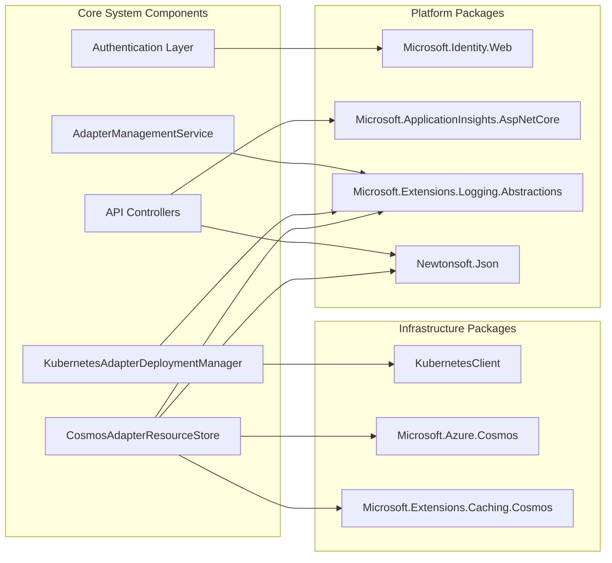

<!-- source: DeepWiki mcp.deepwiki.com · repo microsoft/mcp-gateway · page 6.2 Dependencies and Packages · fetched 2026-10-26 -->

# Dependencies and Packages

Relevant source files

The following files were used as context for generating this wiki page:

- [.github/workflows/main.yml](.github/workflows/main.yml)
- [NOTICE](NOTICE)
- [dotnet/Directory.Packages.props](dotnet/Directory.Packages.props)
- [dotnet/Microsoft.McpGateway.Management/src/Deployment/IAdapterDeploymentManager.cs](dotnet/Microsoft.McpGateway.Management/src/Deployment/IAdapterDeploymentManager.cs)
- [dotnet/Microsoft.McpGateway.Management/src/Store/IAdapterResourceStore.cs](dotnet/Microsoft.McpGateway.Management/src/Store/IAdapterResourceStore.cs)
- [dotnet/Microsoft.McpGateway.Management/src/Store/InMemoryAdapterResourceStore.cs](dotnet/Microsoft.McpGateway.Management/src/Store/InMemoryAdapterResourceStore.cs)
- [dotnet/Microsoft.McpGateway.Management/test/KubernetesAdapterDeploymentManagerTests.cs](dotnet/Microsoft.McpGateway.Management/test/KubernetesAdapterDeploymentManagerTests.cs)

This document provides a comprehensive overview of the external dependencies, NuGet packages, and package management configuration used in the MCP Gateway project. It covers the centralized package management approach, categorizes dependencies by their purpose, and explains how they integrate with the system architecture.

For information about the build and CI process that uses these dependencies, see [Build and CI](#5.3). For development environment setup instructions, see [Getting Started](#5.1).

## Package Management Structure

The MCP Gateway project uses centralized package version management through MSBuild's Central Package Management feature. This approach ensures consistent versioning across all projects in the solution.

### Central Package Management Configuration

The project implements centralized package management using the `Directory.Packages.props` file located at the solution root:

[dotnet/Directory.Packages.props:1-18]()

The configuration enables centralized package version management and defines all package versions in a single location. Individual project files reference packages without specifying versions, inheriting them from the central configuration.

### Project-Level Package References

The main management library project references packages through the centralized system:

[dotnet/Microsoft.McpGateway.Management/src/Microsoft.McpGateway.Management.csproj:16-21]()

**Sources**: [dotnet/Directory.Packages.props:1-18](), [dotnet/Microsoft.McpGateway.Management/src/Microsoft.McpGateway.Management.csproj:16-21]()

## Core Runtime Dependencies

The following packages provide essential runtime functionality for the MCP Gateway system:

### Infrastructure Integration Dependencies

| Package | Version | Purpose |
|---------|---------|---------|
| `KubernetesClient` | 16.0.7 | Kubernetes API client for adapter deployment management |
| `Microsoft.Azure.Cosmos` | 3.51.0 | Azure Cosmos DB client for adapter metadata persistence |
| `Microsoft.Extensions.Caching.Cosmos` | 1.7.0 | Cosmos DB-based distributed caching |

### Identity and Security Dependencies

| Package | Version | Purpose |
|---------|---------|---------|
| `Microsoft.Identity.Web` | 3.9.1 | Microsoft Identity platform integration for authentication |

### Logging and Monitoring Dependencies

| Package | Version | Purpose |
|---------|---------|---------|
| `Microsoft.Extensions.Logging.Abstractions` | 9.0.5 | Logging abstractions for structured logging |
| `Microsoft.ApplicationInsights.AspNetCore` | 2.23.0 | Application Insights telemetry integration |

### Serialization Dependencies

| Package | Version | Purpose |
|---------|---------|---------|
| `Newtonsoft.Json` | 13.0.3 | JSON serialization for API contracts and data persistence |

**Sources**: [dotnet/Directory.Packages.props:5-17]()

## Testing Dependencies

The project includes comprehensive testing infrastructure through dedicated NuGet packages:

### Testing Framework Dependencies

| Package | Version | Purpose |
|---------|---------|---------|
| `Microsoft.NET.Test.Sdk` | 17.12.0 | Core test SDK for .NET test execution |
| `MSTest` | 3.6.4 | MSTest testing framework |
| `Moq` | 4.20.72 | Mocking framework for unit tests |
| `FluentAssertions` | 8.2.0 | Fluent assertion library for readable test assertions |

**Sources**: [dotnet/Directory.Packages.props:6-17]()

## Dependency Architecture

The following diagram shows how external dependencies integrate with the MCP Gateway system components:

```mermaid
graph TB
    subgraph "MCP Gateway System"
        subgraph "AdapterManagementService"
            AMS["AdapterManagementService"]
        end
        
        subgraph "Deployment Layer"
            K8sDeployMgr["KubernetesAdapterDeploymentManager"]
            KubeWrapper["IKubeClientWrapper"]
        end
        
        subgraph "Storage Layer"
            CosmosStore["CosmosAdapterResourceStore"]
            CacheService["Distributed Caching"]
        end
        
        subgraph "API Layer"
            AuthService["Authentication Service"]
            TelemetryService["Telemetry Service"]
            JsonSerialization["JSON Serialization"]
        end
    end
    
    subgraph "External Dependencies"
        KubernetesClient["KubernetesClient<br/>v16.0.7"]
        CosmosDB["Microsoft.Azure.Cosmos<br/>v3.51.0"]
        CosmosCache["Microsoft.Extensions.Caching.Cosmos<br/>v1.7.0"]
        IdentityWeb["Microsoft.Identity.Web<br/>v3.9.1"]
        AppInsights["Microsoft.ApplicationInsights.AspNetCore<br/>v2.23.0"]
        Logging["Microsoft.Extensions.Logging.Abstractions<br/>v9.0.5"]
        NewtonsoftJson["Newtonsoft.Json<br/>v13.0.3"]
    end
    
    K8sDeployMgr --> KubernetesClient
    KubeWrapper --> KubernetesClient
    CosmosStore --> CosmosDB
    CacheService --> CosmosCache
    CacheService --> CosmosDB
    AuthService --> IdentityWeb
    TelemetryService --> AppInsights
    JsonSerialization --> NewtonsoftJson
    AMS --> Logging
    K8sDeployMgr --> Logging
    CosmosStore --> Logging
```

**Sources**: [dotnet/Directory.Packages.props:5-17](), [dotnet/Microsoft.McpGateway.Management/src/Microsoft.McpGateway.Management.csproj:16-21]()

## Package Dependency Relationships

The following diagram illustrates the specific relationships between packages and their roles in the system:

**Sources**: [dotnet/Directory.Packages.props:5-17](), [dotnet/Microsoft.McpGateway.Management/src/Microsoft.McpGateway.Management.csproj:16-21]()

## Project Configuration

### Target Framework and Platform Configuration

The main management library targets .NET 8.0 with the following configuration:

[dotnet/Microsoft.McpGateway.Management/src/Microsoft.McpGateway.Management.csproj:3-8]()

Key configuration settings:
- **Target Framework**: `net8.0` - Latest LTS version of .NET
- **Implicit Usings**: Enabled for simplified using statements
- **Nullable Reference Types**: Enabled for improved null safety
- **Platform Target**: `x64` - 64-bit architecture targeting

### Excluded Components

The project excludes certain components from compilation:

[dotnet/Microsoft.McpGateway.Management/src/Microsoft.McpGateway.Management.csproj:10-14]()

The `Authorization` folder is excluded from the build, indicating that authorization functionality may be implemented separately or is not yet implemented.

**Sources**: [dotnet/Microsoft.McpGateway.Management/src/Microsoft.McpGateway.Management.csproj:3-14]()

## Package Version Management

### Centralized Version Control

The `Directory.Packages.props` file establishes a single source of truth for package versions across the entire solution. This approach provides:

- **Consistency**: All projects use the same version of each package
- **Maintainability**: Version updates require changes in only one location
- **Dependency Resolution**: Eliminates version conflicts between projects

### Version Selection Strategy

The selected package versions follow these principles:

- **Stability**: Uses stable, well-tested versions of critical infrastructure packages
- **Compatibility**: Ensures compatibility with .NET 8.0 target framework
- **Security**: Maintains recent versions to incorporate security updates
- **Feature Completeness**: Selects versions that provide required functionality

**Sources**: [dotnet/Directory.Packages.props:1-18]()

---

