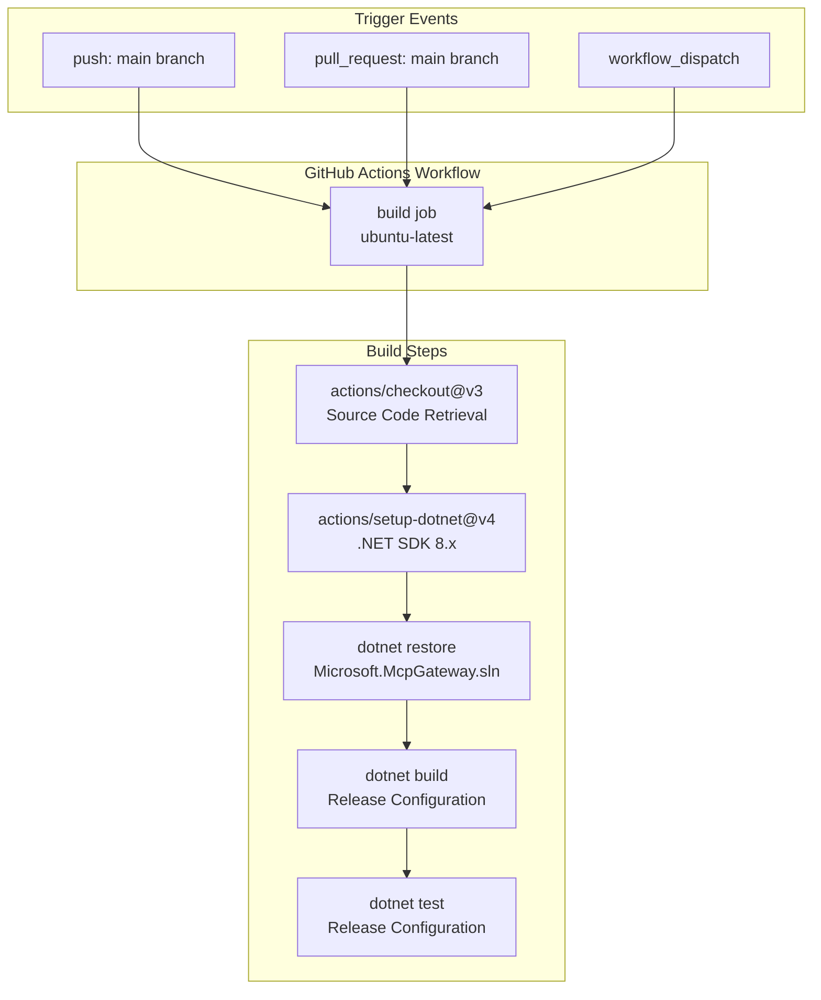
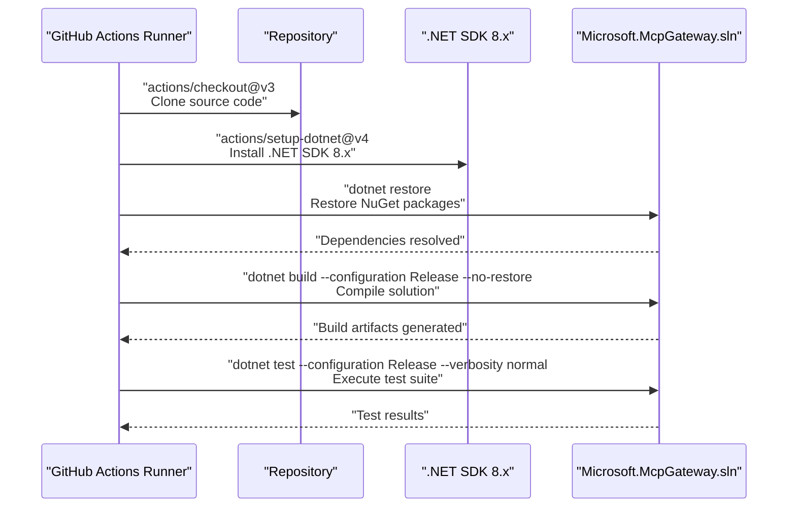
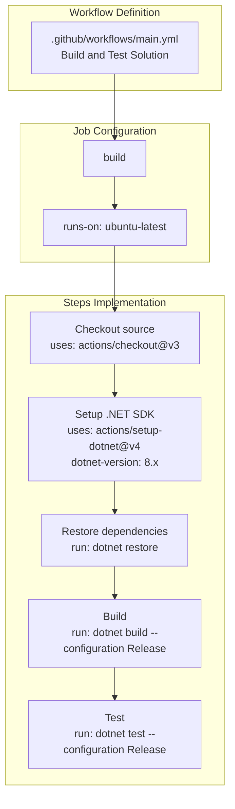

<!-- source: DeepWiki mcp.deepwiki.com · repo microsoft/mcp-gateway · page 6.3 Build and CI/CD · fetched 2026-10-26 -->

# Build and CI

Relevant source files

The following files were used as context for generating this wiki page:

- [.github/workflows/main.yml](.github/workflows/main.yml)
- [NOTICE](NOTICE)
- [dotnet/Microsoft.McpGateway.Tools/src/Properties/PublishProfiles/github.pubxml](dotnet/Microsoft.McpGateway.Tools/src/Properties/PublishProfiles/github.pubxml)
- [dotnet/Microsoft.McpGateway.Tools/src/Properties/PublishProfiles/localhost_5000.pubxml](dotnet/Microsoft.McpGateway.Tools/src/Properties/PublishProfiles/localhost_5000.pubxml)
- [dotnet/Microsoft.McpGateway.Tools/src/Properties/launchSettings.json](dotnet/Microsoft.McpGateway.Tools/src/Properties/launchSettings.json)

This document covers the continuous integration (CI) pipeline, build processes, and automated testing for the MCP Gateway project. It details the GitHub Actions workflow configuration, build steps, and testing automation that ensures code quality and system reliability.

For information about development environment setup and local development workflow, see [Getting Started](#5.1). For details about project dependencies and package management, see [Dependencies and Packages](#5.2).

## CI/CD Pipeline Overview

The MCP Gateway project uses GitHub Actions for continuous integration and automated testing. The primary workflow is triggered on push to the main branch, pull requests, and manual workflow dispatch events.

### Workflow Architecture

**Workflow Configuration Details**
- **Runner Environment**: `ubuntu-latest`
- **Trigger Events**: Push to main, pull requests to main, manual dispatch
- **Solution Path**: `dotnet/Microsoft.McpGateway.sln`
- **Build Configuration**: Release
- **Test Verbosity**: Normal

Sources: [.github/workflows/main.yml:1-31]()

## Build Process

The build process follows standard .NET solution compilation practices with dependency restoration, compilation, and testing phases.

### Build Pipeline Steps

**Build Configuration**
- **Target Framework**: .NET 8.x
- **Build Configuration**: Release mode for CI builds
- **Dependency Management**: NuGet package restoration via `dotnet restore`
- **No-Restore Flag**: Build step uses `--no-restore` to avoid duplicate package downloads

Sources: [.github/workflows/main.yml:14-30]()

## Testing Strategy

The CI pipeline includes automated test execution as part of the build process to ensure code quality and system reliability.

### Test Execution

| Test Phase | Command | Configuration | Output |
|------------|---------|---------------|---------|
| Unit Tests | `dotnet test` | Release | Normal verbosity |
| Solution Scope | `Microsoft.McpGateway.sln` | All projects | Test results |

**Test Configuration Details**
- **Test Framework**: .NET test framework (likely xUnit or MSTest)
- **Execution Mode**: Release configuration for production-like testing
- **Verbosity Level**: Normal output for CI visibility
- **Scope**: Solution-wide test execution

Sources: [.github/workflows/main.yml:29-30]()

## Workflow Configuration

The GitHub Actions workflow is defined in the repository root and provides automated CI/CD capabilities for the MCP Gateway project.

### Workflow Structure

**Workflow Triggers**
- **Manual Execution**: `workflow_dispatch` for on-demand builds
- **Branch Protection**: Automatic execution on `main` branch pushes
- **Pull Request Validation**: Automatic execution on pull requests targeting `main`

Sources: [.github/workflows/main.yml:1-31]()

## Build Artifacts and Outputs

The build process generates standard .NET build outputs and test results that can be used for deployment and quality assurance.

### Output Structure

| Artifact Type | Location | Purpose |
|---------------|----------|---------|
| Compiled Assemblies | `bin/Release/` | Application binaries |
| NuGet Packages | Restored packages cache | Dependencies |
| Test Results | Test runner output | Quality validation |
| Build Logs | GitHub Actions logs | Build diagnostics |

**Key Build Characteristics**
- **Solution-Based Build**: Single solution file encompasses all projects
- **Release Optimization**: CI builds use release configuration for performance
- **Dependency Isolation**: `--no-restore` flag prevents redundant package operations
- **Comprehensive Testing**: Solution-wide test execution ensures system-level validation

Sources: [.github/workflows/main.yml:24-30]()

## Future Considerations

The current CI pipeline provides foundational build and test automation. Potential enhancements could include:

- **Artifact Publishing**: Publishing build outputs for deployment scenarios
- **Code Coverage**: Integration with code coverage tools and reporting
- **Security Scanning**: Static analysis and vulnerability scanning
- **Multi-Environment Testing**: Testing against different .NET versions or operating systems
- **Performance Testing**: Automated performance regression testing
- **Deployment Automation**: CD pipeline for automated deployments

Sources: [.github/workflows/main.yml:1-31]()

---

