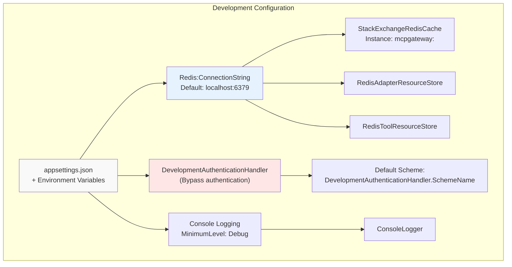
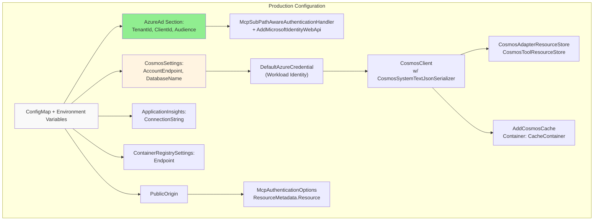
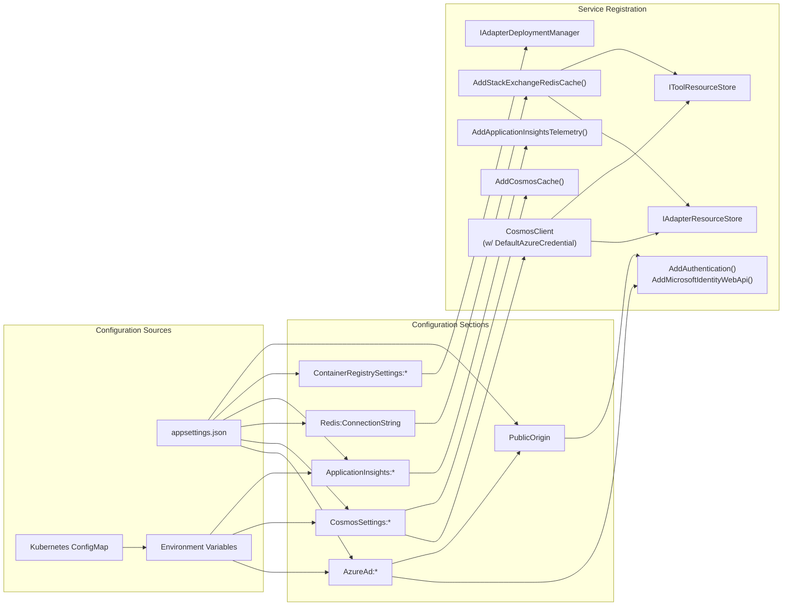
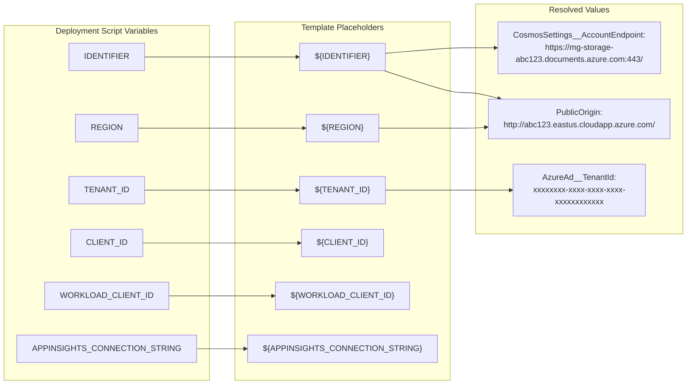
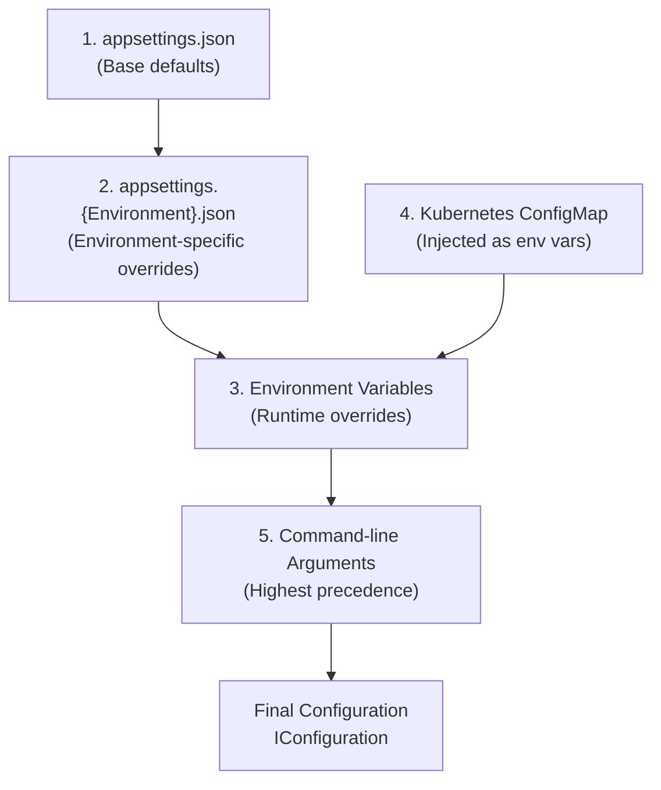

<!-- source: DeepWiki mcp.deepwiki.com · repo microsoft/mcp-gateway · page 6.4 Configuration · fetched 2026-10-26 -->

# Configuration

<details>
<summary>Relevant source files</summary>

The following files were used as context for generating this wiki page:

- [deployment/k8s/cloud-deployment-template.yml](deployment/k8s/cloud-deployment-template.yml)
- [dotnet/Microsoft.McpGateway.Management/src/Store/CosmosAdapterResourceStore.cs](dotnet/Microsoft.McpGateway.Management/src/Store/CosmosAdapterResourceStore.cs)
- [dotnet/Microsoft.McpGateway.Service/src/McpSubPathAwareAuthenticationHandler.cs](dotnet/Microsoft.McpGateway.Service/src/McpSubPathAwareAuthenticationHandler.cs)
- [dotnet/Microsoft.McpGateway.Service/src/Program.cs](dotnet/Microsoft.McpGateway.Service/src/Program.cs)
- [dotnet/Microsoft.McpGateway.Service/src/appsettings.json](dotnet/Microsoft.McpGateway.Service/src/appsettings.json)
- [openapi/mcp-gateway.openapi.json](openapi/mcp-gateway.openapi.json)

</details>


This page documents the configuration system for the MCP Gateway, including configuration file structure, environment-specific settings, environment variables, and how configuration is loaded and applied during service startup. For information about deployment infrastructure setup, see [Azure Infrastructure](#3.1). For details about Kubernetes resource configuration, see [Kubernetes Configuration](#3.2).

## Configuration System Overview

The MCP Gateway uses a hierarchical configuration system based on ASP.NET Core's configuration framework. Configuration is loaded from multiple sources with the following precedence (highest to lowest):

1. **Environment variables** (including Kubernetes ConfigMap values)
2. **appsettings.{Environment}.json** files
3. **appsettings.json** base file
4. **Command-line arguments**

The gateway operates in two primary environments: **Development** (local development with simplified dependencies) and **Production** (Azure deployment with full security and scalability features).

**Sources:** [dotnet/Microsoft.McpGateway.Service/src/Program.cs:21-137]()

## Configuration File Structure

### Base Configuration (appsettings.json)

The base configuration file defines default settings and placeholders for environment-specific values:

```json
{
  "Logging": {
    "LogLevel": {
      "Default": "Information",
      "Microsoft.AspNetCore": "Warning"
    }
  },
  "AllowedHosts": "*",
  "AzureAd": {
    "Instance": "https://login.microsoftonline.com/",
    "TenantId": "YOUR_TENANT_ID",
    "ClientId": "YOUR_API_CLIENT_ID",
    "Audience": "YOUR_API_CLIENT_ID"
  },
  "CosmosSettings": {
    "AccountEndpoint": "https://<your-account>.documents.azure.com:443/",
    "ConnectionString": "",
    "DatabaseName": "McpGatewayDb"
  },
  "ApplicationInsights": {
    "ConnectionString": "InstrumentationKey=xxxxxxxx-xxxx-xxxx-xxxx-xxxxxxxxxxxx"
  },
  "ContainerRegistrySettings": {
    "Endpoint": "localhost:5000"
  },
  "PublicOrigin": "http://localhost:8000/"
}
```

**Sources:** [dotnet/Microsoft.McpGateway.Service/src/appsettings.json:1-28]()

### Configuration Sections

| Section | Purpose | Used By |
|---------|---------|---------|
| `Logging` | Controls log levels and output | ASP.NET Core logging infrastructure |
| `AzureAd` | Azure AD authentication settings | `McpSubPathAwareAuthenticationHandler`, `AddMicrosoftIdentityWebApi` |
| `CosmosSettings` | Cosmos DB connection configuration | `CosmosAdapterResourceStore`, `CosmosToolResourceStore`, `AddCosmosCache` |
| `ApplicationInsights` | Telemetry configuration | `AddApplicationInsightsTelemetry` |
| `ContainerRegistrySettings` | Container registry endpoint | `KubernetesAdapterDeploymentManager` |
| `PublicOrigin` | Public-facing URL for OAuth metadata | `McpSubPathAwareAuthenticationHandler` |
| `Redis` (dev only) | Redis connection string | `AddStackExchangeRedisCache`, `RedisAdapterResourceStore` |

**Sources:** [dotnet/Microsoft.McpGateway.Service/src/appsettings.json:1-28](), [dotnet/Microsoft.McpGateway.Service/src/Program.cs:32-105]()

## Environment-Specific Configuration

### Development Environment

In Development mode (`ASPNETCORE_ENVIRONMENT=Development`), the gateway uses simplified dependencies for rapid local development:



**Key Development Settings:**

- **Authentication:** `DevelopmentAuthenticationHandler` bypasses Azure AD authentication
- **Storage:** `RedisAdapterResourceStore` and `RedisToolResourceStore` use local Redis
- **Cache:** `StackExchangeRedisCache` for distributed caching
- **Logging:** Console output with `Debug` level
- **Container Registry:** `localhost:5000` (local registry)

**Sources:** [dotnet/Microsoft.McpGateway.Service/src/Program.cs:32-50]()

### Production Environment

In Production mode (`ASPNETCORE_ENVIRONMENT=Production`), the gateway uses Azure services with full security:



**Key Production Settings:**

- **Authentication:** `McpSubPathAwareAuthenticationHandler` + `AddMicrosoftIdentityWebApi` for Azure AD
- **Storage:** `CosmosAdapterResourceStore` and `CosmosToolResourceStore` use Cosmos DB
- **Cache:** Cosmos DB-backed cache (`AddCosmosCache`)
- **Credentials:** `DefaultAzureCredential` for managed identity authentication
- **Telemetry:** Application Insights via `AddApplicationInsightsTelemetry`

**Sources:** [dotnet/Microsoft.McpGateway.Service/src/Program.cs:52-105]()

## Kubernetes ConfigMap Configuration

The Kubernetes deployment uses a `ConfigMap` to inject environment-specific values into pods:

### ConfigMap Structure

```yaml
apiVersion: v1
kind: ConfigMap
metadata:
  name: app-config
  namespace: adapter
data:
  AzureAd__Instance: "https://login.microsoftonline.com/"
  AzureAd__TenantId: "${TENANT_ID}"
  AzureAd__ClientId: "${CLIENT_ID}"
  AzureAd__Audience: "${CLIENT_ID}"
  
  CosmosSettings__AccountEndpoint: "https://mg-storage-${IDENTIFIER}.documents.azure.com:443/"
  CosmosSettings__DatabaseName: "McpGatewayDb"
  
  ApplicationInsights__ConnectionString: "${APPINSIGHTS_CONNECTION_STRING}"
  
  ContainerRegistrySettings__Endpoint: "mgreg${IDENTIFIER}.azurecr.io"
  
  PublicOrigin: "http://${IDENTIFIER}.${REGION}.cloudapp.azure.com/"
```

### Configuration Injection

The ConfigMap is injected into pods via `envFrom`:

```yaml
containers:
  - name: mcpgateway-container
    image: ghcr.io/microsoft/mcp-gateway:latest
    env:
      - name: ASPNETCORE_ENVIRONMENT
        value: "Production"
    envFrom:
      - configMapRef:
          name: app-config
```

**Key Points:**

- **Double underscore notation:** `AzureAd__TenantId` maps to nested configuration `AzureAd:TenantId`
- **Variable substitution:** `${TENANT_ID}`, `${IDENTIFIER}`, etc. are replaced during deployment
- **Both gateway and toolgateway** reference the same ConfigMap for consistent configuration

**Sources:** [deployment/k8s/cloud-deployment-template.yml:105-123](), [deployment/k8s/cloud-deployment-template.yml:28-40](), [deployment/k8s/cloud-deployment-template.yml:149-161]()

## Configuration to Service Registration Mapping

The following diagram shows how configuration values flow from sources to registered services:



### Configuration-Driven Service Registration

The `Program.cs` startup configures services based on environment:

| Configuration | Development | Production |
|---------------|-------------|------------|
| `builder.Environment.IsDevelopment()` | `true` | `false` |
| Authentication | `DevelopmentAuthenticationHandler` | `McpSubPathAwareAuthenticationHandler` + JWT |
| Storage | `RedisAdapterResourceStore`, `RedisToolResourceStore` | `CosmosAdapterResourceStore`, `CosmosToolResourceStore` |
| Cache | `AddStackExchangeRedisCache` | `AddCosmosCache` |
| Logging | Console, Debug level | Application Insights |

**Sources:** [dotnet/Microsoft.McpGateway.Service/src/Program.cs:32-105]()

## Critical Configuration Properties

### Azure AD Configuration

Used by `McpSubPathAwareAuthenticationHandler` and `AddMicrosoftIdentityWebApi`:

| Property | Purpose | Example |
|----------|---------|---------|
| `AzureAd:Instance` | Azure AD authority URL | `https://login.microsoftonline.com/` |
| `AzureAd:TenantId` | Azure AD tenant identifier | `xxxxxxxx-xxxx-xxxx-xxxx-xxxxxxxxxxxx` |
| `AzureAd:ClientId` | Application (client) ID | `xxxxxxxx-xxxx-xxxx-xxxx-xxxxxxxxxxxx` |
| `AzureAd:Audience` | Token audience validation | Same as ClientId |

The `PublicOrigin` is combined with `AzureAd:TenantId` and `AzureAd:ClientId` to construct OAuth 2.0 Protected Resource Metadata:

```csharp
options.ResourceMetadata = new()
{
    Resource = new Uri(builder.Configuration.GetValue<string>("PublicOrigin")!),
    AuthorizationServers = { new Uri($"https://login.microsoftonline.com/{azureAdConfig["TenantId"]}/v2.0") },
    ScopesSupported = [$"api://{azureAdConfig["ClientId"]}/.default"]
};
```

**Sources:** [dotnet/Microsoft.McpGateway.Service/src/Program.cs:53-71]()

### Cosmos DB Configuration

Used by `CosmosClient`, `CosmosAdapterResourceStore`, `CosmosToolResourceStore`, and `AddCosmosCache`:

| Property | Purpose | Example |
|----------|---------|---------|
| `CosmosSettings:AccountEndpoint` | Cosmos DB account endpoint URL | `https://mg-storage-xyz.documents.azure.com:443/` |
| `CosmosSettings:DatabaseName` | Database name | `McpGatewayDb` |
| `CosmosSettings:ConnectionString` | (Optional) Connection string for key-based auth | Not used in production |

Cosmos DB uses three containers:
- **AdapterContainer:** Stores `AdapterResource` documents
- **ToolContainer:** Stores `ToolResource` documents
- **CacheContainer:** Stores distributed cache entries

**Sources:** [dotnet/Microsoft.McpGateway.Service/src/Program.cs:74-104](), [dotnet/Microsoft.McpGateway.Management/src/Store/CosmosAdapterResourceStore.cs:15-33]()

### Container Registry Configuration

Used by `KubernetesAdapterDeploymentManager` to construct full image references:

| Property | Purpose | Example |
|----------|---------|---------|
| `ContainerRegistrySettings:Endpoint` | Container registry hostname | `mgreg123.azurecr.io` or `localhost:5000` |

The deployment manager combines this with `imageName` and `imageVersion` from adapter/tool registration requests:

```
{Endpoint}/{imageName}:{imageVersion}
```

**Sources:** [dotnet/Microsoft.McpGateway.Service/src/Program.cs:115-117]()

### Public Origin Configuration

Used by `McpSubPathAwareAuthenticationHandler` to construct OAuth 2.0 resource metadata URIs:

| Property | Purpose | Example |
|----------|---------|---------|
| `PublicOrigin` | Public-facing base URL | `http://example.eastus.cloudapp.azure.com/` |

This value is used as the `Resource` in the Protected Resource Metadata document served at `/.well-known/oauth-protected-resource` endpoints.

**Sources:** [dotnet/Microsoft.McpGateway.Service/src/Program.cs:66](), [dotnet/Microsoft.McpGateway.Service/src/McpSubPathAwareAuthenticationHandler.cs:60-82]()

## Environment Variable Substitution

During Azure deployment, the deployment script performs variable substitution in the Kubernetes template:



**Substituted Values:**

- `${IDENTIFIER}`: Unique deployment identifier (used in resource names)
- `${REGION}`: Azure region (e.g., `eastus`)
- `${TENANT_ID}`: Azure AD tenant ID
- `${CLIENT_ID}`: Gateway application client ID
- `${WORKLOAD_CLIENT_ID}`: Workload identity client ID for pods
- `${APPINSIGHTS_CONNECTION_STRING}`: Application Insights connection string

**Sources:** [deployment/k8s/cloud-deployment-template.yml:111-123]()

## Configuration Loading Precedence

The configuration system loads values in this order (later sources override earlier ones):



**Example:** If `AzureAd:TenantId` is set in:
1. `appsettings.json` → `"YOUR_TENANT_ID"`
2. ConfigMap → `"xxxxxxxx-xxxx-xxxx-xxxx-xxxxxxxxxxxx"`
3. Environment variable → Not set
4. Command-line → Not provided

Result: The ConfigMap value is used (via environment variable injection).

**Sources:** [dotnet/Microsoft.McpGateway.Service/src/Program.cs:21]()

## Service-Specific Configuration Usage

### Authentication Handler Configuration

`McpSubPathAwareAuthenticationHandler` reads configuration to set up OAuth 2.0 Protected Resource Metadata:

```csharp
var azureAdConfig = builder.Configuration.GetSection("AzureAd");
options.ResourceMetadata = new()
{
    Resource = new Uri(builder.Configuration.GetValue<string>("PublicOrigin")!),
    AuthorizationServers = { new Uri($"https://login.microsoftonline.com/{azureAdConfig["TenantId"]}/v2.0") },
    ScopesSupported = [$"api://{azureAdConfig["ClientId"]}/.default"]
};
```

This metadata is served at `/.well-known/oauth-protected-resource` endpoints for MCP client discovery.

**Sources:** [dotnet/Microsoft.McpGateway.Service/src/Program.cs:59-70]()

### Cosmos Storage Configuration

`CosmosAdapterResourceStore` and `CosmosToolResourceStore` are initialized with Cosmos configuration:

```csharp
var cosmosConfig = builder.Configuration.GetSection("CosmosSettings");
var cosmosClient = new CosmosClient(
    cosmosConfig["AccountEndpoint"], 
    credential, 
    new CosmosClientOptions
    {
        Serializer = new CosmosSystemTextJsonSerializer(new JsonSerializerOptions
        {
            DefaultIgnoreCondition = JsonIgnoreCondition.WhenWritingNull
        })
    });

builder.Services.AddSingleton<IAdapterResourceStore>(sp =>
{
    var logger = sp.GetRequiredService<ILogger<CosmosAdapterResourceStore>>();
    return new CosmosAdapterResourceStore(cosmosClient, cosmosConfig["DatabaseName"]!, "AdapterContainer", logger);
});
```

**Sources:** [dotnet/Microsoft.McpGateway.Service/src/Program.cs:74-96]()

### Deployment Manager Configuration

`KubernetesAdapterDeploymentManager` uses the container registry endpoint:

```csharp
var config = builder.Configuration.GetSection("ContainerRegistrySettings");
return new KubernetesAdapterDeploymentManager(
    config["Endpoint"]!, 
    c.GetRequiredService<IKubeClientWrapper>(), 
    c.GetRequiredService<ILogger<KubernetesAdapterDeploymentManager>>());
```

**Sources:** [dotnet/Microsoft.McpGateway.Service/src/Program.cs:113-117]()

## Summary

The MCP Gateway configuration system provides:

- **Environment-based service selection** (Redis for dev, Cosmos for prod)
- **Hierarchical configuration** with proper override precedence
- **Kubernetes ConfigMap integration** for Azure deployments
- **Type-safe configuration sections** for different services
- **OAuth 2.0 metadata construction** from configuration values
- **Flexible storage backends** configurable at runtime

Configuration is centralized in `appsettings.json` with environment-specific overrides via environment variables and Kubernetes ConfigMaps, enabling the same codebase to run in development and production environments with appropriate backing services.

**Sources:** [dotnet/Microsoft.McpGateway.Service/src/Program.cs:1-138](), [dotnet/Microsoft.McpGateway.Service/src/appsettings.json:1-28](), [deployment/k8s/cloud-deployment-template.yml:105-123]()

---

