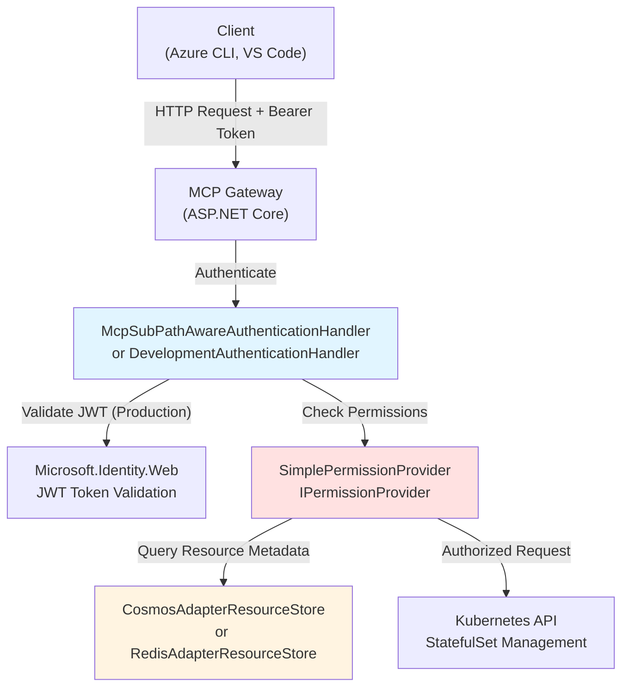
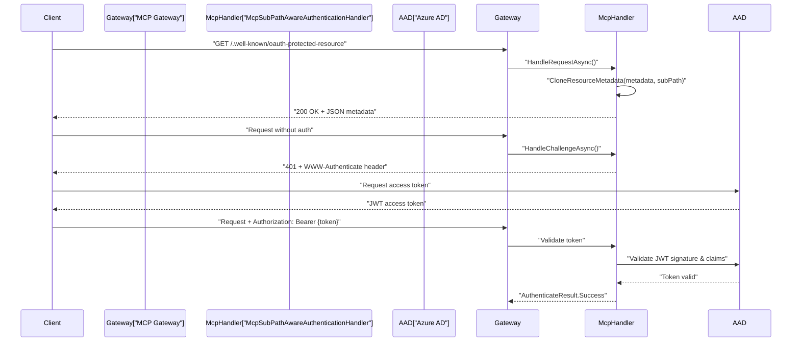
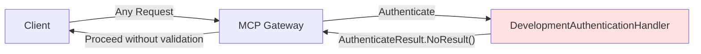
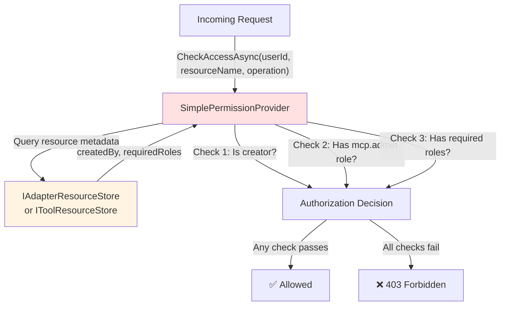
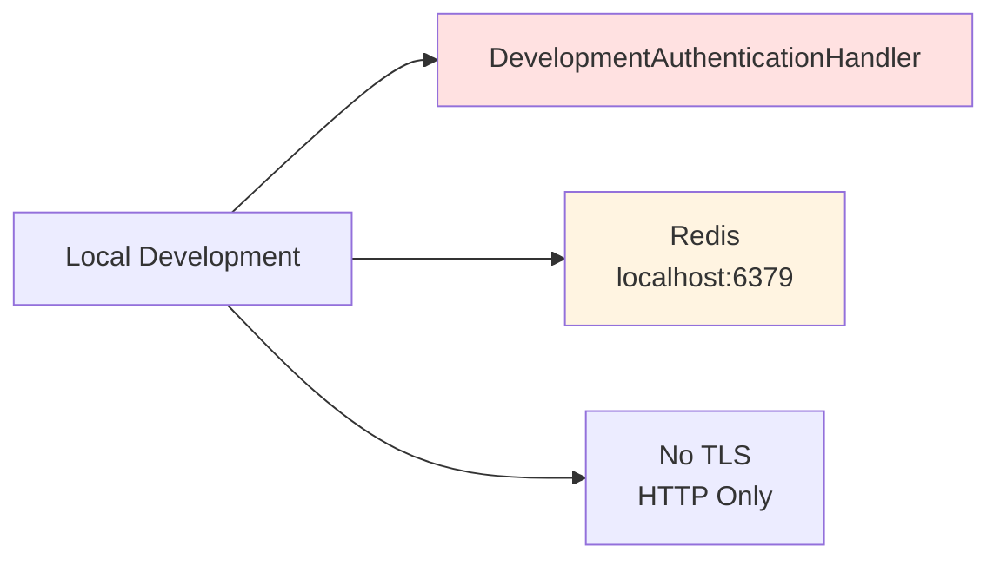
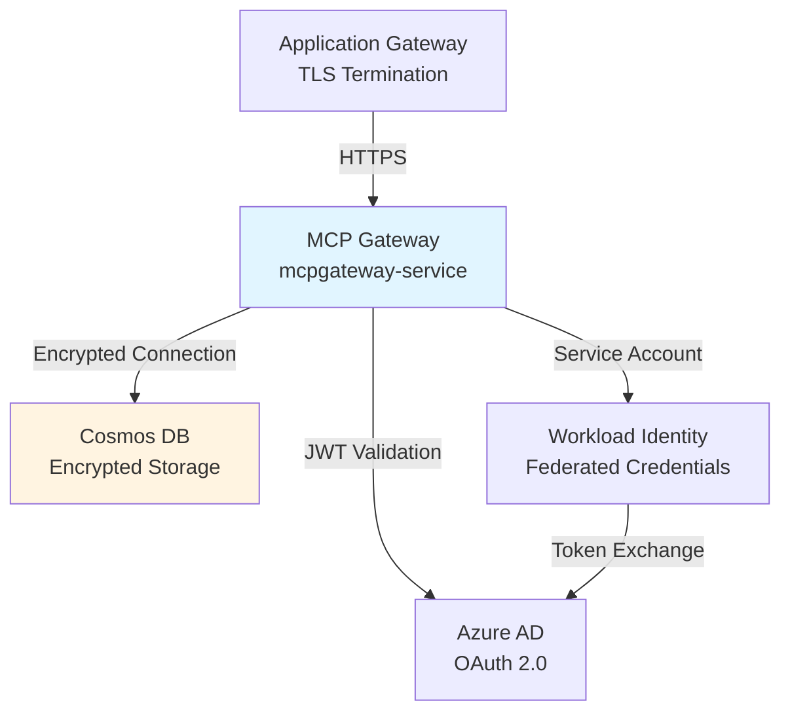

<!-- source: DeepWiki mcp.deepwiki.com · repo microsoft/mcp-gateway · page 7 Security and Authentication · fetched 2026-10-26 -->

# Security and Authentication

<details>
<summary>Relevant source files</summary>

The following files were used as context for generating this wiki page:

- [README.md](README.md)
- [dotnet/Microsoft.McpGateway.Service/src/McpSubPathAwareAuthenticationHandler.cs](dotnet/Microsoft.McpGateway.Service/src/McpSubPathAwareAuthenticationHandler.cs)
- [dotnet/Microsoft.McpGateway.Service/src/Program.cs](dotnet/Microsoft.McpGateway.Service/src/Program.cs)

</details>


The MCP Gateway implements a multi-layered security model with OAuth 2.0/Azure AD authentication, role-based access control (RBAC), and environment-specific security configurations. This page provides an overview of the security architecture and authentication mechanisms.

For detailed authentication flows and token validation, see page 7.1. For authorization policies and RBAC implementation, see page 7.2. For Azure Workload Identity integration, see page 7.3. For legal and licensing information, see page 7.4.

## Security Architecture Overview

The MCP Gateway security architecture operates across three layers: authentication, authorization, and infrastructure security. Security is enforced at both the application level (via ASP.NET Core middleware) and infrastructure level (via Kubernetes RBAC).

### High-Level Security Flow



**Diagram: Authentication and Authorization Pipeline**

Sources: [dotnet/Microsoft.McpGateway.Service/src/Program.cs:32-122](), [dotnet/Microsoft.McpGateway.Service/src/McpSubPathAwareAuthenticationHandler.cs:1-181]()

### Security Components by Layer

| Layer | Production Components | Development Components |
|-------|----------------------|------------------------|
| **Authentication** | `McpSubPathAwareAuthenticationHandler` (OAuth 2.0)<br/>`Microsoft.Identity.Web` (Azure AD) | `DevelopmentAuthenticationHandler` (bypass) |
| **Authorization** | `SimplePermissionProvider`<br/>`IPermissionProvider` | Same as production |
| **Session Management** | `DistributedMemorySessionStore` (Cosmos DB cache) | `StackExchangeRedisCache` (Redis) |
| **Resource Storage** | `CosmosAdapterResourceStore`<br/>`CosmosToolResourceStore` | `RedisAdapterResourceStore`<br/>`RedisToolResourceStore` |
| **Kubernetes RBAC** | `ServiceAccount` + `Role` + `RoleBinding` | Same as production |

Sources: [dotnet/Microsoft.McpGateway.Service/src/Program.cs:32-105]()

## Authentication Mechanisms

The gateway implements two authentication schemes depending on the deployment environment:

### Production Authentication: OAuth 2.0 with Azure AD

In production environments, the gateway uses `McpSubPathAwareAuthenticationHandler` which implements the MCP protocol's OAuth 2.0 Protected Resource Metadata specification.



**Diagram: OAuth 2.0 Authentication Flow with Azure AD**

The authentication configuration is set up in [dotnet/Microsoft.McpGateway.Service/src/Program.cs:53-71]():

```
Authentication scheme: McpAuthenticationDefaults.AuthenticationScheme
JWT validation: Microsoft.Identity.Web
Protected Resource Metadata: /.well-known/oauth-protected-resource
Authorization Server: https://login.microsoftonline.com/{tenantId}/v2.0
```

Sources: [dotnet/Microsoft.McpGateway.Service/src/Program.cs:53-71](), [dotnet/Microsoft.McpGateway.Service/src/McpSubPathAwareAuthenticationHandler.cs:15-154](), [README.md:152-158]()

### Development Authentication: Bypass Handler

In development environments, the gateway uses `DevelopmentAuthenticationHandler` which bypasses authentication checks:



**Diagram: Development Authentication Bypass**

Configuration in [dotnet/Microsoft.McpGateway.Service/src/Program.cs:32-36]():

```
Authentication scheme: DevelopmentAuthenticationHandler.SchemeName
Behavior: No token validation, all requests authenticated
```

Sources: [dotnet/Microsoft.McpGateway.Service/src/Program.cs:32-36]()

### MCP Protocol Authentication Features

The `McpSubPathAwareAuthenticationHandler` implements MCP protocol-specific features:

| Feature | Implementation | Purpose |
|---------|---------------|---------|
| **Resource Metadata Endpoint** | `/.well-known/oauth-protected-resource` | OAuth 2.0 resource discovery |
| **Sub-Path Awareness** | `CloneResourceMetadata(metadata, subPath)` | Per-adapter metadata URLs |
| **WWW-Authenticate Header** | `Bearer realm="{scheme}", resource_metadata="{uri}"` | OAuth 2.0 challenge response |
| **Token Validation** | `Microsoft.Identity.Web` integration | Azure AD JWT validation |

Sources: [dotnet/Microsoft.McpGateway.Service/src/McpSubPathAwareAuthenticationHandler.cs:29-154]()

## Authorization and Access Control

Authorization is enforced through the `IPermissionProvider` interface, implemented by `SimplePermissionProvider`. The authorization logic checks three conditions for resource access.

### Authorization Rules

| Operation | Resource Creator | `mcp.admin` Role | Required Roles | Other Users |
|-----------|-----------------|------------------|----------------|-------------|
| **Read** (GET) | ✅ Allowed | ✅ Allowed | ✅ Allowed (if in `requiredRoles`) | ❌ Denied |
| **Write** (POST/PUT/DELETE) | ✅ Allowed | ✅ Allowed | ❌ Denied | ❌ Denied |

The authorization provider is configured in [dotnet/Microsoft.McpGateway.Service/src/Program.cs:112]():

```
builder.Services.AddSingleton<IPermissionProvider, SimplePermissionProvider>();
```

### Authorization Check Flow



**Diagram: Authorization Decision Process**

Sources: [README.md:152-158](), [dotnet/Microsoft.McpGateway.Service/src/Program.cs:112]()

### Role Configuration in Azure AD

Roles are configured as App Roles in Azure Entra ID (Azure AD) app registration:

- **`mcp.admin`**: Full administrative access (required)
- **`mcp.engineer`**: Example role for read access (configurable)
- **Custom roles**: Can be defined per resource in `requiredRoles` field

The `requiredRoles` field in adapter/tool definitions restricts read access to users with specific roles:

```json
{
  "name": "mcp-example",
  "requiredRoles": ["mcp.engineer"],
  ...
}
```

Sources: [README.md:152-158]()

## Environment-Specific Security Configurations

Security settings vary significantly between development and production environments to balance security with developer productivity.

### Development Environment Security

Development mode prioritizes ease of use with minimal security overhead:



**Diagram: Development Security Configuration**

| Component | Configuration | Location |
|-----------|--------------|----------|
| **Authentication** | `DevelopmentAuthenticationHandler` (bypass) | [dotnet/Microsoft.McpGateway.Service/src/Program.cs:34-36]() |
| **Storage** | Redis (local, unencrypted) | [dotnet/Microsoft.McpGateway.Service/src/Program.cs:38-46]() |
| **Cache** | `StackExchangeRedisCache` | [dotnet/Microsoft.McpGateway.Service/src/Program.cs:39-43]() |
| **Transport** | HTTP (no TLS) | Port 8000 |

Sources: [dotnet/Microsoft.McpGateway.Service/src/Program.cs:32-49]()

### Production Environment Security

Production mode implements comprehensive security controls:



**Diagram: Production Security Architecture**

| Component | Configuration | Location |
|-----------|--------------|----------|
| **Authentication** | `McpSubPathAwareAuthenticationHandler` + Azure AD | [dotnet/Microsoft.McpGateway.Service/src/Program.cs:54-71]() |
| **Storage** | Cosmos DB (encrypted at rest/transit) | [dotnet/Microsoft.McpGateway.Service/src/Program.cs:74-96]() |
| **Cache** | `CosmosCache` (distributed) | [dotnet/Microsoft.McpGateway.Service/src/Program.cs:98-104]() |
| **Transport** | HTTPS via Application Gateway | Azure infrastructure |
| **Identity** | Azure Workload Identity (credential-less) | See page 7.3 |

Sources: [dotnet/Microsoft.McpGateway.Service/src/Program.cs:52-105]()

### Security Configuration Summary

| Feature | Development | Production |
|---------|------------|------------|
| **Authentication** | Bypassed | OAuth 2.0 + Azure AD |
| **Authorization** | Same as production | Role-based (RBAC) |
| **Data Encryption** | None | TLS 1.2+ (transit)<br/>AES-256 (rest) |
| **Identity Management** | None | Workload Identity |
| **Session Storage** | Redis (local) | Cosmos DB (distributed) |
| **Monitoring** | Console logs | Application Insights |

Sources: [dotnet/Microsoft.McpGateway.Service/src/Program.cs:32-105]()

## Security Policies and Procedures

The MCP Gateway project adheres to Microsoft's comprehensive security policies and procedures. Key security processes include:

- **Coordinated Vulnerability Disclosure**: Following Microsoft's coordinated disclosure principles
- **Security Response Center**: 24-hour response commitment for security issues
- **Bug Bounty Program**: Participation in Microsoft's bug bounty program for security researchers
- **Security Training**: Regular security training for development team members

For complete security policy details, vulnerability reporting procedures, and contact information, see [Security Policy](#6.1).

## Legal and Licensing Compliance

The MCP Gateway project operates under Microsoft's standard open source licensing framework with comprehensive legal compliance measures:

- **Open Source License**: MIT License with clear usage rights and limitations
- **Third-Party Notices**: Complete attribution for all dependencies and libraries
- **Export Control**: Compliance with U.S. export administration regulations
- **Code of Conduct**: Microsoft Open Source Code of Conduct for contributors

For detailed licensing information, third-party notices, and contributor guidelines, see [Legal and Licensing](#6.2).

Sources: [SECURITY.md:35-40](), Microsoft open source policies

---

