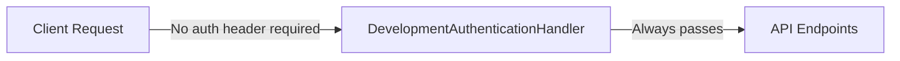
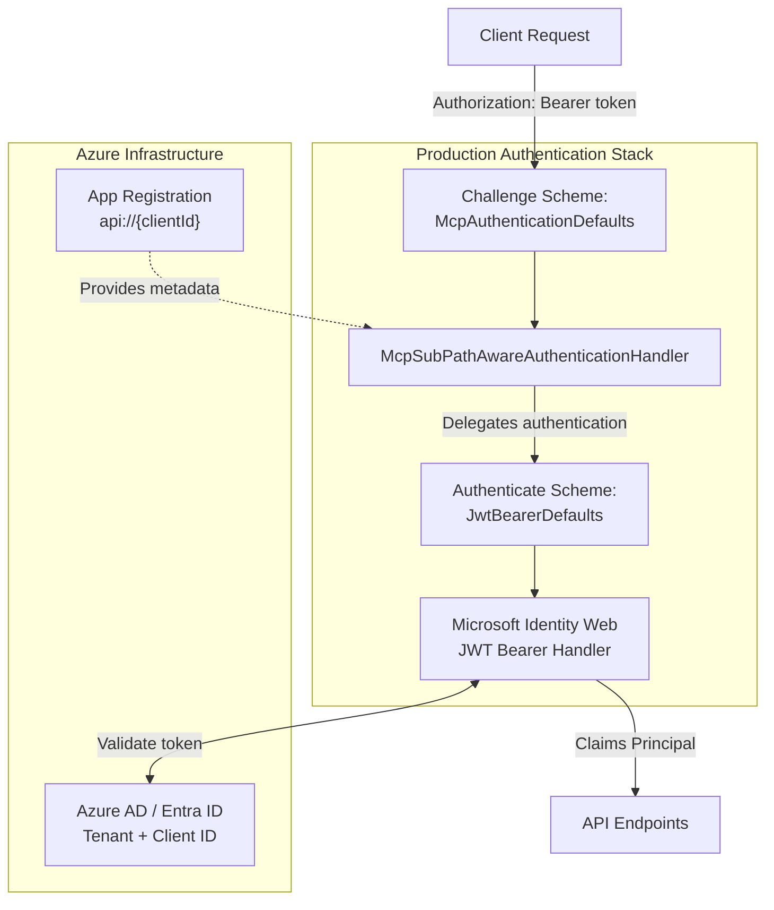
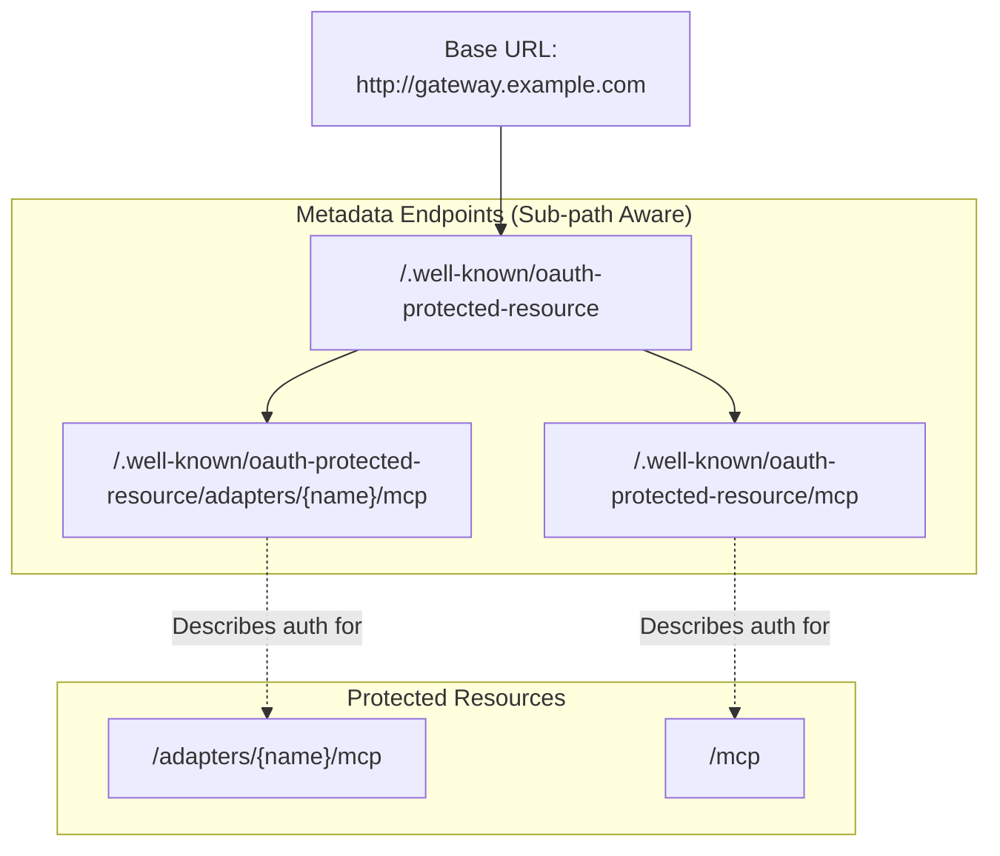
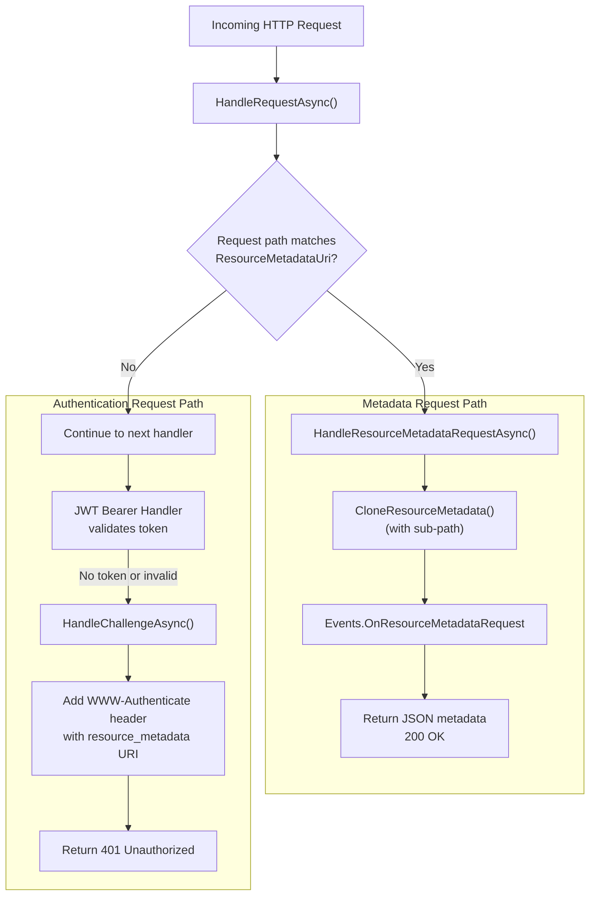
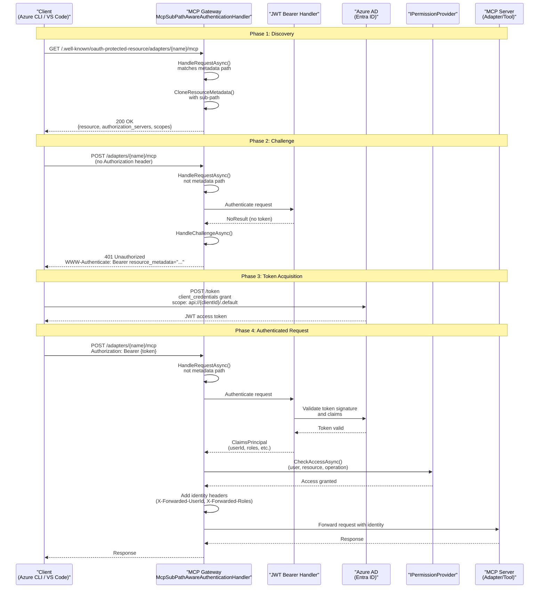
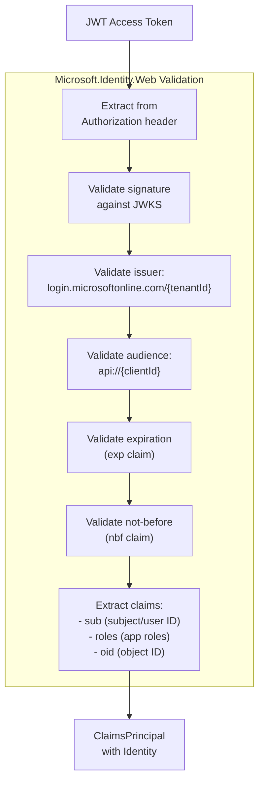
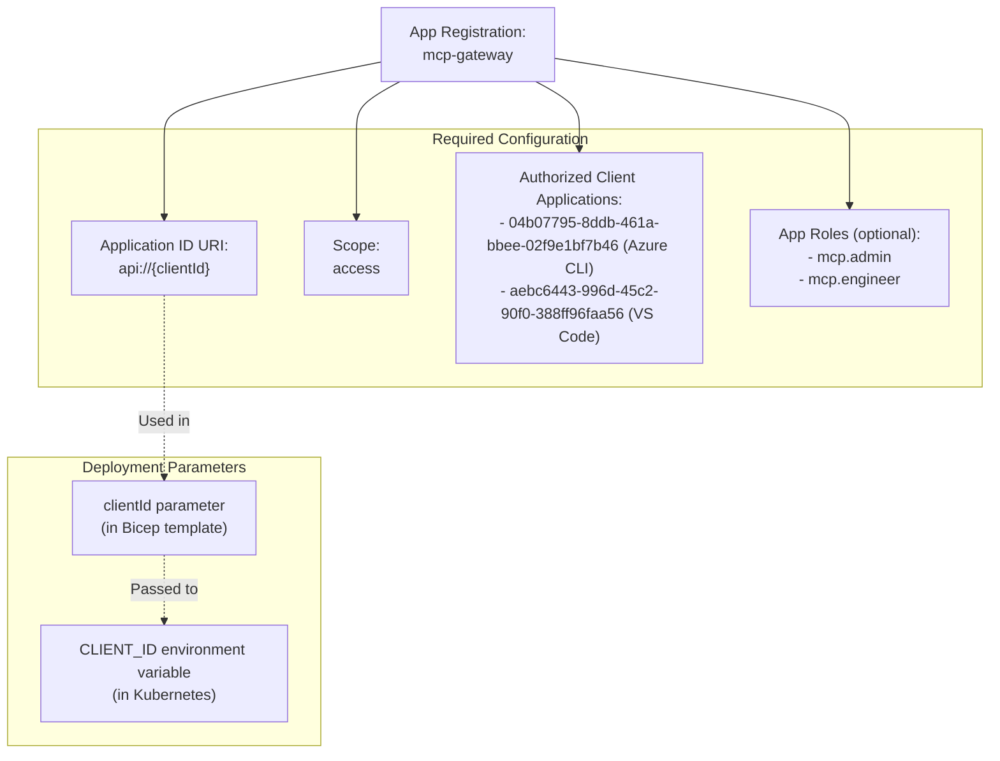

<!-- source: DeepWiki mcp.deepwiki.com · repo microsoft/mcp-gateway · page 7.1 Authentication Flow · fetched 2026-10-26 -->

# Authentication Flow

<details>
<summary>Relevant source files</summary>

The following files were used as context for generating this wiki page:

- [README.md](README.md)
- [deployment/infra/azure-deployment.bicep](deployment/infra/azure-deployment.bicep)
- [dotnet/Microsoft.McpGateway.Service/src/McpSubPathAwareAuthenticationHandler.cs](dotnet/Microsoft.McpGateway.Service/src/McpSubPathAwareAuthenticationHandler.cs)
- [dotnet/Microsoft.McpGateway.Service/src/Program.cs](dotnet/Microsoft.McpGateway.Service/src/Program.cs)

</details>


## Purpose and Scope

This document explains the authentication system in the MCP Gateway, covering how requests are authenticated using Azure Active Directory (Azure AD/Entra ID) in production environments and simplified authentication in development. It focuses on the OAuth 2.0 Protected Resource Metadata discovery mechanism, the `McpSubPathAwareAuthenticationHandler` implementation, and the token validation flow.

For information about authorization policies and role-based access control after authentication, see [Authorization and RBAC](#7.2). For details on how Azure Workload Identity is used by pods to access Azure services, see [Workload Identity](#7.3).

---

## Authentication Architecture Overview

The MCP Gateway implements a dual authentication strategy depending on the deployment environment:

| Environment | Authentication Scheme | Token Source | Purpose |
|-------------|----------------------|--------------|---------|
| **Development** | `DevelopmentAuthenticationHandler` | None (bypass) | Local testing without external dependencies |
| **Production** | `McpSubPathAwareAuthenticationHandler` + JWT Bearer | Azure AD (Entra ID) | Secure authentication with OAuth 2.0 / OpenID Connect |

Both the **Control Plane** (management API) and **Data Plane** (MCP routing) share the same authentication infrastructure, ensuring consistent security across all endpoints.

**Sources:** [dotnet/Microsoft.McpGateway.Service/src/Program.cs:32-72](), [README.md:152-158]()

---

## Environment-Specific Authentication Configuration

### Development Environment



**Figure 1: Development Authentication Flow**

In development mode, the gateway uses `DevelopmentAuthenticationHandler`, which bypasses all authentication checks to simplify local testing:

```csharp
// From Program.cs
if (builder.Environment.IsDevelopment())
{
    builder.Services
        .AddAuthentication(DevelopmentAuthenticationHandler.SchemeName)
        .AddScheme<AuthenticationSchemeOptions, DevelopmentAuthenticationHandler>(
            DevelopmentAuthenticationHandler.SchemeName, null);
}
```

This allows developers to test MCP server deployments and API operations without configuring Azure AD or obtaining access tokens.

**Sources:** [dotnet/Microsoft.McpGateway.Service/src/Program.cs:32-36]()

---

### Production Environment



**Figure 2: Production Authentication Architecture**

In production, authentication uses a two-handler approach:

1. **Challenge Handler**: `McpSubPathAwareAuthenticationHandler` handles authentication challenges and serves OAuth 2.0 Protected Resource Metadata
2. **Authentication Handler**: Microsoft Identity Web's JWT Bearer handler validates tokens against Azure AD

Configuration is driven by the `AzureAd` configuration section and the `PublicOrigin` setting:

```csharp
// From Program.cs
var azureAdConfig = builder.Configuration.GetSection("AzureAd");
builder.Services.AddAuthentication(options =>
{
    options.DefaultChallengeScheme = McpAuthenticationDefaults.AuthenticationScheme;
    options.DefaultAuthenticateScheme = JwtBearerDefaults.AuthenticationScheme;
})
.AddScheme<McpAuthenticationOptions, McpSubPathAwareAuthenticationHandler>(
    McpAuthenticationDefaults.AuthenticationScheme,
    McpAuthenticationDefaults.DisplayName,
    options =>
    {
        options.ResourceMetadata = new()
        {
            Resource = new Uri(builder.Configuration.GetValue<string>("PublicOrigin")!),
            AuthorizationServers = { new Uri($"https://login.microsoftonline.com/{azureAdConfig["TenantId"]}/v2.0") },
            ScopesSupported = [$"api://{azureAdConfig["ClientId"]}/.default"]
        };
    })
.AddMicrosoftIdentityWebApi(azureAdConfig);
```

**Sources:** [dotnet/Microsoft.McpGateway.Service/src/Program.cs:52-71](), [deployment/infra/azure-deployment.bicep:1-3]()

---

## OAuth 2.0 Protected Resource Metadata

The MCP Gateway implements the [OAuth 2.0 Protected Resource Metadata](https://datatracker.ietf.org/doc/html/rfc8707) specification, allowing clients to discover authentication requirements dynamically.

### Metadata Endpoint Structure



**Figure 3: OAuth 2.0 Protected Resource Metadata Endpoints**

The `McpSubPathAwareAuthenticationHandler` serves metadata at `/.well-known/oauth-protected-resource` and all sub-paths beneath it. This allows different MCP endpoints to have distinct resource URIs in their metadata while sharing the same authentication configuration.

**Example Metadata Response:**
```json
{
  "resource": "http://gateway.example.com/adapters/mcp-example/mcp",
  "authorization_servers": ["https://login.microsoftonline.com/{tenantId}/v2.0"],
  "scopes_supported": ["api://{clientId}/.default"]
}
```

**Sources:** [dotnet/Microsoft.McpGateway.Service/src/McpSubPathAwareAuthenticationHandler.cs:28-48](), [README.md:359-395]()

---

## McpSubPathAwareAuthenticationHandler Implementation



**Figure 4: McpSubPathAwareAuthenticationHandler Request Flow**

The `McpSubPathAwareAuthenticationHandler` class implements two key interfaces:

| Interface | Method | Purpose |
|-----------|--------|---------|
| `IAuthenticationRequestHandler` | `HandleRequestAsync()` | Intercepts metadata requests and returns metadata documents |
| `AuthenticationHandler<T>` | `HandleChallengeAsync()` | Adds WWW-Authenticate headers to 401 responses |

### Key Methods

#### 1. HandleRequestAsync

This method intercepts requests to the metadata endpoint before normal authentication occurs:

```csharp
public async Task<bool> HandleRequestAsync()
{
    string requestPath = Request.Path.Value ?? string.Empty;
    string expectedMetadataPath = Options.ResourceMetadataUri?.ToString() ?? string.Empty;
    
    if (!requestPath.StartsWith(expectedMetadataPath, StringComparison.OrdinalIgnoreCase))
    {
        return false; // Let request continue through pipeline
    }
    
    return await HandleResourceMetadataRequestAsync();
}
```

**Sources:** [dotnet/Microsoft.McpGateway.Service/src/McpSubPathAwareAuthenticationHandler.cs:29-48]()

#### 2. CloneResourceMetadata (Sub-path Awareness)

The handler clones the base `ProtectedResourceMetadata` and appends the sub-path to the resource URI, allowing different MCP endpoints to have unique resource identifiers:

```csharp
internal static ProtectedResourceMetadata? CloneResourceMetadata(
    ProtectedResourceMetadata? resourceMetadata, 
    string subPath)
{
    if (resourceMetadata is null) return null;
    
    return new ProtectedResourceMetadata
    {
        Resource = new Uri(resourceMetadata.Resource, subPath),
        AuthorizationServers = [.. resourceMetadata.AuthorizationServers],
        ScopesSupported = [.. resourceMetadata.ScopesSupported],
        // ... other properties copied
    };
}
```

This enables:
- `/adapters/mcp-example/mcp` to have resource URI `http://gateway.com/adapters/mcp-example/mcp`
- `/mcp` to have resource URI `http://gateway.com/mcp`

**Sources:** [dotnet/Microsoft.McpGateway.Service/src/McpSubPathAwareAuthenticationHandler.cs:156-180]()

#### 3. HandleChallengeAsync

When authentication fails, this method adds the OAuth 2.0 compliant `WWW-Authenticate` header:

```csharp
protected override Task HandleChallengeAsync(AuthenticationProperties properties)
{
    string rawPrmDocumentUri = GetAbsoluteResourceMetadataUri();
    properties ??= new AuthenticationProperties();
    properties.Items["resource_metadata"] = rawPrmDocumentUri;
    
    string headerValue = $"Bearer realm=\"{Scheme.Name}\", resource_metadata=\"{rawPrmDocumentUri}\"";
    Response.Headers.Append("WWW-Authenticate", headerValue);
    
    return base.HandleChallengeAsync(properties);
}
```

**Example Header:**
```
WWW-Authenticate: Bearer realm="MCP", resource_metadata="http://gateway.example.com/.well-known/oauth-protected-resource/adapters/mcp-example/mcp"
```

**Sources:** [dotnet/Microsoft.McpGateway.Service/src/McpSubPathAwareAuthenticationHandler.cs:139-154]()

---

## Complete Authentication Flow



**Figure 5: End-to-End Authentication Sequence**

**Sources:** [dotnet/Microsoft.McpGateway.Service/src/Program.cs:52-71](), [dotnet/Microsoft.McpGateway.Service/src/McpSubPathAwareAuthenticationHandler.cs:29-154](), [README.md:441-463]()

---

## Token Validation Process



**Figure 6: JWT Token Validation Steps**

The JWT Bearer handler (added via `.AddMicrosoftIdentityWebApi(azureAdConfig)`) performs comprehensive token validation:

| Validation | Configuration Source | Description |
|------------|---------------------|-------------|
| **Signature** | Azure AD JWKS endpoint | Verifies token was signed by Azure AD |
| **Issuer** | `AzureAd:TenantId` | Ensures token is from correct tenant |
| **Audience** | `AzureAd:ClientId` | Verifies token is intended for this API |
| **Expiration** | `exp` claim | Checks token hasn't expired |
| **Not-Before** | `nbf` claim | Ensures token is already valid |

**Configuration in appsettings.json:**
```json
{
  "AzureAd": {
    "Instance": "https://login.microsoftonline.com/",
    "TenantId": "{tenant-id}",
    "ClientId": "{client-id}"
  }
}
```

**Sources:** [dotnet/Microsoft.McpGateway.Service/src/Program.cs:53-71](), [deployment/infra/azure-deployment.bicep:1-3]()

---

## Identity Forwarding to Backend Services

After successful authentication, the gateway extracts user identity information from the validated token and forwards it to backend MCP servers using custom HTTP headers:

| Header | Source Claim | Purpose |
|--------|-------------|---------|
| `X-Forwarded-UserId` | `sub` or `oid` | Unique user identifier |
| `X-Forwarded-Roles` | `roles` | Application roles assigned to user |

This enables backend MCP servers to:
- Log requests with user context
- Make authorization decisions based on user roles
- Track usage per user

The identity forwarding mechanism is implemented in the routing layer, which operates after authentication completes.

**Sources:** [README.md:152-158]()

---

## Azure AD App Registration Configuration

The production authentication flow requires an Azure AD App Registration configured with:



**Figure 7: Azure AD App Registration Requirements**

**Setup Steps:**
1. Create app registration in Azure portal
2. Set Application ID URI to `api://{clientId}`
3. Add scope named `access`
4. Add authorized client applications (Azure CLI, VS Code)
5. Optionally define app roles for authorization (see [Authorization and RBAC](#7.2))
6. Use the Client ID in deployment parameters

**Sources:** [README.md:356-398](), [deployment/infra/azure-deployment.bicep:1-3](), [deployment/infra/azure-deployment.bicep:570-573]()

---

## Development vs. Production Authentication Comparison

| Aspect | Development | Production |
|--------|-------------|------------|
| **Handler** | `DevelopmentAuthenticationHandler` | `McpSubPathAwareAuthenticationHandler` + JWT Bearer |
| **Token Required** | No | Yes (Azure AD JWT) |
| **Token Validation** | None | Full validation (signature, issuer, audience, expiration) |
| **Metadata Endpoint** | Not served | Served at `/.well-known/oauth-protected-resource/*` |
| **WWW-Authenticate Header** | Not sent | Sent on 401 with resource_metadata |
| **Claims Extraction** | None | User ID, roles, etc. |
| **Identity Forwarding** | None | X-Forwarded-UserId, X-Forwarded-Roles |
| **Configuration** | None | AzureAd section + PublicOrigin |

**Sources:** [dotnet/Microsoft.McpGateway.Service/src/Program.cs:32-105]()

---

## Summary

The MCP Gateway authentication flow implements a standards-compliant OAuth 2.0 Protected Resource authentication system with the following characteristics:

1. **Environment Awareness**: Uses simplified authentication in development and Azure AD in production
2. **Standards Compliance**: Implements OAuth 2.0 Protected Resource Metadata (RFC 8707)
3. **Sub-path Support**: Allows different MCP endpoints to have unique resource URIs while sharing configuration
4. **Challenge-Response Pattern**: Provides clients with discovery information via WWW-Authenticate headers
5. **JWT Validation**: Leverages Microsoft Identity Web for comprehensive token validation
6. **Identity Propagation**: Forwards authenticated user identity to backend services

After authentication succeeds, the request proceeds to authorization checks (see [Authorization and RBAC](#7.2)) before being routed to the appropriate MCP server.

**Sources:** [dotnet/Microsoft.McpGateway.Service/src/Program.cs](), [dotnet/Microsoft.McpGateway.Service/src/McpSubPathAwareAuthenticationHandler.cs](), [README.md]()

---

