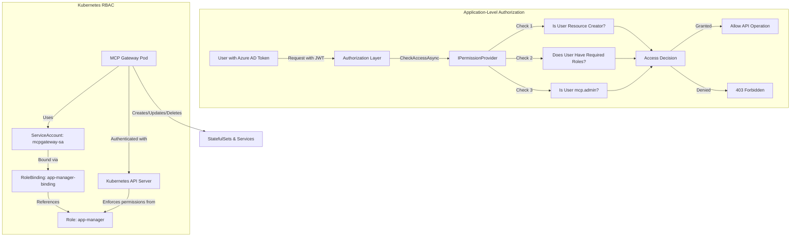
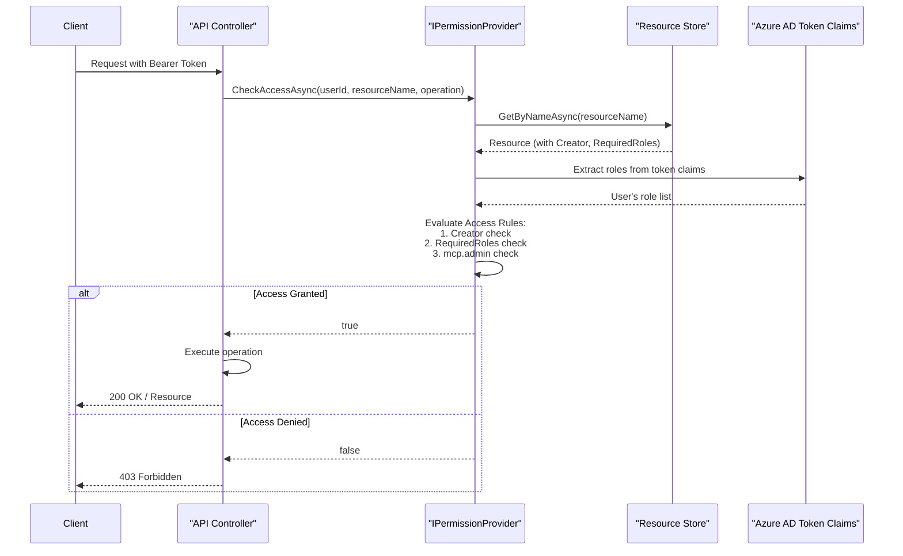
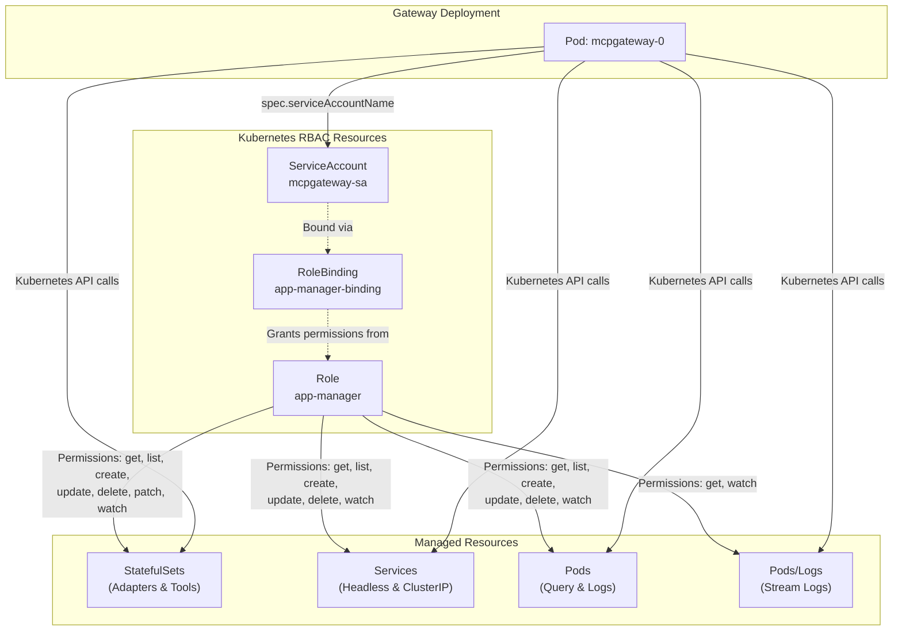
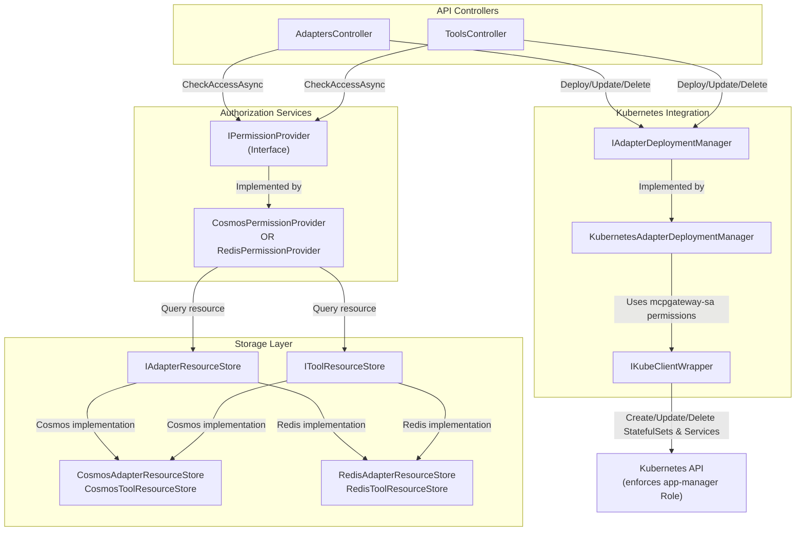

<!-- source: DeepWiki mcp.deepwiki.com · repo microsoft/mcp-gateway · page 7.2 Authorization and RBAC · fetched 2026-10-26 -->

# Authorization and RBAC

<details>
<summary>Relevant source files</summary>

The following files were used as context for generating this wiki page:

- [README.md](README.md)
- [deployment/k8s/cloud-deployment-template.yml](deployment/k8s/cloud-deployment-template.yml)

</details>


## Purpose and Scope

This document describes the authorization and role-based access control (RBAC) mechanisms in the MCP Gateway system. It covers how access decisions are made for adapter and tool resources, the permission provider system, application-level role enforcement, and Kubernetes RBAC configuration that enables the gateway to manage workloads.

For information about authentication and token validation, see [Authentication Flow](#7.1). For information about Azure Workload Identity used by pods, see [Workload Identity](#7.3).

---

## Authorization Architecture Overview

The MCP Gateway implements a **two-tier authorization model**:

1. **Application-Level Authorization**: Controls which users can access, create, modify, or delete adapter and tool resources through the Management API
2. **Kubernetes RBAC**: Controls what operations the gateway service itself can perform within the Kubernetes cluster to manage workloads



**Sources:** [README.md:153-158](), [deployment/k8s/cloud-deployment-template.yml:75-103]()

---

## Application-Level Authorization

### Permission Provider System

The authorization system is implemented through the `IPermissionProvider` interface, which evaluates access requests based on multiple criteria including resource ownership, Azure AD roles, and operation types.

#### Authorization Decision Flow



**Sources:** [README.md:153-158]()

### Access Control Rules

The gateway enforces different access control rules for **read** operations (viewing resources) and **write** operations (creating, modifying, or deleting resources).

#### Read Access Rules

Read access to an adapter or tool resource is granted if **any** of the following conditions are met:

| Condition | Description |
|-----------|-------------|
| **Resource Creator** | The user's identity matches the `Creator` field stored with the resource |
| **Required Roles** | The user possesses at least one role specified in the resource's `RequiredRoles` array |
| **Administrator Role** | The user has the mandatory `mcp.admin` role in their Azure AD token |

#### Write Access Rules

Write access (create, update, delete) is granted if **any** of the following conditions are met:

| Condition | Description |
|-----------|-------------|
| **Resource Creator** | The user's identity matches the `Creator` field (for update/delete operations) |
| **Administrator Role** | The user has the mandatory `mcp.admin` role |

> **Note:** For create operations, the user automatically becomes the creator and can subsequently modify their own resources.

#### Operations and Required Access

| API Operation | Access Type | Authorization Logic |
|--------------|-------------|-------------------|
| `POST /adapters` | Write | User becomes creator; no additional check needed |
| `GET /adapters` | Read | Returns only resources user can read |
| `GET /adapters/{name}` | Read | Creator OR RequiredRoles OR mcp.admin |
| `PUT /adapters/{name}` | Write | Creator OR mcp.admin |
| `DELETE /adapters/{name}` | Write | Creator OR mcp.admin |
| `GET /adapters/{name}/status` | Read | Creator OR RequiredRoles OR mcp.admin |
| `GET /adapters/{name}/logs` | Read | Creator OR RequiredRoles OR mcp.admin |
| `POST /mcp` (Tool Gateway) | Read | Checks access to underlying tools |

**Sources:** [README.md:153-158]()

### Azure AD Application Roles

The gateway integrates with Azure AD (Entra ID) to enforce role-based access control using **Application Roles** defined in the app registration.

#### Role Configuration

Application roles are defined in the Azure AD app registration and included in JWT tokens as claims. The gateway reads these role claims during authorization decisions.

**Key Roles:**

| Role Name | Purpose | Required For |
|-----------|---------|--------------|
| `mcp.admin` | Administrator access | Full read/write access to all resources, regardless of creator or RequiredRoles |
| `mcp.engineer` (example) | Read access role | Read access to resources that include this role in RequiredRoles |
| Custom roles | Domain-specific access | Any roles defined in Azure AD can be used in RequiredRoles |

#### Token Claims Structure

When a user authenticates with Azure AD, their JWT token includes role claims:

```json
{
  "roles": ["mcp.admin", "mcp.engineer"],
  "oid": "user-object-id",
  "preferred_username": "user@domain.com"
}
```

The gateway extracts the `roles` claim array and uses it in authorization decisions.

**Sources:** [README.md:153-158](), [README.md:395-397]()

### Resource-Level Permissions

Each adapter and tool resource includes a `RequiredRoles` field that specifies which Azure AD application roles are required for read access.

#### AdapterResource Schema

```
AdapterResource:
  - Name: string
  - Creator: string (user identity)
  - RequiredRoles: string[] (Azure AD role names)
  - ImageName: string
  - ImageVersion: string
  - Description: string
  - ... (other fields)
```

#### ToolResource Schema

```
ToolResource:
  - Name: string
  - Creator: string (user identity)
  - RequiredRoles: string[] (Azure AD role names)
  - ImageName: string
  - ImageVersion: string
  - ToolDefinition: object
  - ... (other fields)
```

#### Example: Creating an Adapter with Required Roles

When creating an adapter, the user can specify `RequiredRoles` to control who else can read it:

```json
POST /adapters
{
  "name": "sales-data-adapter",
  "imageName": "sales-mcp-server",
  "imageVersion": "1.0.0",
  "description": "Sales data MCP server",
  "requiredRoles": ["mcp.engineer", "sales.analyst"]
}
```

With this configuration:
- The **creator** can always read and modify the adapter
- Users with **mcp.admin** role can read and modify the adapter
- Users with **mcp.engineer** OR **sales.analyst** roles can read the adapter (but not modify it unless they're the creator)

#### Example: Public Access Pattern

To make a resource readable by anyone with a valid token, set `RequiredRoles` to an empty array:

```json
{
  "name": "public-adapter",
  "requiredRoles": []
}
```

However, write access still requires being the creator or having `mcp.admin`.

**Sources:** [README.md:153-158](), [README.md:238-263](), [README.md:448-462]()

---

## Kubernetes RBAC Configuration

The gateway service requires Kubernetes RBAC permissions to dynamically create, update, and delete workloads (StatefulSets and Services) for adapters and tools.

### Service Account and Role Architecture



**Sources:** [deployment/k8s/cloud-deployment-template.yml:60-103]()

### ServiceAccount: mcpgateway-sa

The gateway deployment uses a dedicated ServiceAccount that provides its Kubernetes identity.

**Definition:**
```yaml
apiVersion: v1
kind: ServiceAccount
metadata:
  name: mcpgateway-sa
  namespace: adapter
  annotations:
    azure.workload.identity/client-id: "${AZURE_CLIENT_ID}"
```

**Key Points:**
- The `azure.workload.identity/client-id` annotation enables Azure Workload Identity integration (see [Workload Identity](#7.3))
- All gateway pods run with this ServiceAccount: `spec.serviceAccountName: mcpgateway-sa`
- This ServiceAccount is bound to the `app-manager` Role via `app-manager-binding`

**Sources:** [deployment/k8s/cloud-deployment-template.yml:60-66](), [deployment/k8s/cloud-deployment-template.yml:22]()

### Role: app-manager

The `app-manager` Role defines the Kubernetes API permissions granted to the gateway service.

**Definition:**
```yaml
apiVersion: rbac.authorization.k8s.io/v1
kind: Role
metadata:
  name: app-manager
  namespace: adapter
rules:
  - apiGroups: ["apps"]
    resources: ["statefulsets"]
    verbs: ["get", "list", "create", "update", "delete", "patch", "watch"]
  - apiGroups: [""]
    resources: ["services", "pods"]
    verbs: ["get", "list", "create", "update", "delete", "watch"]
  - apiGroups: [""]
    resources: ["pods/log"]
    verbs: ["get", "watch"]
```

#### Granted Permissions by Resource Type

| Resource Type | API Group | Allowed Verbs | Purpose |
|--------------|-----------|---------------|---------|
| `statefulsets` | `apps` | get, list, create, update, delete, patch, watch | Create and manage adapter/tool StatefulSets |
| `services` | `` (core) | get, list, create, update, delete, watch | Create headless/ClusterIP services for routing |
| `pods` | `` (core) | get, list, create, update, delete, watch | Query pod status and details |
| `pods/log` | `` (core) | get, watch | Stream logs from adapter/tool pods |

These permissions enable the gateway to:
1. **Deploy workloads**: Create StatefulSets and Services when users register adapters/tools via `POST /adapters` or `POST /tools`
2. **Update workloads**: Modify existing StatefulSets when users update configurations via `PUT /adapters/{name}` or `PUT /tools/{name}`
3. **Delete workloads**: Remove StatefulSets and Services when users delete resources via `DELETE /adapters/{name}` or `DELETE /tools/{name}`
4. **Query status**: Check pod readiness and health for `GET /adapters/{name}/status` endpoints
5. **Stream logs**: Retrieve container logs for `GET /adapters/{name}/logs` endpoints

**Sources:** [deployment/k8s/cloud-deployment-template.yml:75-89]()

### RoleBinding: app-manager-binding

The RoleBinding connects the `mcpgateway-sa` ServiceAccount to the `app-manager` Role.

**Definition:**
```yaml
apiVersion: rbac.authorization.k8s.io/v1
kind: RoleBinding
metadata:
  name: app-manager-binding
  namespace: adapter
subjects:
  - kind: ServiceAccount
    name: mcpgateway-sa
    namespace: adapter
roleRef:
  kind: Role
  name: app-manager
  apiGroup: rbac.authorization.k8s.io
```

**Binding Relationship:**
- **Subject**: `mcpgateway-sa` ServiceAccount in `adapter` namespace
- **Role**: `app-manager` Role in `adapter` namespace
- **Scope**: Limited to the `adapter` namespace only (Role, not ClusterRole)

This means the gateway can only manage resources within the `adapter` namespace, providing namespace-level isolation.

**Sources:** [deployment/k8s/cloud-deployment-template.yml:91-103]()

### Namespace Isolation

All gateway-managed resources are deployed in the `adapter` namespace:

```yaml
apiVersion: v1
kind: Namespace
metadata:
  name: adapter
```

The use of a **Role** (not ClusterRole) and **RoleBinding** (not ClusterRoleBinding) ensures the gateway has no permissions outside this namespace, following the principle of least privilege.

**Sources:** [deployment/k8s/cloud-deployment-template.yml:1-4]()

---

## Authorization Implementation Mapping

### Code-Level Authorization Components



**Key Code Entities:**

| Component | Type | Purpose | Authorization Role |
|-----------|------|---------|-------------------|
| `IPermissionProvider` | Interface | Defines authorization contract | Application-level access control |
| `IAdapterResourceStore` | Interface | Adapter metadata storage | Stores Creator and RequiredRoles |
| `IToolResourceStore` | Interface | Tool metadata storage | Stores Creator and RequiredRoles |
| `IAdapterDeploymentManager` | Interface | Kubernetes workload management | Uses Kubernetes RBAC permissions |
| `IKubeClientWrapper` | Interface | Kubernetes API client | Authenticates with mcpgateway-sa |

**Sources:** [README.md:153-158](), [deployment/k8s/cloud-deployment-template.yml:75-103]()

---

## Summary

The MCP Gateway implements a comprehensive two-tier RBAC model:

### Application-Level Authorization
- **Permission Provider** evaluates access based on resource creator, Azure AD roles, and the mandatory `mcp.admin` role
- **Read access** granted to: creator, users with required roles, or mcp.admin
- **Write access** restricted to: creator or mcp.admin
- Each resource includes a `RequiredRoles` field for fine-grained access control
- Integrates with Azure AD app roles defined in the Entra ID app registration

### Kubernetes RBAC
- Gateway runs with **mcpgateway-sa** ServiceAccount
- **app-manager** Role grants permissions to manage StatefulSets, Services, Pods, and Pod logs
- **app-manager-binding** RoleBinding connects the ServiceAccount to the Role
- Scoped to **adapter** namespace only for isolation
- Enables dynamic workload provisioning for adapters and tools

This dual authorization model ensures secure access control at both the API level (who can access resources) and the infrastructure level (what the gateway can manage in Kubernetes).

**Sources:** [README.md:153-158](), [deployment/k8s/cloud-deployment-template.yml:60-103]()

---

