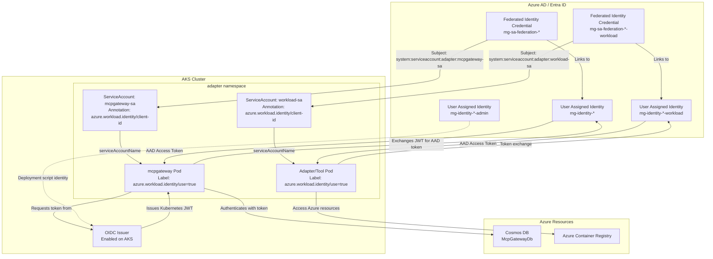
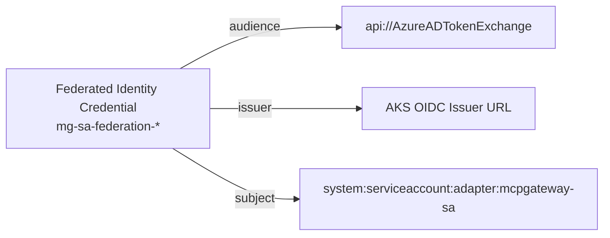
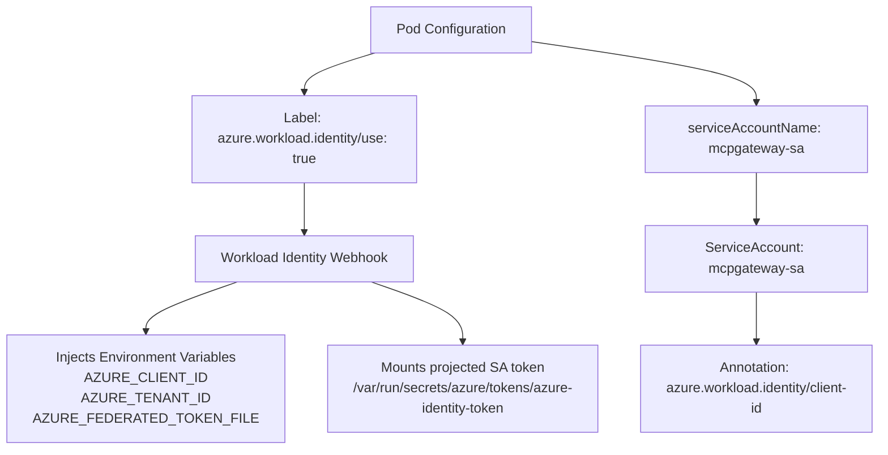
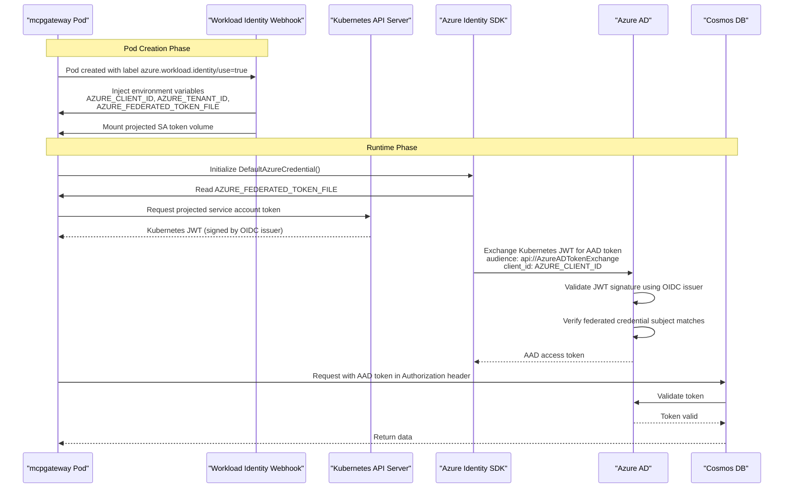

<!-- source: DeepWiki mcp.deepwiki.com · repo microsoft/mcp-gateway · page 7.3 Workload Identity · fetched 2026-10-26 -->

# Workload Identity

<details>
<summary>Relevant source files</summary>

The following files were used as context for generating this wiki page:

- [deployment/infra/azure-deployment.bicep](deployment/infra/azure-deployment.bicep)
- [deployment/k8s/cloud-deployment-template.yml](deployment/k8s/cloud-deployment-template.yml)

</details>


This page documents the Azure Workload Identity integration in the MCP Gateway system. Azure Workload Identity enables Kubernetes pods running in AKS to authenticate to Azure services (such as Cosmos DB and Azure Container Registry) using Azure Active Directory without managing secrets or connection strings.

For information about general authentication flow, see [Authentication Flow](#7.1). For authorization policies, see [Authorization and RBAC](#7.2).

## Overview

Workload Identity is a critical security component that allows the MCP Gateway and its managed workloads to securely access Azure resources. The system uses Azure AD federated identity credentials to establish trust between Kubernetes service accounts and Azure Managed Identities, eliminating the need to store and rotate secrets.

**Key Benefits:**
- **No secret management** - No connection strings or passwords stored in configuration
- **Automatic token rotation** - Azure AD handles token lifecycle
- **Fine-grained access control** - Each workload can have separate Azure identities with specific permissions
- **Audit trail** - All Azure resource access is tied to specific managed identities

## Architecture

The following diagram shows how Workload Identity integrates the Kubernetes and Azure AD identity systems:



**Sources:**
- [deployment/infra/azure-deployment.bicep:159-166]()
- [deployment/infra/azure-deployment.bicep:358-381]()
- [deployment/k8s/cloud-deployment-template.yml:60-73]()

## Managed Identities

The system creates three User Assigned Managed Identities, each serving a distinct purpose:

### Primary Gateway Identity

The primary gateway identity (`mg-identity-*`) is used by the MCP Gateway service to access Azure resources.

| Property | Value |
|----------|-------|
| Resource Name | `mg-identity-${resourceLabel}` |
| Client ID | Injected as `${AZURE_CLIENT_ID}` |
| Linked ServiceAccount | `mcpgateway-sa` |
| Primary Purpose | Access Cosmos DB for adapter/tool metadata storage |

**Azure Role Assignments:**
- **Cosmos DB Data Contributor** - Read/write access to Cosmos DB containers

**Sources:**
- [deployment/infra/azure-deployment.bicep:320-323]()
- [deployment/infra/azure-deployment.bicep:460-468]()

### Admin Identity

The admin identity is used during infrastructure deployment to configure Kubernetes resources.

| Property | Value |
|----------|-------|
| Resource Name | `mg-identity-${resourceLabel}-admin` |
| Purpose | Execute deployment scripts and manage AKS |
| Used By | Deployment scripts only (not runtime pods) |

**Azure Role Assignments:**
- **AKS Contributor** - Manage AKS cluster resources
- **AKS RBAC Cluster Admin** - Execute kubectl commands via `az aks command invoke`

**Sources:**
- [deployment/infra/azure-deployment.bicep:326-329]()
- [deployment/infra/azure-deployment.bicep:337-355]()

### Workload Identity

The workload identity is intended for adapter and tool pods that need to access Azure resources.

| Property | Value |
|----------|-------|
| Resource Name | `mg-identity-${resourceLabel}-workload` |
| Client ID | Injected as `${WORKLOAD_CLIENT_ID}` |
| Linked ServiceAccount | `workload-sa` |
| Primary Purpose | Allow adapter/tool workloads to access Azure services |

This identity can be used by developers when deploying custom adapters or tools that need to interact with Azure services (e.g., Azure Storage, Key Vault, etc.).

**Sources:**
- [deployment/infra/azure-deployment.bicep:332-335]()
- [deployment/k8s/cloud-deployment-template.yml:68-73]()

## Federated Identity Credentials

Federated Identity Credentials establish the trust relationship between Kubernetes service accounts and Azure Managed Identities. They use the OIDC protocol to validate that a Kubernetes pod is authorized to assume an Azure identity.

### Gateway Federation



The gateway federation links the `mcpgateway-sa` service account to the primary managed identity.

| Field | Value | Description |
|-------|-------|-------------|
| `audiences` | `api://AzureADTokenExchange` | Standard Azure audience for token exchange |
| `issuer` | AKS OIDC Issuer URL | Obtained from `aks.properties.oidcIssuerProfile.issuerURL` |
| `subject` | `system:serviceaccount:adapter:mcpgateway-sa` | Kubernetes service account identifier |

**Sources:**
- [deployment/infra/azure-deployment.bicep:358-368]()

### Workload Federation

The workload federation links the `workload-sa` service account to the workload managed identity.

| Field | Value |
|-------|-------|
| `subject` | `system:serviceaccount:adapter:workload-sa` |

This allows any pod using the `workload-sa` service account to obtain Azure AD tokens scoped to the workload managed identity.

**Sources:**
- [deployment/infra/azure-deployment.bicep:371-381]()

## AKS Configuration

The AKS cluster must be configured to support Workload Identity. This involves enabling OIDC issuer and workload identity features.

### OIDC Issuer Profile

```yaml
oidcIssuerProfile:
  enabled: true
```

The OIDC issuer provides a public endpoint that Azure AD can use to validate Kubernetes-issued tokens. The issuer URL follows the format:

```
https://<region>.oic.prod-aks.azure.com/<tenant-id>/<uuid>/
```

**Sources:**
- [deployment/infra/azure-deployment.bicep:159-161]()

### Security Profile

```yaml
securityProfile:
  workloadIdentity:
    enabled: true
```

This enables the Azure Workload Identity webhook in the cluster, which:
- Injects environment variables into pods with the appropriate labels
- Configures the Azure Identity SDK to use workload identity
- Mounts projected service account tokens into pods

**Sources:**
- [deployment/infra/azure-deployment.bicep:162-165]()

## Kubernetes Service Accounts

Service accounts in Kubernetes are annotated to link them to Azure Managed Identities.

### Gateway Service Account

```yaml
apiVersion: v1
kind: ServiceAccount
metadata:
  name: mcpgateway-sa
  namespace: adapter
  annotations:
    azure.workload.identity/client-id: "${AZURE_CLIENT_ID}"
```

The annotation `azure.workload.identity/client-id` specifies which Azure Managed Identity client ID this service account maps to. During deployment, the Bicep template injects the actual client ID value.

**Sources:**
- [deployment/k8s/cloud-deployment-template.yml:60-65]()

### Workload Service Account

```yaml
apiVersion: v1
kind: ServiceAccount
metadata:
  name: workload-sa
  namespace: adapter
  annotations:
    azure.workload.identity/client-id: "${WORKLOAD_CLIENT_ID}"
```

This service account is available for adapter and tool workloads that need Azure access.

**Sources:**
- [deployment/k8s/cloud-deployment-template.yml:68-73]()

## Pod Configuration

Pods must be properly labeled and configured to use Workload Identity.

### Required Pod Label

```yaml
metadata:
  labels:
    azure.workload.identity/use: "true"
```

This label tells the Workload Identity webhook to inject the necessary environment variables and volume mounts into the pod. Without this label, the pod will not be able to use Workload Identity.

**Sources:**
- [deployment/k8s/cloud-deployment-template.yml:20]()
- [deployment/k8s/cloud-deployment-template.yml:140]()

### Service Account Reference

```yaml
spec:
  serviceAccountName: mcpgateway-sa
```

The pod specification must reference the annotated service account. The combination of the label and service account reference enables the authentication flow.

**Sources:**
- [deployment/k8s/cloud-deployment-template.yml:22]()
- [deployment/k8s/cloud-deployment-template.yml:143]()

### Complete Pod Configuration Example



**Sources:**
- [deployment/k8s/cloud-deployment-template.yml:17-40]()

## Token Exchange Flow

The following sequence diagram shows how a pod obtains an Azure AD token using Workload Identity:



**Key Steps:**

1. **Webhook Injection** - When the pod is created, the Workload Identity webhook injects environment variables and mounts a projected service account token
2. **Token Retrieval** - The Azure Identity SDK reads the projected token file path from `AZURE_FEDERATED_TOKEN_FILE`
3. **JWT Exchange** - The SDK sends the Kubernetes JWT to Azure AD's token endpoint along with the client ID
4. **Validation** - Azure AD validates the JWT signature using the AKS OIDC issuer's public keys and verifies the subject matches the federated credential
5. **AAD Token** - Azure AD issues an access token scoped to the managed identity
6. **Resource Access** - The pod uses the AAD token to authenticate to Azure resources like Cosmos DB

**Sources:**
- [deployment/infra/azure-deployment.bicep:358-368]()
- [deployment/k8s/cloud-deployment-template.yml:20-22]()

## Cosmos DB Access

The primary use case for Workload Identity in the MCP Gateway is to access Cosmos DB without storing connection strings.

### Role Assignment

```bicep
resource cosmosDbRoleAssignment 'Microsoft.DocumentDB/databaseAccounts/sqlRoleAssignments@2022-11-15' = {
  parent: cosmosDb
  name: guid(cosmosDb.name, uai.id, 'data-contributor')
  properties: {
    roleDefinitionId: resourceId('Microsoft.DocumentDB/databaseAccounts/sqlRoleDefinitions', 
                                  cosmosDb.name, 
                                  '00000000-0000-0000-0000-000000000002')
    principalId: uai.properties.principalId
    scope: cosmosDb.id
  }
}
```

The managed identity is granted the **Cosmos DB Built-in Data Contributor** role (ID `00000000-0000-0000-0000-000000000002`), which allows:
- Read and write access to all containers
- Create, update, and delete documents
- Query operations

**Configuration Required:**

The gateway must be configured with only the Cosmos DB endpoint - no keys or connection strings:

```yaml
CosmosSettings__AccountEndpoint: "https://mg-storage-${IDENTIFIER}.documents.azure.com:443/"
CosmosSettings__DatabaseName: "McpGatewayDb"
```

The Azure Cosmos DB SDK automatically uses `DefaultAzureCredential` which detects Workload Identity and obtains tokens.

**Sources:**
- [deployment/infra/azure-deployment.bicep:460-468]()
- [deployment/k8s/cloud-deployment-template.yml:116-117]()

## Deployment Script Identity

The deployment script uses the admin managed identity to execute Kubernetes commands.

```bicep
resource kubernetesDeployment 'Microsoft.Resources/deploymentScripts@2023-08-01' = {
  identity: {
    type: 'UserAssigned'
    userAssignedIdentities: {
      '${uaiAdmin.id}': {}
    }
  }
  // ... script content
}
```

The script identity is assigned:
- **AKS Contributor** role on the AKS cluster
- **AKS RBAC Cluster Admin** role for executing kubectl commands

This allows the deployment script to run `az aks command invoke` to apply the Kubernetes manifests without requiring the user to have kubectl access to the cluster.

**Sources:**
- [deployment/infra/azure-deployment.bicep:537-543]()
- [deployment/infra/azure-deployment.bicep:337-355]()

## Configuration Injection

The deployment process injects the managed identity client IDs into the Kubernetes manifests using environment variable substitution.

```bash
sed -i "s|\${AZURE_CLIENT_ID}|$AZURE_CLIENT_ID|g" cloud-deployment-template.yml
sed -i "s|\${WORKLOAD_CLIENT_ID}|$WORKLOAD_CLIENT_ID|g" cloud-deployment-template.yml
```

The Bicep template provides the client IDs as environment variables to the deployment script:

```bicep
environmentVariables: [
  {
    name: 'AZURE_CLIENT_ID'
    value: uai.properties.clientId
  }
  {
    name: 'WORKLOAD_CLIENT_ID'
    value: uaiWorkload.properties.clientId
  }
]
```

This ensures that the service account annotations contain the correct client IDs that match the federated credentials.

**Sources:**
- [deployment/infra/azure-deployment.bicep:552-553]()
- [deployment/infra/azure-deployment.bicep:575-581]()

## Security Considerations

### No Secret Storage

Workload Identity eliminates the need to store any secrets in Kubernetes or application configuration:

- ❌ No Cosmos DB connection strings with keys
- ❌ No service principal client secrets
- ❌ No certificates to manage
- ✅ All authentication via short-lived tokens

### Token Lifetime

Azure AD access tokens obtained via Workload Identity have a limited lifetime (typically 1 hour). The Azure SDK automatically handles token refresh by:

1. Detecting token expiration
2. Reading a fresh Kubernetes JWT from the projected token file
3. Exchanging it for a new Azure AD token

### Federated Credential Subject Validation

The `subject` field in the federated credential uses a specific format:

```
system:serviceaccount:<namespace>:<serviceaccount-name>
```

Azure AD validates that the Kubernetes JWT's subject claim exactly matches this value. This prevents:
- Pods in other namespaces from using the identity
- Pods using different service accounts from obtaining tokens
- Token theft or replay attacks

**Sources:**
- [deployment/infra/azure-deployment.bicep:366]()
- [deployment/infra/azure-deployment.bicep:379]()

### RBAC Separation

The system uses different managed identities for different purposes:

| Identity | Purpose | Permissions |
|----------|---------|-------------|
| `mg-identity-*` | Gateway runtime | Cosmos DB data access only |
| `mg-identity-*-admin` | Deployment | AKS management (not used at runtime) |
| `mg-identity-*-workload` | Adapter/tool workloads | None by default (configured per use case) |

This separation ensures that if an adapter or tool is compromised, it cannot access the gateway's Cosmos DB data or manage the AKS cluster.

**Sources:**
- [deployment/infra/azure-deployment.bicep:320-335]()

---

