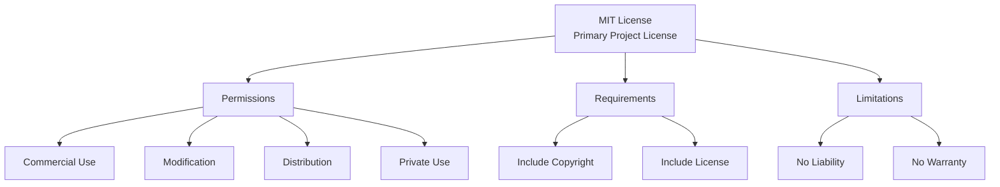
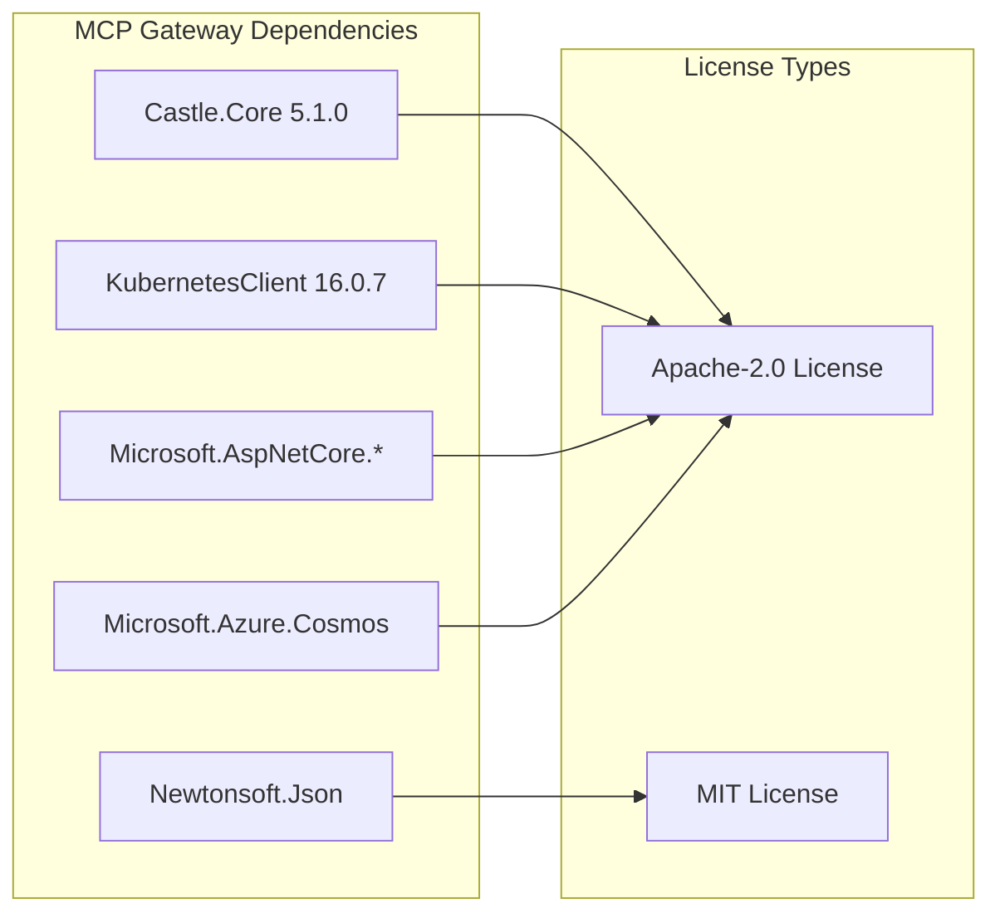
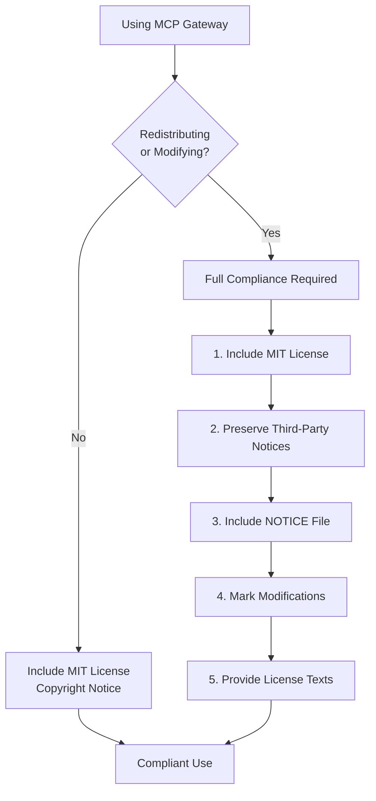
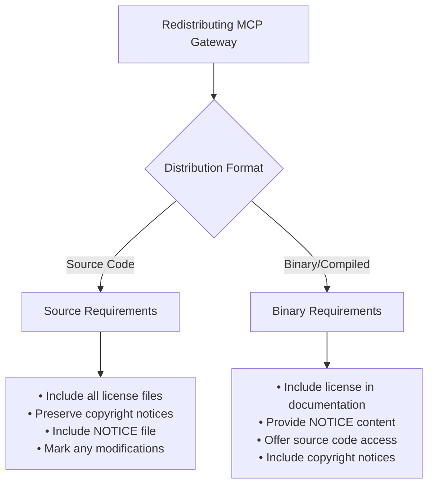

<!-- source: DeepWiki mcp.deepwiki.com · repo microsoft/mcp-gateway · page 7.4 Legal and Licensing · fetched 2026-10-26 -->

# Legal and Licensing

Relevant source files

The following files were used as context for generating this wiki page:

- [.github/workflows/main.yml](.github/workflows/main.yml)
- [NOTICE](NOTICE)

This page documents the licensing terms, legal obligations, and compliance requirements for the MCP Gateway project. It covers the main project license, code of conduct guidelines, third-party dependency licenses, and redistribution requirements.

For information about security policies and vulnerability reporting, see [Security Policy](#6.1).

## Project License

The MCP Gateway is licensed under the MIT License, which provides broad permissions for use, modification, and distribution while requiring preservation of copyright and license notices.

### MIT License Terms

The primary license grants the following permissions:
- **Use**: Run the software for any purpose
- **Modify**: Create derivative works and modifications  
- **Distribute**: Share copies of the original or modified software
- **Sublicense**: Include in larger works under different license terms
- **Sell**: Use in commercial applications

The license requires:
- **Copyright Notice**: Include the original copyright notice in all copies
- **License Notice**: Include the license text in all substantial portions
- **No Warranty**: Software is provided "as is" without warranties

**Sources:** [LICENSE:1-22]()

## Code of Conduct

The project follows the Microsoft Open Source Code of Conduct, establishing community standards and reporting mechanisms for inappropriate behavior.

### Community Standards

The code of conduct covers:
- **Respectful Communication**: Professional and inclusive interactions
- **Harassment Prevention**: Zero tolerance for discriminatory behavior
- **Constructive Participation**: Focus on collaborative problem-solving
- **Reporting Mechanisms**: Clear escalation paths for violations

### Enforcement

Violations can be reported to `opencode@microsoft.com` for investigation and appropriate action by Microsoft's community management team.

**Sources:** [CODE_OF_CONDUCT.md:1-10]()

## Third-Party Dependencies

The MCP Gateway incorporates several third-party components, each with their own licensing terms that must be respected in derivative works.

### Dependency License Summary

### Major Dependencies

| Component | Version | License | Usage |
|-----------|---------|---------|-------|
| Castle.Core | 5.1.0 | Apache-2.0 | Dependency injection and mocking |
| KubernetesClient | 16.0.7 | Apache-2.0 | Kubernetes API integration |
| Microsoft.AspNetCore.* | 2.1.x | Apache-2.0 | Web hosting and HTTP abstractions |
| Microsoft.Azure.Cosmos | Latest | Apache-2.0 | Azure Cosmos DB client |

**Sources:** [NOTICE:20-21](), [NOTICE:45-46](), [NOTICE:151-152]()

## Third-Party Notices

The `NOTICE` file contains detailed attribution and license text for all incorporated third-party software, as required by Apache-2.0 and other permissive licenses.

### Notice Requirements

When redistributing the MCP Gateway or derivative works, you must:

1. **Include Attribution**: Preserve all copyright notices from third-party components
2. **Provide License Text**: Include complete license texts for Apache-2.0 components
3. **Maintain Notice File**: Distribute the `NOTICE` file or equivalent attribution
4. **Mark Modifications**: Clearly indicate any changes made to third-party code

### Source Code Availability

Microsoft provides access to third-party source code through:
- Online repository: `https://3rdpartysource.microsoft.com`
- Physical request: Source Code Compliance Team with $5.00 fee

**Sources:** [NOTICE:1-17]()

## Compliance Workflow

**Sources:** [LICENSE:1-22](), [NOTICE:101-111]()

## License Compatibility

The combination of MIT (main project) and Apache-2.0 (dependencies) licenses creates a permissive licensing environment:

### Compatible Usage Scenarios

- **Open Source Projects**: MIT and Apache-2.0 are compatible with most open source licenses
- **Commercial Applications**: Both licenses permit commercial use without royalties
- **Proprietary Integration**: Can be incorporated into closed-source software
- **Cloud Services**: Suitable for SaaS and cloud-based deployments

### Redistribution Requirements

**Sources:** [LICENSE:10-11](), [NOTICE:103-109]()

## Contact Information

For legal questions regarding the MCP Gateway license:

- **General Licensing**: Review the MIT License terms in the `LICENSE` file
- **Third-Party Concerns**: Contact Source Code Compliance Team for dependency-related issues
- **Code of Conduct**: Report violations to `opencode@microsoft.com`
- **Security Issues**: Follow the security policy documented in [Security Policy](#6.1)

**Sources:** [CODE_OF_CONDUCT.md:9](), [NOTICE:9-13]()