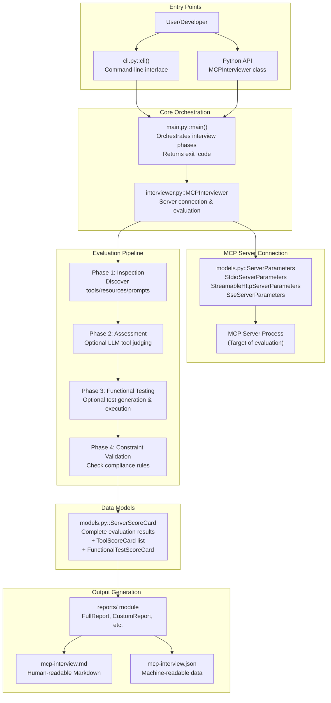
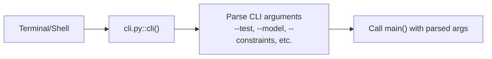
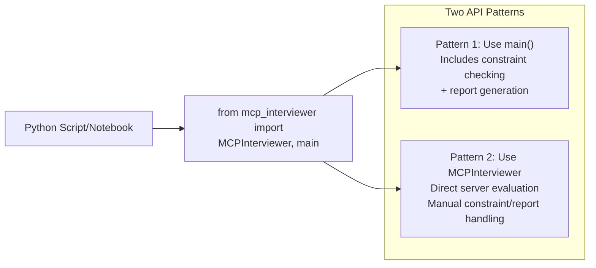
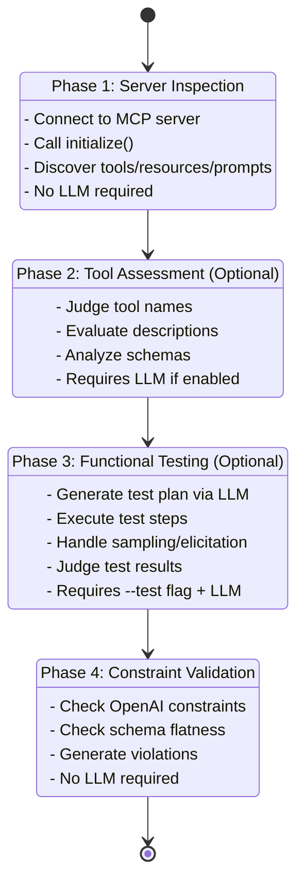
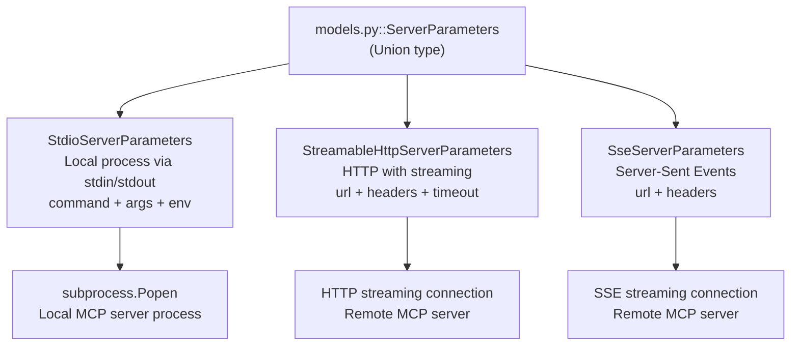
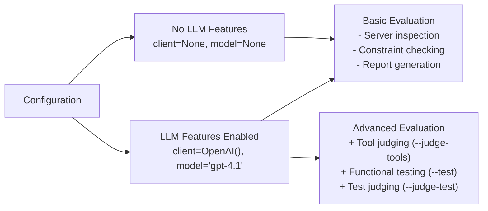

<!-- source: DeepWiki mcp.deepwiki.com · repo microsoft/mcp-interviewer · page 1 Overview · fetched 2026-10-26 -->

# Overview

<details>
<summary>Relevant source files</summary>

The following files were used as context for generating this wiki page:

- [.pre-commit-config.yaml](.pre-commit-config.yaml)
- [README.md](README.md)
- [pyproject.toml](pyproject.toml)
- [src/mcp_interviewer/__init__.py](src/mcp_interviewer/__init__.py)

</details>


**mcp-interviewer** is a Python-based evaluation tool for MCP (Model Context Protocol) servers. It analyzes server implementations to identify compatibility issues, validate tool definitions, test functionality, and generate comprehensive reports. The tool serves as a pre-deployment validation system to catch problems before LLM agents encounter them in production.

This page provides a high-level introduction to mcp-interviewer's architecture, usage modes, and evaluation approach. For detailed capability descriptions, see [Key Capabilities](#1.1). For installation and setup instructions, see [Getting Started](#2).

## Purpose and Scope

The mcp-interviewer tool addresses three primary use cases:

1. **Pre-deployment validation**: Check MCP servers against provider constraints (e.g., OpenAI's 128-tool limit) before integration
2. **Quality assurance**: Evaluate tool definitions, schemas, and functional behavior through automated testing
3. **Documentation generation**: Produce machine-readable and human-readable reports of server capabilities

The tool operates by connecting to an MCP server, inspecting its capabilities, optionally testing its tools, validating against defined constraints, and generating output reports.

Sources: [README.md:1-31](), [pyproject.toml:1-6]()

## System Architecture

The following diagram shows the core components and data flow through mcp-interviewer:



The system follows a pipeline architecture where each phase builds upon the previous one's results. The `MCPInterviewer` class handles server communication, while the `main()` function coordinates the overall evaluation workflow.

Sources: [src/mcp_interviewer/__init__.py:1-13](), [README.md:32-91]()

## Usage Modes

mcp-interviewer supports two primary usage modes with identical capabilities:

### Command-Line Interface

The CLI provides the most straightforward access to mcp-interviewer:



The CLI entry point is defined in [pyproject.toml:23-24]() and implemented in `cli.py`. Users invoke it as:

```bash
mcp-interviewer [OPTIONS] <server_command_or_url>
```

Key CLI flags include:
- `--test`: Enable functional testing
- `--model`: Specify LLM model for test generation and judging
- `--constraints`: Select specific constraints to check
- `--reports`: Customize report sections

For complete CLI reference, see [CLI Options Reference](#6.1).

### Python API

The Python API provides programmatic access through the same core functions:



**Pattern 1: Using `main()` function**

The `main()` function ([main.py]()) provides the complete evaluation pipeline including constraint checking and report generation:

```python
from mcp_interviewer import main, StdioServerParameters

params = StdioServerParameters(command="uvx", args=["mcp-server-fetch"])
exit_code = main(client=None, model=None, server_params=params)
```

**Pattern 2: Using `MCPInterviewer` class**

The `MCPInterviewer` class ([interviewer.py]()) provides lower-level control for custom evaluation workflows:

```python
from mcp_interviewer import MCPInterviewer, StdioServerParameters

interviewer = MCPInterviewer(client=None, model=None)
params = StdioServerParameters(command="uvx", args=["mcp-server-fetch"])
scorecard = await interviewer.interview_server(params)
```

For detailed Python API documentation, see [Python API](#3.2).

Sources: [README.md:236-288](), [pyproject.toml:23-24](), [src/mcp_interviewer/__init__.py:1-13]()

## Evaluation Pipeline

The evaluation process consists of four sequential phases:



### Phase Descriptions

| Phase | Required | LLM Used | Input | Output |
|-------|----------|----------|-------|--------|
| **1. Inspection** | Yes | No | `ServerParameters` | `Server` object with tools/resources |
| **2. Assessment** | No | Optional | Tool definitions | `ToolScoreCard` list with quality metrics |
| **3. Functional Testing** | No | Yes | Server capabilities | `FunctionalTestScoreCard` with execution results |
| **4. Constraint Validation** | Yes | No | `ServerScoreCard` | `ConstraintViolation` list |

Phases 2 and 3 are optional and require an LLM client. Phase 1 and 4 always execute and require no external dependencies beyond the MCP server itself.

Sources: [README.md:32-91](), Diagram 3 from system architecture diagrams

## Server Connection Types

mcp-interviewer supports three MCP transport protocols:



The connection type is automatically detected from the server parameters. For local servers, use `StdioServerParameters`. For remote servers, provide an HTTP/HTTPS URL (automatically uses `StreamableHttpServerParameters` or `SseServerParameters` based on endpoint).

For detailed connection configuration, see [Server Connection Types](#3.3).

Sources: [models.py]() (inferred from ServerParameters types), Diagram 1 from system architecture diagrams

## Key Data Models

The evaluation results are captured in structured data models:

| Model | Location | Purpose |
|-------|----------|---------|
| `ServerScoreCard` | [models.py]() | Root evaluation result containing all server information and scores |
| `ToolScoreCard` | [models.py]() | Per-tool evaluation with name, description, and schema scores |
| `FunctionalTestScoreCard` | [models.py]() | Test plan, step results, and pass/fail evaluations |
| `ConstraintViolation` | [constraints/]() | Individual constraint validation failures |

The `ServerScoreCard` extends the base `Server` class with evaluation results, creating a complete audit trail from server discovery through validation.

For complete data model documentation, see [Data Models Reference](#6.2).

Sources: [src/mcp_interviewer/__init__.py:4-12](), [README.md:1-6]()

## Output Formats

mcp-interviewer generates two complementary outputs:

**Markdown Report (`mcp-interview.md`)**
- Human-readable documentation
- Organized into collapsible sections
- Includes tables, code blocks, and formatted text
- Configurable via `--reports` flag

**JSON Data (`mcp-interview.json`)**
- Machine-readable evaluation results
- Complete `ServerScoreCard` serialization
- Suitable for programmatic analysis and CI/CD integration
- Fixed structure regardless of report customization

Both files are written to the current working directory by default. The Markdown report structure can be customized using the `--reports` flag to include only specific sections. For report interpretation guidance, see [Understanding Reports](#3.7).

Sources: [README.md:67-91](), Diagram 5 from system architecture diagrams

## LLM Integration

LLM integration is **optional** and controlled through configuration:



The tool accepts any object compatible with the OpenAI Python SDK's chat completions API. This allows using:
- OpenAI models directly
- Azure OpenAI endpoints
- Local models via Ollama or similar
- Custom LLM wrappers

LLM features are **experimental** and all LLM-generated evaluations should be manually reviewed. For model configuration details, see [Bring Your Own Models](#2.2) and [LLM Evaluation](#3.6).

Sources: [README.md:196-234](), [pyproject.toml:7-12]()

## Exit Codes

When using the CLI or `main()` function, mcp-interviewer returns standard Unix exit codes:

| Exit Code | Condition |
|-----------|-----------|
| `0` | Success (no critical violations) |
| `1` | Failure (critical constraint violations found) |
| `1` | Failure (warnings found with `--fail-on-warnings` enabled) |

Exit codes enable integration with CI/CD pipelines where constraint violations should fail builds.

Sources: [README.md:189-190](), Diagram 3 from system architecture diagrams

---

