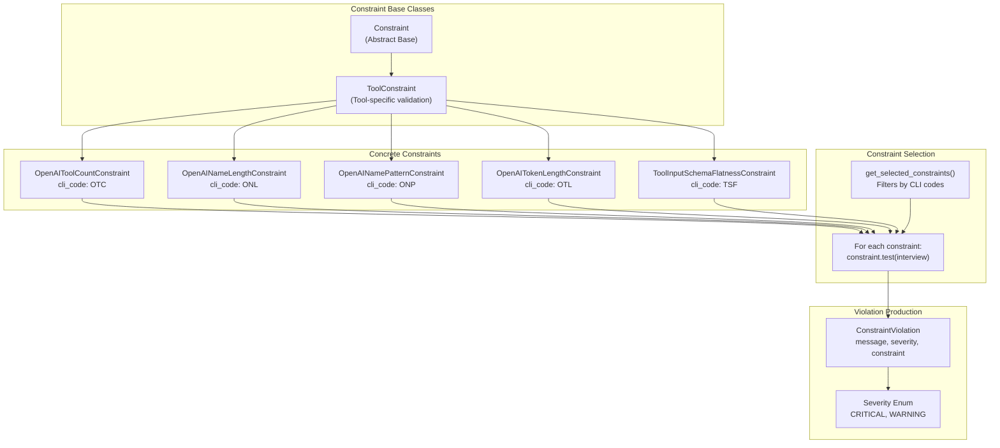
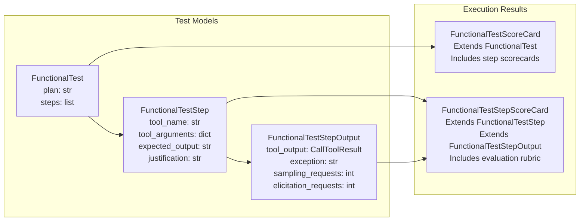
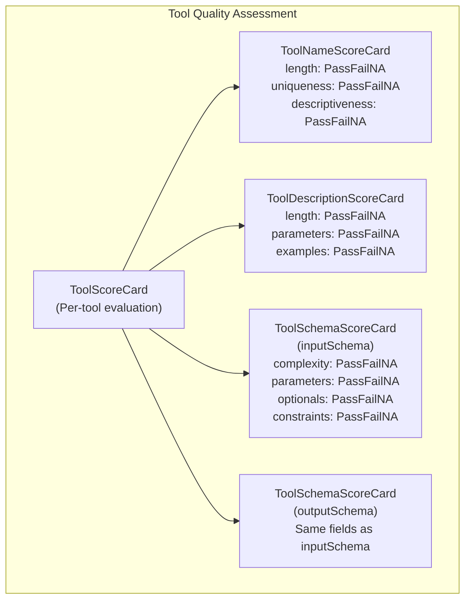
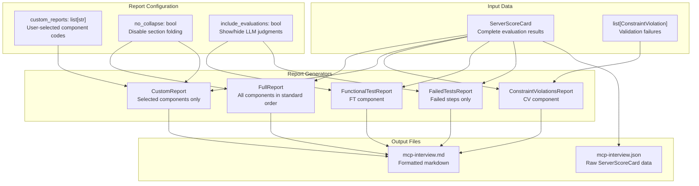

<!-- source: DeepWiki mcp.deepwiki.com · repo microsoft/mcp-interviewer · page 1.1 Key Capabilities · fetched 2026-10-26 -->

# Key Capabilities

Relevant source files

The following files were used as context for generating this wiki page:

- [README.md](README.md)
- [src/mcp_interviewer/constraints/tool_schema_flatness.py](src/mcp_interviewer/constraints/tool_schema_flatness.py)
- [src/mcp_interviewer/models.py](src/mcp_interviewer/models.py)
- [src/mcp_interviewer/reports/functional_test/test_step.py](src/mcp_interviewer/reports/functional_test/test_step.py)
- [src/mcp_interviewer/reports/interviewer/constraint_violations.py](src/mcp_interviewer/reports/interviewer/constraint_violations.py)

This page details the four core capabilities of mcp-interviewer: constraint checking, functional testing, LLM evaluation, and report generation. These capabilities work together to provide comprehensive evaluation of MCP servers. For architectural details on how these capabilities are implemented and orchestrated, see [Core Components](#4.1) and [Interview Execution Flow](#4.2).

---

## Constraint Checking

Constraint checking validates MCP servers against provider-specific requirements and best practices. Constraints can be hard limits (e.g., OpenAI's 128-tool maximum) or recommendations (e.g., flat schemas). The system supports selective constraint execution and produces severity-graded violations.

### Available Constraints

The constraint system is extensible through inheritance from the `Constraint` base class. Currently implemented constraints focus primarily on OpenAI compatibility:

| Code | Name | Severity | Description |
|------|------|----------|-------------|
| `OTC` | OpenAI Tool Count | CRITICAL | Validates ≤128 tools per request |
| `ONL` | OpenAI Name Length | CRITICAL | Validates tool names ≤64 characters |
| `ONP` | OpenAI Name Pattern | CRITICAL | Validates tool names match `[a-zA-Z0-9_-]+` |
| `OTL` | OpenAI Token Length | CRITICAL | Validates tool definitions within token limits |
| `TSF` | Tool Input Schema Flatness | WARNING | Warns against nested objects/arrays in schemas |

Users select constraints via the `--constraints` CLI flag or by passing constraint codes to `get_selected_constraints()`.

**Sources:** [README.md:34-54](), [src/mcp_interviewer/constraints/tool_schema_flatness.py:1-139]()

### Constraint Architecture

**Sources:** [src/mcp_interviewer/constraints/base.py](), [src/mcp_interviewer/constraints/tool_schema_flatness.py:13-38]()

### Violation Reporting

Constraint violations are categorized by severity and affect exit codes:

- **CRITICAL**: Always causes non-zero exit code
- **WARNING**: Causes non-zero exit code only if `--fail-on-warnings` is enabled

The `ConstraintViolationsReport` class aggregates violations by constraint type and generates summary statistics (❌ Errors, ⚠️ Warnings, ✅ Passes). Each violation includes links to source documentation for remediation guidance.

**Sources:** [src/mcp_interviewer/reports/interviewer/constraint_violations.py:1-86]()

---

## Functional Testing

Functional testing exercises MCP server tools through LLM-generated test plans. This capability requires an LLM client and is enabled via the `--test` CLI flag or the `should_run_functional_test` parameter in the Python API.

### Test Generation and Execution

The functional testing system follows a three-phase process:

1. **Test Plan Generation**: The LLM generates a `FunctionalTest` containing a plan description and a list of `FunctionalTestStep` objects
2. **Test Execution**: Each step invokes the specified tool with the provided arguments, collecting outputs and statistics
3. **Test Evaluation**: Optionally, the LLM judges each step against evaluation rubrics

**Sources:** [src/mcp_interviewer/models.py:75-166]()

### MCP Request Handling

During test execution, the server may initiate bidirectional requests to the interviewer:

| Request Type | Handler | Purpose |
|-------------|---------|---------|
| `sampling/createMessage` | Forwards to LLM client | Server requests LLM completion |
| `elicitation/request` | Prompts user for input | Server requests human input |
| `roots/list` | Returns empty list | Server queries root resources |
| `logging/setLevel` | Accepts silently | Server sets logging verbosity |

Request counts are tracked in `FunctionalTestStepOutput` and reported for each test step.

**Sources:** [src/mcp_interviewer/models.py:87-94](), [src/mcp_interviewer/reports/functional_test/test_step.py:170-193]()

### Test Evaluation Rubrics

When `--judge-test` is enabled, each test step is evaluated against seven criteria:

| Criterion | Type | Purpose |
|-----------|------|---------|
| `error_handling` | PassFailNA | Validates error message quality |
| `error_type` | ErrorType | Categorizes error (Authorization, Connection, etc.) |
| `no_silent_error` | PassFailNA | Ensures `isError` flag is set correctly |
| `output_relevance` | PassFailNA | Validates output addresses input |
| `output_quality` | PassFailNA | Validates output accuracy and completeness |
| `schema_compliance` | PassFailNA | Validates output matches declared schema |
| `meets_expectations` | PassFailNA | Compares actual vs. expected output |

**Sources:** [src/mcp_interviewer/models.py:106-121]()

---

## LLM Evaluation

LLM evaluation is an experimental feature that uses an LLM to provide structured quality assessments of server components. This capability requires an LLM client and is controlled by the `--judge`, `--judge-tools`, and `--judge-test` flags.

### Tool Quality Evaluation

When `--judge-tools` is enabled, the LLM evaluates each tool across four dimensions, producing a `ToolScoreCard`:

Each dimension includes multiple criteria that receive pass/fail/N/A scores with accompanying justifications generated by the LLM.

**Sources:** [src/mcp_interviewer/models.py:34-73]()

### Test Execution Evaluation

When `--judge-test` is enabled, the LLM evaluates both individual test steps (via `FunctionalTestStepEvaluationRubric`) and the overall test plan (via `FunctionalTestEvaluationRubric`). The step-level evaluation examines error handling, output quality, and expectation matching. The plan-level evaluation provides an overall assessment of whether the test suite adequately exercises server capabilities.

**Sources:** [src/mcp_interviewer/models.py:106-166]()

### Model Configuration

The LLM client can be configured in multiple ways:

1. **Default OpenAI**: Use `OpenAI()` with API key from environment
2. **Custom kwargs**: Use `--client-kwargs` to pass constructor arguments (e.g., `base_url`, `api_key` for Ollama)
3. **Custom client**: Use `--client` to import a custom factory function that returns an OpenAI-compatible client

The model name is specified via the `--model` flag and used in structured output generation.

**Sources:** [README.md:196-234]()

---

## Report Generation

Report generation produces human-readable Markdown and machine-readable JSON outputs summarizing all evaluation results. The system provides both comprehensive and customizable reporting options.

### Report Components

Ten distinct report components can be included in any combination:

| Code | Component | Content |
|------|-----------|---------|
| `II` | Interviewer Info | Model name, parameters, timestamp |
| `SI` | Server Info | Server name, version, protocol version, capabilities |
| `CAP` | Capability Assessment | Supported features (tools, resources, prompts, sampling, etc.) |
| `TS` | Tool Statistics | Tool counts, naming patterns, parameter statistics |
| `TCS` | Tool Call Statistics | Performance metrics from test execution |
| `FT` | Functional Tests | Test plan, steps, outputs, evaluations |
| `CV` | Constraint Violations | Error/warning/pass summary by constraint |
| `T` | Tools | Complete tool schemas with descriptions |
| `R` | Resources | Available resources with URIs and descriptions |
| `P` | Prompts | Available prompts with arguments |

**Sources:** [README.md:67-91]()

### Report Types

**Sources:** [src/mcp_interviewer/reports/interviewer/constraint_violations.py:9-86](), [src/mcp_interviewer/reports/functional_test/test_step.py:14-305]()

### Report Customization

Users customize reports via the `--reports` CLI flag or the `custom_reports` parameter. The `FullReport` class includes all components in a standardized order, while `CustomReport` allows arbitrary selection. Additional flags control verbosity:

- `--no-collapse`: Disables collapsible sections in Markdown output
- `--include-evaluations`: Shows/hides LLM-generated scores and justifications

The JSON output always contains the complete `ServerScoreCard` regardless of Markdown customization, enabling programmatic access to all evaluation data.

**Sources:** [README.md:72-91](), [src/mcp_interviewer/models.py:206-210]()

---

