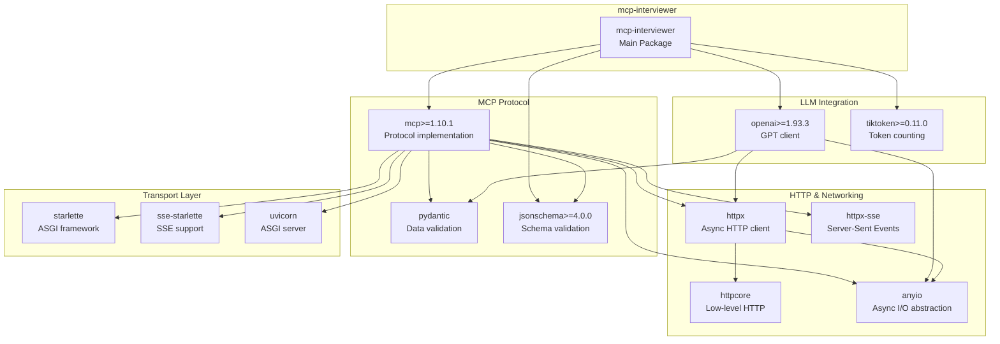
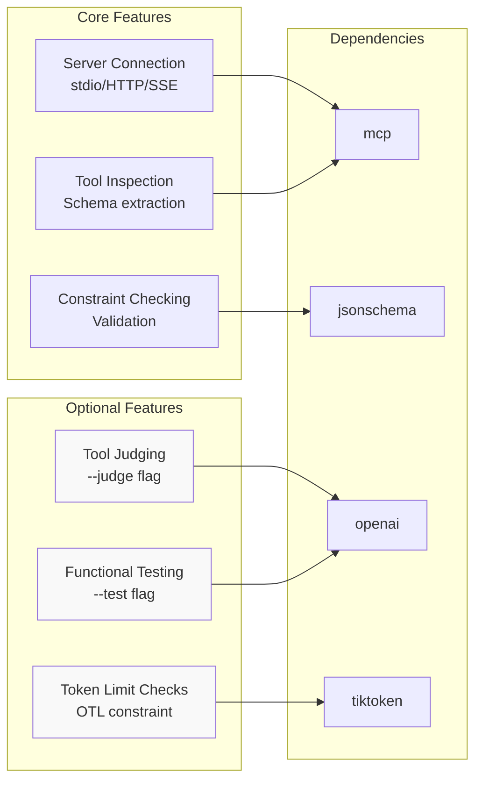
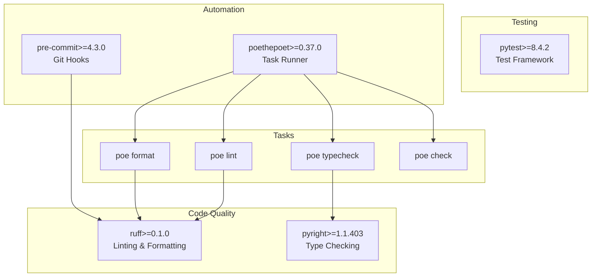
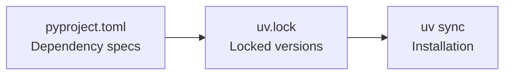
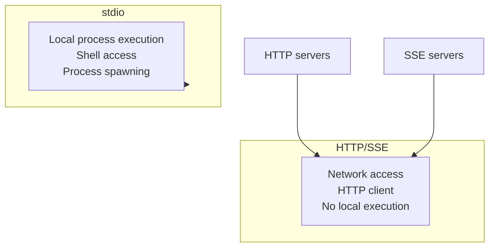
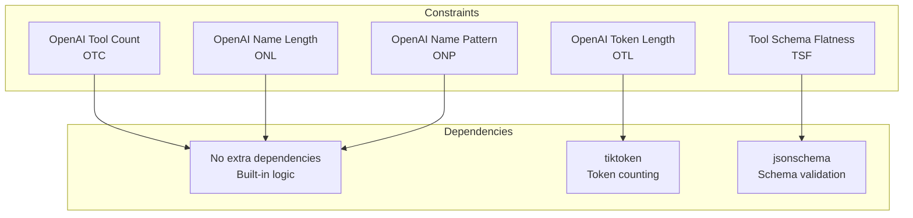

<!-- source: DeepWiki mcp.deepwiki.com · repo microsoft/mcp-interviewer · page 1.2 System Requirements · fetched 2026-10-26 -->

# System Requirements

<details>
<summary>Relevant source files</summary>

The following files were used as context for generating this wiki page:

- [.pre-commit-config.yaml](.pre-commit-config.yaml)
- [.python-version](.python-version)
- [pyproject.toml](pyproject.toml)
- [tests/constraints/test_tool_schema_flatness.py](tests/constraints/test_tool_schema_flatness.py)
- [uv.lock](uv.lock)

</details>


This document specifies the technical prerequisites for running and developing mcp-interviewer. It covers Python version requirements, runtime dependencies, optional features, and development tools. For installation instructions and setup procedures, see [Installation](#2.1).

---

## Python Version Requirements

mcp-interviewer requires **Python 3.11 or higher**. This minimum version is enforced at the package level and enables critical language features used throughout the codebase.

| Requirement | Specification | Location |
|-------------|---------------|----------|
| Minimum Python | `>=3.11` | [pyproject.toml:6]() |
| Development Python | `3.13` | [.python-version:1]() |
| Target Version (Ruff) | `py311` | [pyproject.toml:50]() |

**Rationale**: Python 3.11 provides:
- PEP 654 exception groups used in error handling
- Performance improvements for async operations (critical for MCP client interactions)
- Enhanced type hints used extensively with Pydantic models
- Structural pattern matching for constraint checking logic

Sources: [pyproject.toml:6](), [.python-version:1](), [pyproject.toml:50]()

---

## Runtime Dependencies

### Core Dependencies



### Dependency Details

| Package | Version | Purpose | Used By |
|---------|---------|---------|---------|
| `mcp` | `>=1.10.1` | MCP protocol client/server implementation | Core interviewing logic, server connections |
| `openai` | `>=1.93.3` | OpenAI API client for GPT models | Tool judging, functional test generation |
| `tiktoken` | `>=0.11.0` | Token counting for OpenAI models | Token limit constraint checking |
| `jsonschema` | `>=4.0.0` | JSON schema validation | Schema flatness constraint, validation |

Sources: [pyproject.toml:7-12](), [pyproject.toml:353-358]()

---

## Feature-Dependency Mapping

The following diagram maps system features to their required dependencies:



**Key Points**:
- **Core features** (server connection, inspection, constraint checking) work without OpenAI API credentials
- **LLM features** (`--judge` and `--test` flags) require valid OpenAI API key and credits
- **Token counting** (`tiktoken`) is only needed when running OpenAI token limit constraints

Sources: [pyproject.toml:7-12]()

---

## Development Dependencies

Development dependencies are defined in the `dev` dependency group and are required for contributing to the project:



| Tool | Version | Purpose | Invocation |
|------|---------|---------|------------|
| `ruff` | `>=0.1.0` | Fast Python linter and formatter | `poe format`, `poe lint` |
| `pyright` | `>=1.1.403` | Static type checker | `poe typecheck` |
| `poethepoet` | `>=0.37.0` | Task automation | `poe <task>` |
| `pre-commit` | `>=4.3.0` | Git hook management | Automatic on commit |
| `pytest` | `>=8.4.2` | Test framework | Test execution |

**Installation**: Install all development dependencies with:
```bash
pip install -e ".[dev]"
```

Sources: [pyproject.toml:14-21](), [pyproject.toml:360-367](), [pyproject.toml:55-64]()

---

## Dependency Management

### uv Lock File

mcp-interviewer uses `uv` as its package manager with a lock file for reproducible builds:



| File | Purpose | Updates |
|------|---------|---------|
| [pyproject.toml]() | Dependency specifications with version constraints | Manual |
| [uv.lock:1-3]() | Exact resolved versions with hashes | Via `uv lock` |

**Lock file format**: The lock file specifies `requires-python = ">=3.11"` and contains full dependency resolution with SHA-256 checksums for security.

Sources: [uv.lock:1-3]()

---

## Platform Compatibility

mcp-interviewer supports all major platforms through its dependencies:

### Supported Platforms

| Platform | Architecture | Status | Notes |
|----------|-------------|--------|-------|
| **Linux** | x86_64 | ✅ Full support | Primary CI platform |
| Linux | aarch64 | ✅ Full support | ARM64 support |
| Linux | i686 | ✅ Full support | 32-bit support |
| **macOS** | x86_64 | ✅ Full support | Intel Macs |
| **macOS** | arm64 | ✅ Full support | Apple Silicon |
| **Windows** | amd64 | ✅ Full support | 64-bit Windows |
| Windows | win32 | ✅ Full support | 32-bit Windows |

**Evidence**: The [uv.lock]() file contains pre-built wheels for all these platforms across multiple packages (e.g., `jiter`, `charset-normalizer`, `httpcore`).

### MCP Server Connection Types

Different connection types have different system requirements:



**stdio**: Requires ability to spawn local processes (e.g., `npx`, `python`, Docker commands)
**HTTP/SSE**: Only requires network access, no local process execution needed

Sources: [uv.lock]() (platform wheels evidence)

---

## Build System Requirements

For building from source or developing:

| Component | Requirement | Purpose |
|-----------|-------------|---------|
| Build backend | `hatchling` | Package building |
| Build dependencies | None beyond hatchling | Minimal build requirements |
| Python environment | `>=3.11` | Build-time Python |

Sources: [pyproject.toml:26-28]()

---

## Hardware Requirements

mcp-interviewer has minimal hardware requirements:

| Resource | Minimum | Recommended | Notes |
|----------|---------|-------------|-------|
| **RAM** | 512 MB | 2 GB | Higher for LLM features |
| **Disk** | 100 MB | 500 MB | Includes dependencies |
| **CPU** | 1 core | 2+ cores | For concurrent operations |
| **Network** | - | Required | For OpenAI API, HTTP/SSE servers |

**LLM Operations**: When using `--judge` or `--test` flags:
- Network bandwidth for OpenAI API calls (typically <1 MB per request)
- Additional memory for token processing (typically <100 MB)
- No GPU required (inference is cloud-based)

Sources: General system knowledge, not code-specific

---

## Optional External Dependencies

### OpenAI API Access

| Feature | Required | Configuration |
|---------|----------|---------------|
| Tool judging (`--judge`) | OpenAI API key | `OPENAI_API_KEY` env var |
| Functional testing (`--test`) | OpenAI API key | `OPENAI_API_KEY` env var |
| Constraint checking | Not required | - |
| Server inspection | Not required | - |

**API Key Setup**:
```bash
export OPENAI_API_KEY="sk-..."
```

The system will fail gracefully with clear error messages if API key is missing when LLM features are requested.

### MCP Server Under Test

The target MCP server being interviewed may have its own dependencies:
- For **stdio servers**: May require Node.js, Python, Docker, or other runtimes
- For **HTTP/SSE servers**: Server must be running and accessible

Sources: Context from architecture diagrams

---

## Constraint-Specific Dependencies

Different constraint types have different dependency requirements:



Sources: [tests/constraints/test_tool_schema_flatness.py]() (constraint test file showing jsonschema usage)

---

