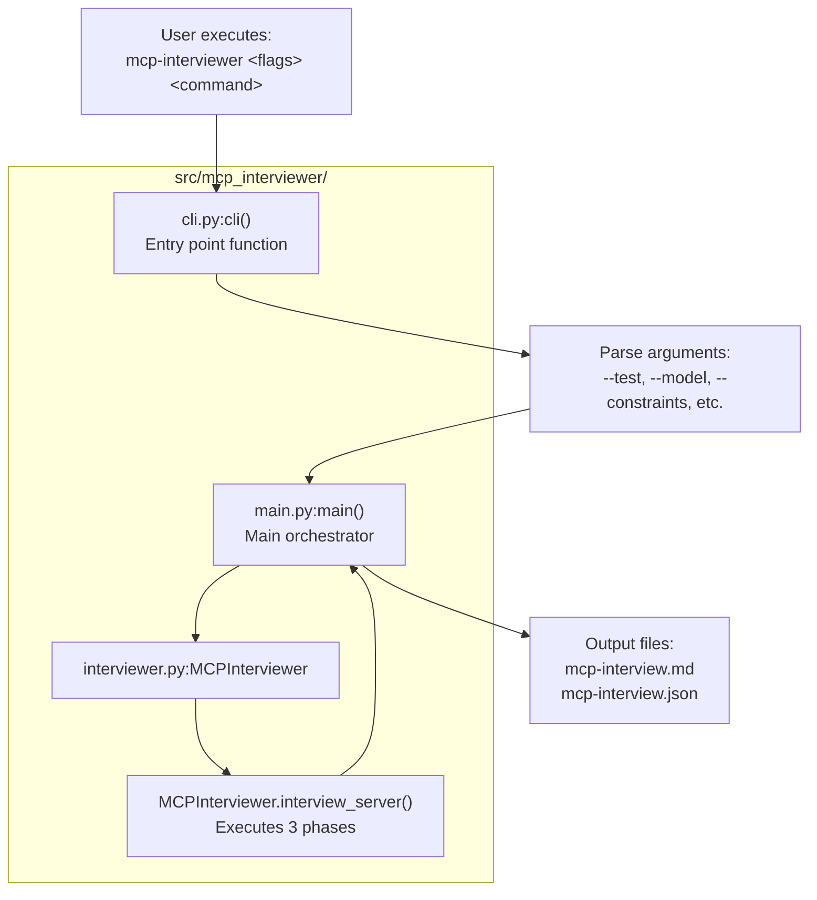
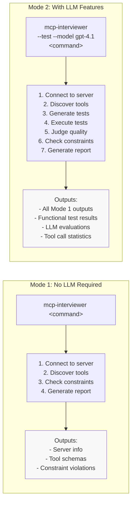
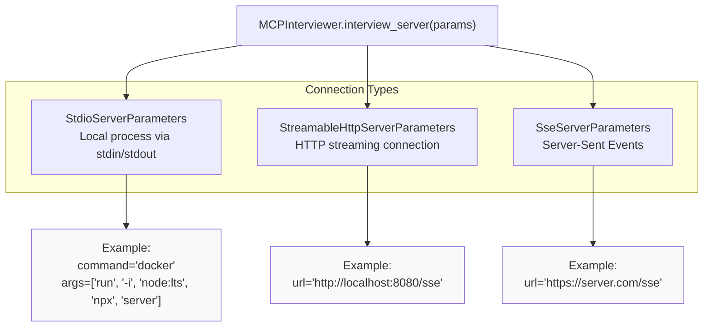

<!-- source: DeepWiki mcp.deepwiki.com · repo microsoft/mcp-interviewer · page 2 Getting Started · fetched 2026-10-26 -->

# Getting Started

<details>
<summary>Relevant source files</summary>

The following files were used as context for generating this wiki page:

- [.pre-commit-config.yaml](.pre-commit-config.yaml)
- [README.md](README.md)
- [pyproject.toml](pyproject.toml)

</details>


This page provides installation instructions and basic usage patterns to get mcp-interviewer running quickly. It covers both CLI and Python API usage, demonstrates the core workflows, and explains the outputs you'll receive.

For detailed installation instructions including dependency management, see [Installation](#2.1). For a comprehensive walkthrough of a basic example, see [Quick Start Guide](#2.2).

---

## Prerequisites

mcp-interviewer requires Python 3.11 or higher. The system has four core dependencies that are automatically installed:

| Dependency | Minimum Version | Purpose |
|------------|----------------|---------|
| `mcp` | 1.10.1 | MCP server communication |
| `openai` | 1.93.3 | LLM integration (optional features) |
| `tiktoken` | 0.11.0 | Token counting for constraints |
| `jsonschema` | 4.0.0 | Schema validation |

**Sources:** [pyproject.toml:6-12]()

---

## Installation Overview

mcp-interviewer can be installed as a standalone CLI tool or as a Python library dependency.

### CLI Tool Installation

```bash
pip install mcp-interviewer
```

This installs the `mcp-interviewer` command globally, making it available from any terminal:

```bash
mcp-interviewer <server-command>
```

### Python Library Installation

```bash
# Using uv (recommended)
uv add mcp-interviewer

# Using pip
pip install mcp-interviewer
```

This allows you to import and use mcp-interviewer programmatically in your Python code.

For detailed installation instructions including container setups and virtual environments, see [Installation](#2.1).

**Sources:** [README.md:93-120](), [pyproject.toml:23-24]()

---

## Command Execution Flow

The following diagram shows how a user command flows through the codebase to produce results:



**Sources:** [pyproject.toml:23-24](), [README.md:164-194]()

---

## Basic Usage Patterns

mcp-interviewer operates in two primary modes based on whether you provide an LLM client:

### Mode 1: Constraint Checking Only (No LLM Required)

This mode performs server inspection and constraint validation without requiring an OpenAI API key or model:

```bash
mcp-interviewer "docker run -i --rm node:lts npx -y @modelcontextprotocol/server-everything"
```

**What it does:**
- Connects to the MCP server
- Discovers available tools, resources, and prompts
- Validates against OpenAI constraints (tool count, naming, token limits)
- Generates reports

**Outputs:** `mcp-interview.md`, `mcp-interview.json`

### Mode 2: Full Evaluation (LLM Required)

This mode adds functional testing and LLM-based evaluation:

```bash
mcp-interviewer --test --model gpt-4.1 "docker run -i --rm node:lts npx -y @modelcontextprotocol/server-everything"
```

**What it adds:**
- `--test`: Generates and executes functional tests
- `--judge-tools`: LLM evaluates tool quality
- `--judge-test`: LLM evaluates test results

**Outputs:** Same files with additional test results and LLM evaluations

**Sources:** [README.md:122-149](), [README.md:164-194]()

---

## Usage Mode Comparison



**Sources:** [README.md:32-92](), [README.md:152-194]()

---

## CLI Usage

The CLI entry point is defined in [pyproject.toml:23-24]() as `mcp_interviewer.cli:cli`. The most commonly used flags are:

| Flag | Purpose | Requires `--model` |
|------|---------|-------------------|
| `--test` | Enable functional testing | ✓ |
| `--judge` | Enable all LLM evaluation | ✓ |
| `--judge-tools` | Evaluate tool quality only | ✓ |
| `--judge-test` | Evaluate test results only | ✓ (and `--test`) |
| `--constraints [CODE ...]` | Select specific constraints | ✗ |
| `--reports [CODE ...]` | Select report sections | ✗ |
| `--fail-on-warnings` | Fail CI on warnings | ✗ |

### Examples

```bash
# Basic inspection and constraint checking
mcp-interviewer "uvx mcp-server-fetch"

# Add functional testing
mcp-interviewer --test --model gpt-4.1 "uvx mcp-server-fetch"

# Custom constraints and reports
mcp-interviewer --constraints OTC ONL --reports SI TS CV "uvx mcp-server-fetch"

# CI/CD mode - fail on warnings
mcp-interviewer --fail-on-warnings "uvx mcp-server-fetch"
```

For complete CLI reference, see [CLI Usage](#3.1).

**Sources:** [README.md:152-194]()

---

## Python API Usage

The Python API provides two main entry points: the `MCPInterviewer` class for core functionality and the `main()` function for the complete workflow including report generation.

### Using MCPInterviewer Class

```python
from mcp_interviewer import MCPInterviewer, StdioServerParameters

# Define server parameters
params = StdioServerParameters(
    command="docker",
    args=["run", "-i", "--rm", "node:lts", "npx", "-y", "@modelcontextprotocol/server-everything"]
)

# Mode 1: No LLM required
interviewer = MCPInterviewer(client=None, model=None)
interview = await interviewer.interview_server(params)

# Mode 2: With LLM features
from openai import OpenAI
client = OpenAI()
interviewer = MCPInterviewer(
    client=client,
    model="gpt-4.1",
    should_run_functional_test=True
)
interview = await interviewer.interview_server(params)
```

### Using main() Function

The `main()` function includes constraint checking and report generation:

```python
from mcp_interviewer import main, StdioServerParameters

params = StdioServerParameters(
    command="docker",
    args=["run", "-i", "--rm", "node:lts", "npx", "-y", "@modelcontextprotocol/server-everything"]
)

# Returns exit code: 0 = success, 1 = constraint violations
exit_code = main(client=None, model=None, params=params)

# With LLM features
from openai import OpenAI
exit_code = main(
    client=OpenAI(),
    model="gpt-4.1",
    params=params,
    should_run_functional_test=True
)
```

For detailed Python API documentation, see [Python API](#3.2).

**Sources:** [README.md:236-287]()

---

## Connection Types

mcp-interviewer supports three connection types for communicating with MCP servers:



For detailed information on each connection type and when to use them, see [Server Connection Types](#3.3).

**Sources:** [README.md:240-287]()

---

## Output Files

Every interview generates two files in the current directory:

| File | Format | Purpose |
|------|--------|---------|
| `mcp-interview.md` | Markdown | Human-readable report with sections, tables, and collapsible details |
| `mcp-interview.json` | JSON | Machine-readable data with complete `ServerScoreCard` structure |

### Report Sections

The Markdown report includes these sections (customizable via `--reports`):

| Code | Section | Content |
|------|---------|---------|
| `II` | Interviewer Info | Model and parameters used |
| `SI` | Server Info | Name, version, capabilities |
| `CAP` | Capabilities | Supported MCP features |
| `TS` | Tool Statistics | Tool counts and patterns |
| `TCS` | Tool Call Statistics | Performance metrics from tests |
| `FT` | Functional Tests | Test execution results |
| `CV` | Constraint Violations | Errors and warnings |
| `T` | Tools | Detailed tool schemas |
| `R` | Resources | Available resources |
| `P` | Prompts | Available prompts |

For complete report documentation, see [Understanding Reports](#3.7).

**Sources:** [README.md:67-92]()

---

## Security Considerations

⚠️ **Important:** mcp-interviewer executes the provided server command in a child process. Always run MCP servers in isolated containers to protect your host system:

```bash
# ✓ Good - runs in Docker container
mcp-interviewer "docker run -i --rm node:lts npx -y @modelcontextprotocol/server-everything"

# ✓ Good - runs in container via uvx
mcp-interviewer "docker run -i --rm ghcr.io/astral-sh/uv:python3.12-alpine uvx mcp-server-fetch"

# ✗ Risky - runs directly on host
mcp-interviewer "npx -y @modelcontextprotocol/server-everything"
```

When using `--test`, the interviewer will invoke the server's tools, which may perform file operations, network requests, or other actions. Always review the server's capabilities before enabling functional testing.

**Sources:** [README.md:122-124](), [README.md:289-295]()

---

## Next Steps

Now that you understand the basics:

1. See [Quick Start Guide](#2.2) for a complete walkthrough of a basic example
2. Explore [CLI Usage](#3.1) for all available command-line options
3. Learn about [Constraint Checking](#3.4) to understand validation rules
4. Review [Functional Testing](#3.5) to use LLM-based testing effectively
5. Read [Understanding Reports](#3.7) to interpret your results

**Sources:** [README.md:1-305]()

---

