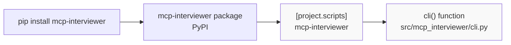
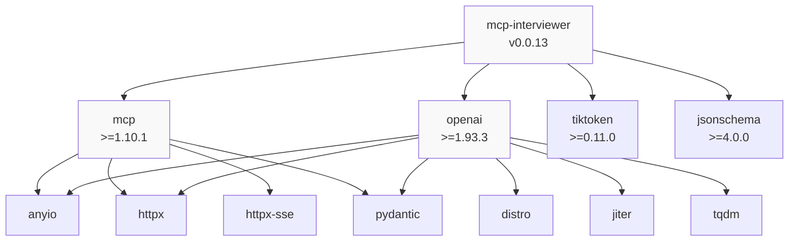
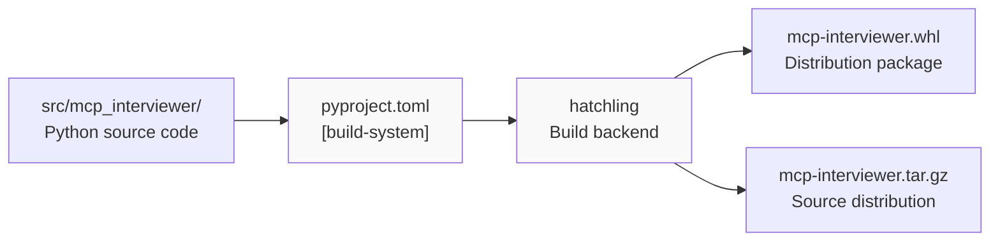

<!-- source: DeepWiki mcp.deepwiki.com · repo microsoft/mcp-interviewer · page 2.1 Installation · fetched 2026-10-26 -->

# Installation

<details>
<summary>Relevant source files</summary>

The following files were used as context for generating this wiki page:

- [.pre-commit-config.yaml](.pre-commit-config.yaml)
- [README.md](README.md)
- [pyproject.toml](pyproject.toml)
- [tests/constraints/test_tool_schema_flatness.py](tests/constraints/test_tool_schema_flatness.py)
- [uv.lock](uv.lock)

</details>


This page provides instructions for installing mcp-interviewer on your system. It covers the required Python version, installation methods for both CLI and library usage, and verification steps.

For information about basic usage after installation, see [Quick Start Guide](#2.2). For comprehensive configuration options, see [CLI Usage](#3.1) and [Python API](#3.2).

---

## System Requirements

mcp-interviewer requires Python 3.11 or higher.

**Python Version Constraint**: The package specifies `requires-python = ">=3.11"` in its configuration.

**Platform Support**: The tool runs on any platform that supports Python 3.11+, including Linux, macOS, and Windows.

Sources: [pyproject.toml:6]()

---

## Installation as CLI Tool

To install mcp-interviewer as a command-line tool, use pip:

```bash
pip install mcp-interviewer
```

This makes the `mcp-interviewer` command available globally in your shell.

### CLI Entry Point Configuration



The CLI command is configured via the `[project.scripts]` section in pyproject.toml, which maps the `mcp-interviewer` command to the `cli()` function in the `cli` module.

Sources: [pyproject.toml:23-24](), [README.md:95-104]()

---

## Installation as Python Dependency

### Using pip

Add mcp-interviewer to your project:

```bash
pip install mcp-interviewer
```

This allows you to import and use the library in your Python code:

```python
from mcp_interviewer import MCPInterviewer, StdioServerParameters
```

### Using uv

For projects using the [uv](https://github.com/astral-sh/uv) package manager:

```bash
uv add mcp-interviewer
```

The uv package manager provides faster installation and better dependency resolution. The project itself uses uv for development, as evidenced by the presence of `uv.lock`.

Sources: [README.md:106-120](), [uv.lock:1-4]()

---

## Verifying Installation

After installation, verify that mcp-interviewer is accessible:

### CLI Verification

```bash
mcp-interviewer --help
```

This should display usage information for the command-line interface.

### Python Module Verification

```python
import mcp_interviewer
print(mcp_interviewer.__name__)
```

This verifies that the package can be imported in Python.

Sources: [pyproject.toml:23-24]()

---

## Dependency Overview

### Installation Dependency Tree



### Core Dependencies

The table below shows the direct dependencies specified in `pyproject.toml`:

| Dependency | Minimum Version | Purpose |
|------------|----------------|---------|
| `mcp` | 1.10.1 | MCP protocol implementation for connecting to servers |
| `openai` | 1.93.3 | OpenAI API client for LLM evaluation features |
| `tiktoken` | 0.11.0 | Token counting for OpenAI constraints |
| `jsonschema` | 4.0.0 | JSON schema validation for tool schemas |

### Transitive Dependencies

The `mcp` and `openai` packages bring in their own dependencies:

- **anyio**: Async I/O library used by both mcp and openai
- **httpx**: HTTP client for MCP's HTTP transport and OpenAI API calls
- **httpx-sse**: Server-Sent Events support for MCP's SSE transport
- **pydantic**: Data validation and settings management used by mcp
- **distro**: Linux distribution detection for OpenAI client
- **jiter**: Fast JSON parsing for OpenAI client
- **tqdm**: Progress bars for OpenAI file operations

### Development Dependencies

Development dependencies are specified in the `[dependency-groups]` section:

| Dependency | Minimum Version | Purpose |
|------------|----------------|---------|
| `ruff` | 0.1.0 | Linting and formatting |
| `pre-commit` | 4.3.0 | Git hook management |
| `pyright` | 1.1.403 | Static type checking |
| `poethepoet` | 0.37.0 | Task runner |
| `pytest` | 8.4.2 | Testing framework |

Development dependencies are not installed by default. To install them for development work, see [Development Workflow](#5.2).

Sources: [pyproject.toml:7-12](), [pyproject.toml:14-21](), [uv.lock:1-3]()

---

## Build System

### Package Build Configuration



The package uses **hatchling** as its build backend, specified in the `[build-system]` section. When you install via pip, the following process occurs:

1. pip downloads the source distribution or wheel from PyPI
2. If building from source, hatchling creates the wheel
3. The wheel is installed into your Python environment
4. The CLI entry point is registered in your shell's PATH

### Package Structure

The build configuration specifies:

- **Package location**: `src/mcp_interviewer` (defined in `[tool.hatch.build.targets.wheel]`)
- **Included files**: Source code, LICENSE, README.md
- **Excluded files**: Cache files, bytecode (`.pyc`, `.pyo`), `.DS_Store`

Sources: [pyproject.toml:26-44]()

---

## Lock File

The repository includes a `uv.lock` file that pins all transitive dependencies to specific versions. This ensures reproducible installations across different environments.

**Lock file format**: The file uses uv's lock format version 1, revision 3.

**When the lock file is used**:
- During development with `uv`
- In CI/CD pipelines
- When contributors set up their development environment

**When the lock file is NOT used**:
- When end users install via `pip install mcp-interviewer`
- When the package is used as a dependency in other projects

End users get the versions specified by the minimum version constraints in `pyproject.toml`, not the locked versions.

Sources: [uv.lock:1-3](), [pyproject.toml:7-12]()

---

