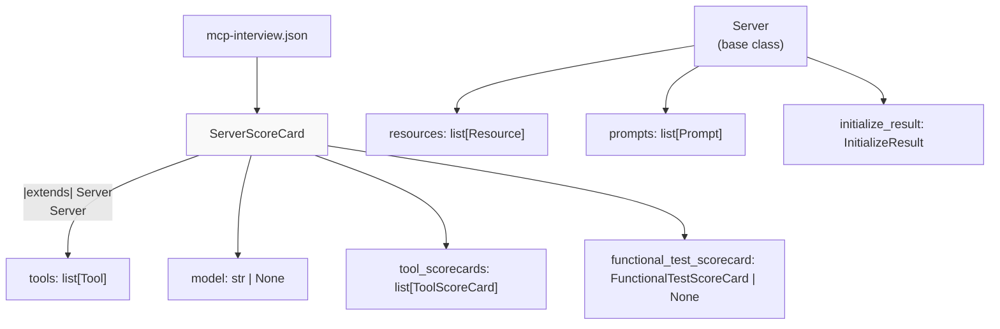

<!-- source: DeepWiki mcp.deepwiki.com · repo microsoft/mcp-interviewer · page 2.2 Quick Start Guide · fetched 2026-10-26 -->

# Quick Start Guide

<details>
<summary>Relevant source files</summary>

The following files were used as context for generating this wiki page:

- [README.md](README.md)
- [mcp-interview.md](mcp-interview.md)
- [src/mcp_interviewer/cli.py](src/mcp_interviewer/cli.py)

</details>


This guide walks through the simplest use cases for interviewing an MCP server. It demonstrates basic server inspection and constraint checking without requiring an LLM, then shows how to add functional testing. For detailed information about all CLI options, see [CLI Usage](#3.1). For Python API usage, see [Python API](#3.2).

**Prerequisites:** Ensure you have installed mcp-interviewer as described in [Installation](#2.1).

## Basic Server Interview (No LLM Required)

The simplest way to use mcp-interviewer requires no LLM configuration. This mode performs server inspection and constraint checking only.

### Command Structure

```bash
mcp-interviewer <server_command>
```

The `<server_command>` can be:
- A local command to execute via stdio (e.g., `npx -y @modelcontextprotocol/server-everything`)
- A URL for remote server connection (e.g., `https://my-mcp-server.com/sse`)

### Safety Recommendation

⚠️ **Important:** mcp-interviewer executes the provided command in a child process. Always run MCP servers in isolated containers to protect your host system.

```bash
# Define a container command for safe execution
NPX_CONTAINER="docker run -i --rm node:lts npx"

# Interview the MCP reference server
mcp-interviewer "$NPX_CONTAINER -y @modelcontextprotocol/server-everything"
```

Sources: [README.md:122-138](), [cli.py:8-11]()

### Execution Flow

```mermaid
sequenceDiagram
    participant User
    participant CLI["cli()<br/>cli.py"]
    participant Main["main()<br/>main.py"]
    participant Interviewer["MCPInterviewer<br/>interviewer.py"]
    participant Server["MCP Server"]
    participant Constraints["Constraint System"]
    participant Reports["Report Generator"]
    
    User->>CLI: "mcp-interviewer $NPX_CONTAINER ..."
    CLI->>CLI: "Parse server_params"
    CLI->>CLI: "Create StdioServerParameters"
    
    Note over CLI: "No --model provided, client=None"
    
    CLI->>Main: "main(client=None, model=None, params)"
    Main->>Interviewer: "MCPInterviewer(None, None)"
    Main->>Interviewer: "interview_server(params)"
    
    Interviewer->>Server: "Connect via stdio"
    Server-->>Interviewer: "InitializeResult<br/>(tools, resources, prompts)"
    
    Note over Interviewer: "Skip LLM features<br/>(no client provided)"
    
    Interviewer-->>Main: "ServerScoreCard"
    Main->>Constraints: "get_selected_constraints()"
    Main->>Constraints: "test(scorecard)"
    Constraints-->>Main: "List[ConstraintViolation]"
    
    Main->>Reports: "generate_report(scorecard, violations)"
    Reports-->>Main: "mcp-interview.md<br/>mcp-interview.json"
    
    Main-->>CLI: "exit_code (0 or 1)"
    CLI-->>User: "Exit with code"
```

Sources: [cli.py:95-218](), [src/mcp_interviewer/main.py]()

### What Happens During Basic Interview

| Phase | Description | Requires LLM |
|-------|-------------|--------------|
| **1. Server Connection** | Establishes connection via `StdioServerParameters`, `StreamableHttpServerParameters`, or `SseServerParameters` | ❌ |
| **2. Server Inspection** | Calls `initialize()` on the server, retrieves tools, resources, prompts, and capabilities | ❌ |
| **3. Constraint Checking** | Validates against all enabled constraints (OpenAI limits, schema flatness, etc.) | ❌ |
| **4. Report Generation** | Creates `mcp-interview.md` (Markdown) and `mcp-interview.json` (structured data) | ❌ |

Sources: [README.md:32-55]()

## Understanding the Output

The interview generates two files in the current directory (or path specified by `--out-dir`):

### File: mcp-interview.md

Human-readable Markdown report containing:

| Section | Content |
|---------|---------|
| **Server Information** | Name, version, protocol version, instructions |
| **Interviewer Parameters** | Model used (if any), CLI command, launch parameters |
| **Server Capabilities** | Tools, resources, prompts, logging support with counts |
| **Tool Statistics** | Schema lengths, parameter counts, max depth metrics |
| **Constraint Violations** | Pass/fail/warning status for each constraint |
| **Tools** | Detailed schemas for each tool (input/output) |
| **Resources** | List of available resources with URIs and MIME types |
| **Prompts** | Available prompts with argument specifications |

Sources: [mcp-interview.md:1-72]()

### File: mcp-interview.json

Machine-readable JSON containing the complete `ServerScoreCard` structure:



Sources: [src/mcp_interviewer/models.py]()

### Example: Inspecting Constraint Results

```bash
# View constraint violations summary
grep "Constraint Violations" -A 5 mcp-interview.md

# Output shows:
# | ❌ Errors | ⚠️ Warnings | ✅ Passes |
# | --- | --- | --- |
# | 0 | 0 | 5 |
```

Sources: [mcp-interview.md:109-128]()

## Adding Functional Testing

To execute actual tool calls and test server functionality, add the `--test` flag. This requires an LLM model.

### Command with Testing

```bash
mcp-interviewer --test --model gpt-4.1 "$NPX_CONTAINER -y @modelcontextprotocol/server-everything"
```

### Risk Acceptance

When `--test` is enabled, the tool prompts for risk acceptance:

```
🚨 MCP Interviewer will make tool call requests to your MCP server. 
   Depending on the server's capabilities this can lead to 
   irreversible outcomes (e.g. deleting files).
Do you accept this risk? (y|[n]): 
```

Bypass this prompt in automated scenarios with `--accept-risk`.

Sources: [cli.py:163-173]()

### Functional Testing Flow

```mermaid
sequenceDiagram
    participant CLI
    participant Interviewer["MCPInterviewer<br/>(should_run_functional_test=True)"]
    participant LLM["LLM Client<br/>(OpenAI-compatible)"]
    participant Server["MCP Server"]
    
    Note over CLI: "User provided --test --model gpt-4.1"
    
    CLI->>Interviewer: "interview_server(params)"
    
    Note over Interviewer: "Phase 1: Inspection complete"
    
    Interviewer->>LLM: "generate_functional_test(server_info)"
    LLM-->>Interviewer: "FunctionalTest<br/>(plan + steps)"
    
    loop "For each FunctionalTestStep"
        Interviewer->>Server: "tools/call<br/>{tool_name, arguments}"
        Server-->>Interviewer: "CallToolResult"
        
        opt "Server requests sampling"
            Server->>Interviewer: "sampling/createMessage"
            Interviewer->>LLM: "Forward request"
            LLM-->>Interviewer: "Response"
            Interviewer->>Server: "Return sample"
        end
        
        opt "Server requests user input"
            Server->>Interviewer: "elicitation/request"
            Interviewer->>CLI: "Prompt user"
            CLI-->>Interviewer: "User response"
            Interviewer->>Server: "Return elicitation"
        end
    end
    
    Interviewer-->>CLI: "ServerScoreCard with FunctionalTestScoreCard"
```

Sources: [cli.py:152-161]()

### Key Components Involved

| Component | File | Role |
|-----------|------|------|
| `MCPInterviewer` | [src/mcp_interviewer/interviewer.py]() | Orchestrates test execution |
| `FunctionalTest` | [src/mcp_interviewer/models.py]() | Contains test plan and steps |
| `FunctionalTestStep` | [src/mcp_interviewer/models.py]() | Individual tool call with expected output |
| `FunctionalTestStepOutput` | [src/mcp_interviewer/models.py]() | Actual results including exceptions, request counts |
| `FunctionalTestScoreCard` | [src/mcp_interviewer/models.py]() | Complete test results with step evaluations |

Sources: [src/mcp_interviewer/models.py]()

### Functional Test Report Sections

The report includes additional sections when `--test` is enabled:

| Section | Description |
|---------|-------------|
| **Tool Call Statistics** | Counts of attempted calls, errors, output lengths, content block types |
| **Functional Test Results** | Step-by-step execution logs with reasoning, expected vs actual output |
| **MCP Requests** | Counts of sampling requests, elicitation requests, logging requests per step |

Example output structure:

```
## Tool Call Statistics
- Tool calls attempted: 20
- Tool calls returned output: 20
- Sampling requests: 2
- Elicitation requests: 1

## Functional Test Results
### Step 1: echo ✅
**Reasoning (🤖):** Echo is a foundational tool...
**Tool Call (🤖):** {"message": "Hello, MCP!"}
**Expected Output (🤖):** Should return the exact message...
**Actual Output:** Echo: Hello, MCP!
```

Sources: [mcp-interview.md:92-942]()

## Next Steps

### Customize Constraint Checking

```bash
# Check only OpenAI constraints
mcp-interviewer --constraints OA "$NPX_CONTAINER ..."

# Check specific constraints
mcp-interviewer --constraints OTC ONL "$NPX_CONTAINER ..."
```

Sources: [cli.py:75-78](), [README.md:186-187]()

### Customize Report Sections

```bash
# Include only specific report sections
mcp-interviewer --reports SI TS CV "$NPX_CONTAINER ..."

# Available codes: II, SI, CAP, TS, TCS, FT, CV, T, R, RT, P
```

Sources: [cli.py:65-68](), [README.md:183-184]()

### Enable LLM Evaluation

```bash
# Add experimental tool quality evaluation
mcp-interviewer --model gpt-4.1 --judge-tools "$NPX_CONTAINER ..."

# Add test evaluation (requires --test)
mcp-interviewer --model gpt-4.1 --test --judge-test "$NPX_CONTAINER ..."

# Enable all LLM features
mcp-interviewer --model gpt-4.1 --test --judge "$NPX_CONTAINER ..."
```

Sources: [cli.py:50-63](), [README.md:174-181]()

### Connect to Remote Servers

```bash
# HTTP streaming connection (default)
mcp-interviewer "https://my-mcp-server.com/mcp"

# Server-Sent Events connection
mcp-interviewer --remote-connection-type sse "https://my-mcp-server.com/sse"

# With custom headers
mcp-interviewer --headers "Authorization=Bearer TOKEN" "https://my-mcp-server.com/mcp"
```

Sources: [cli.py:13-17](), [cli.py:38-42](), [README.md:193-194]()

### Use in CI/CD Pipelines

```bash
# Fail build on any warnings
mcp-interviewer --fail-on-warnings "$NPX_CONTAINER ..."

# Returns exit code 1 if constraints violated
echo $?  # Check exit code
```

Sources: [cli.py:90-93](), [README.md:189-190]()

## Further Reading

- **Detailed CLI Options:** See [CLI Usage](#3.1) for all available flags and their behaviors
- **Python API:** See [Python API](#3.2) for programmatic usage via `MCPInterviewer` class
- **Server Connection Types:** See [Server Connection Types](#3.3) for stdio, HTTP, and SSE details
- **Constraint System:** See [Constraint Checking](#3.4) for understanding violation severities
- **Report Interpretation:** See [Understanding Reports](#3.7) for detailed report section descriptions

Sources: [README.md:14-30]()

---

