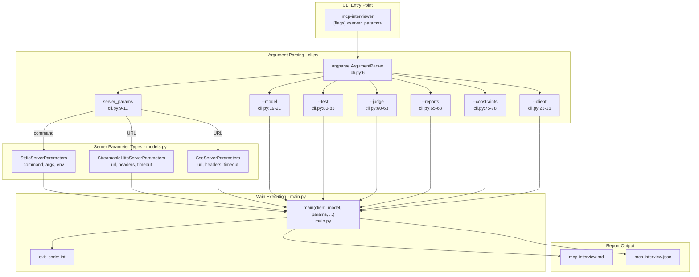
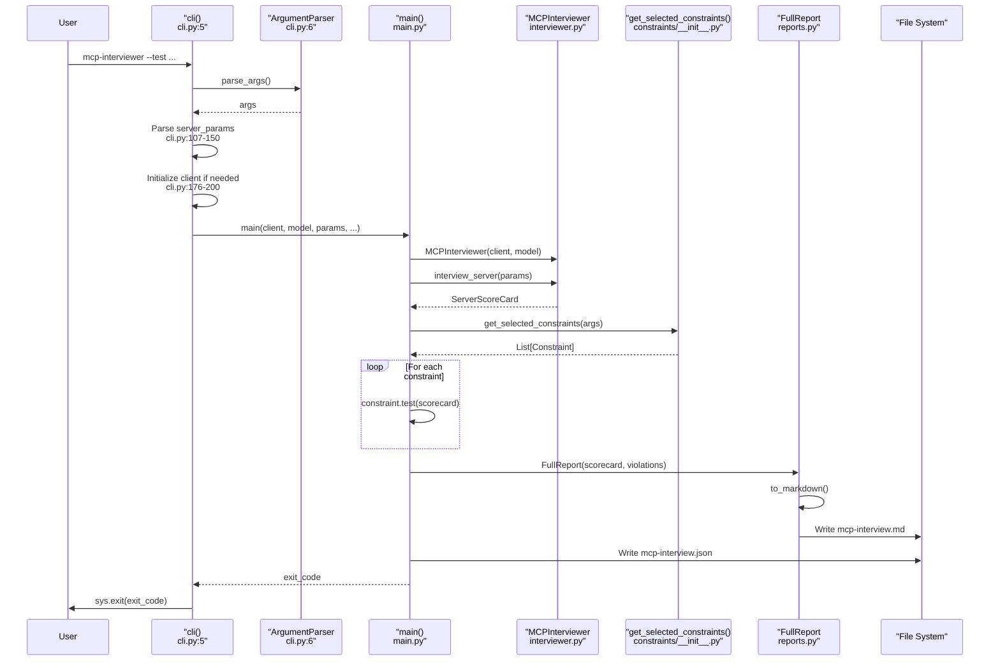

<!-- source: DeepWiki mcp.deepwiki.com · repo microsoft/mcp-interviewer · page 3 User Guide · fetched 2026-10-26 -->

# User Guide

<details>
<summary>Relevant source files</summary>

The following files were used as context for generating this wiki page:

- [README.md](README.md)
- [src/mcp_interviewer/cli.py](src/mcp_interviewer/cli.py)

</details>


This guide explains how to use mcp-interviewer to evaluate MCP servers. It covers basic usage patterns, command-line options, Python API usage, and how to interpret results. For installation instructions, see [Getting Started](#2). For detailed architecture and internal design, see [Architecture](#4).

## Overview

mcp-interviewer evaluates MCP servers through four main operations:

1. **Server Inspection** - Connects to the server and discovers its capabilities, tools, resources, and prompts
2. **Constraint Checking** - Validates the server against provider-specific requirements (e.g., OpenAI limits)
3. **Functional Testing** - Optionally tests the server by executing its tools with LLM-generated test plans
4. **Report Generation** - Produces Markdown and JSON reports summarizing all findings

The tool operates in two modes:

| Mode | Client Required | Model Required | Capabilities |
|------|----------------|----------------|--------------|
| **Basic** | No | No | Server inspection, constraint checking, basic reports |
| **LLM-Enhanced** | Yes | Yes | All basic features plus functional testing and LLM-based evaluation |

Sources: [README.md:1-304](), [src/mcp_interviewer/cli.py:1-223]()

## Usage Modes

### CLI Mode

The command-line interface is the primary way to use mcp-interviewer. It accepts a server command or URL and generates report files in the specified output directory.

```bash
# Basic usage - no LLM required
mcp-interviewer <server_command>

# With functional testing - requires --model
mcp-interviewer --model gpt-4.1 --test <server_command>

# Remote server
mcp-interviewer "https://my-server.com/sse"
```

### Python API Mode

The tool can also be imported as a Python library, providing two interfaces:

1. **`MCPInterviewer` class** - Core interviewing logic, returns `ServerScoreCard` ([src/mcp_interviewer/interviewer.py]())
2. **`main()` function** - Complete workflow including constraint checking and report generation ([src/mcp_interviewer/main.py]())

For details on Python API usage, see [Python API](#3.2).

Sources: [README.md:153-288](), [src/mcp_interviewer/cli.py:1-223]()

## Command Structure

The following diagram maps CLI commands to their corresponding code entities:



Sources: [src/mcp_interviewer/cli.py:5-218]()

## Configuration Options

### Server Connection

mcp-interviewer supports three connection types. The type is automatically determined based on the `server_params` argument:

| Input Format | Detected Type | Parameter Class | Details |
|--------------|---------------|-----------------|---------|
| Command string | `stdio` | `StdioServerParameters` | Executes command as subprocess |
| `http://` or `https://` URL | Remote | `StreamableHttpServerParameters` or `SseServerParameters` | Connects via HTTP/SSE |

Use `--remote-connection-type` to choose between `streamable_http` (default) and `sse` for remote connections. See [Server Connection Types](#3.3) for detailed information.

Sources: [src/mcp_interviewer/cli.py:107-150]()

### LLM Configuration

LLM features require both `--client` and `--model` arguments:

| Flag | Purpose | Code Reference |
|------|---------|----------------|
| `--client` | Import path to OpenAI-compatible client constructor | [cli.py:23-26]() |
| `--client-kwargs` | Keyword arguments for client constructor | [cli.py:27-32]() |
| `--model` | Model name to use for completions | [cli.py:19-21]() |

The client must follow the OpenAI SDK's chat completions API interface. See [LLM Evaluation](#3.6) for details on bring-your-own-model support.

Sources: [src/mcp_interviewer/cli.py:176-201](), [README.md:196-234]()

### Evaluation Options

| Flag | Requires LLM | Purpose |
|------|-------------|---------|
| `--test` | Yes | Enable functional testing with LLM-generated test plans |
| `--judge-tools` | Yes | Enable LLM evaluation of tool quality |
| `--judge-test` | Yes | Enable LLM evaluation of test results (requires `--test`) |
| `--judge` | Yes | Enable all LLM evaluation (equivalent to `--judge-tools --judge-test`) |

The code enforces these requirements in [cli.py:156-161]():

```python
requires_llm = args.test or should_judge_tool or should_judge_functional_test
if requires_llm and not args.model:
    parser.error("--model is required when using --test, --judge, --judge-tools, or --judge-test")
```

For constraint checking details, see [Constraint Checking](#3.4). For functional testing details, see [Functional Testing](#3.5).

Sources: [src/mcp_interviewer/cli.py:49-93](), [src/mcp_interviewer/cli.py:152-161]()

### Report Customization

| Flag | Purpose | Code Reference |
|------|---------|----------------|
| `--reports [CODE ...]` | Select specific report sections | [cli.py:65-68]() |
| `--no-collapse` | Disable collapsible sections in Markdown | [cli.py:70-73]() |
| `--constraints [CODE ...]` | Select specific constraints to check | [cli.py:75-78]() |
| `--fail-on-warnings` | Exit with error code on WARNING-severity violations | [cli.py:90-93]() |

Available report codes: `II`, `SI`, `CAP`, `TS`, `TCS`, `FT`, `CV`, `T`, `R`, `RT`, `P`

Available constraint codes: `OTC`, `ONL`, `ONP`, `OTL`, `TSF`, `OA` (all OpenAI)

See [Understanding Reports](#3.7) for report code meanings and [Constraint Types Reference](#6.3) for constraint code details.

Sources: [src/mcp_interviewer/cli.py:65-93](), [README.md:44-91]()

## Basic Workflow

The following diagram shows how a user command flows through the system to produce output files:



Sources: [src/mcp_interviewer/cli.py:5-218]()

## Output Files

mcp-interviewer generates two files in the output directory (specified by `--out-dir`, defaults to current directory):

| File | Format | Purpose | Code Reference |
|------|--------|---------|----------------|
| `mcp-interview.md` | Markdown | Human-readable report with all findings | Generated by report classes in [reports.py]() |
| `mcp-interview.json` | JSON | Machine-readable `ServerScoreCard` data | Serialized from `ServerScoreCard.model_dump()` |

The Markdown report structure varies based on the `--reports` flag:

- **Default**: `FullReport` includes all sections in standard order
- **Custom**: Includes only specified report codes in the order provided

See [Understanding Reports](#3.7) for details on report sections and structure.

Sources: [README.md:67-91]()

## Common Usage Patterns

### Basic Server Inspection

No LLM required. Performs server discovery and constraint checking only:

```bash
mcp-interviewer "docker run -i --rm node:lts npx -y @modelcontextprotocol/server-everything"
```

Generates reports showing server capabilities, tools, resources, prompts, and constraint violations.

### Functional Testing

Requires `--model` flag. Generates and executes test plans:

```bash
mcp-interviewer --model gpt-4.1 --test "docker run -i --rm node:lts npx -y @modelcontextprotocol/server-everything"
```

⚠️ **Risk Warning**: The `--test` flag causes the interviewer to invoke server tools, which may have side effects (file deletion, API calls, etc.). The CLI prompts for confirmation unless `--accept-risk` is provided ([cli.py:163-173]()).

### LLM Evaluation

Requires `--model` flag. Provides structured quality assessments:

```bash
# Evaluate tools only
mcp-interviewer --model gpt-4.1 --judge-tools "server command"

# Evaluate tests only (requires --test)
mcp-interviewer --model gpt-4.1 --test --judge-test "server command"

# Evaluate everything
mcp-interviewer --model gpt-4.1 --test --judge "server command"
```

See [LLM Evaluation](#3.6) for details on the experimental judging features.

### Custom Reports

Select specific report sections:

```bash
mcp-interviewer --reports SI TS CV "server command"
```

This generates a report containing only:
- `SI`: Server Info
- `TS`: Tool Statistics  
- `CV`: Constraint Violations

### CI/CD Pipeline Usage

Exit with non-zero code on any violations:

```bash
mcp-interviewer --fail-on-warnings --constraints OTC ONL "server command"
if [ $? -ne 0 ]; then
  echo "Server failed constraint validation"
  exit 1
fi
```

The `--fail-on-warnings` flag causes `WARNING`-severity violations to fail the build, not just `CRITICAL`-severity violations ([cli.py:90-93]()).

### Remote Server Testing

Connect to HTTP or SSE endpoints:

```bash
# Streamable HTTP (default)
mcp-interviewer "https://my-server.com/mcp"

# Server-Sent Events
mcp-interviewer --remote-connection-type sse "https://my-server.com/sse"

# With custom headers
mcp-interviewer --headers "Authorization=Bearer token" "https://my-server.com/mcp"
```

Sources: [README.md:122-194](), [src/mcp_interviewer/cli.py:38-48](), [src/mcp_interviewer/cli.py:107-141]()

## Exit Codes

The CLI returns exit codes to indicate success or failure:

| Exit Code | Meaning |
|-----------|---------|
| `0` | Success - no CRITICAL violations, and no WARNING violations if `--fail-on-warnings` |
| `1` | Failure - CRITICAL violations found, or WARNING violations found with `--fail-on-warnings` |

Exit code logic is implemented in [main.py]() and returned through [cli.py:217-218]():

```python
exit_code = main(...)
sys.exit(exit_code)
```

Sources: [src/mcp_interviewer/cli.py:217-218]()

## Safety Considerations

⚠️ **Important Security Notes**:

1. **Subprocess Execution**: For `stdio` connections, mcp-interviewer executes arbitrary commands via `StdioServerParameters`. Run servers in isolated containers when possible ([README.md:124]()).

2. **Tool Invocation**: The `--test` flag causes tool calls that may have irreversible side effects. The CLI requires explicit risk acceptance ([cli.py:163-173]()).

3. **Malicious Metadata**: Servers may provide misleading tool descriptions or schemas that could affect LLM-based evaluations. Manually review outputs for signs of manipulation ([README.md:289-296]()).

Sources: [README.md:124-125](), [README.md:163-174](), [README.md:289-296]()

## Next Steps

- For detailed CLI reference, see [CLI Usage](#3.1)
- For Python library usage, see [Python API](#3.2)
- For understanding constraint violations, see [Constraint Checking](#3.4)
- For functional test details, see [Functional Testing](#3.5)
- For report interpretation, see [Understanding Reports](#3.7)

Sources: [README.md:1-304](), [src/mcp_interviewer/cli.py:1-223]()

---

