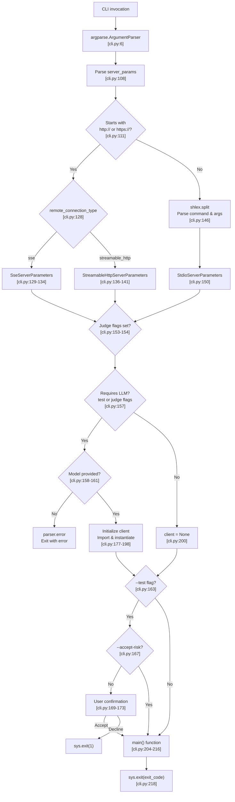
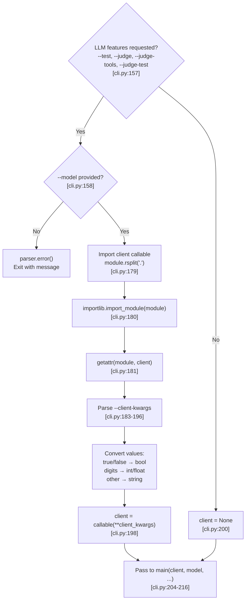

<!-- source: DeepWiki mcp.deepwiki.com · repo microsoft/mcp-interviewer · page 3.1 CLI Usage · fetched 2026-10-26 -->

# CLI Usage

<details>
<summary>Relevant source files</summary>

The following files were used as context for generating this wiki page:

- [README.md](README.md)
- [src/mcp_interviewer/cli.py](src/mcp_interviewer/cli.py)

</details>


This page provides a complete reference for the `mcp-interviewer` command-line interface. For programmatic usage, see [Python API](#3.2). For detailed information about specific features referenced by CLI flags, see [Server Connection Types](#3.3), [Constraint Checking](#3.4), [Functional Testing](#3.5), [LLM Evaluation](#3.6), and [Understanding Reports](#3.7).

## Overview

The `mcp-interviewer` CLI accepts a server command or URL as a positional argument and provides numerous flags to control evaluation behavior, LLM integration, report generation, and constraint checking. The tool automatically detects whether the server runs locally (via stdio) or remotely (via HTTP/SSE) based on the provided argument format.

**Sources:** [README.md:25-194](), [src/mcp_interviewer/cli.py:1-223]()

## Basic Command Structure

```bash
mcp-interviewer [OPTIONS] <server_command_or_url>
```

The `server_command_or_url` argument determines the connection type:
- **Local stdio**: Any string that doesn't start with `http://` or `https://` is treated as a shell command
- **Remote HTTP/SSE**: Strings starting with `http://` or `https://` are treated as remote URLs

**Sources:** [src/mcp_interviewer/cli.py:8-11](), [src/mcp_interviewer/cli.py:107-150]()

## CLI Argument Processing Flow



**Sources:** [src/mcp_interviewer/cli.py:5-219]()

## Server Connection Arguments

### `server_params` (Positional, Required)

The command to execute (for stdio connections) or URL to connect to (for remote connections).

**Local stdio example:**
```bash
mcp-interviewer "docker run -i --rm node:lts npx -y @modelcontextprotocol/server-everything"
```

**Remote HTTP/SSE example:**
```bash
mcp-interviewer "https://my-mcp-server.com/sse"
```

The argument is parsed using `shlex.split()` for local commands, splitting on whitespace while respecting quotes.

**Sources:** [src/mcp_interviewer/cli.py:8-11](), [src/mcp_interviewer/cli.py:107-150]()

### `--remote-connection-type`

Specifies the protocol for remote MCP servers. Only used when `server_params` is a URL.

| Value | Description |
|-------|-------------|
| `streamable_http` | Uses `StreamableHttpServerParameters` (default) |
| `sse` | Uses `SseServerParameters` for Server-Sent Events |

```bash
mcp-interviewer --remote-connection-type sse "https://example.com/mcp"
```

**Sources:** [src/mcp_interviewer/cli.py:13-17](), [src/mcp_interviewer/cli.py:128-141]()

### `--headers`

HTTP headers for remote connections, specified as `KEY=VALUE` pairs. Can be specified multiple times.

```bash
mcp-interviewer --headers "Authorization=Bearer token" "X-API-Key=abc123" "https://example.com/mcp"
```

Headers are parsed at [cli.py:116-125]() and stored in a dictionary.

**Sources:** [src/mcp_interviewer/cli.py:38-39](), [src/mcp_interviewer/cli.py:116-125]()

### `--timeout`

Connection timeout in seconds for remote MCP servers (default: 5).

```bash
mcp-interviewer --timeout 10 "https://example.com/mcp"
```

**Sources:** [src/mcp_interviewer/cli.py:41-42]()

### `--sse-read-timeout`

Read timeout in seconds for SSE connections (default: 5).

```bash
mcp-interviewer --remote-connection-type sse --sse-read-timeout 30 "https://example.com/mcp"
```

**Sources:** [src/mcp_interviewer/cli.py:44-48]()

## LLM Configuration Arguments

These arguments configure the LLM client used for functional testing and evaluation features.

### `--model`

The model name/identifier for LLM-based features. Required when using `--test`, `--judge`, `--judge-tools`, or `--judge-test`.

```bash
mcp-interviewer --model gpt-4.1 --test "docker run -i --rm node:lts npx -y @modelcontextprotocol/server-everything"
```

The CLI validates model presence at [cli.py:157-161]() and raises an error if missing when LLM features are requested.

**Sources:** [src/mcp_interviewer/cli.py:19-21](), [src/mcp_interviewer/cli.py:157-161]()

### `--client`

Import path to a callable that returns an OpenAI-compatible client object. Default: `openai.OpenAI`.

The format is `module.path.callable_name`, which is dynamically imported at [cli.py:177-181]().

**Example with custom client:**
```python
# my_client.py
from openai import AzureOpenAI

def azure_client():
    return AzureOpenAI(azure_endpoint="https://...", api_version="2024-02-01")
```

```bash
mcp-interviewer --client "my_client.azure_client" --model "gpt-4" --test "..."
```

**Sources:** [src/mcp_interviewer/cli.py:23-26](), [src/mcp_interviewer/cli.py:177-181](), [README.md:216-233]()

### `--client-kwargs`

Keyword arguments passed to the client constructor as `key=value` pairs. Can be specified multiple times.

Values are automatically converted to appropriate Python types:
- `"true"` / `"false"` → boolean
- Numeric strings → int or float
- Other values → string

```bash
mcp-interviewer \
  --client-kwargs "base_url=http://localhost:11434/v1" "api_key=ollama" \
  --model "gpt-oss:20b" \
  --test "..."
```

Parsing occurs at [cli.py:183-196]().

**Sources:** [src/mcp_interviewer/cli.py:28-32](), [src/mcp_interviewer/cli.py:183-196](), [README.md:204-214]()

## Client Initialization Flow



**Sources:** [src/mcp_interviewer/cli.py:157-201]()

## Evaluation Control Flags

### `--test`

Enables functional testing of the MCP server. Requires `--model`. Triggers a risk confirmation prompt unless `--accept-risk` is also provided.

```bash
mcp-interviewer --model gpt-4.1 --test "uvx mcp-server-fetch"
```

When enabled, the CLI displays a warning and prompts for confirmation at [cli.py:164-173]().

**Sources:** [src/mcp_interviewer/cli.py:80-83](), [src/mcp_interviewer/cli.py:163-173]()

### `--accept-risk`

Bypasses the user confirmation prompt for functional testing. Use in CI/CD pipelines or automated workflows.

```bash
mcp-interviewer --model gpt-4.1 --test --accept-risk "uvx mcp-server-fetch"
```

**Sources:** [src/mcp_interviewer/cli.py:85-88](), [src/mcp_interviewer/cli.py:167-173]()

### `--judge-tools`

Enables experimental LLM-based evaluation of tool quality. Requires `--model`.

```bash
mcp-interviewer --model gpt-4.1 --judge-tools "uvx mcp-server-fetch"
```

**Sources:** [src/mcp_interviewer/cli.py:50-53](), [README.md:174-175]()

### `--judge-test`

Enables experimental LLM-based evaluation of functional test results. Requires both `--model` and `--test`.

```bash
mcp-interviewer --model gpt-4.1 --test --judge-test "uvx mcp-server-fetch"
```

**Sources:** [src/mcp_interviewer/cli.py:55-58](), [README.md:177-178]()

### `--judge`

Enables all experimental LLM judging operations. Equivalent to `--judge-tools --judge-test`. Requires `--model` and (implicitly) `--test` for test judging.

```bash
mcp-interviewer --model gpt-4.1 --test --judge "uvx mcp-server-fetch"
```

The flag is processed at [cli.py:153-154]() using boolean OR logic with the individual judge flags.

**Sources:** [src/mcp_interviewer/cli.py:60-63](), [src/mcp_interviewer/cli.py:153-154](), [README.md:180-181]()

## Report Configuration Flags

### `--reports`

Specifies which report sections to include and their order. Accepts both full names and shorthand codes.

**Available report codes:**

| Code | Full Name | Description |
|------|-----------|-------------|
| `II` | `interviewer-info` | Interviewer model and parameters |
| `SI` | `server-info` | Server name, version, capabilities |
| `CAP` | `capabilities` | Supported MCP features |
| `TS` | `tool-statistics` | Tool counts and patterns |
| `TCS` | `tool-call-statistics` | Performance metrics from testing |
| `FT` | `functional-tests` | Test execution results |
| `CV` | `constraint-violations` | Constraint validation results |
| `T` | `tools` | Tool schemas and descriptions |
| `R` | `resources` | Available resources |
| `RT` | `resource-templates` | Resource templates |
| `P` | `prompts` | Available prompts |

```bash
# Include only specific sections
mcp-interviewer --reports SI TS FT CV "uvx mcp-server-fetch"

# Mix full names and codes
mcp-interviewer --reports server-info TS functional-tests "uvx mcp-server-fetch"
```

If not specified, all sections are included in the default order.

**Sources:** [src/mcp_interviewer/cli.py:65-68](), [README.md:74-91]()

### `--no-collapse`

Disables collapsible sections in Markdown reports. By default, reports use HTML `<details>` tags for lengthy sections.

```bash
mcp-interviewer --no-collapse "uvx mcp-server-fetch"
```

**Sources:** [src/mcp_interviewer/cli.py:70-73]()

## Constraint Configuration Flags

### `--constraints`

Specifies which constraints to check. Accepts both full names and shorthand codes. If not specified, all constraints are checked by default.

**Available constraint codes:**

| Code | Full Name | Description |
|------|-----------|-------------|
| `OTC` | `openai-tool-count` | OpenAI tool count limit (≤128 tools) |
| `ONL` | `openai-name-length` | OpenAI name length (≤64 chars) |
| `ONP` | `openai-name-pattern` | OpenAI name pattern (a-zA-Z0-9_-) |
| `OTL` | `openai-token-length` | OpenAI token length limit |
| `TSF` | `tool-schema-flatness` | Tool input schema flatness |
| `OA` | — | All OpenAI constraints (expands to OTC, ONL, ONP, OTL) |

```bash
# Check only specific constraints
mcp-interviewer --constraints OTC ONL "uvx mcp-server-fetch"

# Check all OpenAI constraints
mcp-interviewer --constraints OA "uvx mcp-server-fetch"
```

**Sources:** [src/mcp_interviewer/cli.py:75-78](), [README.md:44-54]()

### `--fail-on-warnings`

Returns a non-zero exit code if any constraint violations with `WARNING` severity are encountered. By default, only `CRITICAL` violations cause failure.

```bash
mcp-interviewer --fail-on-warnings "uvx mcp-server-fetch"
```

**Sources:** [src/mcp_interviewer/cli.py:90-93]()

## Output Configuration Flags

### `--out-dir` / `-o`

Specifies the output directory for generated reports. Default: current directory (`.`).

```bash
mcp-interviewer -o ./reports "uvx mcp-server-fetch"
```

The interviewer generates two files in this directory:
- `mcp-interview.md` - Markdown report
- `mcp-interview.json` - JSON data

**Sources:** [src/mcp_interviewer/cli.py:33]()

### `--log-level`

Controls logging verbosity. Options: `DEBUG`, `INFO`, `WARN`, `ERROR`. Default: `INFO`.

```bash
mcp-interviewer --log-level DEBUG "uvx mcp-server-fetch"
```

Logging is configured via Python's `logging.basicConfig()` at [cli.py:99]().

**Sources:** [src/mcp_interviewer/cli.py:35-36](), [src/mcp_interviewer/cli.py:97-99]()

## Common Usage Patterns

### Basic Inspection (No LLM Required)

```bash
# Local server
mcp-interviewer "uvx mcp-server-fetch"

# Remote server
mcp-interviewer "https://my-server.com/mcp"

# With specific constraints
mcp-interviewer --constraints OTC ONL "uvx mcp-server-fetch"
```

### Functional Testing (Requires LLM)

```bash
# With OpenAI
mcp-interviewer --model gpt-4.1 --test "uvx mcp-server-fetch"

# With local Ollama
mcp-interviewer \
  --client-kwargs "base_url=http://localhost:11434/v1" "api_key=ollama" \
  --model "llama2" \
  --test \
  "uvx mcp-server-fetch"
```

### Full Evaluation Suite

```bash
mcp-interviewer \
  --model gpt-4.1 \
  --test \
  --judge \
  --reports SI CAP TS FT CV \
  --constraints OA TSF \
  --fail-on-warnings \
  -o ./reports \
  "docker run -i --rm node:lts npx -y @modelcontextprotocol/server-everything"
```

### CI/CD Pipeline

```bash
mcp-interviewer \
  --model gpt-4.1 \
  --test \
  --accept-risk \
  --constraints OA \
  --fail-on-warnings \
  --log-level WARN \
  "uvx mcp-server-fetch"
```

**Sources:** [README.md:122-194]()

## Exit Codes

The CLI exits with the following codes:

| Exit Code | Meaning |
|-----------|---------|
| `0` | Success - no critical violations (warnings allowed unless `--fail-on-warnings`) |
| `1` | Failure - critical constraint violations, warnings with `--fail-on-warnings`, or user declined risk |

The exit code is returned from `main()` and passed to `sys.exit()` at [cli.py:218]().

**Sources:** [src/mcp_interviewer/cli.py:218]()

## Flag Dependency Matrix

This table shows which flags require other flags to be set:

| Flag | Required Dependencies | Optional Dependencies |
|------|----------------------|----------------------|
| `--model` | — | — |
| `--test` | `--model` | — |
| `--judge-tools` | `--model` | — |
| `--judge-test` | `--model`, `--test` | — |
| `--judge` | `--model`, `--test` (implicitly) | — |
| `--accept-risk` | `--test` | — |
| `--client-kwargs` | `--client` (uses default if not set) | — |

The dependency validation occurs at [cli.py:157-161]().

**Sources:** [src/mcp_interviewer/cli.py:157-161]()

---

