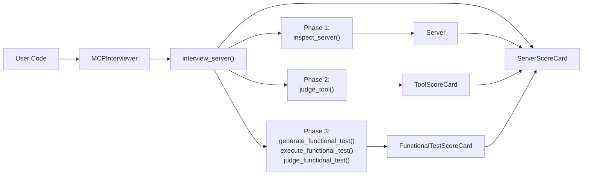
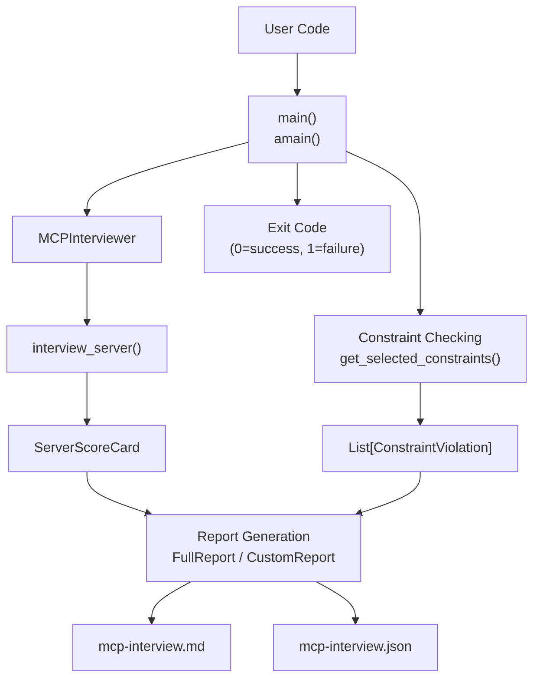
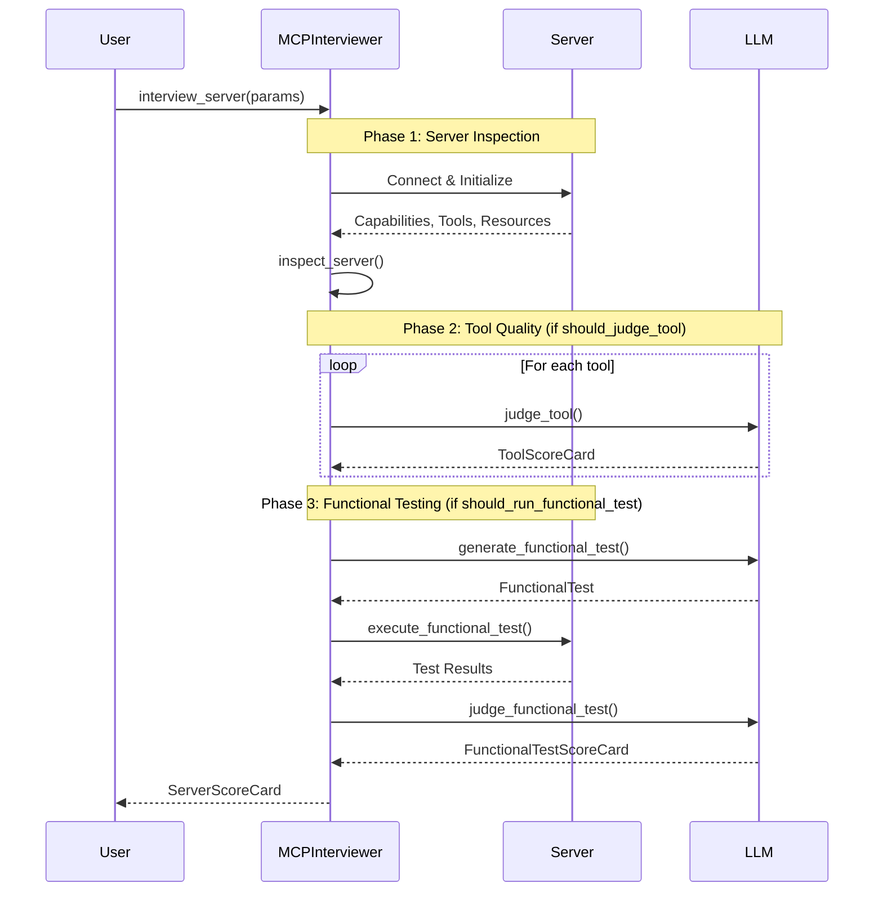
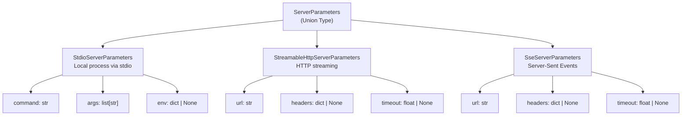
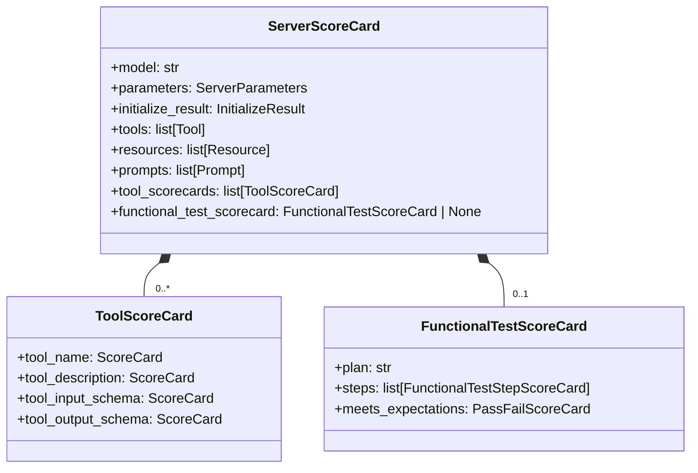

<!-- source: DeepWiki mcp.deepwiki.com · repo microsoft/mcp-interviewer · page 3.2 Python API · fetched 2026-10-26 -->

# Python API

<details>
<summary>Relevant source files</summary>

The following files were used as context for generating this wiki page:

- [README.md](README.md)
- [src/mcp_interviewer/__init__.py](src/mcp_interviewer/__init__.py)
- [src/mcp_interviewer/interviewer/_interviewer.py](src/mcp_interviewer/interviewer/_interviewer.py)
- [src/mcp_interviewer/main.py](src/mcp_interviewer/main.py)

</details>


This document describes how to use mcp-interviewer as a Python library for programmatic evaluation of MCP servers. It covers the two main API entry points: the `MCPInterviewer` class for fine-grained control over evaluation phases, and the `main()` function for complete end-to-end evaluation with constraint checking and report generation.

For command-line usage, see [CLI Usage](#3.1). For details on report output structures, see [Understanding Reports](#3.7). For architectural details about how these components work internally, see [Core Components](#4.1).

## API Entry Points

The library exposes two primary interfaces for evaluating MCP servers:

| Entry Point | Purpose | Includes Constraints | Includes Reports | Best For |
|------------|---------|---------------------|------------------|----------|
| `MCPInterviewer` | Direct control over evaluation phases | No | No | Custom workflows, integration testing |
| `main()` / `amain()` | Complete evaluation pipeline | Yes | Yes | Standard evaluation, CLI equivalent |

**MCPInterviewer Entry Point**



Sources: [src/mcp_interviewer/__init__.py:1-14](), [src/mcp_interviewer/interviewer/_interviewer.py:52-442]()

**main() Function Entry Point**



Sources: [src/mcp_interviewer/main.py:16-173]()

## Installation and Imports

After installing `mcp-interviewer` as a dependency, import the required components:

```python
from mcp_interviewer import MCPInterviewer, main, ServerParameters, ServerScoreCard
from mcp_interviewer import Client  # Type alias for OpenAI client
```

For server connection types, import the specific parameter classes:

```python
from mcp_interviewer.models import (
    StdioServerParameters,
    HttpServerParameters,
    SseServerParameters
)
```

Sources: [src/mcp_interviewer/__init__.py:1-14]()

## MCPInterviewer Class

The `MCPInterviewer` class provides programmatic access to individual evaluation phases. Use this when you need fine-grained control over the evaluation process or want to integrate evaluation into custom workflows.

### Constructor

```python
MCPInterviewer(
    client: Client | None,
    model: str | None,
    should_run_functional_test: bool = False,
    should_judge_tool: bool = False,
    should_judge_functional_test: bool = False
)
```

**Parameters:**

| Parameter | Type | Required | Description |
|-----------|------|----------|-------------|
| `client` | `Client \| None` | Conditional | OpenAI-compatible client for LLM features. Required if any LLM features are enabled, otherwise `None` |
| `model` | `str \| None` | Conditional | Model name (e.g., `"gpt-4"`). Required if any LLM features are enabled, otherwise `None` |
| `should_run_functional_test` | `bool` | No | Generate and execute functional tests (default: `False`) |
| `should_judge_tool` | `bool` | No | Use LLM to evaluate tool quality (default: `False`) |
| `should_judge_functional_test` | `bool` | No | Use LLM to evaluate test results (default: `False`) |

Sources: [src/mcp_interviewer/interviewer/_interviewer.py:60-82]()

### Primary Method: interview_server()

The main entry point for server evaluation:

```python
async def interview_server(self, params: ServerParameters) -> ServerScoreCard
```

This method orchestrates the complete evaluation process including server inspection, tool assessment, and optional functional testing. It returns a `ServerScoreCard` containing all evaluation results.

**Execution Phases:**



Sources: [src/mcp_interviewer/interviewer/_interviewer.py:328-442]()

### Auxiliary Methods

The `MCPInterviewer` class exposes individual evaluation methods for advanced use cases:

| Method | Purpose | Requires LLM |
|--------|---------|-------------|
| `inspect_server()` | Discover server capabilities | No |
| `judge_tool()` | Evaluate a single tool | Yes |
| `generate_functional_test()` | Create test plan for server | Yes |
| `execute_functional_test_step()` | Run a single test step | No |
| `execute_functional_test()` | Run complete test | No |
| `judge_functional_test_step()` | Evaluate a test step result | Yes |
| `judge_functional_test()` | Evaluate complete test results | Yes |

Sources: [src/mcp_interviewer/interviewer/_interviewer.py:83-223]()

## main() Function

The `main()` function provides a complete evaluation pipeline including constraint checking and report generation. It is the Python equivalent of the CLI interface.

### Function Signatures

**Synchronous wrapper:**

```python
def main(
    client: Client | None,
    model: str | None,
    params: ServerParameters,
    out_dir: Path = Path("."),
    should_judge_tool: bool = False,
    should_judge_functional_test: bool = False,
    should_run_functional_test: bool = False,
    custom_reports: list[str] | None = None,
    no_collapse: bool = False,
    selected_constraints: list[str] | None = None,
    fail_on_warnings: bool = False,
) -> int
```

**Asynchronous version:**

```python
async def amain(
    # Same parameters as main()
) -> int
```

**Parameters:**

| Parameter | Type | Default | Description |
|-----------|------|---------|-------------|
| `client` | `Client \| None` | Required | OpenAI client or `None` for no LLM features |
| `model` | `str \| None` | Required | Model name or `None` for no LLM features |
| `params` | `ServerParameters` | Required | Server connection parameters |
| `out_dir` | `Path` | `Path(".")` | Output directory for reports |
| `should_judge_tool` | `bool` | `False` | Enable LLM tool evaluation |
| `should_judge_functional_test` | `bool` | `False` | Enable LLM test evaluation |
| `should_run_functional_test` | `bool` | `False` | Enable functional testing |
| `custom_reports` | `list[str] \| None` | `None` | Specific report sections to include |
| `no_collapse` | `bool` | `False` | Disable collapsible sections in report |
| `selected_constraints` | `list[str] \| None` | `None` | Constraint codes to check (all if `None`) |
| `fail_on_warnings` | `bool` | `False` | Return non-zero exit code for warnings |

**Returns:** `int` - Exit code (0 for success, 1 for failure)

**Output Files:**
- `mcp-interview.md` - Markdown report
- `mcp-interview.json` - JSON data dump

Sources: [src/mcp_interviewer/main.py:16-173]()

## Usage Patterns

### Pattern 1: Basic Server Inspection

Inspect a server without LLM features (no client or model required):

```python
from mcp_interviewer import MCPInterviewer
from mcp_interviewer.models import StdioServerParameters

params = StdioServerParameters(
    command="docker",
    args=["run", "-i", "--rm", "node:lts", "npx", "-y", 
          "@modelcontextprotocol/server-everything"]
)

# Create interviewer without LLM client
interviewer = MCPInterviewer(None, None)
scorecard = await interviewer.interview_server(params)

# Access inspection results
print(f"Server: {scorecard.server_info.name}")
print(f"Tools: {len(scorecard.tools)}")
print(f"Resources: {len(scorecard.resources)}")
```

Sources: [README.md:240-251](), [src/mcp_interviewer/interviewer/_interviewer.py:60-82]()

### Pattern 2: LLM-Enhanced Evaluation

Enable functional testing and tool evaluation:

```python
from openai import OpenAI
from mcp_interviewer import MCPInterviewer
from mcp_interviewer.models import StdioServerParameters

client = OpenAI()  # Uses OPENAI_API_KEY environment variable
params = StdioServerParameters(
    command="docker",
    args=["run", "-i", "--rm", "node:lts", "npx", "-y",
          "@modelcontextprotocol/server-everything"]
)

# Enable all LLM features
interviewer = MCPInterviewer(
    client,
    "gpt-4",
    should_run_functional_test=True,
    should_judge_tool=True,
    should_judge_functional_test=True
)

scorecard = await interviewer.interview_server(params)

# Access evaluation results
for tool_card in scorecard.tool_scorecards:
    print(f"Tool: {tool_card.tool_name.score}")

if scorecard.functional_test_scorecard:
    print(f"Test passed: {scorecard.functional_test_scorecard.meets_expectations.score}")
```

Sources: [README.md:254-268](), [src/mcp_interviewer/interviewer/_interviewer.py:60-82]()

### Pattern 3: Complete Pipeline with Reports

Use `main()` for constraint checking and report generation:

```python
from pathlib import Path
from openai import OpenAI
from mcp_interviewer import main
from mcp_interviewer.models import StdioServerParameters

params = StdioServerParameters(
    command="docker",
    args=["run", "-i", "--rm", "node:lts", "npx", "-y",
          "@modelcontextprotocol/server-everything"]
)

# Basic usage - no LLM features
exit_code = main(None, None, params)

# With LLM features
client = OpenAI()
exit_code = main(
    client,
    "gpt-4",
    params,
    out_dir=Path("./output"),
    should_run_functional_test=True,
    should_judge_tool=True,
    selected_constraints=["OTC", "ONL"],  # Only check specific constraints
    fail_on_warnings=True
)

# Check exit code
if exit_code == 0:
    print("Evaluation passed")
else:
    print("Evaluation failed")
```

Sources: [README.md:272-287](), [src/mcp_interviewer/main.py:132-173]()

### Pattern 4: Custom Report Sections

Generate reports with specific sections only:

```python
from mcp_interviewer import main
from mcp_interviewer.models import StdioServerParameters

exit_code = main(
    None,
    None,
    params,
    custom_reports=["SI", "TS", "CV"],  # Server Info, Tool Stats, Violations
    no_collapse=True  # Disable collapsible sections
)
```

Sources: [src/mcp_interviewer/main.py:104-123]()

## Server Connection Types

The `ServerParameters` type is a union of three connection types:



**Example - Stdio Connection:**

```python
from mcp_interviewer.models import StdioServerParameters

params = StdioServerParameters(
    command="uvx",
    args=["mcp-server-fetch"],
    env={"CUSTOM_VAR": "value"}  # Optional environment variables
)
```

**Example - HTTP Connection:**

```python
from mcp_interviewer.models import StreamableHttpServerParameters

params = StreamableHttpServerParameters(
    url="http://localhost:8080/mcp",
    headers={"Authorization": "Bearer token"},
    timeout=30.0
)
```

**Example - SSE Connection:**

```python
from mcp_interviewer.models import SseServerParameters

params = SseServerParameters(
    url="https://my-mcp-server.com/sse",
    headers={"Authorization": "Bearer token"}
)
```

For more details on connection types, see [Server Connection Types](#3.3).

Sources: [src/mcp_interviewer/models/__init__.py]() (inferred from architecture)

## Data Models

### ServerScoreCard

The primary return type containing complete evaluation results:



**Key Attributes:**

| Attribute | Type | Description |
|-----------|------|-------------|
| `model` | `str` | LLM model used for evaluation or `"N/A"` |
| `tools` | `list[Tool]` | All tools discovered from server |
| `tool_scorecards` | `list[ToolScoreCard]` | LLM evaluations of tools (if enabled) |
| `functional_test_scorecard` | `FunctionalTestScoreCard \| None` | Functional test results (if enabled) |

**Accessing Results:**

```python
scorecard = await interviewer.interview_server(params)

# Server metadata
print(f"Server: {scorecard.initialize_result.serverInfo.name}")
print(f"Version: {scorecard.initialize_result.serverInfo.version}")

# Tools
for tool in scorecard.tools:
    print(f"Tool: {tool.name}")
    print(f"Description: {tool.description}")

# Tool evaluations (if should_judge_tool=True)
for tool_card in scorecard.tool_scorecards:
    print(f"Name quality: {tool_card.tool_name.score}")
    print(f"Description quality: {tool_card.tool_description.score}")

# Functional tests (if should_run_functional_test=True)
if scorecard.functional_test_scorecard:
    test = scorecard.functional_test_scorecard
    print(f"Test plan: {test.plan}")
    print(f"Passed: {test.meets_expectations.score}")
```

For complete data model reference, see [Data Models Reference](#6.2).

Sources: [src/mcp_interviewer/interviewer/_interviewer.py:424-432]()

## Advanced Usage

### Custom LLM Client

Any object implementing the OpenAI chat completions API works:

```python
from anthropic import Anthropic
from mcp_interviewer import MCPInterviewer

# Example: Custom wrapper around another LLM provider
class AnthropicClientWrapper:
    def __init__(self):
        self.client = Anthropic()
    
    @property
    def chat(self):
        return self
    
    @property
    def completions(self):
        return self
    
    def create(self, model, messages, **kwargs):
        # Translate to Anthropic API format
        response = self.client.messages.create(
            model=model,
            messages=messages,
            # ... map other parameters
        )
        # Return OpenAI-compatible response
        # ... convert response format
        return response

client = AnthropicClientWrapper()
interviewer = MCPInterviewer(client, "claude-3-opus-20240229")
```

For CLI-based custom client configuration, see [Bring Your Own Models](#2) in the README.

Sources: [README.md:196-234]()

### Asynchronous Workflows

Both entry points support async/await patterns:

```python
import asyncio
from mcp_interviewer import MCPInterviewer, amain
from mcp_interviewer.models import StdioServerParameters

async def evaluate_multiple_servers():
    servers = [
        StdioServerParameters(command="server1", args=[]),
        StdioServerParameters(command="server2", args=[]),
        StdioServerParameters(command="server3", args=[]),
    ]
    
    # Evaluate servers concurrently
    interviewer = MCPInterviewer(None, None)
    scorecards = await asyncio.gather(
        *[interviewer.interview_server(params) for params in servers]
    )
    
    return scorecards

async def evaluate_with_reports():
    params = StdioServerParameters(command="server", args=[])
    
    # Use amain for async execution with reports
    exit_code = await amain(None, None, params)
    
    return exit_code

# Run async functions
asyncio.run(evaluate_multiple_servers())
asyncio.run(evaluate_with_reports())
```

Sources: [src/mcp_interviewer/main.py:16-130](), [src/mcp_interviewer/interviewer/_interviewer.py:328-442]()

### Request Tracking

The `MCPInterviewer` class tracks server requests during evaluation:

```python
interviewer = MCPInterviewer(client, "gpt-4", should_run_functional_test=True)
scorecard = await interviewer.interview_server(params)

# Access request counters
print(f"Sampling requests: {interviewer.sampling_requests}")
print(f"Elicitation requests: {interviewer.elicitation_requests}")
print(f"List roots requests: {interviewer.list_roots_requests}")
print(f"Logging requests: {interviewer.logging_requests}")
```

These counters track how many times the server requested services from the interviewer during functional testing.

Sources: [src/mcp_interviewer/interviewer/_interviewer.py:308-327]()

## Error Handling

Both entry points propagate exceptions for critical failures:

```python
from mcp_interviewer import MCPInterviewer

try:
    interviewer = MCPInterviewer(client, "gpt-4")
    scorecard = await interviewer.interview_server(params)
except ValueError as e:
    # Missing required parameters
    print(f"Configuration error: {e}")
except Exception as e:
    # Server connection or evaluation failure
    print(f"Evaluation failed: {e}")
```

The `main()` function returns exit codes instead of raising exceptions:

```python
from mcp_interviewer import main

exit_code = main(client, model, params)

if exit_code == 0:
    print("Success")
elif exit_code == 1:
    print("Failed: constraint violations or evaluation errors")
```

Sources: [src/mcp_interviewer/main.py:48-96](), [src/mcp_interviewer/interviewer/_interviewer.py:438-442]()

---

