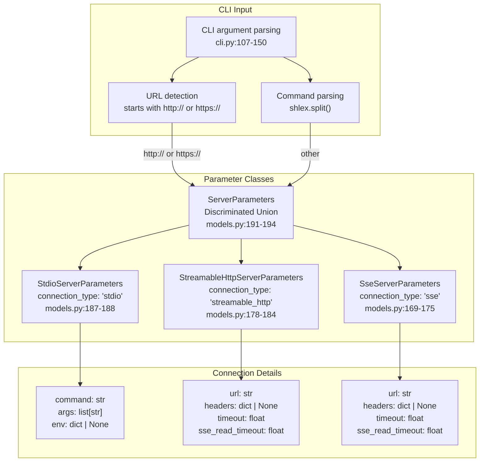
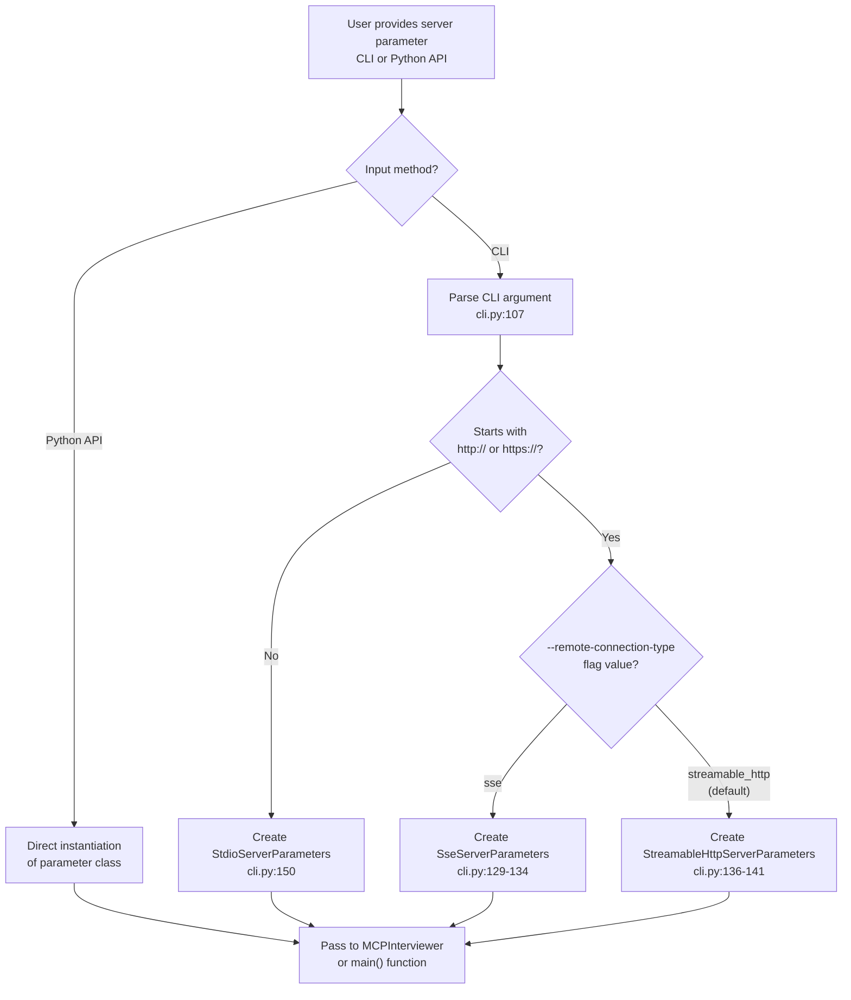

<!-- source: DeepWiki mcp.deepwiki.com · repo microsoft/mcp-interviewer · page 3.3 Server Connection Types · fetched 2026-10-26 -->

# Server Connection Types

<details>
<summary>Relevant source files</summary>

The following files were used as context for generating this wiki page:

- [README.md](README.md)
- [src/mcp_interviewer/cli.py](src/mcp_interviewer/cli.py)
- [src/mcp_interviewer/models.py](src/mcp_interviewer/models.py)
- [src/mcp_interviewer/reports/functional_test/test_step.py](src/mcp_interviewer/reports/functional_test/test_step.py)

</details>


## Purpose and Scope

This page documents the three connection types that mcp-interviewer supports for connecting to MCP servers: stdio (local process), streamable_http (HTTP streaming), and sse (Server-Sent Events). Each connection type is represented by a specific parameter class and used in different deployment scenarios.

For information about how the interview process executes after connection, see [Interview Execution Flow](#4.2). For CLI usage examples, see [CLI Usage](#3.1).

---

## Connection Type Overview

mcp-interviewer supports three distinct connection types for communicating with MCP servers. The connection type is determined either automatically (based on CLI input) or explicitly (via Python API).

| Connection Type | Parameter Class | Use Case | Transport |
|----------------|-----------------|----------|-----------|
| `stdio` | `StdioServerParameters` | Local MCP server running as a subprocess | Standard input/output streams |
| `streamable_http` | `StreamableHttpServerParameters` | Remote MCP server via HTTP with streaming | HTTP with SSE-like streaming responses |
| `sse` | `SseServerParameters` | Remote MCP server via Server-Sent Events | SSE protocol over HTTP |

**Sources:** [src/mcp_interviewer/models.py:169-194]()

---

## Connection Type Architecture



**Sources:** [src/mcp_interviewer/cli.py:107-150](), [src/mcp_interviewer/models.py:169-194]()

---

## StdioServerParameters (Local Process)

The `StdioServerParameters` class is used for connecting to MCP servers running as local subprocesses. This is the most common connection type for development and testing.

### Data Model

```python
class StdioServerParameters(McpStdioServerParameters):
    connection_type: Literal["stdio"] = "stdio"
```

The class inherits from `mcp.client.stdio.StdioServerParameters` from the MCP Python SDK, which provides:

| Field | Type | Description |
|-------|------|-------------|
| `command` | `str` | Executable command to run (e.g., `"npx"`, `"docker"`) |
| `args` | `list[str]` | Command-line arguments |
| `env` | `dict[str, str] \| None` | Environment variables for the subprocess |

**Sources:** [src/mcp_interviewer/models.py:187-188](), [src/mcp_interviewer/models.py:3]()

### CLI Detection

When the CLI argument does not start with `http://` or `https://`, it is parsed as a stdio command:

```python
# cli.py:142-150
else:
    # Local stdio connection - parse as command and args
    import shlex

    params_list = shlex.split(server_params_str)
    params_command = params_list[0]
    params_args = params_list[1:] if len(params_list) > 1 else []

    params = StdioServerParameters(command=params_command, args=params_args)
```

The CLI uses `shlex.split()` to properly parse shell-style quoted arguments.

**Sources:** [src/mcp_interviewer/cli.py:142-150]()

### Python API Usage

```python
from mcp_interviewer import MCPInterviewer, StdioServerParameters

params = StdioServerParameters(
    command="docker",
    args=["run", "-i", "--rm", "node:lts", "npx", "-y", "@modelcontextprotocol/server-everything"]
)

interviewer = MCPInterviewer(None, None)
interview = await interviewer.interview_server(params)
```

**Sources:** [README.md:239-251]()

### Common Use Cases

- **Containerized servers**: Running MCP servers in Docker containers for isolation
- **Local development**: Testing servers under development
- **NPX-based servers**: JavaScript/TypeScript MCP servers installed via npm
- **Python servers**: Servers installed via pip or uv

**Example CLI commands:**

```bash
# Docker container running npx
mcp-interviewer "docker run -i --rm node:lts npx -y @modelcontextprotocol/server-everything"

# Direct npx execution
mcp-interviewer "npx -y @modelcontextprotocol/server-everything"

# Python server via uvx
mcp-interviewer "uvx mcp-server-fetch"
```

**Sources:** [README.md:128-135](), [README.md:164-173]()

---

## StreamableHttpServerParameters (HTTP Streaming)

The `StreamableHttpServerParameters` class connects to remote MCP servers via HTTP with streaming support. This is the default connection type for remote servers.

### Data Model

```python
class StreamableHttpServerParameters(BaseModel):
    connection_type: Literal["streamable_http"] = "streamable_http"
    
    url: str
    headers: dict[str, Any] | None = None
    timeout: float = 5
    sse_read_timeout: float = 60 * 5
```

| Field | Type | Default | Description |
|-------|------|---------|-------------|
| `url` | `str` | Required | HTTP(S) URL of the MCP server endpoint |
| `headers` | `dict[str, Any] \| None` | `None` | Optional HTTP headers (e.g., authorization) |
| `timeout` | `float` | `5` | Connection timeout in seconds |
| `sse_read_timeout` | `float` | `300` | Streaming read timeout in seconds (5 minutes) |

**Sources:** [src/mcp_interviewer/models.py:178-184]()

### CLI Detection and Configuration

When a URL is detected, the CLI defaults to `streamable_http` unless `--remote-connection-type` specifies otherwise:

```python
# cli.py:111-141
if server_params_str.startswith(("http://", "https://")):
    # Remote connection
    url = server_params_str
    
    # Parse headers if provided
    headers = {}
    if args.headers:
        for header in args.headers:
            if "=" in header:
                key, value = header.split("=", 1)
                headers[key] = value
    
    # Create appropriate remote server parameters
    if args.remote_connection_type == "sse":
        params = SseServerParameters(...)
    else:  # streamable_http
        params = StreamableHttpServerParameters(
            url=url,
            headers=headers if headers else None,
            timeout=args.timeout,
            sse_read_timeout=args.sse_read_timeout,
        )
```

**Sources:** [src/mcp_interviewer/cli.py:111-141]()

### CLI Flags

The following CLI flags control HTTP streaming connections:

| Flag | Type | Default | Description |
|------|------|---------|-------------|
| `--remote-connection-type` | `sse \| streamable_http` | `streamable_http` | Connection protocol for remote servers |
| `--headers` | `KEY=VALUE ...` | None | HTTP headers in `KEY=VALUE` format |
| `--timeout` | `int` | `5` | Connection timeout (seconds) |
| `--sse-read-timeout` | `int` | `5` | Streaming read timeout (seconds) |

**Sources:** [src/mcp_interviewer/cli.py:12-48]()

### Example Usage

```bash
# Basic remote connection (uses streamable_http by default)
mcp-interviewer "https://my-mcp-server.com/api"

# With authentication headers
mcp-interviewer --headers "Authorization=Bearer token123" "https://my-mcp-server.com/api"

# With custom timeout
mcp-interviewer --timeout 10 --sse-read-timeout 600 "https://my-mcp-server.com/api"
```

**Sources:** [README.md:193]()

---

## SseServerParameters (Server-Sent Events)

The `SseServerParameters` class connects to remote MCP servers using the Server-Sent Events (SSE) protocol. This is an alternative to `streamable_http` for servers that implement SSE.

### Data Model

```python
class SseServerParameters(BaseModel):
    connection_type: Literal["sse"] = "sse"
    
    url: str
    headers: dict[str, Any] | None = None
    timeout: float = 5
    sse_read_timeout: float = 60 * 5
```

The field structure is identical to `StreamableHttpServerParameters`:

| Field | Type | Default | Description |
|-------|------|---------|-------------|
| `url` | `str` | Required | HTTP(S) URL of the SSE endpoint |
| `headers` | `dict[str, Any] \| None` | `None` | Optional HTTP headers |
| `timeout` | `float` | `5` | Connection timeout in seconds |
| `sse_read_timeout` | `float` | `300` | SSE event read timeout (5 minutes) |

**Sources:** [src/mcp_interviewer/models.py:169-175]()

### CLI Configuration

To use SSE instead of streamable_http, specify `--remote-connection-type sse`:

```python
# cli.py:128-134
if args.remote_connection_type == "sse":
    params = SseServerParameters(
        url=url,
        headers=headers if headers else None,
        timeout=args.timeout,
        sse_read_timeout=args.sse_read_timeout,
    )
```

**Sources:** [src/mcp_interviewer/cli.py:128-134]()

### Example Usage

```bash
# SSE connection
mcp-interviewer --remote-connection-type sse "https://my-mcp-server.com/sse"

# SSE with headers
mcp-interviewer \
  --remote-connection-type sse \
  --headers "Authorization=Bearer token123" \
  "https://my-mcp-server.com/sse"
```

---

## Connection Type Selection Flow



**Sources:** [src/mcp_interviewer/cli.py:107-150]()

---

## ServerParameters Union Type

All three parameter classes are unified via a discriminated union type:

```python
# models.py:191-194
ServerParameters = Annotated[
    StdioServerParameters | StreamableHttpServerParameters | SseServerParameters,
    Field(discriminator="connection_type"),
]
```

The `connection_type` field serves as the discriminator, allowing Pydantic to automatically determine which parameter class to use during deserialization. This enables:

1. **Type-safe serialization/deserialization**: The `connection_type` field ensures the correct class is reconstructed from JSON
2. **Validation**: Pydantic validates that all fields for the selected connection type are present
3. **API consistency**: All functions accept `ServerParameters` without needing to specify the concrete type

**Sources:** [src/mcp_interviewer/models.py:191-194]()

### Usage in Server Model

The `Server` model (and its subclass `ServerScoreCard`) stores the connection parameters used for the interview:

```python
# models.py:197-204
class Server(BaseModel):
    parameters: ServerParameters
    initialize_result: InitializeResult
    tools: list[Tool]
    resources: list[Resource]
    resource_templates: list[ResourceTemplate]
    prompts: list[Prompt]
```

This allows reports to display which connection type was used for reproducibility.

**Sources:** [src/mcp_interviewer/models.py:197-204]()

---

## When to Use Each Connection Type

### Use StdioServerParameters When:

- **Local development**: Testing servers during development
- **Security isolation**: Running servers in containers to limit host access
- **Simple deployment**: Single-machine deployments
- **Subprocess management**: Full control over server lifecycle needed
- **Environment variables**: Need to pass custom environment to the server

### Use StreamableHttpServerParameters When:

- **Remote servers**: Connecting to servers deployed on other machines
- **Production deployments**: Servers behind load balancers or proxies
- **Scalability**: Multiple clients connecting to the same server
- **Network boundaries**: Servers in different networks or cloud regions
- **Default choice**: When unsure, this is the default for URLs

### Use SseServerParameters When:

- **SSE protocol required**: Server specifically implements SSE
- **Event streaming**: Server uses SSE-specific features
- **Compatibility**: Server doesn't support streamable_http
- **Explicit requirement**: Server documentation specifies SSE

**Sources:** [src/mcp_interviewer/cli.py:12-17](), [README.md:122-135]()

---

## Security Considerations

### StdioServerParameters Security

The README emphasizes the security implications of executing arbitrary commands:

> ⚠️ ***mcp-interviewer executes the provided MCP server command in a child process. Whenever possible, run your server in a container like in the examples below to isolate the server from your host system.***

**Best practices:**
- Always use containers (Docker) when possible
- Never run untrusted server commands directly on the host
- Review server code before execution
- Use minimal privilege containers

**Sources:** [README.md:124]()

### Remote Connection Security

For HTTP and SSE connections:

- Use `https://` URLs in production, not `http://`
- Provide authentication via `--headers` flag
- Configure appropriate timeouts to prevent hanging connections
- Validate server certificates (handled by underlying HTTP client)

**Example with authentication:**
```bash
mcp-interviewer \
  --headers "Authorization=Bearer secret-token" \
  "https://secure-mcp-server.com/api"
```

**Sources:** [src/mcp_interviewer/cli.py:38-39](), [src/mcp_interviewer/cli.py:116-125]()

---

## Complete Examples

### Stdio Examples

```bash
# NPX in Docker container (recommended)
NPX_CONTAINER="docker run -i --rm node:lts npx"
mcp-interviewer "$NPX_CONTAINER -y @modelcontextprotocol/server-everything"

# Python server via uvx in Docker
UVX_CONTAINER="docker run -i --rm ghcr.io/astral-sh/uv:python3.12-alpine uvx"
mcp-interviewer "$UVX_CONTAINER mcp-server-fetch"

# Direct execution (less secure)
mcp-interviewer "npx -y @modelcontextprotocol/server-everything"
```

**Sources:** [README.md:128-135](), [README.md:164-173]()

### Remote HTTP Examples

```bash
# Basic streamable_http (default)
mcp-interviewer "https://my-mcp-server.com/api"

# With headers and timeout
mcp-interviewer \
  --headers "Authorization=Bearer token" "X-Custom-Header=value" \
  --timeout 10 \
  "https://my-mcp-server.com/api"
```

**Sources:** [README.md:193]()

### SSE Examples

```bash
# SSE connection
mcp-interviewer \
  --remote-connection-type sse \
  "https://my-mcp-server.com/sse"

# SSE with custom read timeout
mcp-interviewer \
  --remote-connection-type sse \
  --sse-read-timeout 600 \
  "https://my-mcp-server.com/sse"
```

**Sources:** [src/mcp_interviewer/cli.py:12-17]()

### Python API Examples

```python
# Stdio connection
from mcp_interviewer import MCPInterviewer, StdioServerParameters

stdio_params = StdioServerParameters(
    command="docker",
    args=["run", "-i", "--rm", "node:lts", "npx", "-y", "@modelcontextprotocol/server-everything"]
)

interviewer = MCPInterviewer(client=None, model=None)
result = await interviewer.interview_server(stdio_params)

# HTTP streaming connection
from mcp_interviewer import StreamableHttpServerParameters

http_params = StreamableHttpServerParameters(
    url="https://my-mcp-server.com/api",
    headers={"Authorization": "Bearer token123"},
    timeout=10,
    sse_read_timeout=600
)

result = await interviewer.interview_server(http_params)

# SSE connection
from mcp_interviewer import SseServerParameters

sse_params = SseServerParameters(
    url="https://my-mcp-server.com/sse",
    headers={"Authorization": "Bearer token123"},
    timeout=10,
    sse_read_timeout=600
)

result = await interviewer.interview_server(sse_params)
```

**Sources:** [README.md:239-268]()

---

