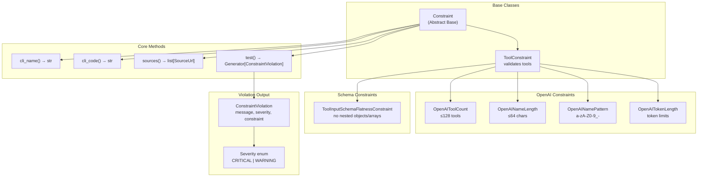
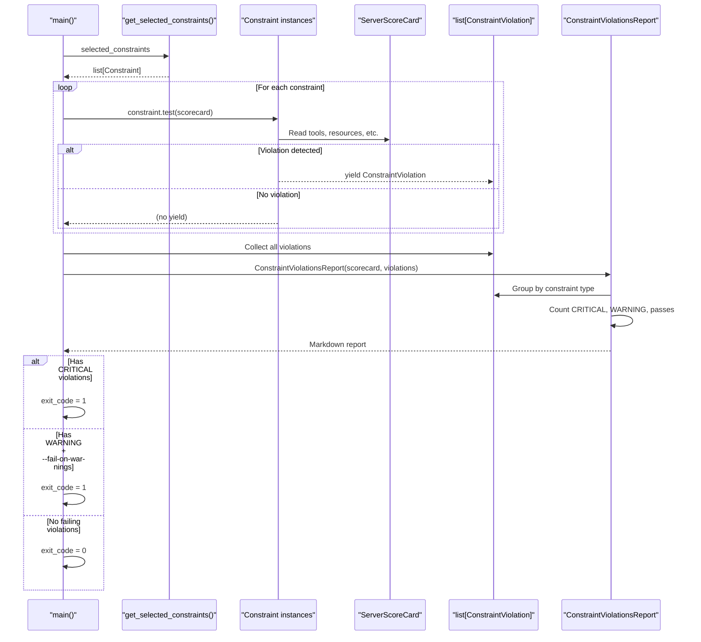
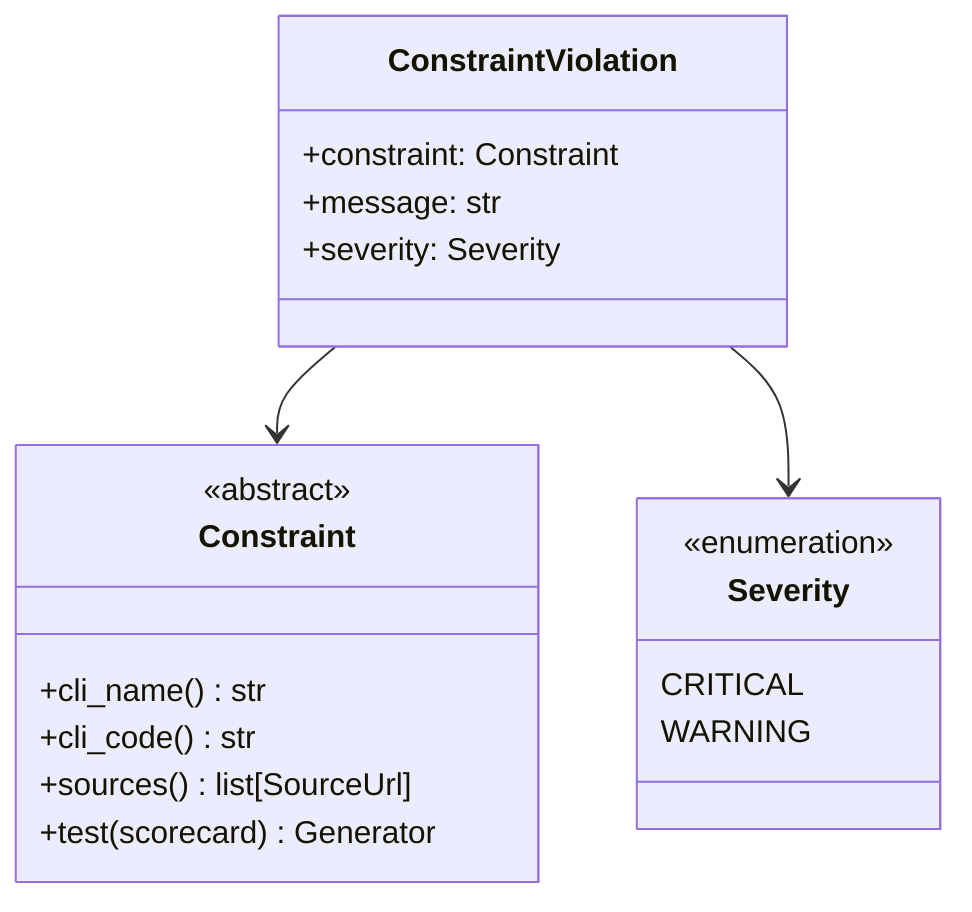

<!-- source: DeepWiki mcp.deepwiki.com · repo microsoft/mcp-interviewer · page 3.4 Constraint Checking · fetched 2026-10-26 -->

# Constraint Checking

<details>
<summary>Relevant source files</summary>

The following files were used as context for generating this wiki page:

- [README.md](README.md)
- [src/mcp_interviewer/constraints/tool_schema_flatness.py](src/mcp_interviewer/constraints/tool_schema_flatness.py)
- [src/mcp_interviewer/reports/interviewer/constraint_violations.py](src/mcp_interviewer/reports/interviewer/constraint_violations.py)
- [tests/constraints/test_tool_schema_flatness.py](tests/constraints/test_tool_schema_flatness.py)
- [uv.lock](uv.lock)

</details>


## Purpose and Scope

Constraint checking validates MCP server compliance against provider-specific requirements and best practices. This system runs automated tests against the server's capabilities (tools, resources, prompts) to detect violations before deployment. The constraint system executes after server inspection and tool evaluation, producing violations that are reported and used to determine exit codes.

For information about the broader interview process, see [Interview Execution Flow](#4.2). For report generation from constraint violations, see [Report Generation Pipeline](#4.5).

**Sources:** [README.md:34-54](), [src/mcp_interviewer/reports/interviewer/constraint_violations.py:1-86]()

## Constraint System Architecture

The constraint validation system uses an inheritance-based plugin architecture that allows easy extension with new constraint types. All constraints inherit from a base class and implement a common testing interface.



**Diagram: Constraint class hierarchy and core interfaces**

The `Constraint` base class defines four required methods that all constraints must implement:
- `cli_name()`: Returns the human-readable name
- `cli_code()`: Returns the short code (e.g., "OTC", "TSF") used in CLI arguments
- `sources()`: Returns URLs to documentation explaining the constraint
- `test()`: Executes validation logic and yields violations

**Sources:** [src/mcp_interviewer/constraints/base.py]() (implied), [src/mcp_interviewer/constraints/tool_schema_flatness.py:13-38]()

## Available Constraint Types

The following table lists all currently implemented constraints. Constraints are identified by both a CLI code (short form) and a CLI name (long form).

| CLI Code | CLI Name | Description | Severity | Target |
|----------|----------|-------------|----------|--------|
| `OTC` | openai-tool-count | Validates tool count ≤ 128 | CRITICAL | Server-wide |
| `ONL` | openai-name-length | Validates tool names ≤ 64 characters | CRITICAL | Per-tool |
| `ONP` | openai-name-pattern | Validates tool names match `^[a-zA-Z0-9_-]+$` | CRITICAL | Per-tool |
| `OTL` | openai-token-length | Validates token count within limits | WARNING | Per-tool |
| `TSF` | tool-schema-flatness | Validates no nested objects/arrays in schemas | WARNING | Per-tool |
| `OA` | - | Meta-code selecting all OpenAI constraints | - | - |

**Note:** The `OA` code is a convenience selector that includes `OTC`, `ONL`, `ONP`, and `OTL`.

**Sources:** [README.md:40-54](), [src/mcp_interviewer/constraints/tool_schema_flatness.py:26-33]()

## Constraint Execution Flow



**Diagram: Constraint validation execution sequence**

The constraint checking process follows these steps:

1. **Selection:** `get_selected_constraints()` filters constraints based on CLI arguments
2. **Testing:** Each constraint's `test()` method is called with the `ServerScoreCard`
3. **Collection:** Violations are yielded as generators and collected into a list
4. **Reporting:** Violations are grouped by constraint type for the report
5. **Exit Code:** Determined based on severity and `--fail-on-warnings` flag

**Sources:** [src/mcp_interviewer/reports/interviewer/constraint_violations.py:29-85]()

## Violation Severity and Handling

Violations are categorized by severity, which affects both reporting and build success:

### Severity Levels

```python
class Severity(Enum):
    CRITICAL  # Always causes build failure
    WARNING   # Fails only if --fail-on-warnings is set
```

### Severity Impact Matrix

| Severity | Report Symbol | Default Behavior | With `--fail-on-warnings` |
|----------|---------------|------------------|---------------------------|
| CRITICAL | ❌ | Exit code 1 | Exit code 1 |
| WARNING | ⚠️ | Exit code 0 | Exit code 1 |
| (none) | ✅ | Exit code 0 | Exit code 0 |

### ConstraintViolation Structure



**Diagram: ConstraintViolation data model**

Each `ConstraintViolation` contains:
- `constraint`: Reference to the constraint that produced the violation
- `message`: Human-readable description of the specific violation
- `severity`: `CRITICAL` or `WARNING` severity level

**Sources:** [src/mcp_interviewer/constraints/base.py]() (implied), [src/mcp_interviewer/reports/interviewer/constraint_violations.py:42-54]()

## Configuration and Selection

### CLI Usage

Constraints are selected via the `--constraints` flag, which accepts space-separated constraint codes:

```bash
# Check all OpenAI constraints
mcp-interviewer --constraints OA <server_command>

# Check specific constraints
mcp-interviewer --constraints OTC ONL TSF <server_command>

# Check only schema flatness
mcp-interviewer --constraints TSF <server_command>

# Fail build on warnings
mcp-interviewer --constraints OA --fail-on-warnings <server_command>
```

### Default Behavior

When `--constraints` is not specified, the system applies a default set of constraints. The selection is controlled by:

```python
selected_constraints = get_selected_constraints(constraint_codes)
# Returns: list[type[Constraint]]
```

This function resolves constraint codes (like "OA") into concrete constraint classes and handles inheritance relationships.

**Sources:** [README.md:156-190](), [src/mcp_interviewer/reports/interviewer/constraint_violations.py:29]()

## Tool Schema Flatness Constraint (TSF)

The `ToolInputSchemaFlatnessConstraint` is a detailed example of constraint implementation. It validates that tool input schemas avoid nested structures that make tools difficult to use.

### Validation Rules

The constraint checks for:
1. **Nested objects:** No `properties` field within another `properties` field
2. **Nested arrays:** No array type within an array's `items`
3. **$ref resolution:** Follows JSON Schema references to check resolved schemas

### Allowed Patterns

```json
// ✅ Flat schema - PASSES
{
  "type": "object",
  "properties": {
    "name": {"type": "string"},
    "age": {"type": "integer"}
  }
}

// ✅ Array of primitives - PASSES
{
  "type": "object",
  "properties": {
    "tags": {
      "type": "array",
      "items": {"type": "string"}
    }
  }
}

// ✅ Union types - PASSES
{
  "type": "object",
  "properties": {
    "value": {
      "oneOf": [
        {"type": "string"},
        {"type": "integer"}
      ]
    }
  }
}
```

### Rejected Patterns

```json
// ❌ Nested object - FAILS
{
  "type": "object",
  "properties": {
    "user": {
      "type": "object",
      "properties": {
        "name": {"type": "string"}
      }
    }
  }
}

// ❌ Nested array - FAILS
{
  "type": "object",
  "properties": {
    "matrix": {
      "type": "array",
      "items": {
        "type": "array",
        "items": {"type": "number"}
      }
    }
  }
}
```

### Implementation Details

The constraint uses recursive descent with these key features:

1. **Depth tracking:** Maintains depth counter to distinguish top-level `properties` from nested ones
2. **$ref resolution:** Uses `jsonschema.RefResolver` to resolve schema references
3. **Circular reference handling:** Tracks visited $ref URLs to prevent infinite loops
4. **Array context:** Tracks when inside an array's `items` to detect nested arrays

**Sources:** [src/mcp_interviewer/constraints/tool_schema_flatness.py:13-139](), [tests/constraints/test_tool_schema_flatness.py:31-53](), [tests/constraints/test_tool_schema_flatness.py:337-363]()

## Constraint Report Generation

Violations are presented in a structured report with three sections:

### Summary Table

| ❌ Errors | ⚠️ Warnings | ✅ Passes |
|-----------|-------------|-----------|
| Count of CRITICAL violations | Count of WARNING violations | Count of constraints with no violations |

### Detailed Violations

Violations are grouped by constraint type and displayed with:
- Severity indicator (❌ for CRITICAL, ⚠️ for WARNING, ✅ for passing)
- Constraint name and code
- Specific violation message
- Documentation links

Example output format:
```
❌ OpenAI Tool Count (OTC): Server has 150 tools but limit is 128 [[1]](https://platform.openai.com/...)

⚠️ Tool Schema Flatness (TSF): Tool 'create_user': inputSchema contains nested structures [[1]](https://composio.dev/...)

✅ OpenAI Name Pattern (ONP) [[1]](https://platform.openai.com/...)
```

### Collapsible Details

The report uses collapsible sections (when `--no-collapse` is not set) to keep the output manageable while preserving full detail.

**Sources:** [src/mcp_interviewer/reports/interviewer/constraint_violations.py:32-85]()

## Creating Custom Constraints

To add a new constraint, create a class inheriting from `Constraint` or `ToolConstraint`:

```python
from mcp_interviewer.constraints.base import (
    ToolConstraint, 
    ConstraintViolation, 
    Severity
)
from mcp import Tool
from collections.abc import Generator

class MyCustomConstraint(ToolConstraint):
    @classmethod
    def cli_name(cls) -> str:
        return "my-custom-constraint"
    
    @classmethod
    def cli_code(cls) -> str:
        return "MCC"
    
    @classmethod
    def sources(cls) -> list[SourceUrl]:
        return [HttpUrl("https://example.com/docs")]
    
    def test_tool(self, tool: Tool) -> Generator[ConstraintViolation, None, None]:
        # Validation logic here
        if some_condition:
            yield ConstraintViolation(
                self,
                f"Tool '{tool.name}' violates constraint",
                severity=Severity.WARNING
            )
```

### Base Classes

| Base Class | Use Case | Must Implement |
|------------|----------|----------------|
| `Constraint` | Server-wide validation | `test(ServerScoreCard)` |
| `ToolConstraint` | Per-tool validation | `test_tool(Tool)` |

The `ToolConstraint` base class automatically iterates over all tools in the server and calls `test_tool()` for each, making per-tool validation simpler.

**Sources:** [src/mcp_interviewer/constraints/tool_schema_flatness.py:13-38]()

---

