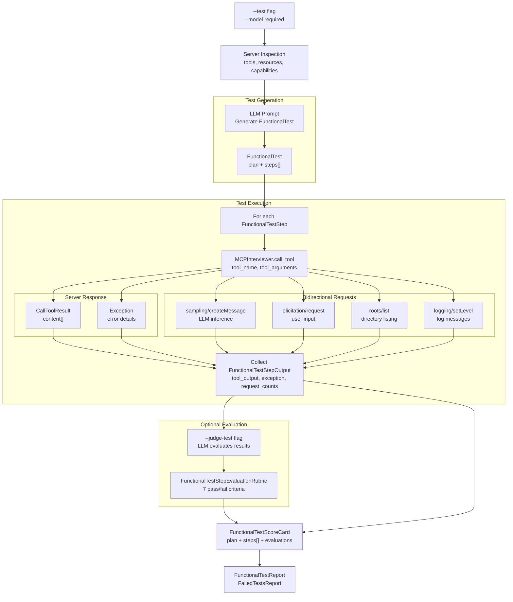
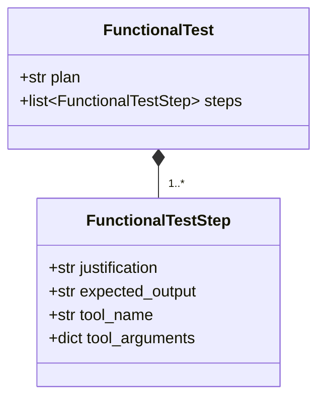
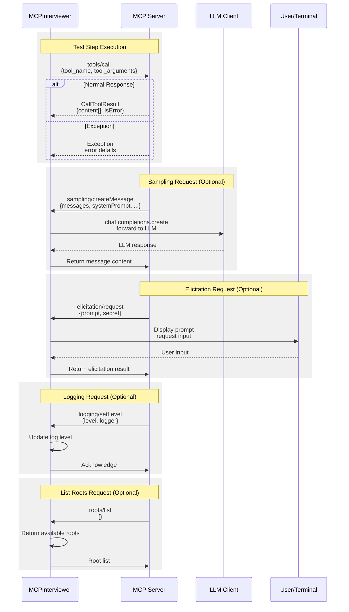
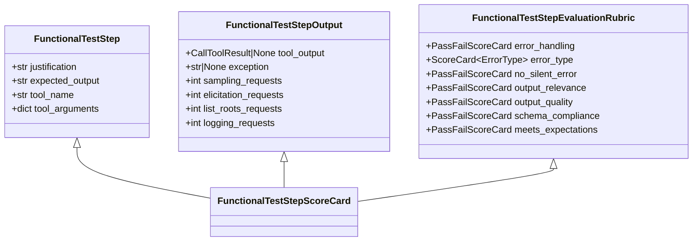
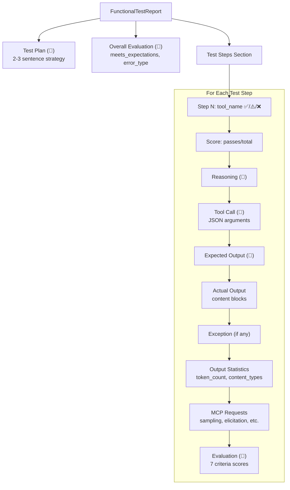

<!-- source: DeepWiki mcp.deepwiki.com · repo microsoft/mcp-interviewer · page 3.5 Functional Testing · fetched 2026-10-26 -->

# Functional Testing

<details>
<summary>Relevant source files</summary>

The following files were used as context for generating this wiki page:

- [README.md](README.md)
- [src/mcp_interviewer/models.py](src/mcp_interviewer/models.py)
- [src/mcp_interviewer/reports/functional_test/failed_tests.py](src/mcp_interviewer/reports/functional_test/failed_tests.py)
- [src/mcp_interviewer/reports/functional_test/test.py](src/mcp_interviewer/reports/functional_test/test.py)
- [src/mcp_interviewer/reports/functional_test/test_step.py](src/mcp_interviewer/reports/functional_test/test_step.py)

</details>


## Purpose and Scope

Functional testing exercises an MCP server by generating and executing realistic tool calls, allowing evaluation of server behavior in conditions similar to actual agent usage. This page covers test generation, execution mechanics, bidirectional server requests, evaluation criteria, and result interpretation.

For general LLM evaluation features (judging tool quality, scoring test results), see [LLM Evaluation](#3.6). For generated report formats, see [Understanding Reports](#3.7).

**Sources:** [README.md:56-58]()

## What is Functional Testing

Functional testing uses an LLM to create a test plan that exercises the MCP server's tools with realistic arguments. The interviewer executes each test step by calling the specified tools, capturing outputs, exceptions, and statistics. During execution, the server may make bidirectional requests back to the interviewer (sampling from the LLM, eliciting user input, logging messages). All execution data is collected in a `FunctionalTestScoreCard` for analysis.

**Purpose:**
- Validate that tools execute without errors
- Test tools with realistic, agent-like usage patterns
- Capture statistics about tool behavior (output types, token counts, request patterns)
- Identify errors, warnings, and unexpected behaviors

**Sources:** [README.md:56-58](), [src/mcp_interviewer/models.py:131-166]()

### Functional Testing Data Flow



**Sources:** [README.md:56-58](), [src/mcp_interviewer/models.py:131-166]()

## Enabling Functional Testing

Functional testing is **disabled by default**. Enable with the `--test` flag. An LLM client and model must be configured for test generation.

### CLI Example

```bash
# Enable functional testing (requires --model)
mcp-interviewer --test --model gpt-4.1 <server_command>

# Test + LLM evaluation of results
mcp-interviewer --test --judge-test --model gpt-4.1 <server_command>

# Test + all LLM features
mcp-interviewer --test --judge --model gpt-4.1 <server_command>
```

### Python API Example

```python
from mcp_interviewer import MCPInterviewer, StdioServerParameters
from openai import OpenAI

client = OpenAI()
params = StdioServerParameters(command="npx", args=["-y", "@modelcontextprotocol/server-everything"])

# Enable functional testing
interviewer = MCPInterviewer(
    client=client,
    model="gpt-4.1",
    should_run_functional_test=True,  # Enable tests
    should_judge_functional_test=False  # Disable LLM evaluation
)

scorecard = await interviewer.interview_server(params)
```

**Sources:** [README.md:157-181](), [README.md:254-268]()

## Test Generation Process

When functional testing is enabled, the interviewer uses the LLM to generate a `FunctionalTest` after server inspection completes. The test plan is based on the server's advertised capabilities (tools, resources, prompts).

### FunctionalTest Structure



| Field | Type | Description |
|-------|------|-------------|
| `plan` | `str` | 2-3 sentence overview of testing approach |
| `steps` | `list[FunctionalTestStep]` | Individual test steps to execute |

### FunctionalTestStep Fields

| Field | Type | Description |
|-------|------|-------------|
| `justification` | `str` | Why this step tests the tool effectively |
| `expected_output` | `str` | Expected result from the tool call |
| `tool_name` | `str` | Name of the tool to invoke |
| `tool_arguments` | `dict[str, Any]` | Realistic arguments for the tool |

**Sources:** [src/mcp_interviewer/models.py:131-138](), [src/mcp_interviewer/models.py:76-84]()

## Test Execution

The interviewer executes each `FunctionalTestStep` sequentially by calling `MCPInterviewer._call_tool`. For each step, the system:

1. Invokes `tools/call` with the specified `tool_name` and `tool_arguments`
2. Waits for the server response or exception
3. Handles any bidirectional requests from the server
4. Records the `CallToolResult` or exception
5. Counts sampling, elicitation, list roots, and logging requests
6. Collects output statistics (token counts, content types)

### Execution Flow with Bidirectional Requests



**Sources:** [src/mcp_interviewer/models.py:87-93]()

### FunctionalTestStepOutput Structure

After execution, each step produces a `FunctionalTestStepOutput`:

| Field | Type | Description |
|-------|------|-------------|
| `tool_output` | `CallToolResult \| None` | Successful tool response with `content[]` blocks |
| `exception` | `str \| None` | Exception message if tool call failed |
| `sampling_requests` | `int` | Count of `sampling/createMessage` requests |
| `elicitation_requests` | `int` | Count of `elicitation/request` requests |
| `list_roots_requests` | `int` | Count of `roots/list` requests |
| `logging_requests` | `int` | Count of `logging/setLevel` requests |

**Sources:** [src/mcp_interviewer/models.py:87-93]()

### Bidirectional Server Requests

During test execution, the server may issue requests back to the interviewer. These are tracked per test step:

| Request Type | MCP Method | Handler | Purpose |
|--------------|------------|---------|---------|
| **Sampling** | `sampling/createMessage` | Forward to LLM client | Server requests LLM inference |
| **Elicitation** | `elicitation/request` | Prompt user for input | Server needs user input (e.g., API keys) |
| **List Roots** | `roots/list` | Return available roots | Server queries file system roots |
| **Logging** | `logging/setLevel` | Update log configuration | Server adjusts logging verbosity |

**Sources:** [src/mcp_interviewer/models.py:87-93]()

## Test Data and Evaluation

Each executed test step is combined with its output and optional evaluation into a `FunctionalTestStepScoreCard`. This aggregates test definition, execution results, and LLM-based evaluation.

### FunctionalTestStepScoreCard Composition



**Sources:** [src/mcp_interviewer/models.py:123-125]()

### Evaluation Criteria (with --judge-test)

When `--judge-test` is enabled, each test step is evaluated by the LLM across seven criteria. Each produces a `PassFailScoreCard` with a score (`"pass"`, `"fail"`, `"N/A"`) and justification.

| Criterion | Pass | Fail | N/A |
|-----------|------|------|-----|
| **error_handling** | Detailed, actionable error message | No error message or uninformative | No error occurred |
| **error_type** | Categorizes error: Authorization, Connection, Internal Server, Bad Request | - | No error occurred |
| **no_silent_error** | `isError=true` matches error content | `isError=false` but content shows error | No error occurred |
| **output_relevance** | Output directly addresses input | Output unrelated to input | - |
| **output_quality** | Comprehensive, accurate, helpful | Incorrect or misleading | - |
| **schema_compliance** | Output matches declared `outputSchema` | Missing fields or incorrect types | - |
| **meets_expectations** | Output matches expected behavior | Differs significantly from expectations | - |

**Sources:** [src/mcp_interviewer/models.py:106-121]()

### ErrorType Classification

When an error occurs, the LLM classifies it:

| ErrorType | Description | Example |
|-----------|-------------|---------|
| `"Authorization Error"` | Authentication or permission issues | "Missing API key" |
| `"Connection Error"` | Network or transport failures | "Connection/Transport closed" |
| `"Internal Server Error"` | Server-side crashes or bugs | "Unhandled exception in tool handler" |
| `"Bad Request"` | Invalid arguments or parameters | "Invalid city name 'Lond@n'" |
| `"N/A"` | No error occurred | - |

**Sources:** [src/mcp_interviewer/models.py:96-102](), [src/mcp_interviewer/models.py:109-110]()

### Output Statistics

For each test step, the system computes statistics about the tool output:

| Statistic | Description | Source |
|-----------|-------------|--------|
| **Token Count** | Number of tokens in text content (using `gpt-4o` tokenizer) | [src/mcp_interviewer/reports/functional_test/test_step.py:60-78]() |
| **Content Type Distribution** | Count of each content block type (text, image, audio, resource_link, embedded_resource) | [src/mcp_interviewer/reports/functional_test/test_step.py:80-84]() |

**Sources:** [src/mcp_interviewer/reports/functional_test/test_step.py:55-108]()

## Understanding Test Results

Test results are presented in the generated report through multiple report components. The primary reports are `FunctionalTestReport` (complete test details) and `FailedTestsReport` (failures only).

### FunctionalTestReport Structure



**Sources:** [src/mcp_interviewer/reports/functional_test/test.py:1-80]()

### Report Content

The `FunctionalTestReport` includes:

1. **Test Plan** (if `--include-evaluations`): LLM-generated testing strategy
2. **Overall Evaluation** (if `--judge-test`): High-level assessment of test results
3. **Test Steps**: Individual step details with:
   - Step number, tool name, status indicator (✅/⚠️/❌)
   - Score summary (passes/total criteria)
   - Link to tool details section
   - Reasoning for why this step tests the tool
   - Tool call arguments (JSON)
   - Expected output
   - Actual output (truncated if >500 chars)
   - Exception details (if applicable)
   - Output statistics (token counts, content types)
   - MCP request counts
   - Evaluation scores (7 criteria, if `--judge-test`)

**Sources:** [src/mcp_interviewer/reports/functional_test/test.py:32-79](), [src/mcp_interviewer/reports/functional_test/test_step.py:109-233]()

### Status Indicators

Each test step displays a visual status:

| Indicator | Meaning | Condition |
|-----------|---------|-----------|
| ✅ | Success | No exception, `isError=false` |
| ⚠️ | Warning | No exception, but `isError=true` (tool reported error) |
| ❌ | Failure | Exception occurred during execution |

**Sources:** [src/mcp_interviewer/reports/functional_test/test_step.py:109-118]()

### FailedTestsReport

The `FailedTestsReport` filters test steps to show only those with failed evaluation criteria. It has two modes:

**Summary Mode** (default):
```
Failed Test Steps (🤖)
**Step 1: tool_name** - Failed: Error Handling, Output Quality
**Step 3: another_tool** - Failed: Schema Compliance
```

**Detailed Mode** (`detailed=True`):
Shows full `TestStepReport` for each failed step, including all evaluation criteria and justifications.

**Sources:** [src/mcp_interviewer/reports/functional_test/failed_tests.py:1-93]()

## Risk Acceptance

⚠️ **Functional testing executes tools on the MCP server**, which may:
- Modify files or databases
- Make network requests
- Consume resources (API calls, compute)
- Access sensitive data

**Recommended Precautions:**
1. Run servers in isolated containers (Docker, VM)
2. Use security tools to validate server safety before testing
3. Review generated test arguments before execution
4. Limit server access to host system resources
5. Monitor tool execution for unexpected behavior

**Example: Containerized Testing**
```bash
# Run server in isolated Docker container
NPX_CONTAINER="docker run -i --rm node:lts npx"
mcp-interviewer --test --model gpt-4.1 "$NPX_CONTAINER -y @modelcontextprotocol/server-everything"
```

**Sources:** [README.md:124](), [README.md:289-295]()

### Examining Generated Tests

Before accepting generated tests, review the `tool_arguments` to ensure they're safe:

```python
from mcp_interviewer import MCPInterviewer, StdioServerParameters
from openai import OpenAI

client = OpenAI()
params = StdioServerParameters(command="server_command")

interviewer = MCPInterviewer(client, "gpt-4.1")
# Generate test without executing
test = await interviewer._generate_functional_test(server_info)

# Review test.steps[].tool_arguments before accepting
for step in test.steps:
    print(f"Tool: {step.tool_name}")
    print(f"Arguments: {step.tool_arguments}")
    
# If acceptable, execute
scorecard = await interviewer.interview_server(params, should_run_functional_test=True)
```

**Note:** The current implementation does not provide a built-in "review before execute" mode. Test generation and execution occur atomically. To review tests, you must modify the interviewer code or implement custom test execution logic.

**Sources:** [README.md:289-296]()

## Report Configuration

Control functional test reporting through CLI flags:

| Flag | Effect | Default |
|------|--------|---------|
| `--reports FT` | Include `FunctionalTestReport` | Included in full report |
| `--reports FAIL` | Include `FailedTestsReport` | Not included by default |
| `--include-evaluations` | Show LLM-generated content (plan, reasoning, evaluations) | Enabled |
| `--no-collapse` | Disable collapsible sections for test steps | Collapsed |

**Examples:**

```bash
# Full test report with evaluations
mcp-interviewer --test --judge-test --model gpt-4.1 <server_command>

# Only failed tests, no collapsible sections
mcp-interviewer --test --judge-test --reports FAIL --no-collapse --model gpt-4.1 <server_command>

# Test results without LLM-generated content
mcp-interviewer --test --exclude-evaluations --model gpt-4.1 <server_command>
```

**Sources:** [README.md:71-91](), [src/mcp_interviewer/reports/functional_test/test.py:20-30]()

---

