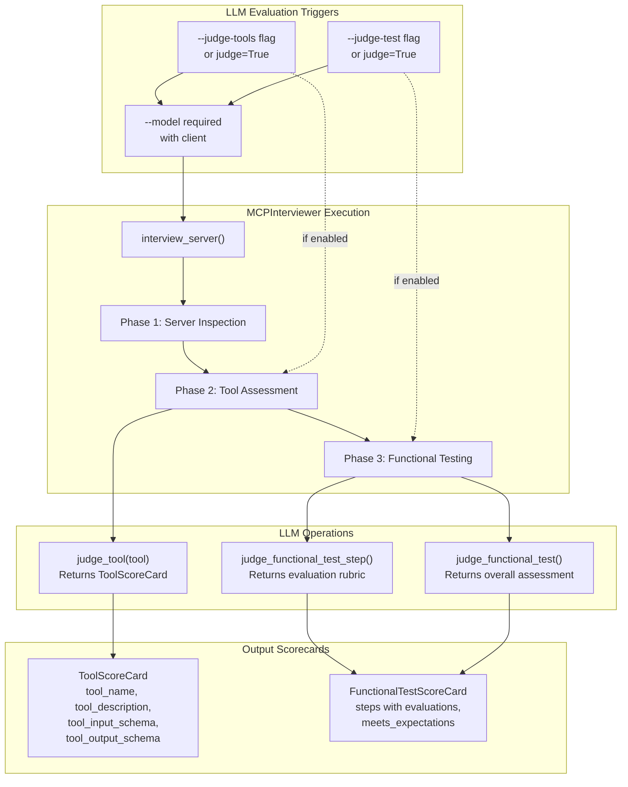
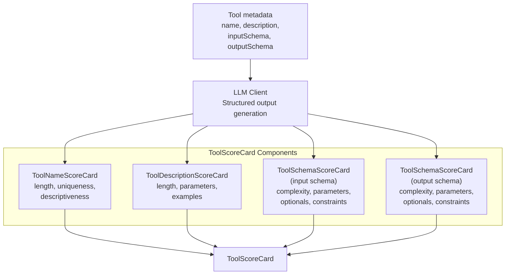
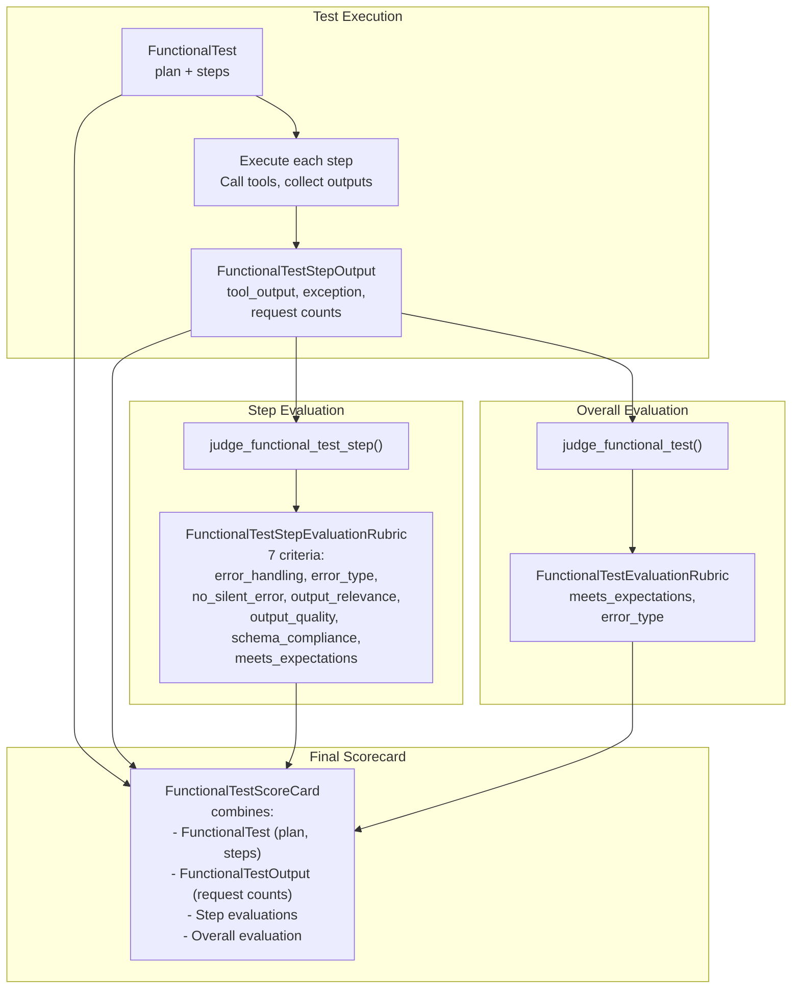
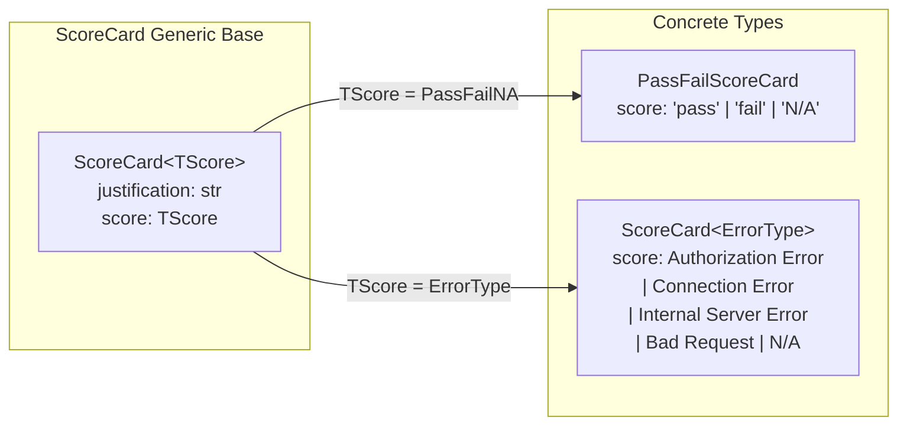

<!-- source: DeepWiki mcp.deepwiki.com · repo microsoft/mcp-interviewer · page 3.6 LLM Evaluation · fetched 2026-10-26 -->

# LLM Evaluation

<details>
<summary>Relevant source files</summary>

The following files were used as context for generating this wiki page:

- [README.md](README.md)
- [src/mcp_interviewer/cli.py](src/mcp_interviewer/cli.py)
- [src/mcp_interviewer/models.py](src/mcp_interviewer/models.py)
- [src/mcp_interviewer/reports/functional_test/test_step.py](src/mcp_interviewer/reports/functional_test/test_step.py)

</details>


This document describes the experimental LLM-based evaluation features in mcp-interviewer. These features use Large Language Models to provide structured assessments of tool quality and functional test results.

**Purpose and Scope:** This page covers how to enable LLM evaluation, what aspects of MCP servers are evaluated, the scoring rubrics used, and how to interpret results. For information about enabling functional testing (which can be evaluated by LLMs), see [Functional Testing](#3.5). For configuring the LLM client, see [CLI Usage](#3.1) and [Python API](#3.2).

**⚠️ Important:** LLM evaluation is experimental and all generated evaluations should be manually inspected for errors. The LLM may produce incorrect or misleading assessments.

## Overview

LLM evaluation enables two types of assessments:

1. **Tool Evaluation** - Analyzes the quality of tool names, descriptions, and schemas
2. **Functional Test Evaluation** - Assesses whether test outputs meet expectations

Both evaluation types generate structured `PassFailScoreCard` instances containing justifications and pass/fail/N/A scores. Results appear in reports with a 🤖 emoji to indicate LLM-generated content.



**Sources:** [README.md:60-65](), [cli.py:50-62](), [cli.py:156-161]()

## Enabling LLM Evaluation

### CLI Flags

| Flag | Description | Requirements |
|------|-------------|--------------|
| `--judge-tools` | Enable LLM evaluation of tools | `--model` required |
| `--judge-test` | Enable LLM evaluation of functional tests | `--model` and `--test` required |
| `--judge` | Enable all LLM evaluation | `--model` required; implies `--test` |

```bash
# Evaluate tools only
mcp-interviewer --model gpt-4o --judge-tools <server_command>

# Evaluate functional tests only (requires --test)
mcp-interviewer --model gpt-4o --test --judge-test <server_command>

# Evaluate both tools and tests
mcp-interviewer --model gpt-4o --judge <server_command>
```

**Sources:** [cli.py:50-62](), [cli.py:152-161](), [README.md:160-162]()

### Python API

```python
from mcp_interviewer import MCPInterviewer, StdioServerParameters
from openai import OpenAI

client = OpenAI()
interviewer = MCPInterviewer(
    client=client,
    model="gpt-4o",
    should_judge_tool=True,
    should_judge_functional_test=True,
    should_run_functional_test=True  # Required for test evaluation
)

scorecard = await interviewer.interview_server(params)
```

**Sources:** [README.md:254-268]()

## Tool Evaluation

Tool evaluation assesses four aspects of each tool using structured rubrics. The `judge_tool()` method generates a `ToolScoreCard` containing evaluations for tool name, description, input schema, and output schema.



**Sources:** [models.py:66-72]()

### Tool Name Evaluation

The `ToolNameScoreCard` evaluates three criteria:

| Criterion | Pass | Fail |
|-----------|------|------|
| **length** | Optimal length for comprehension (e.g., `getWeatherForecast`) | Too short or excessively long (e.g., `q` or `retrieve_information_about_weather_forecast_and_historical_data_analysis`) |
| **uniqueness** | Clearly unique across the server (e.g., `fetchGoogleSearchResults` vs `queryMySQLDatabase`) | Generic or duplicate names (e.g., multiple tools named `search` or `get_data`) |
| **descriptiveness** | Function immediately clear from name (e.g., `convertJsonToCsv`) | Unclear functionality (e.g., `process` or `handle`) |

**Sources:** [models.py:34-40]()

### Tool Description Evaluation

The `ToolDescriptionScoreCard` evaluates three criteria:

| Criterion | Pass | Fail |
|-----------|------|------|
| **length** | Adequate information, comprehensive yet concise | Too brief (e.g., "Gets data") or verbose (three paragraphs for simple concept) |
| **parameters** | Clear explanation of all parameters with types and requirements | Missing parameter explanations (e.g., just "location: string") |
| **examples** | Helpful, realistic examples showing actual usage | No examples provided |

**Example of pass-level description:**
> "Retrieves current weather data for any global location using either city name or coordinates. Returns temperature, conditions, and forecasts."

**Sources:** [models.py:44-50]()

### Tool Schema Evaluation

The `ToolSchemaScoreCard` evaluates both input and output schemas on four criteria:

| Criterion | Pass | Fail |
|-----------|------|------|
| **complexity** | Simple, intuitive structure with flat or minimal nesting | Overly complex, deeply nested (e.g., 5+ nesting levels) |
| **parameters** | Minimal necessary parameters (1-3 core parameters) | Too many parameters (10+ for a simple function) |
| **optionals** | Well-balanced required vs optional parameters | Too many optional fields with unclear defaults |
| **constraints** | Clear, helpful constraints with validation info | Missing constraints or validation information |

For output schemas without defined structure, all scores are set to N/A.

**Sources:** [models.py:54-62](), [models.py:69-72]()

## Functional Test Evaluation

Functional test evaluation occurs in two stages:
1. **Per-step evaluation** - Assesses each test step's execution
2. **Overall evaluation** - Assesses whether the complete test meets expectations



**Sources:** [models.py:123-126](), [models.py:162-166]()

### Test Step Evaluation Rubric

Each test step is evaluated on seven criteria:

| Criterion | Pass | Fail | N/A |
|-----------|------|------|-----|
| **error_handling** | Detailed, actionable error message | No error message or uninformative (e.g., "Error occurred") | No error occurred |
| **error_type** | Accurate error classification | Content indicates different error type | No error occurred |
| **no_silent_error** | `isError` is true when error occurred | `isError` is false but content shows error | No error occurred |
| **output_relevance** | Output directly addresses input | Output unrelated to input | - |
| **output_quality** | Comprehensive, accurate, helpful | Incorrect or misleading | - |
| **schema_compliance** | Output matches defined schema | Missing required fields or incorrect types | - |
| **meets_expectations** | Output matches expected behavior | Output differs significantly from expectations | - |

Error types are classified as:
- `Authorization Error`
- `Connection Error`
- `Internal Server Error`
- `Bad Request`
- `N/A` (no error)

**Sources:** [models.py:106-121]()

### Overall Test Evaluation

After all steps complete, the entire test receives an overall evaluation:

| Criterion | Description |
|-----------|-------------|
| **meets_expectations** | Pass if the test as a whole demonstrates expected server functionality; Fail if systematic issues or failures indicate server problems |
| **error_type** | Classification of any systemic error pattern across test steps |

**Sources:** [models.py:149-159]()

## LLM Client Configuration

The interviewer supports any Python object implementing the OpenAI chat completions API. Two configuration approaches are available:

### Default OpenAI Client

```bash
# Use OpenAI with API key from environment
export OPENAI_API_KEY="sk-..."
mcp-interviewer --model gpt-4o --judge <server_command>
```

### Custom Client via Keyword Arguments

```bash
# Use Ollama with OpenAI-compatible endpoint
mcp-interviewer \
  --client-kwargs "base_url=http://localhost:11434/v1" "api_key=ollama" \
  --model "gpt-oss:20b" \
  --judge \
  <server_command>
```

**Sources:** [cli.py:27-32](), [cli.py:183-198](), [README.md:196-214]()

### Custom Client via Import Path

Create a callable returning an OpenAI-compatible client:

```python
# my_client.py
from openai import AzureOpenAI

def azure_client():
    return AzureOpenAI(
        azure_endpoint="https://...",
        azure_ad_token_provider=...
    )
```

```bash
mcp-interviewer \
  --client "my_client.azure_client" \
  --model "gpt-4o" \
  --judge \
  <server_command>
```

**Sources:** [cli.py:23-26](), [cli.py:176-182](), [README.md:216-233]()

## Scoring System

All LLM evaluations use the `PassFailScoreCard` model containing a score and justification.



### Score Values

| Score | Meaning | Usage |
|-------|---------|-------|
| `pass` | Criterion met successfully | Tool quality is acceptable, test output is correct |
| `fail` | Criterion not met | Tool quality issue detected, test output problematic |
| `N/A` | Not applicable | No error occurred (for error-specific criteria), no output schema defined |

**Sources:** [models.py:20-30]()

### Justification Field

Every score includes a `justification` string explaining the LLM's reasoning. Justifications should be:
- Concise (1-2 sentences)
- Specific to the evaluated content
- Actionable when score is `fail`

Example justification for a failing tool name length:
> "Tool name 'q' is too short to convey its purpose. Consider using a more descriptive name like 'queryDatabase' or 'quickSearch'."

**Sources:** [models.py:21-22]()

## Report Integration

LLM-generated evaluations appear in reports with 🤖 indicators to distinguish them from system-measured metrics.

### Tool Evaluation Display

Tool evaluations appear in the Tools section of reports, showing pass/fail counts for each criterion:

```
## Tool: get_weather

**Tool Quality Assessment (🤖):** 8/12 criteria passed

**Name Evaluation:**
- ✅ length: Optimal length for tool comprehension
- ✅ uniqueness: Name is clearly unique within server
- ❌ descriptiveness: Name could be more specific (e.g., getCurrentWeather)
```

### Test Evaluation Display

Test step evaluations show scores and detailed justifications:

```
#### Step 1: fetch_data ✅

Score (🤖): 6/7

**Evaluation (🤖):**
- ✅ **Meets Expectations**: Output contains all expected fields with correct values
- ✅ **Output Quality**: Response is comprehensive and accurate
- ✅ **Output Relevance**: Output directly addresses the input parameters
```

**Sources:** [reports/functional_test/test_step.py:129-228]()

## Interpretation and Limitations

### Understanding LLM Scores

LLM evaluations are subjective assessments that should complement, not replace, human judgment. Consider:

1. **Context matters** - A "fail" score may be acceptable for certain use cases
2. **Consistency varies** - Different LLMs may score the same content differently
3. **Edge cases** - LLMs may misinterpret unusual but valid patterns
4. **False positives** - The LLM may flag issues that aren't problems in practice

### When Scoring is Disabled

Scoring may be disabled (all scores set to N/A) when:
- The test step encounters an exception before execution
- No LLM client is provided but test execution is enabled
- The `--judge-test` flag is not set

In these cases, the justification will state: "No score generated because scoring was not enabled for this test."

**Sources:** [reports/functional_test/test_step.py:196-203]()

### Best Practices

1. **Always manually review** - Inspect LLM justifications for accuracy
2. **Use multiple data points** - Combine LLM scores with constraint violations and functional test results
3. **Test with your LLM** - Different models (GPT-4o, Claude, etc.) may provide varying quality assessments
4. **Focus on patterns** - Multiple related failures are more significant than isolated issues
5. **Consider your use case** - Tool quality requirements vary by application

**Sources:** [README.md:62-64]()

---

