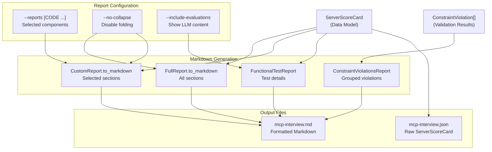
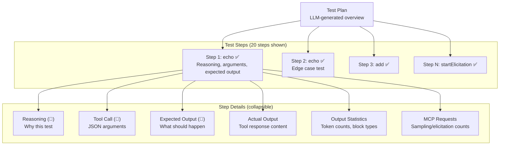
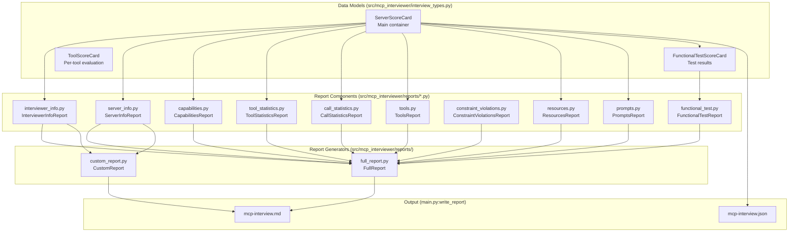

<!-- source: DeepWiki mcp.deepwiki.com · repo microsoft/mcp-interviewer · page 3.7 Understanding Reports · fetched 2026-10-26 -->

# Understanding Reports

<details>
<summary>Relevant source files</summary>

The following files were used as context for generating this wiki page:

- [README.md](README.md)
- [mcp-interview.json](mcp-interview.json)
- [mcp-interview.md](mcp-interview.md)

</details>


This page explains how to interpret the Markdown and JSON reports generated by mcp-interviewer after evaluating an MCP server. For information about configuring which report sections to include, see the `--reports` flag in [CLI Usage](#3.1). For details about the constraint checking system that produces the violation reports, see [Constraint Checking](#3.4).

## Report Output Files

After running an interview, mcp-interviewer generates two output files in the current directory:

| File | Format | Purpose |
|------|--------|---------|
| `mcp-interview.md` | Markdown | Human-readable report with formatted sections, tables, and collapsible details |
| `mcp-interview.json` | JSON | Machine-readable data containing complete `ServerScoreCard` for programmatic access |

**Sources:** [README.md:69](), [README.md:137-138]()

## Report Generation Pipeline



**Sources:** Diagram 5 in system architecture, [README.md:74-91]()

## Report Component Codes

The `--reports` CLI flag accepts component codes to customize output. Each code corresponds to a specific section:

| Code | Section | Content | Always Included |
|------|---------|---------|-----------------|
| `II` | Interviewer Info | Model, parameters, CLI command | Yes |
| `SI` | Server Info | Name, version, protocol, instructions | Yes |
| `CAP` | Capabilities | Supported features (tools, resources, prompts) | No |
| `TS` | Tool Statistics | Token counts, parameter counts, schema depth | No |
| `TCS` | Tool Call Statistics | Performance metrics from functional testing | No |
| `FT` | Functional Tests | Test execution results with step details | No |
| `CV` | Constraint Violations | Errors, warnings, and passes | Yes |
| `T` | Tools | Detailed tool schemas | No |
| `R` | Resources | Resource list with URIs | No |
| `RT` | Resource Templates | URI templates | No |
| `P` | Prompts | Available prompts with arguments | No |

**Example:**
```bash
# Include only server info, tool statistics, and constraint violations
mcp-interviewer --reports SI TS CV <server_command>
```

**Sources:** [README.md:76-91](), [mcp-interview.md:1-2614]()

## Markdown Report Structure

### Section 1: Interviewer Parameters

Located at the top of the report, this section documents the evaluation context:

```markdown
**Date:** 2025-10-11
**mcp-interviewer Version:** 0.0.12
**Evaluation Model:** gpt-4.1
**CLI Command:** mcp-interviewer--test --model gpt-4.1 docker run...
**Server Launch Parameters:**
  **Command:** docker
  **Arguments:** run -i --rm node:lts npx -y @modelcontextprotocol/server-everything
```

This section is always included and provides:
- Evaluation timestamp
- Tool version for reproducibility
- LLM model used (if `--test` or `--judge` enabled)
- Exact CLI command for reproduction
- Server connection parameters (`StdioServerParameters`, `HttpServerParameters`, or `SseServerParameters`)

**Sources:** [mcp-interview.md:46-71]()

### Section 2: Server Information

Displays metadata returned from the server's `initialize` response:

```markdown
**Name:** example-servers/everything
**Version:** 1.0.0
**Protocol Version:** 2025-06-18
**Instructions:** [Server-provided instructions text]
```

The `instructions` field contains guidance the server provides for LLM clients. This is optional and may be absent.

**Sources:** [mcp-interview.md:4-44](), [mcp-interview.json:19-43]()

### Section 3: Server Capabilities

A table summarizing MCP protocol features the server supports:

```markdown
| Feature | Supported | Count | Additional Features |
| --- | --- | --- | --- |
| Tools | ✅ | 12 |  |
| Resources | ✅ | 100 | subscribe |
| Resource Templates | ✅ | 1 |  |
| Prompts | ✅ | 3 |  |
| Logging | ✅ |  |  |
```

- **Supported**: ✅ if the server advertises this capability
- **Count**: Number of items (tools, resources, etc.)
- **Additional Features**: Capability-specific features (e.g., `subscribe` for resources, `listChanged` for dynamic capabilities)

**Sources:** [mcp-interview.md:73-81]()

### Section 4: Tool Statistics

Aggregated metrics about the server's tools, calculated without invoking them:

```markdown
| Metric | Total | Average | Min | Max |
| --- | --- | --- | --- | --- |
| Input schema lengths (gpt-4o tokens) | 589 | 49.1 | 29 | 76 |
| Input schemas parameter count |  | 1.0 | 0 | 2 |
| Input schemas required parameter count |  | 0.6 | 0 | 2 |
| Input schemas optional parameter count |  | 0.4 | 0 | 2 |
| Input schema max depth |  | 1.4 | 0 | 3 |
```

Metrics explained:
- **Input schema lengths**: Total tokens in all tool input schemas (using `gpt-4o` tokenizer). Large schemas may exceed LLM context limits.
- **Parameter counts**: Statistics about tool arguments (required vs. optional)
- **Max depth**: Deepest nesting level in schemas. Deep nesting may violate provider constraints (see [Constraint Checking](#3.4))

**Sources:** [mcp-interview.md:83-91]()

### Section 5: Tool Call Statistics

Performance metrics collected during functional testing (only present when `--test` flag used):

```markdown
| Metric | Total | Average | Min | Max |
| --- | --- | --- | --- | --- |
| Tool calls attempted | 20 |  |  |  |
| Tool calls returned output | 20 |  |  |  |
| Tool call outputs with no error | 20 |  |  |  |
| Tool call outputs with error | 0 |  |  |  |
| Exceptions calling tools | 0 |  |  |  |
| Tool call output lengths (gpt-4o text tokens) | 736 | 36.8 | 3 | 407 |
| Text output content blocks | 24 | 6.0 | 1 | 2 |
| Resource_Link output content blocks | 11 | 2.8 | 0 | 10 |
| Image output content blocks | 2 | 0.5 | 0 | 1 |
| Resource output content blocks | 2 | 0.5 | 0 | 1 |
| Sampling requests | 2 | 0.1 | 0 | 1 |
| Elicitation requests | 1 | 0.1 | 0 | 1 |
| Logging requests | 1 | 0.1 | 0 | 1 |
```

Key metrics:
- **Tool calls attempted vs. returned**: Detects unresponsive tools
- **Error counts**: Tools returning `isError: true`
- **Exceptions**: Python exceptions during tool invocation
- **Output lengths**: Token counts for text content (affects context usage)
- **Content block types**: Counts of text, images, resources, and resource links
- **MCP request counts**: Server-initiated requests (sampling, elicitation, logging)

**Sources:** [mcp-interview.md:92-108]()

### Section 6: Constraint Violations

Summary of validation results with severity indicators:

```markdown
| ❌ Errors | ⚠️ Warnings | ✅ Passes |
| --- | --- | --- |
| 0 | 0 | 5 |

Details:
✅ openai-name-length (ONL) [[1]](https://github.com/...)
✅ openai-name-pattern (ONP) [[1]](https://github.com/...)
❌ openai-tool-count (OTC) [[1]](https://platform.openai.com/...)
   Error: Server has 150 tools but OpenAI allows maximum 128
```

Severity levels:
- **✅ Pass**: Constraint satisfied
- **⚠️ Warning**: Non-critical violation (fails build only with `--fail-on-warnings`)
- **❌ Error**: Critical violation (always fails build with non-zero exit code)

Each constraint links to documentation explaining the requirement. See [Constraint Checking](#3.4) for detailed information about available constraints.

**Sources:** [mcp-interview.md:109-128]()

### Section 7: Functional Test Results

When `--test` is enabled, this section shows the LLM-generated test plan and execution results:



Each test step includes:
- **Status indicator**: ✅ (success) or ❌ (failure)
- **Tool name**: Links to detailed tool schema in Tools section
- **Reasoning (🤖)**: LLM's justification for including this test
- **Tool Call (🤖)**: Arguments passed to the tool
- **Expected Output (🤖)**: LLM's prediction of correct behavior
- **Actual Output**: Content blocks returned by the tool
- **Output Statistics**: Token counts and content block type counts
- **MCP Requests**: Counts of server-initiated requests during execution

Example step:

```markdown
#### Step 8: sampleLLM ✅

**Reasoning (🤖):** Test LLM sampling with a factual prompt and a small token limit.

**Tool Call (🤖):**
```json
{
  "prompt": "What is the capital of France?",
  "maxTokens": 10
}
```

**Expected Output (🤖):** Should return a short LLM-generated response, e.g., 'The capital of France is Paris.'

**Actual Output (1 blocks):**
✅ **No Error**
```
LLM sampling result: Dummy content
```

**MCP Requests:**
| Request Type | Count |
| --- | --- |
| Sampling | 1 |
```

**Legend markers:**
- 🤖 indicates AI-generated content (created by LLM during test generation or evaluation)
- Numbers like `(1 blocks)` show count of content blocks in response

**Sources:** [mcp-interview.md:130-943](), [mcp-interview.json:2392-2940]()

### Section 8: Tools

Detailed schemas for each tool, showing input/output specifications:

```markdown
### echo

**Description:**
```
Echoes back the input
```

**Input Schema:**
```json
{
  "type": "object",
  "properties": {
    "message": {
      "type": "string",
      "description": "Message to echo"
    }
  },
  "required": ["message"],
  "additionalProperties": false,
  "$schema": "http://json-schema.org/draft-07/schema#"
}
```

**Output Schema:**
_No Output Schema_
```

Each tool section includes:
- **Description**: Human-readable explanation of tool purpose
- **Input Schema**: JSON Schema defining required/optional parameters
- **Output Schema**: JSON Schema for structured output (if server provides one)

The `additionalProperties: false` constraint indicates the tool rejects unexpected parameters.

**Sources:** [mcp-interview.md:945-1340](), [mcp-interview.json:45-338]()

### Sections 9-11: Resources, Resource Templates, Prompts

These sections list available server features:

**Resources** (Section 9): Static resources with URIs and MIME types
```markdown
### Resource 1
**URI:** `test://static/resource/1`
**MIME Type:** text/plain
```

**Resource Templates** (Section 10): Dynamic URI patterns
```markdown
### Static Resource
**URI Template:** `test://static/resource/{id}`
**Description:** A static resource with a numeric ID
```

**Prompts** (Section 11): Reusable prompt templates
```markdown
### complex_prompt
**Description:** A prompt with arguments
**Arguments:**
- **temperature**: Temperature setting (Required: ✅)
- **style**: Output style (Required: ❌)
```

**Sources:** [mcp-interview.md:1343-2614](), [mcp-interview.json:340-1595]()

## JSON Report Structure

The `mcp-interview.json` file contains the raw `ServerScoreCard` object with the following top-level structure:

```json
{
  "parameters": { /* StdioServerParameters | HttpServerParameters */ },
  "initialize_result": { /* Server initialization response */ },
  "tools": [ /* Array of Tool objects */ ],
  "resources": [ /* Array of Resource objects */ ],
  "resource_templates": [ /* Array of ResourceTemplate objects */ ],
  "prompts": [ /* Array of Prompt objects */ ],
  "model": "gpt-4.1",
  "tool_scorecards": [ /* Array of ToolScoreCard objects */ ],
  "functional_test_scorecard": { /* FunctionalTestScoreCard object */ }
}
```

### Key JSON Fields

| Field | Type | Description |
|-------|------|-------------|
| `parameters` | `ServerParameters` | Connection parameters used to launch server |
| `initialize_result` | `InitializeResult` | Server capabilities and metadata |
| `tools` | `Tool[]` | Tool definitions with input/output schemas |
| `resources` | `Resource[]` | Available resources (may include `text` or `blob` content) |
| `resource_templates` | `ResourceTemplate[]` | URI templates for dynamic resources |
| `prompts` | `Prompt[]` | Prompt definitions with arguments |
| `model` | `string` | LLM model used for evaluation (if applicable) |
| `tool_scorecards` | `ToolScoreCard[]` | Per-tool quality evaluations (if `--judge-tools` used) |
| `functional_test_scorecard` | `FunctionalTestScoreCard` | Test execution results (if `--test` used) |

### FunctionalTestScoreCard Structure

When functional testing is enabled, the `functional_test_scorecard` field contains:

```json
{
  "meets_expectations": {
    "justification": "No score generated",
    "score": "N/A"
  },
  "error_type": { /* PassFailScoreCard */ },
  "sampling_requests": 2,
  "elicitation_requests": 1,
  "list_roots_requests": 0,
  "logging_requests": 1,
  "plan": "This testing plan systematically exercises...",
  "steps": [
    {
      "justification": "Echo is a foundational tool...",
      "expected_output": "Should return the exact message sent...",
      "tool_name": "echo",
      "tool_arguments": { "message": "Hello, MCP!" },
      "tool_output": { /* CallToolResult */ },
      "exception": null,
      "sampling_requests": 0,
      "elicitation_requests": 0,
      "logging_requests": 1,
      "error_handling": { /* PassFailScoreCard */ },
      "output_relevance": { /* PassFailScoreCard */ }
      /* ... additional evaluation fields ... */
    }
  ]
}
```

Each test step in the `steps` array contains:
- **Test generation fields**: `justification`, `expected_output`, `tool_name`, `tool_arguments`
- **Execution results**: `tool_output`, `exception`
- **MCP request counts**: `sampling_requests`, `elicitation_requests`, `logging_requests`
- **Evaluation fields**: `error_handling`, `output_relevance`, `meets_expectations` (if `--judge-test` enabled)

**Sources:** [mcp-interview.json:1-2940]()

## Interpreting Statistics

### Token Counts

All token counts use the `gpt-4o` tokenizer (cl100k_base) for consistency:

```python
# Example from mcp-interview.json
"Input schema lengths (gpt-4o tokens)": {
  "Total": 589,
  "Average": 49.1,
  "Min": 29,
  "Max": 76
}
```

**Interpretation:**
- **Total > 4096**: May exceed smaller model context limits
- **Max > 1000**: Individual tool schema is verbose, may need simplification
- **Average > 100**: Server may have complex tools requiring detailed schemas

### Schema Depth

The `Input schema max depth` metric measures nesting levels in JSON schemas:

```python
depth_examples = {
  "flat_schema": 1,        # { "type": "object", "properties": { "name": "string" } }
  "nested_schema": 2,      # { "type": "object", "properties": { "user": { "type": "object", ... } } }
  "deeply_nested": 3       # Three levels of object nesting
}
```

**Constraint implications:**
- **Depth > 1**: May violate `tool-schema-flatness` constraint (TSF)
- **Depth > 2**: Increases likelihood of LLM misunderstanding parameter structure

### Content Block Counts

The tool call statistics section shows distribution of content types:

```markdown
| Text output content blocks | 24 | 6.0 | 1 | 2 |
| Resource_Link output content blocks | 11 | 2.8 | 0 | 10 |
| Image output content blocks | 2 | 0.5 | 0 | 1 |
```

**Patterns to observe:**
- **High text block average**: Tools return verbose or multi-part responses
- **Presence of images**: Server supports multi-modal content
- **Resource links**: Server leverages MCP's resource reference feature

**Sources:** [mcp-interview.md:83-108]()

## Customizing Report Output

### Selecting Report Sections

Use the `--reports` flag to include specific sections:

```bash
# Minimal report: just server info and constraint violations
mcp-interviewer --reports SI CV <server_command>

# Focus on tools: include statistics, schemas, and test results
mcp-interviewer --reports TS T FT --test --model gpt-4.1 <server_command>

# Full server inventory: capabilities, tools, resources, prompts
mcp-interviewer --reports CAP T R RT P <server_command>
```

**Note:** Interviewer Info (II) and Constraint Violations (CV) are always included regardless of `--reports` specification.

### Collapsible Sections

By default, most sections are wrapped in `<details>` tags for collapsibility:

```markdown
<details>
<summary>Toggle details</summary>

... section content ...

</details>
```

Use `--no-collapse` to expand all sections:

```bash
mcp-interviewer --no-collapse <server_command>
```

This is useful for searching or reading the full report in text editors.

### Including/Excluding LLM Evaluations

When using `--judge-test`, LLM-generated evaluation scorecards are included by default. To exclude them and show only test execution results:

```bash
mcp-interviewer --test --judge-test --no-include-evaluations <server_command>
```

This reduces report size while preserving test execution data.

**Sources:** [README.md:156-194]()

## Report Generation Code Mapping



**Key files:**
- [src/mcp_interviewer/interview_types.py](): Defines `ServerScoreCard`, `FunctionalTestScoreCard`, and related data models
- [src/mcp_interviewer/reports/](): Directory containing report component implementations
- [src/mcp_interviewer/main.py](): Orchestrates report generation and file writing

**Sources:** Diagram 5 from system architecture

## Common Patterns and Troubleshooting

### Empty Statistics Sections

If Tool Call Statistics or Functional Test Results are absent:
- **Cause**: `--test` flag not provided
- **Solution**: Re-run with `--test --model <model_name>` to enable functional testing

### Missing Evaluation Fields

If test steps show `"No score generated"` for evaluation fields:
- **Cause**: `--judge-test` flag not provided
- **Solution**: Re-run with `--judge-test` to enable LLM-based test evaluation

### Large Report Files

Reports can grow large (>1MB) with many tools or resources:
- **Use `--reports` flag**: Include only needed sections (e.g., `--reports SI TS CV`)
- **Use `--no-include-evaluations`**: Omit verbose LLM justifications
- **Rely on JSON**: Parse `mcp-interview.json` programmatically instead of reading Markdown

### Constraint Violation Interpretation

If seeing unexpected constraint violations:
- **Check constraint documentation**: Each violation links to source documentation
- **Review OpenAI constraints**: Many constraints reflect OpenAI's function calling limits
- **Consider `--fail-on-warnings`**: Warnings may indicate non-critical issues you can accept

**Sources:** [README.md:156-194](), [README.md:289-298]()

---

