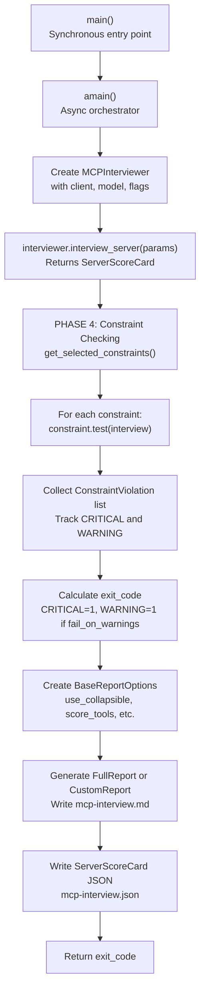
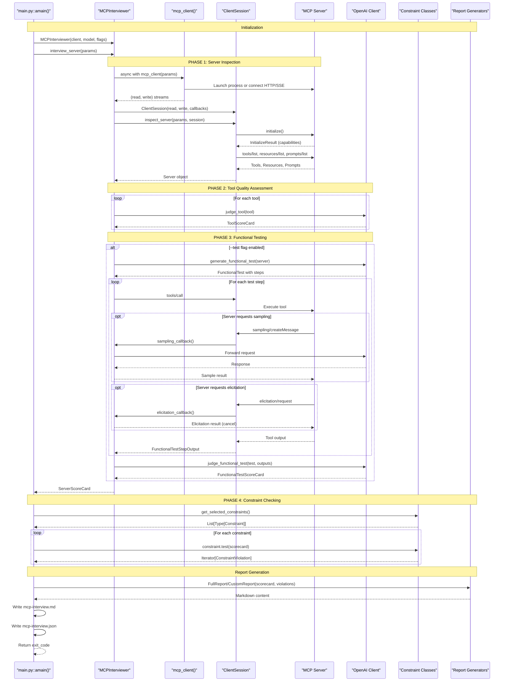
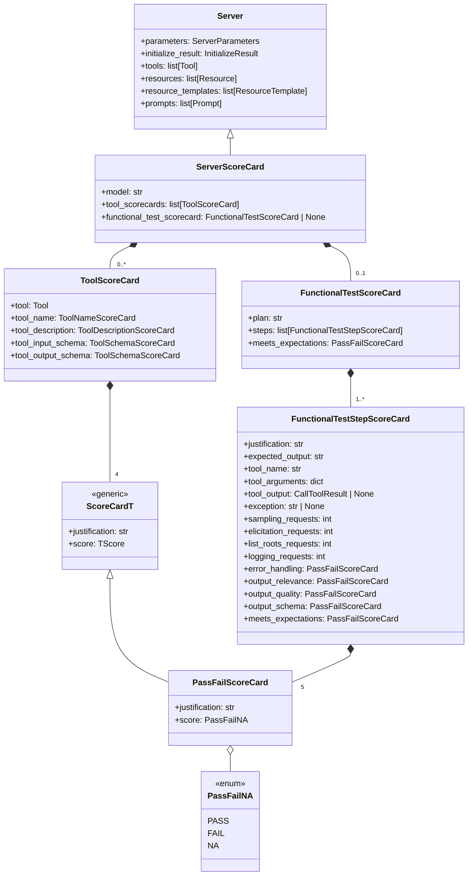
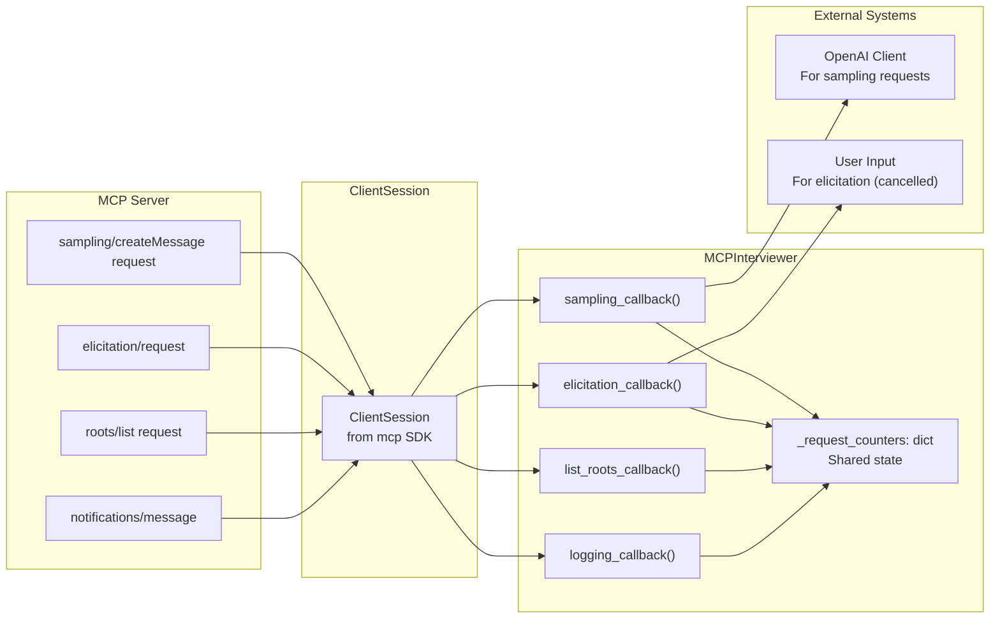

<!-- source: DeepWiki mcp.deepwiki.com · repo microsoft/mcp-interviewer · page 4 Architecture · fetched 2026-10-26 -->

# Architecture

<details>
<summary>Relevant source files</summary>

The following files were used as context for generating this wiki page:

- [src/mcp_interviewer/__init__.py](src/mcp_interviewer/__init__.py)
- [src/mcp_interviewer/interviewer/_interviewer.py](src/mcp_interviewer/interviewer/_interviewer.py)
- [src/mcp_interviewer/main.py](src/mcp_interviewer/main.py)

</details>


This document explains the internal architecture and design of mcp-interviewer. It covers the core components, their interactions, data flow, and execution phases. This page is intended for developers who want to understand how the system works internally.

For information about using mcp-interviewer, see [User Guide](#3). For information about contributing to the codebase, see [Development Guide](#5).

## System Overview

The mcp-interviewer system is organized into distinct layers with clear separation of concerns. The architecture follows a pipeline pattern where data flows through multiple phases of evaluation, each producing structured results that feed into the next stage.

```mermaid
graph TB
    subgraph "Entry Points"
        CLI["cli.py<br/>CLI parsing and logging"]
        APIEntry["__init__.py<br/>Python API exports"]
    end
    
    subgraph "Orchestration Layer"
        MainFunc["main.py::main()<br/>Synchronous wrapper"]
        AMainFunc["main.py::amain()<br/>Async orchestrator"]
        Interviewer["interviewer/_interviewer.py<br/>MCPInterviewer class"]
    end
    
    subgraph "Connection Management"
        MCPClient["interviewer/connection.py<br/>mcp_client()"]
        StdioParams["models.py<br/>StdioServerParameters"]
        HTTPParams["models.py<br/>StreamableHttpServerParameters"]
        SSEParams["models.py<br/>SseServerParameters"]
    end
    
    subgraph "Evaluation Modules"
        Inspection["interviewer/inspection.py<br/>inspect_server()"]
        ToolJudging["interviewer/tool_judging.py<br/>judge_tool()"]
        TestGen["interviewer/test_generation.py<br/>generate_functional_test()"]
        TestExec["interviewer/test_execution.py<br/>execute_functional_test()"]
        TestJudge["interviewer/test_judging.py<br/>judge_functional_test()"]
        Callbacks["interviewer/callbacks.py<br/>sampling/elicitation handlers"]
    end
    
    subgraph "Constraint System"
        GetConstraints["constraints/__init__.py<br/>get_selected_constraints()"]
        BaseConstraint["constraints/base.py<br/>Constraint class"]
        ToolConstraints["constraints/tool.py<br/>ToolConstraint subclasses"]
    end
    
    subgraph "Report System"
        ReportBase["reports/base.py<br/>BaseReport"]
        FullReport["reports/__init__.py<br/>FullReport"]
        CustomReport["reports/custom.py<br/>CustomReport"]
        ViolationReport["reports/constraint_violations.py"]
    end
    
    subgraph "Data Models"
        ServerModel["models.py<br/>Server"]
        ScoreCardModel["models.py<br/>ServerScoreCard"]
        ToolScoreCardModel["models.py<br/>ToolScoreCard"]
        FuncTestModel["models.py<br/>FunctionalTestScoreCard"]
    end
    
    CLI --> MainFunc
    APIEntry --> MainFunc
    MainFunc --> AMainFunc
    
    AMainFunc --> Interviewer
    AMainFunc --> GetConstraints
    AMainFunc --> FullReport
    AMainFunc --> CustomReport
    
    Interviewer --> MCPClient
    MCPClient --> StdioParams
    MCPClient --> HTTPParams
    MCPClient --> SSEParams
    
    Interviewer --> Inspection
    Interviewer --> ToolJudging
    Interviewer --> TestGen
    Interviewer --> TestExec
    Interviewer --> TestJudge
    Interviewer --> Callbacks
    
    Inspection --> ServerModel
    ToolJudging --> ToolScoreCardModel
    TestExec --> FuncTestModel
    TestJudge --> FuncTestModel
    
    Interviewer --> ScoreCardModel
    ScoreCardModel --> ServerModel
    ScoreCardModel --> ToolScoreCardModel
    ScoreCardModel --> FuncTestModel
    
    GetConstraints --> BaseConstraint
    GetConstraints --> ToolConstraints
    BaseConstraint --> AMainFunc
    
    ScoreCardModel --> ReportBase
    ReportBase --> FullReport
    ReportBase --> CustomReport
    ReportBase --> ViolationReport
```



**Sources:** [src/mcp_interviewer/__init__.py:1-13](), [src/mcp_interviewer/main.py:1-173](), [src/mcp_interviewer/interviewer/_interviewer.py:1-442]()

## Core Components

The system consists of three primary components that work together to evaluate MCP servers:

### MCPInterviewer Class

The `MCPInterviewer` class [src/mcp_interviewer/interviewer/_interviewer.py:52-442]() is the central evaluation engine. It manages the complete lifecycle of server evaluation including connection management, test execution, and result compilation.

| Component | Type | Purpose |
|-----------|------|---------|
| `_client` | `Client \| None` | OpenAI client for LLM operations |
| `_model` | `str \| None` | Model name (e.g., "gpt-4o") |
| `_should_run_functional_test` | `bool` | Enable functional testing phase |
| `_should_judge_tool` | `bool` | Enable LLM-based tool evaluation |
| `_should_judge_functional_test` | `bool` | Enable LLM-based test evaluation |
| `_request_counters` | `dict` | Tracks sampling/elicitation/logging requests |

Key methods include:

- `interview_server()` [src/mcp_interviewer/interviewer/_interviewer.py:328-442]() - Main orchestration method that coordinates all phases
- `inspect_server()` [src/mcp_interviewer/interviewer/_interviewer.py:224-240]() - Phase 1: Discovery of server capabilities
- `judge_tool()` [src/mcp_interviewer/interviewer/_interviewer.py:83-99]() - Phase 2: Tool quality assessment
- `generate_functional_test()` [src/mcp_interviewer/interviewer/_interviewer.py:101-120]() - Phase 3a: Test generation
- `execute_functional_test()` [src/mcp_interviewer/interviewer/_interviewer.py:139-157]() - Phase 3b: Test execution
- `judge_functional_test()` [src/mcp_interviewer/interviewer/_interviewer.py:189-222]() - Phase 3c: Test evaluation

**Sources:** [src/mcp_interviewer/interviewer/_interviewer.py:52-442]()

### Main Orchestrator

The `main.py` module [src/mcp_interviewer/main.py:1-173]() provides the top-level orchestration that coordinates the interviewer with constraint checking and report generation.



The `amain()` function [src/mcp_interviewer/main.py:16-129]() accepts configuration parameters and coordinates:

1. MCPInterviewer instantiation based on enabled features
2. Server evaluation via `interview_server()`
3. Constraint validation (Phase 4)
4. Exit code determination based on violations
5. Report generation (Markdown and JSON)

**Sources:** [src/mcp_interviewer/main.py:16-129]()

### Connection Management

Connection to MCP servers is abstracted through the `mcp_client()` context manager in `interviewer/connection.py`. It supports three connection types defined in `models.py`:

| Parameter Type | Connection Method | Use Case |
|----------------|-------------------|----------|
| `StdioServerParameters` | Local subprocess via stdin/stdout | Development, local servers |
| `StreamableHttpServerParameters` | HTTP streaming | Remote servers, containerized deployments |
| `SseServerParameters` | Server-Sent Events | Alternative streaming protocol |

All connection types yield a `(read, write)` stream pair compatible with `ClientSession` from the `mcp` SDK.

**Sources:** [src/mcp_interviewer/main.py:19]()

## Execution Flow

The evaluation process follows a strict four-phase pipeline. Each phase builds on the results of the previous phase.



**Sources:** [src/mcp_interviewer/interviewer/_interviewer.py:328-442](), [src/mcp_interviewer/main.py:16-129]()

### Phase 1: Server Inspection

The inspection phase [src/mcp_interviewer/interviewer/_interviewer.py:368-371]() discovers server capabilities without requiring LLM access. The `inspect_server()` function in `interviewer/inspection.py`:

1. Initializes the MCP server connection via `session.initialize()`
2. Reads server capabilities from `InitializeResult`
3. Conditionally lists tools (if `capabilities.tools` is set)
4. Conditionally lists resources (if `capabilities.resources` is set)
5. Conditionally lists prompts (if `capabilities.prompts` is set)
6. Returns a `Server` object containing all discovered features

This phase never fails - if the server doesn't support a capability, that section is simply omitted from results.

**Sources:** [src/mcp_interviewer/interviewer/_interviewer.py:368-371]()

### Phase 2: Tool Quality Assessment

The tool quality assessment phase [src/mcp_interviewer/interviewer/_interviewer.py:374-397]() evaluates each discovered tool. If `should_judge_tool` is `False`, this phase creates scorecards with `N/A` values without LLM calls.

When LLM evaluation is enabled:

1. For each tool, `judge_tool()` sends the tool definition to the LLM
2. The LLM evaluates four aspects: name quality, description quality, input schema quality, output schema quality
3. Results are collected into `ToolScoreCard` objects
4. Errors are logged but don't stop evaluation of other tools

The phase uses `asyncio.gather()` with `return_exceptions=True` to evaluate all tools concurrently while capturing failures.

**Sources:** [src/mcp_interviewer/interviewer/_interviewer.py:374-397]()

### Phase 3: Functional Testing

The functional testing phase [src/mcp_interviewer/interviewer/_interviewer.py:400-422]() is optional and consists of three sub-phases:

**3a. Test Generation**: The `generate_functional_test()` method uses the LLM to create a test plan with multiple steps. Each step specifies a tool to call and expected output.

**3b. Test Execution**: The `execute_functional_test()` method runs each test step sequentially:
- Calls tools via `session.call_tool()`
- Tracks sampling requests (server asking LLM for help)
- Tracks elicitation requests (server asking user for input)
- Tracks logging notifications
- Captures tool outputs and exceptions

**3c. Test Evaluation**: The `judge_functional_test()` method sends execution results to the LLM, which evaluates:
- Error handling quality
- Output relevance to the request
- Output quality and completeness
- Schema compliance
- Whether expectations were met

The result is a `FunctionalTestScoreCard` containing the plan, step-by-step evaluation, and overall assessment.

**Sources:** [src/mcp_interviewer/interviewer/_interviewer.py:400-422]()

### Phase 4: Constraint Checking

Constraint checking [src/mcp_interviewer/main.py:72-95]() runs after the interviewer completes. The `get_selected_constraints()` function returns constraint classes based on user selection (or all constraints if none specified).

For each constraint:

1. Instantiate the constraint class
2. Call `constraint.test(interview)` which yields `ConstraintViolation` objects
3. Collect all violations
4. Determine exit code based on severity:
   - `CRITICAL` violations always cause exit code 1
   - `WARNING` violations cause exit code 1 only if `--fail-on-warnings` is set

Violations are grouped by constraint in the final report.

**Sources:** [src/mcp_interviewer/main.py:72-95]()

## Data Model Architecture

The data models form a hierarchical structure rooted at `ServerScoreCard`. All models are Pydantic classes defined in `models.py`.



### Key Model Classes

**`Server`**: Base class containing server discovery results from Phase 1. Includes server parameters, initialization result, and all discovered capabilities (tools, resources, prompts).

**`ServerScoreCard`**: Extends `Server` with evaluation results. Adds the model name used for evaluation, tool scorecards from Phase 2, and optional functional test scorecard from Phase 3.

**`ToolScoreCard`**: Contains evaluation results for a single tool. Includes the original `Tool` object and four specialized scorecards evaluating different aspects.

**`FunctionalTestScoreCard`**: Contains the test plan, individual step results, and overall assessment. Each step includes both input (test definition), output (execution results), and evaluation (LLM judgment).

**`ScoreCard[TScore]`**: Generic base class for all scoring. Contains a justification string and a score of type `TScore`. Specialized versions include `PassFailScoreCard`, `ToolNameScoreCard`, `ToolDescriptionScoreCard`, etc.

**Sources:** [src/mcp_interviewer/models.py]() (referenced but not provided in full)

## Constraint System Architecture

Constraints are defined as classes inheriting from the abstract `Constraint` base class in `constraints/base.py`. The system uses a plugin architecture where new constraints can be added without modifying core code.

```mermaid
graph TB
    subgraph "Constraint Discovery"
        GetSelected["get_selected_constraints()<br/>constraints/__init__.py"]
        AllConstraints["ALL_CONSTRAINTS list<br/>Registry of constraint classes"]
        CLIMatch["Match by cli_code() or cli_name()"]
    end
    
    subgraph "Base Classes"
        BaseConstraint["Constraint<br/>Abstract base class"]
        ToolConstraintBase["ToolConstraint<br/>Base for tool validation"]
    end
    
    subgraph "Concrete Constraints"
        OTC["OpenAIToolCount<br/>≤128 tools"]
        ONL["OpenAINameLength<br/>≤64 chars"]
        ONP["OpenAINamePattern<br/>^[a-zA-Z0-9_-]+$"]
        OTL["OpenAITokenLength<br/>Token limits"]
        TSF["ToolInputSchemaFlatnessConstraint<br/>No nested objects/arrays"]
    end
    
    subgraph "Constraint Execution"
        TestMethod["constraint.test(scorecard)<br/>Yields violations"]
        Violation["ConstraintViolation<br/>message, severity, constraint"]
    end
    
    subgraph "Severity Levels"
        Critical["Severity.CRITICAL<br/>Always fails"]
        Warning["Severity.WARNING<br/>Conditionally fails"]
    end
    
    GetSelected --> AllConstraints
    AllConstraints --> CLIMatch
    CLIMatch --> BaseConstraint
    
    BaseConstraint <|-- ToolConstraintBase
    ToolConstraintBase <|-- OTC
    ToolConstraintBase <|-- ONL
    ToolConstraintBase <|-- ONP
    ToolConstraintBase <|-- OTL
    ToolConstraintBase <|-- TSF
    
    OTC --> TestMethod
    ONL --> TestMethod
    ONP --> TestMethod
    OTL --> TestMethod
    TSF --> TestMethod
    
    TestMethod --> Violation
    Violation --> Critical
    Violation --> Warning
```

### Constraint Base Class

The `Constraint` abstract class defines the interface:

| Method | Return Type | Purpose |
|--------|-------------|---------|
| `cli_name()` | `str` | Human-readable name for CLI help |
| `cli_code()` | `str` | Short code for CLI selection (e.g., "OTC") |
| `sources()` | `list[str]` | Documentation URLs |
| `test(scorecard)` | `Iterator[ConstraintViolation]` | Validation logic |

### ToolConstraint Specialization

The `ToolConstraint` class provides a helper base for constraints that operate on individual tools. It implements `test()` to iterate over all tools in the scorecard and call `test_tool()` for each.

**Sources:** [src/mcp_interviewer/constraints/base.py]() (referenced), [src/mcp_interviewer/main.py:77-80]()

## Report Generation Architecture

Reports are generated from the `ServerScoreCard` and violation list. The system uses a modular component architecture where different report sections can be composed.

```mermaid
graph TB
    subgraph "Input Data"
        ScoreCard["ServerScoreCard<br/>Complete evaluation results"]
        ViolationsList["list[ConstraintViolation]<br/>Validation failures"]
        Options["BaseReportOptions<br/>use_collapsible, score_tools, etc."]
    end
    
    subgraph "Report Base Class"
        BaseReport["BaseReport<br/>reports/base.py"]
        BuildMethod["build() -> str<br/>Generates markdown"]
        ComponentMethod["Component rendering methods"]
    end
    
    subgraph "Report Types"
        FullReportClass["FullReport<br/>All components in fixed order"]
        CustomReportClass["CustomReport<br/>User-selected components"]
    end
    
    subgraph "Report Components"
        InterviewerInfoComp["build_interviewer_info()"]
        ServerInfoComp["build_server_info()"]
        CapabilityComp["build_capability_assessment()"]
        ToolStatsComp["build_tool_statistics()"]
        CallStatsComp["build_tool_call_statistics()"]
        FuncTestComp["build_functional_tests()"]
        ConstraintComp["build_constraint_violations()"]
        ToolsComp["build_tools()"]
        ResourcesComp["build_resources()"]
        PromptsComp["build_prompts()"]
    end
    
    subgraph "Specialized Reports"
        ViolationReportClass["ConstraintViolationsReport<br/>Grouped by constraint"]
        TestReportClass["FunctionalTestReport<br/>Detailed test execution"]
    end
    
    subgraph "Output"
        MarkdownFile["mcp-interview.md<br/>Human-readable"]
        JSONFile["mcp-interview.json<br/>Machine-readable"]
    end
    
    ScoreCard --> BaseReport
    ViolationsList --> BaseReport
    Options --> BaseReport
    
    BaseReport <|-- FullReportClass
    BaseReport <|-- CustomReportClass
    BaseReport <|-- ViolationReportClass
    BaseReport <|-- TestReportClass
    
    BaseReport --> BuildMethod
    BuildMethod --> ComponentMethod
    
    ComponentMethod --> InterviewerInfoComp
    ComponentMethod --> ServerInfoComp
    ComponentMethod --> CapabilityComp
    ComponentMethod --> ToolStatsComp
    ComponentMethod --> CallStatsComp
    ComponentMethod --> FuncTestComp
    ComponentMethod --> ConstraintComp
    ComponentMethod --> ToolsComp
    ComponentMethod --> ResourcesComp
    ComponentMethod --> PromptsComp
    
    FullReportClass --> MarkdownFile
    CustomReportClass --> MarkdownFile
    ViolationReportClass --> MarkdownFile
    TestReportClass --> MarkdownFile
    
    ScoreCard --> JSONFile
```

### Report Component Registry

The `CustomReport` class [src/mcp_interviewer/reports/custom.py]() defines a mapping from component codes to rendering methods:

| Component Code | Method | Content |
|----------------|--------|---------|
| `interviewer_info` | `build_interviewer_info()` | Model used, parameters |
| `server_info` | `build_server_info()` | Server name, version, capabilities |
| `capability_assessment` | `build_capability_assessment()` | Capability matrix |
| `tool_statistics` | `build_tool_statistics()` | Tool counts, patterns |
| `tool_call_statistics` | `build_tool_call_statistics()` | Performance metrics from tests |
| `functional_tests` | `build_functional_tests()` | Test execution results |
| `constraint_violations` | `build_constraint_violations()` | Validation failures |
| `tools` | `build_tools()` | Tool schemas |
| `resources` | `build_resources()` | Resource listings |
| `prompts` | `build_prompts()` | Prompt templates |

The `FullReport` renders all components in the order listed above. The `CustomReport` renders only selected components in the order they appear in the user's `custom_reports` list.

**Sources:** [src/mcp_interviewer/main.py:97-122](), [src/mcp_interviewer/reports/__init__.py:9](), [src/mcp_interviewer/reports/custom.py:11]()

## Callback System

The interviewer implements callbacks for bidirectional communication with MCP servers. These callbacks are registered with the `ClientSession` and track requests during test execution.



### Callback Implementations

**`sampling_callback()`** [src/mcp_interviewer/interviewer/_interviewer.py:242-258](): Handles requests from the server to create messages using an LLM. Increments the sampling counter and returns a dummy response.

**`elicitation_callback()`** [src/mcp_interviewer/interviewer/_interviewer.py:260-276](): Handles requests from the server to elicit input from the user. Increments the elicitation counter and returns a cancel action.

**`list_roots_callback()`** [src/mcp_interviewer/interviewer/_interviewer.py:278-292](): Handles requests from the server to list available roots. Increments the list_roots counter and returns a dummy file root.

**`logging_callback()`** [src/mcp_interviewer/interviewer/_interviewer.py:294-305](): Handles logging notifications from the server. Increments the logging counter.

All callbacks are implemented in `interviewer/callbacks.py` and use a shared `request_counters` dictionary that's passed through the call stack during test execution.

**Sources:** [src/mcp_interviewer/interviewer/_interviewer.py:242-305](), [src/mcp_interviewer/interviewer/_interviewer.py:81]()

---

