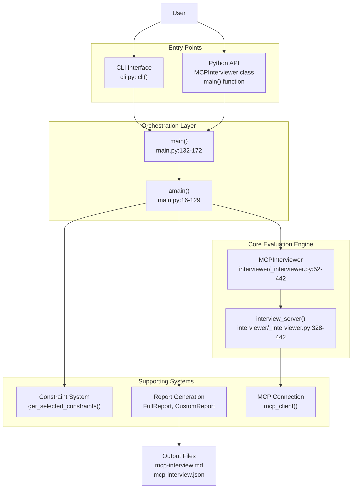
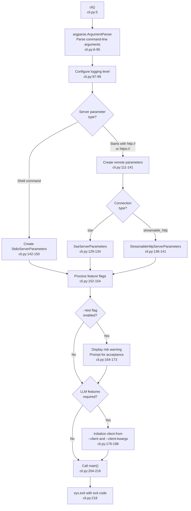
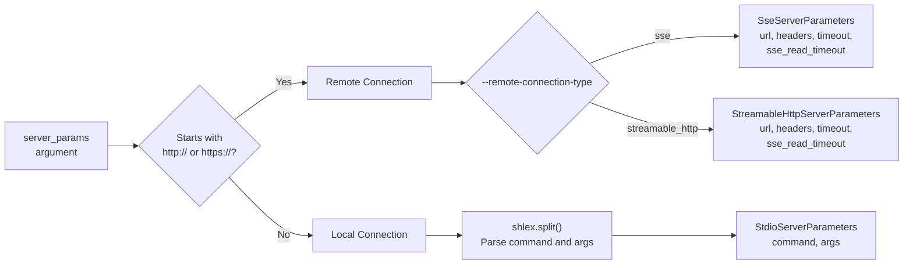
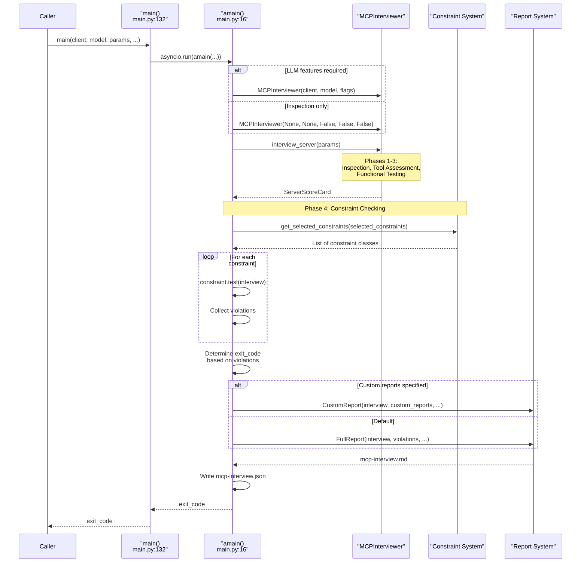
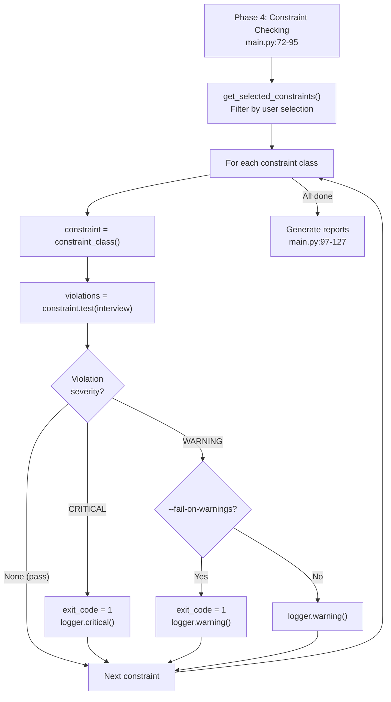
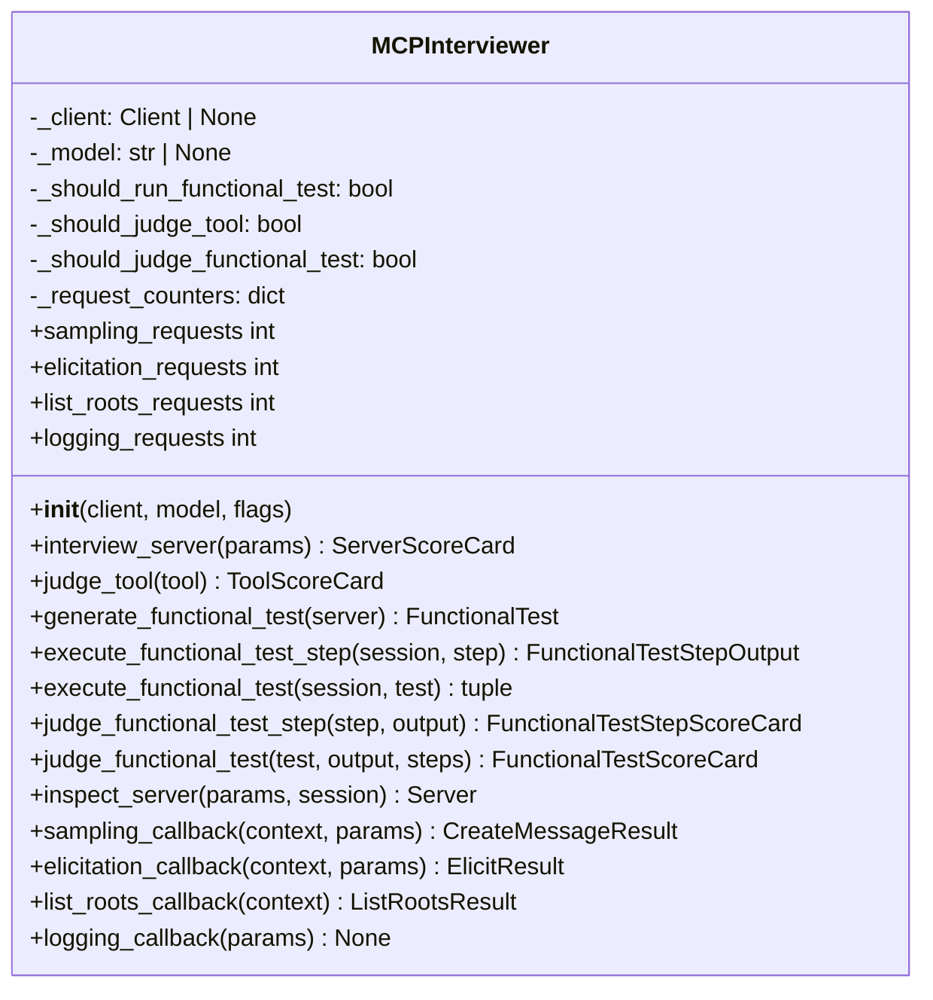
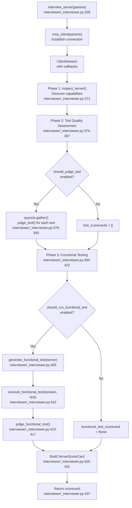
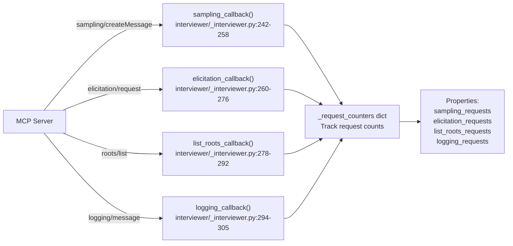
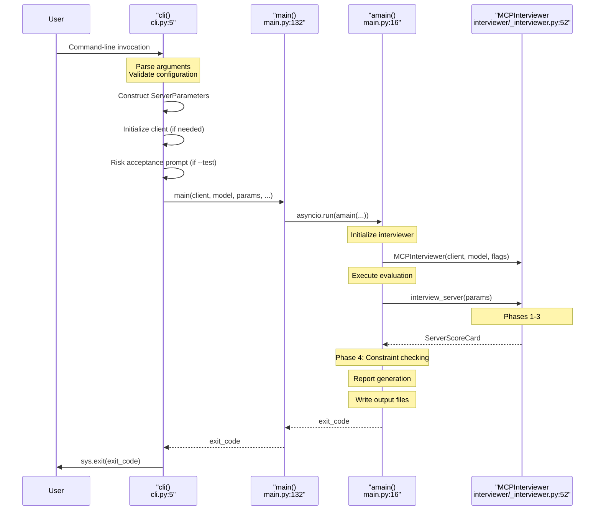
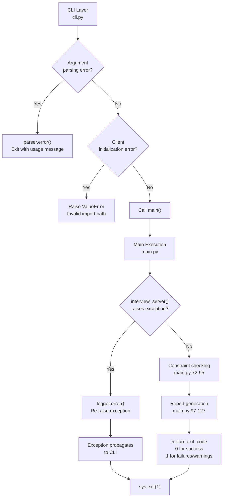

<!-- source: DeepWiki mcp.deepwiki.com · repo microsoft/mcp-interviewer · page 4.1 Core Components · fetched 2026-10-26 -->

# Core Components

<details>
<summary>Relevant source files</summary>

The following files were used as context for generating this wiki page:

- [src/mcp_interviewer/__init__.py](src/mcp_interviewer/__init__.py)
- [src/mcp_interviewer/cli.py](src/mcp_interviewer/cli.py)
- [src/mcp_interviewer/interviewer/_interviewer.py](src/mcp_interviewer/interviewer/_interviewer.py)
- [src/mcp_interviewer/main.py](src/mcp_interviewer/main.py)

</details>


This document describes the three primary components that form the foundation of mcp-interviewer: the CLI interface, the main orchestrator, and the MCPInterviewer class. Together, these components handle argument parsing, coordinate the evaluation workflow, and execute server inspections.

For information about the specific phases of evaluation execution, see [Interview Execution Flow](#4.2). For details on data structures used throughout the system, see [Data Models](#4.3). For report generation details, see [Report Generation Pipeline](#4.5).

## Component Architecture

The system is organized into three layers that work together to evaluate MCP servers:



**Sources:** [src/mcp_interviewer/cli.py:1-223](), [src/mcp_interviewer/main.py:1-173](), [src/mcp_interviewer/interviewer/_interviewer.py:1-442](), [src/mcp_interviewer/__init__.py:1-14]()

## CLI Interface

### Purpose and Responsibilities

The CLI interface in `cli.py` serves as the primary entry point for command-line usage. It handles:
- Argument parsing and validation
- Server parameter construction (stdio/HTTP/SSE)
- Client initialization and configuration
- Risk acceptance prompts for functional testing
- Delegation to the main orchestrator

### Argument Processing Flow



**Sources:** [src/mcp_interviewer/cli.py:1-223]()

### Key Configuration Parameters

| Argument | Type | Purpose | Default |
|----------|------|---------|---------|
| `server_params` | `str` | Shell command or URL | Required |
| `--remote-connection-type` | `str` | Connection type for remote servers | `streamable_http` |
| `--model` | `str` | LLM model name | None |
| `--client` | `str` | Import path to OpenAI-compatible client | `openai.OpenAI` |
| `--client-kwargs` | `list[str]` | Client constructor arguments | `[]` |
| `--out-dir` | `str` | Output directory for reports | `.` |
| `--log-level` | `str` | Logging verbosity | `INFO` |
| `--judge-tools` | `bool` | Enable LLM tool evaluation | `False` |
| `--judge-test` | `bool` | Enable LLM test evaluation | `False` |
| `--judge` | `bool` | Enable all LLM evaluation | `False` |
| `--test` | `bool` | Enable functional testing | `False` |
| `--accept-risk` | `bool` | Skip risk confirmation prompt | `False` |
| `--constraints` | `list[str]` | Constraint filters | All enabled |
| `--reports` | `list[str]` | Report components to include | All components |
| `--no-collapse` | `bool` | Disable collapsible sections | `False` |
| `--fail-on-warnings` | `bool` | Exit with error on warnings | `False` |

**Sources:** [src/mcp_interviewer/cli.py:6-93]()

### Server Parameter Construction

The CLI determines the connection type based on the `server_params` argument:



**Sources:** [src/mcp_interviewer/cli.py:107-150]()

## Main Orchestrator

### Overview

The main orchestrator provides both synchronous (`main()`) and asynchronous (`amain()`) entry points that coordinate the complete evaluation workflow. It manages:
- MCPInterviewer instantiation
- Server evaluation execution
- Constraint validation (Phase 4)
- Report generation
- Exit code determination

### Function Signatures

The main orchestrator exposes two functions:

| Function | Location | Purpose |
|----------|----------|---------|
| `main()` | [main.py:132-172]() | Synchronous wrapper that runs `asyncio.run()` |
| `amain()` | [main.py:16-129]() | Asynchronous implementation of orchestration logic |

**Sources:** [src/mcp_interviewer/main.py:1-173]()

### Orchestration Flow



**Sources:** [src/mcp_interviewer/main.py:16-173]()

### Constraint Checking Logic

The main orchestrator executes constraint validation after the interview completes:



**Sources:** [src/mcp_interviewer/main.py:72-96]()

### Report Generation Decision

The orchestrator selects the appropriate report type based on configuration:

| Condition | Report Type | File Location |
|-----------|-------------|---------------|
| `custom_reports` is provided | `CustomReport` | [main.py:105-115]() |
| Default | `FullReport` | [main.py:116-122]() |

Both report types write to `mcp-interview.md`. Additionally, the raw JSON data is always written to `mcp-interview.json` [main.py:124-127]().

**Sources:** [src/mcp_interviewer/main.py:97-129]()

## MCPInterviewer Class

### Class Structure

The `MCPInterviewer` class is the core evaluation engine that orchestrates server inspection, tool assessment, and functional testing:



**Sources:** [src/mcp_interviewer/interviewer/_interviewer.py:52-442]()

### Constructor Parameters

The `MCPInterviewer.__init__()` method accepts the following parameters [interviewer/_interviewer.py:60-82]():

| Parameter | Type | Purpose |
|-----------|------|---------|
| `client` | `Client \| None` | OpenAI-compatible client for LLM operations |
| `model` | `str \| None` | Model name (e.g., "gpt-4o") |
| `should_run_functional_test` | `bool` | Enable functional test execution |
| `should_judge_tool` | `bool` | Enable LLM-based tool evaluation |
| `should_judge_functional_test` | `bool` | Enable LLM-based test evaluation |

When `client` and `model` are `None`, the interviewer operates in inspection-only mode.

**Sources:** [src/mcp_interviewer/interviewer/_interviewer.py:60-82]()

### Primary Entry Point: interview_server()

The `interview_server()` method [interviewer/_interviewer.py:328-442]() is the main entry point that executes the complete evaluation:



**Sources:** [src/mcp_interviewer/interviewer/_interviewer.py:328-442]()

### Tool Evaluation Methods

The class provides methods for evaluating individual tools:

| Method | Location | Returns | Purpose |
|--------|----------|---------|---------|
| `judge_tool()` | [interviewer/_interviewer.py:83-99]() | `ToolScoreCard` | Evaluates tool name, description, and schema quality |
| `generate_functional_test()` | [interviewer/_interviewer.py:101-120]() | `FunctionalTest` | Generates test plan with LLM |
| `execute_functional_test_step()` | [interviewer/_interviewer.py:122-137]() | `FunctionalTestStepOutput` | Executes single test step |
| `execute_functional_test()` | [interviewer/_interviewer.py:139-157]() | `tuple` | Executes complete test suite |
| `judge_functional_test_step()` | [interviewer/_interviewer.py:159-187]() | `FunctionalTestStepScoreCard` | Evaluates step execution |
| `judge_functional_test()` | [interviewer/_interviewer.py:189-222]() | `FunctionalTestScoreCard` | Evaluates overall test results |

**Sources:** [src/mcp_interviewer/interviewer/_interviewer.py:83-222]()

### Callback System

The interviewer implements callbacks for handling bidirectional requests from MCP servers:



**Sources:** [src/mcp_interviewer/interviewer/_interviewer.py:242-326]()

### Request Counter Properties

The class exposes request counters as read-only properties [interviewer/_interviewer.py:308-326]():

```python
@property
def sampling_requests(self) -> int:
    """Get the current number of sampling requests."""
    return self._request_counters["sampling"]
```

These properties provide backward compatibility while internally using a shared dictionary managed by the callback system.

**Sources:** [src/mcp_interviewer/interviewer/_interviewer.py:308-326]()

## Component Interaction Patterns

### CLI to Main to Interviewer Flow

The three core components interact in a layered fashion:



**Sources:** [src/mcp_interviewer/cli.py:1-223](), [src/mcp_interviewer/main.py:1-173](), [src/mcp_interviewer/interviewer/_interviewer.py:1-442]()

### Error Handling Flow

Each layer handles errors at the appropriate level:



**Sources:** [src/mcp_interviewer/cli.py:1-223](), [src/mcp_interviewer/main.py:16-129](), [src/mcp_interviewer/interviewer/_interviewer.py:328-442]()

## Public API Surface

The package exports a minimal public API through `__init__.py` [__init__.py:1-14]():

### Exported Entities

| Symbol | Type | Module | Purpose |
|--------|------|--------|---------|
| `__version__` | `str` | `_version` | Package version string |
| `MCPInterviewer` | `class` | `interviewer` | Main evaluation class |
| `main` | `function` | `main` | Synchronous orchestration entry point |
| `Client` | `type` | `models` | Type alias for OpenAI-compatible clients |
| `ServerParameters` | `type` | `models` | Union type for server connection parameters |
| `ServerScoreCard` | `class` | `models` | Complete evaluation results |

### Usage Example

```python
from mcp_interviewer import MCPInterviewer, ServerScoreCard, StdioServerParameters

# Direct API usage
params = StdioServerParameters(command="node", args=["server.js"])
interviewer = MCPInterviewer(client, "gpt-4o", True, True, True)
scorecard: ServerScoreCard = await interviewer.interview_server(params)
```

Or using the main function:

```python
from mcp_interviewer import main, StdioServerParameters

# Using main orchestrator
params = StdioServerParameters(command="node", args=["server.js"])
exit_code = main(client, "gpt-4o", params, should_run_functional_test=True)
```

**Sources:** [src/mcp_interviewer/__init__.py:1-14]()

### Type Aliases

The `Client` type is defined in `models.py` as:

```python
Client = openai.OpenAI | openai.AsyncOpenAI
```

This allows both synchronous and asynchronous OpenAI clients, as well as compatible third-party implementations.

**Sources:** [src/mcp_interviewer/models/__init__.py]()

## Component Dependencies

The core components have the following dependency relationships:

| Component | Direct Dependencies | Purpose |
|-----------|---------------------|---------|
| `cli.py` | `main`, `models` | Entry point delegation |
| `main.py` | `interviewer`, `models`, `constraints`, `reports` | Orchestration |
| `MCPInterviewer` | `models`, `connection`, `inspection`, `test_*`, `tool_judging` | Evaluation engine |
| `__init__.py` | `_version`, `interviewer`, `main`, `models` | Public API surface |

**Sources:** [src/mcp_interviewer/cli.py:1-223](), [src/mcp_interviewer/main.py:1-173](), [src/mcp_interviewer/interviewer/_interviewer.py:1-442](), [src/mcp_interviewer/__init__.py:1-14]()

---

