<!-- source: DeepWiki mcp.deepwiki.com · repo microsoft/mcp-interviewer · page 4.2 Interview Execution Flow · fetched 2026-10-26 -->

# Interview Execution Flow

Relevant source files

The following files were used as context for generating this wiki page:

- [README.md](README.md)
- [src/mcp_interviewer/cli.py](src/mcp_interviewer/cli.py)
- [src/mcp_interviewer/interviewer/_interviewer.py](src/mcp_interviewer/interviewer/_interviewer.py)
- [src/mcp_interviewer/main.py](src/mcp_interviewer/main.py)

This document details the four-phase interview process that evaluates MCP servers. For information about the core components that implement this flow, see [Core Components](#4.1). For details on the data structures produced during execution, see [Data Models](#4.3). For constraint validation logic, see [Constraint System](#4.4). For report generation from evaluation results, see [Report Generation Pipeline](#4.5).

## Overview

The interview execution flow orchestrates a complete evaluation of an MCP server through four sequential phases:

1. **Server Inspection** - Discovers server capabilities, tools, resources, and prompts
2. **Tool Quality Assessment** - Evaluates each tool's name, description, and schema quality
3. **Functional Testing** - Generates, executes, and judges functional tests
4. **Constraint Checking** - Validates the server against configured constraints

The flow is implemented across two main entry points: `cli.cli()` for command-line usage and `main.main()` for programmatic access. Both funnel into `main.amain()`, which coordinates with `MCPInterviewer.interview_server()` to execute the first three phases before running constraint validation.

**Sources:** [src/mcp_interviewer/interviewer/_interviewer.py:328-441](), [src/mcp_interviewer/main.py:16-129](), [src/mcp_interviewer/cli.py:5-218]()

## Entry Point Flow

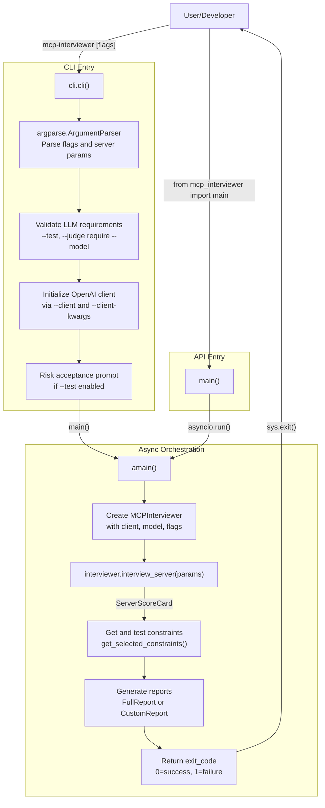

**Sources:** [src/mcp_interviewer/cli.py:5-218](), [src/mcp_interviewer/main.py:16-173]()

## Phase Coordination

The `amain()` function coordinates the overall execution flow and manages the boundary between phases. Phases 1-3 execute within `MCPInterviewer.interview_server()`, while Phase 4 executes in `amain()` after receiving the `ServerScoreCard`.

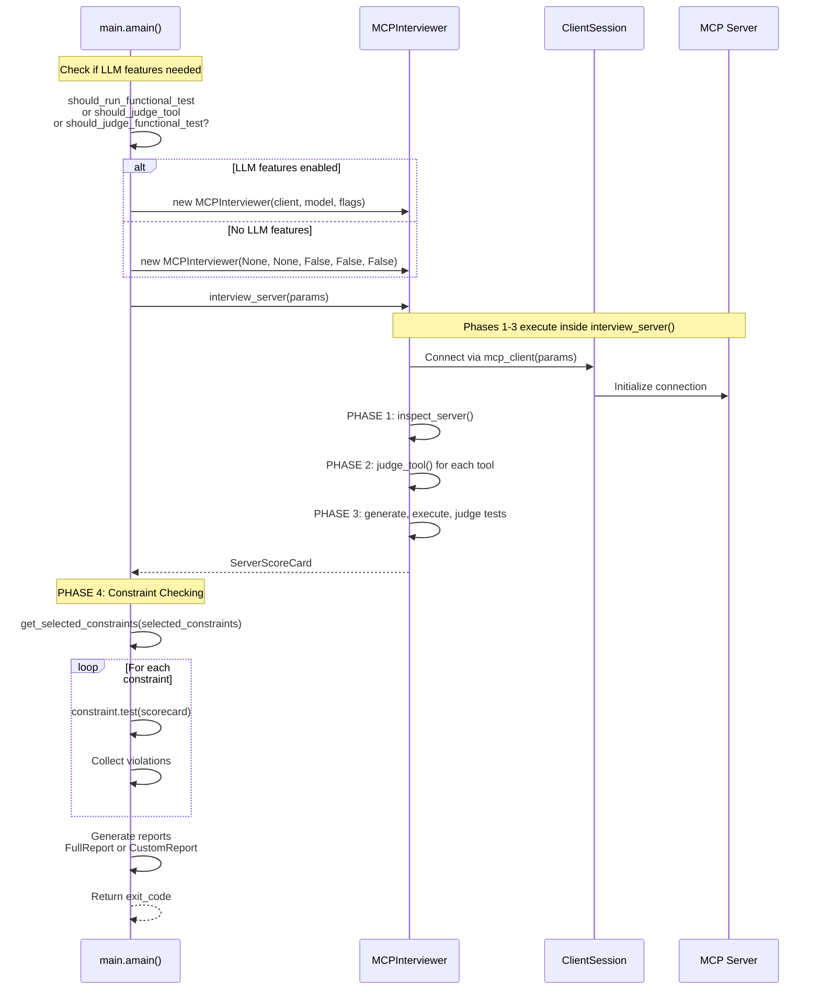

**Sources:** [src/mcp_interviewer/main.py:16-129](), [src/mcp_interviewer/interviewer/_interviewer.py:328-441]()

## Phase 1: Server Inspection

Server inspection discovers all capabilities and features without invoking LLM evaluation. The `inspect_server()` method initializes the MCP connection and queries for available tools, resources, resource templates, and prompts.

### Inspection Process

```mermaid
graph TB
    Start["inspect_server(params, session)"]
    
    subgraph "Initialization"
        Init["session.initialize()"]
        InitResult["Store InitializeResult<br/>server_info, capabilities"]
    end
    
    subgraph "Feature Discovery"
        CheckCaps{"Check capabilities<br/>from InitializeResult"}
        
        ListTools["session.list_tools()"]
        StoreTools["Store list[Tool]"]
        
        ListRes["session.list_resources()"]
        StoreRes["Store list[Resource]"]
        
        ListResTpl["session.list_resource_templates()"]
        StoreResTpl["Store list[ResourceTemplate]"]
        
        ListPrompts["session.list_prompts()"]
        StorePrompts["Store list[Prompt]"]
    end
    
    CreateServer["Create Server object<br/>with all discovered features"]
    Return["Return Server"]
    
    Start --> Init
    Init --> InitResult
    InitResult --> CheckCaps
    
    CheckCaps -->|"tools capability"| ListTools
    ListTools --> StoreTools
    
    CheckCaps -->|"resources capability"| ListRes
    ListRes --> StoreRes
    
    CheckCaps -->|"resourceTemplates capability"| ListResTpl
    ListResTpl --> StoreResTpl
    
    CheckCaps -->|"prompts capability"| ListPrompts
    ListPrompts --> StorePrompts
    
    StoreTools --> CreateServer
    StoreRes --> CreateServer
    StoreResTpl --> CreateServer
    StorePrompts --> CreateServer
    
    CreateServer --> Return
```

The inspection phase creates a `Server` object that contains:
- `parameters`: The `ServerParameters` used for connection
- `initialize_result`: The `InitializeResult` from MCP initialization
- `tools`: List of available tools
- `resources`: List of available resources
- `resource_templates`: List of available resource templates
- `prompts`: List of available prompts

**Sources:** [src/mcp_interviewer/interviewer/_interviewer.py:224-240](), [src/mcp_interviewer/interviewer/_interviewer.py:368-371]()

## Phase 2: Tool Quality Assessment

Tool quality assessment optionally evaluates each discovered tool using LLM judging. This phase runs concurrently for all tools using `asyncio.gather()` for performance.

### Tool Judging Flow

| Step | Method | Input | Output | Conditional |
|------|--------|-------|--------|-------------|
| 1 | `judge_tool()` | `Tool` | `ToolScoreCard` | `should_judge_tool=True` |
| 2 | Tool name evaluation | `tool.name` | `ToolNameScoreCard` | LLM enabled |
| 3 | Description evaluation | `tool.description` | `ToolDescriptionScoreCard` | LLM enabled |
| 4 | Input schema evaluation | `tool.inputSchema` | `ToolSchemaScoreCard` | LLM enabled |
| 5 | Output schema evaluation | (inferred) | `ToolSchemaScoreCard` | LLM enabled |

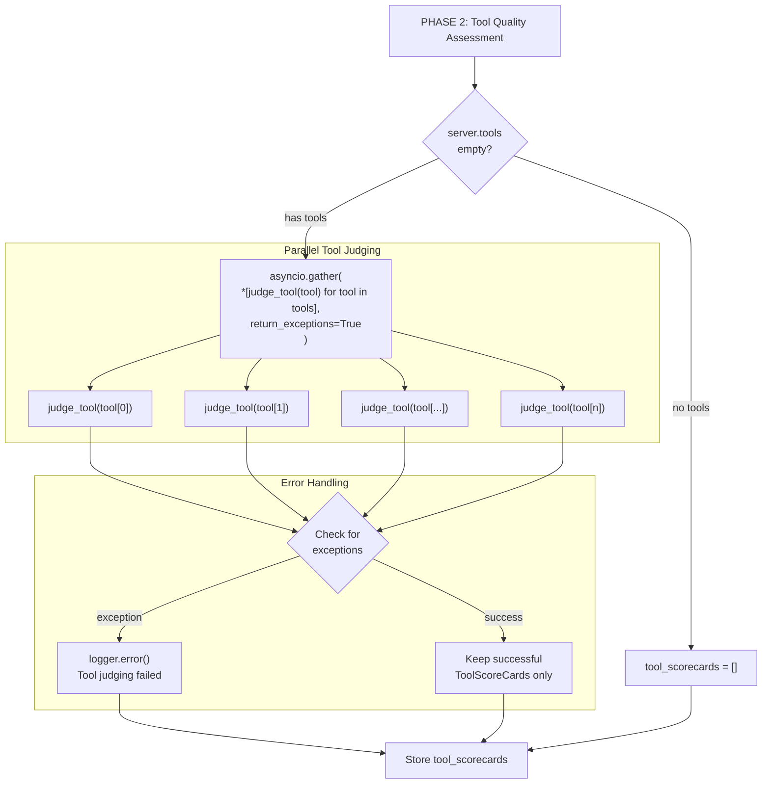

When `should_judge_tool=False`, the `judge_tool()` method still executes but returns placeholder scorecards without performing LLM evaluation. This ensures the data model remains consistent regardless of configuration.

**Sources:** [src/mcp_interviewer/interviewer/_interviewer.py:83-99](), [src/mcp_interviewer/interviewer/_interviewer.py:374-397]()

## Phase 3: Functional Testing

Functional testing comprises three sub-phases: test generation, test execution, and test judging. This phase only executes when `should_run_functional_test=True`.

### Test Generation

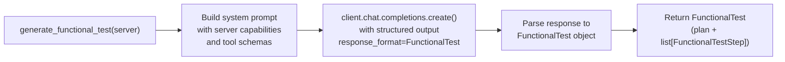

The generated `FunctionalTest` contains:
- `plan`: Overall test strategy description
- `steps`: List of `FunctionalTestStep` objects, each with:
  - `justification`: Why this step is necessary
  - `expected_output`: What output is expected
  - `tool_name`: Name of tool to call
  - `tool_arguments`: Arguments to pass

**Sources:** [src/mcp_interviewer/interviewer/_interviewer.py:101-120](), [src/mcp_interviewer/interviewer/_interviewer.py:405]()

### Test Execution

Test execution invokes each test step sequentially against the MCP server. The `_request_counters` dictionary tracks all requests made during execution.

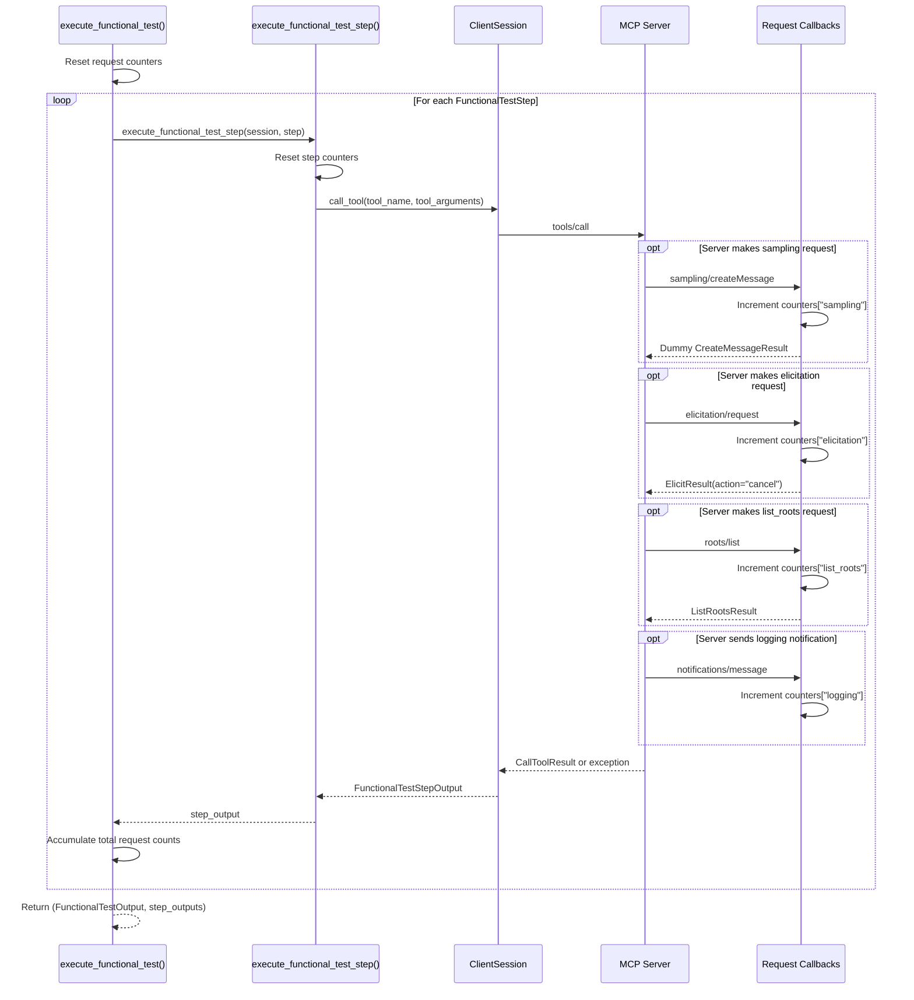

The `FunctionalTestStepOutput` captures:
- `tool_output`: The `CallToolResult` from the server
- `exception`: Any exception message if call failed
- `sampling_requests`: Number of sampling requests during this step
- `elicitation_requests`: Number of elicitation requests during this step
- `list_roots_requests`: Number of list_roots requests during this step
- `logging_requests`: Number of logging notifications during this step

**Sources:** [src/mcp_interviewer/interviewer/_interviewer.py:122-157](), [src/mcp_interviewer/interviewer/_interviewer.py:407-410]()

### Test Judging

After execution, the LLM evaluates both individual steps and overall test results.

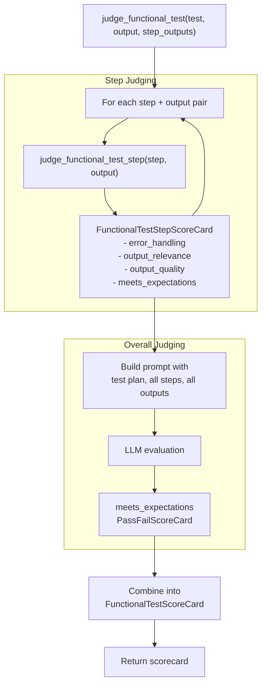

When `should_judge_functional_test=False`, placeholder scorecards are returned without LLM evaluation.

**Sources:** [src/mcp_interviewer/interviewer/_interviewer.py:159-222](), [src/mcp_interviewer/interviewer/_interviewer.py:413-417]()

## Phase 4: Constraint Checking

Constraint checking validates the `ServerScoreCard` against selected constraints. This phase executes in `main.amain()` after receiving results from `interview_server()`.

### Constraint Validation Process

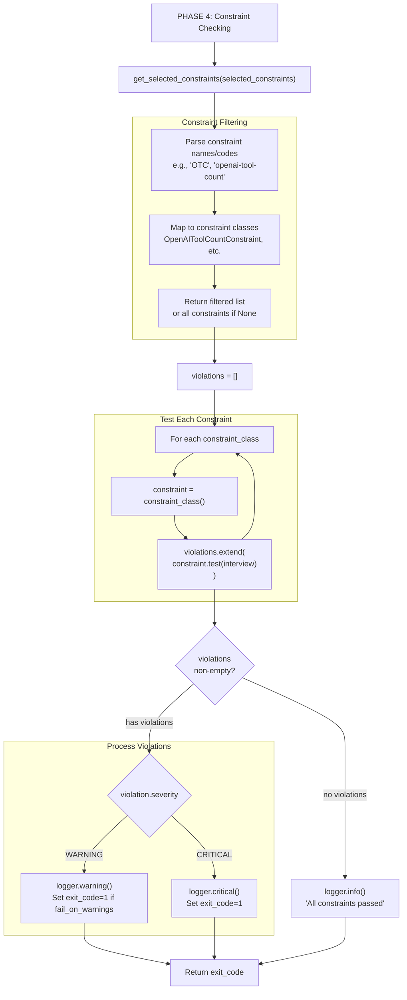

Each constraint implements the `test()` method, which yields `ConstraintViolation` objects. The violation severity determines the impact on exit code:

| Severity | Exit Code Impact | CLI Flag |
|----------|------------------|----------|
| `CRITICAL` | Always sets `exit_code=1` | N/A |
| `WARNING` | Sets `exit_code=1` only if `--fail-on-warnings` | `--fail-on-warnings` |

**Sources:** [src/mcp_interviewer/main.py:73-95](), [src/mcp_interviewer/constraints/__init__.py]()

## Request Tracking System

The interviewer tracks all requests made to and from the MCP server during test execution. Request counters enable analyzing server behavior patterns.

### Counter Implementation

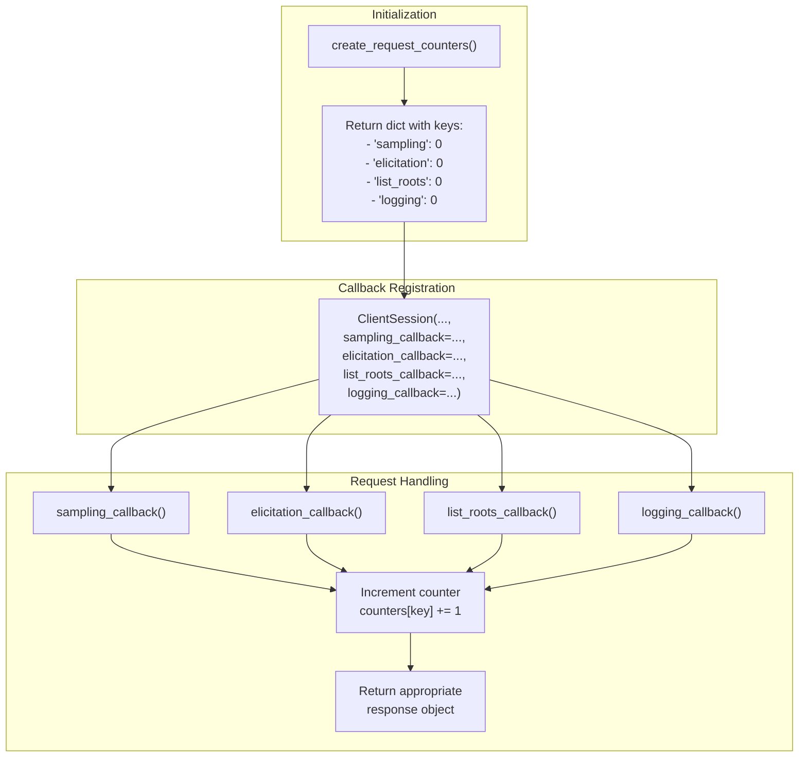

The `MCPInterviewer` class exposes counter values through properties:
- `sampling_requests`: Total sampling requests made
- `elicitation_requests`: Total elicitation requests made
- `list_roots_requests`: Total list_roots requests made
- `logging_requests`: Total logging notifications received

**Sources:** [src/mcp_interviewer/interviewer/_interviewer.py:81](), [src/mcp_interviewer/interviewer/_interviewer.py:308-326](), [src/mcp_interviewer/interviewer/_interviewer.py:358-366]()

## Error Handling and Recovery

The interview execution implements multiple layers of error handling to ensure graceful degradation.

### Error Handling Levels

| Level | Location | Strategy | Impact |
|-------|----------|----------|--------|
| Tool Judging | `interview_server()` line 379 | `return_exceptions=True` in `asyncio.gather()` | Failed tools logged; others continue |
| Step Execution | `execute_functional_test_step()` | Exception captured in `FunctionalTestStepOutput.exception` | Test continues to next step |
| Server Connection | `interview_server()` line 438 | Top-level try/except with logging | Evaluation terminates |
| LLM Validation | `amain()` line 51 | Check for `None` client/model | Raises `ValueError` |

### Exception Flow

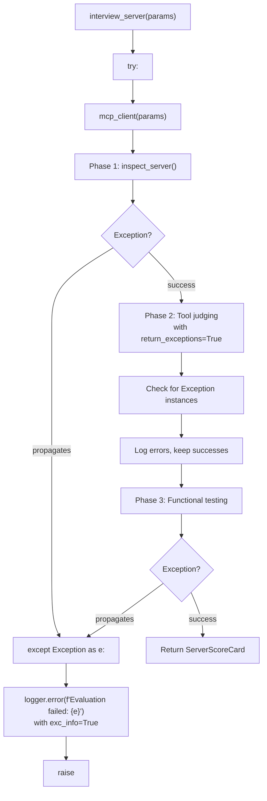

**Sources:** [src/mcp_interviewer/interviewer/_interviewer.py:357-441]()

## Complete Execution Timeline

The following diagram shows the complete timeline of execution from CLI invocation to exit, mapping each phase to specific code locations.

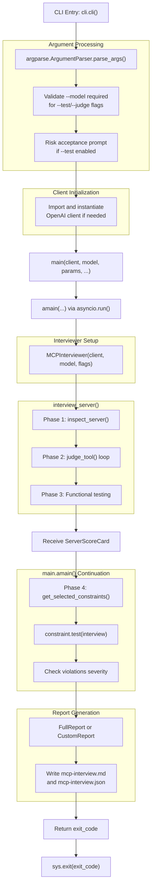

**Sources:** [src/mcp_interviewer/cli.py:5-218](), [src/mcp_interviewer/main.py:16-172](), [src/mcp_interviewer/interviewer/_interviewer.py:328-441]()

---

