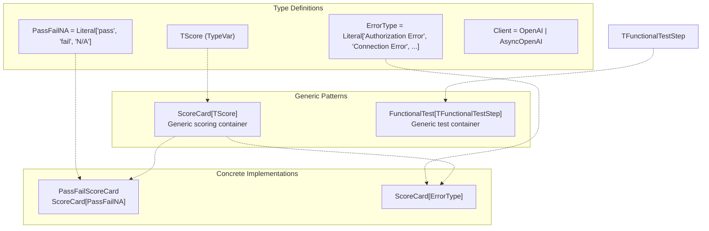
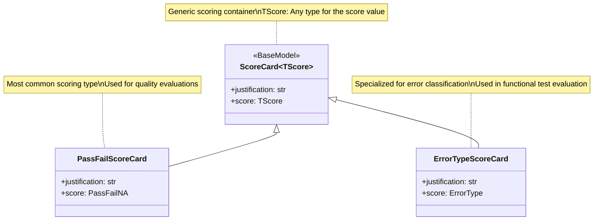
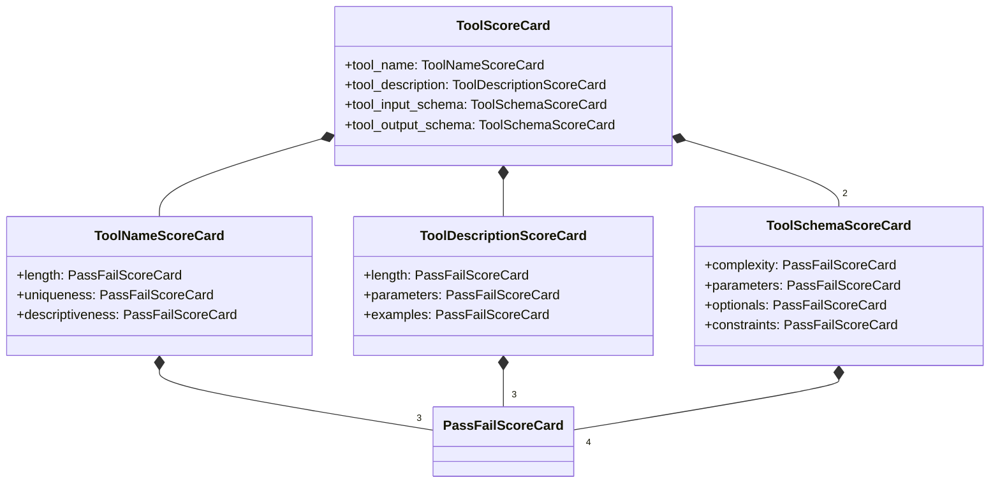
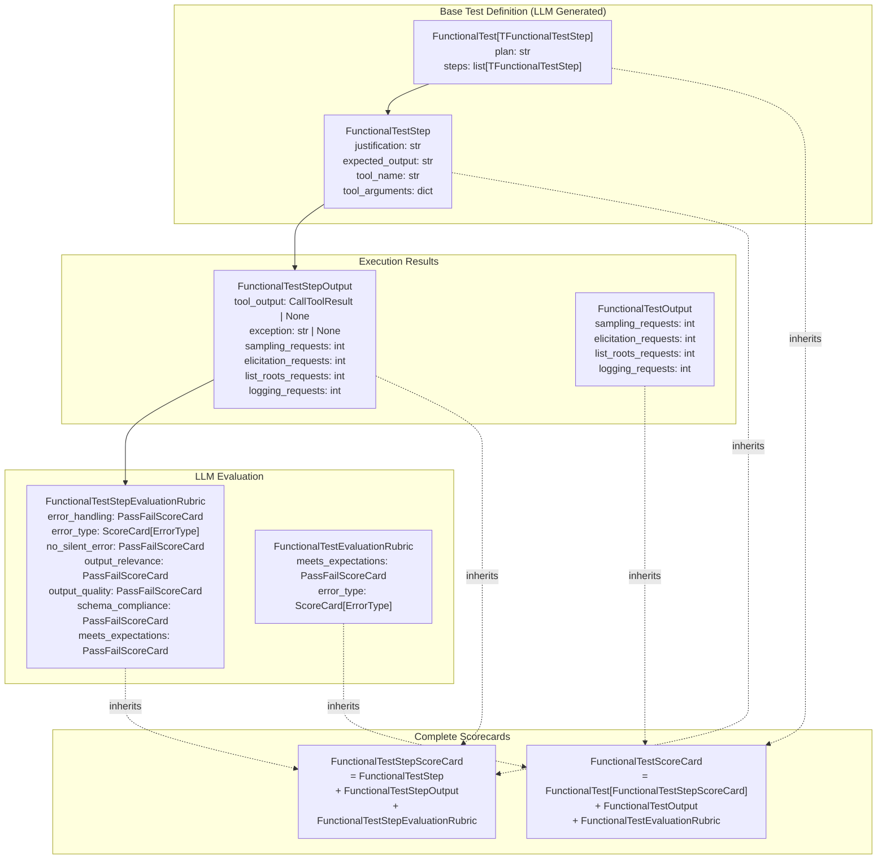
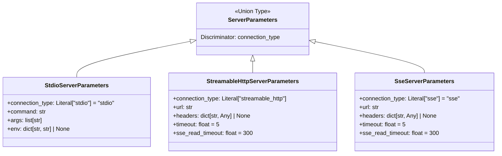
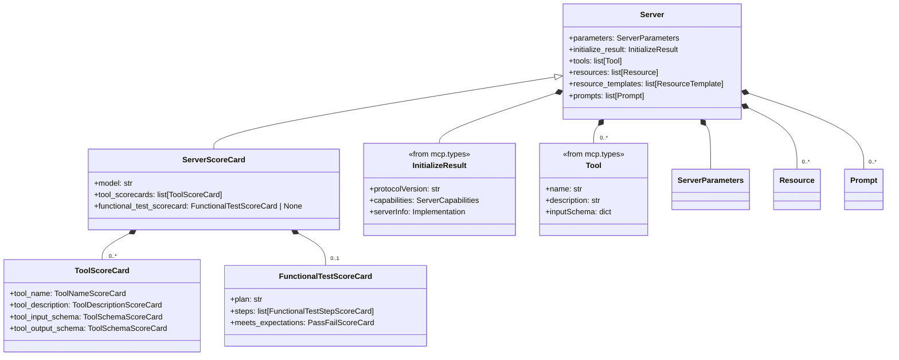
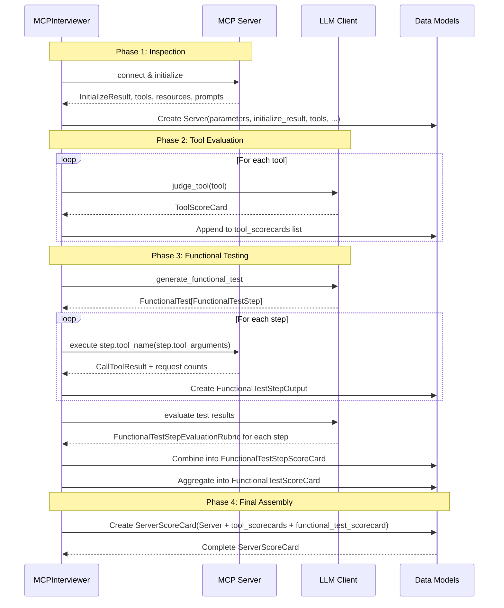

<!-- source: DeepWiki mcp.deepwiki.com · repo microsoft/mcp-interviewer · page 4.3 Data Models · fetched 2026-10-26 -->

# Data Models

<details>
<summary>Relevant source files</summary>

The following files were used as context for generating this wiki page:

- [src/mcp_interviewer/__init__.py](src/mcp_interviewer/__init__.py)
- [src/mcp_interviewer/models.py](src/mcp_interviewer/models.py)
- [src/mcp_interviewer/reports/functional_test/test_step.py](src/mcp_interviewer/reports/functional_test/test_step.py)

</details>


This document provides comprehensive documentation of the data structures used throughout mcp-interviewer. These models are defined using Pydantic and serve as the foundation for server evaluation, scoring, functional testing, and report generation.

For information about how these models are used during interview execution, see [Interview Execution Flow](#4.2). For details on report generation from these models, see [Report Generation Pipeline](#4.5). For a complete API reference of all model fields, see [Data Models Reference](#6.2).

**Sources:** [src/mcp_interviewer/models.py:1-210]()

---

## Data Model Overview

The data model architecture follows a hierarchical composition pattern where `ServerScoreCard` serves as the root container for all evaluation results. Models are organized into four primary categories: scoring abstractions, tool evaluation, functional testing, and server connection parameters.

### Core Type System



**Diagram: Type System Foundation**

The system uses generic types to provide flexible scoring mechanisms. `ScoreCard[TScore]` is a generic container that can hold any score type, allowing different evaluation criteria to use appropriate scoring schemes (pass/fail, numeric, categorical, etc.).

**Sources:** [src/mcp_interviewer/models.py:15-30]()

---

## Scoring System Architecture

The scoring system uses a generic pattern to represent evaluations across different dimensions. All scores include a justification explaining the assigned value.

### ScoreCard Generic Pattern



**Diagram: ScoreCard Pattern**

| Model | Score Type | Usage |
|-------|------------|-------|
| `ScoreCard[TScore]` | Generic `TScore` | Base class for all scoring |
| `PassFailScoreCard` | `PassFailNA` (pass/fail/N/A) | Tool quality evaluation, test step evaluation |
| `ScoreCard[ErrorType]` | 5 error categories + N/A | Error classification in functional tests |

**Sources:** [src/mcp_interviewer/models.py:17-30](), [src/mcp_interviewer/models.py:96-121]()

---

## Tool Evaluation Models

Tool evaluation models represent LLM-generated assessments of tool quality across multiple dimensions. Each tool receives a `ToolScoreCard` containing four sub-scorecards.

### Tool Evaluation Hierarchy



**Diagram: Tool Quality Assessment Structure**

### Tool Name Evaluation

The `ToolNameScoreCard` evaluates three aspects of tool naming:

| Field | Pass Criteria | Fail Criteria |
|-------|--------------|---------------|
| `length` | Optimal comprehension length (e.g., "getWeatherForecast") | Too short ("q") or excessively long |
| `uniqueness` | Clearly unique across server | Generic or duplicate names (multiple "search") |
| `descriptiveness` | Function clear from name (e.g., "convertJsonToCsv") | Unclear functionality ("process", "handle") |

**Sources:** [src/mcp_interviewer/models.py:34-41]()

### Tool Description Evaluation

The `ToolDescriptionScoreCard` evaluates documentation quality:

| Field | Pass Criteria | Fail Criteria |
|-------|--------------|---------------|
| `length` | Adequate or comprehensive information | Too brief ("Gets data") or verbose (multiple paragraphs) |
| `parameters` | Clear explanation of all parameters with types/requirements | Missing parameter explanations |
| `examples` | Helpful, realistic usage examples | No examples provided |

**Sources:** [src/mcp_interviewer/models.py:44-51]()

### Tool Schema Evaluation

The `ToolSchemaScoreCard` evaluates both input and output schemas:

| Field | Pass Criteria | Fail Criteria |
|-------|--------------|---------------|
| `complexity` | Simple, intuitive structure | Overly complex, deeply nested (5+ levels) |
| `parameters` | Minimal necessary parameters (1-3 core) | Too many parameters (10+) |
| `optionals` | Well-balanced required vs. optional | Most parameters optional with unclear defaults |
| `constraints` | Clear validation constraints (format, pattern) | Missing constraint information |

**Note:** The `tool_output_schema` field should have all scores set to `N/A` if the tool does not define an output schema.

**Sources:** [src/mcp_interviewer/models.py:54-73]()

---

## Functional Testing Models

Functional testing models represent the complete lifecycle of test generation, execution, and evaluation. These models form a hierarchy where base test definitions are extended with outputs and evaluations.

### Functional Test Model Hierarchy



**Diagram: Functional Test Model Composition**

The functional testing models use multiple inheritance to compose complete scorecards from base definitions, execution results, and evaluations.

**Sources:** [src/mcp_interviewer/models.py:76-166]()

### FunctionalTestStep (Base Definition)

Generated by the LLM to define a single test action:

```python
class FunctionalTestStep(BaseModel):
    justification: str      # Why this step tests the tool
    expected_output: str    # Expected result description
    tool_name: str          # Tool to call
    tool_arguments: dict    # Realistic test arguments
```

**Sources:** [src/mcp_interviewer/models.py:76-85]()

### FunctionalTestStepOutput (Execution Results)

Added during test execution to capture actual behavior:

```python
class FunctionalTestStepOutput(BaseModel):
    tool_output: CallToolResult | None  # Actual tool response
    exception: str | None                # Exception if execution failed
    sampling_requests: int = 0           # LLM sampling requests during execution
    elicitation_requests: int = 0        # User input requests during execution
    list_roots_requests: int = 0         # Resource root queries
    logging_requests: int = 0            # Logging messages sent
```

The request counters track bidirectional MCP requests made by the server during test execution.

**Sources:** [src/mcp_interviewer/models.py:87-94]()

### FunctionalTestStepEvaluationRubric (LLM Assessment)

Generated by the LLM after test execution to evaluate the results:

| Field | Type | Evaluation Focus |
|-------|------|-----------------|
| `error_handling` | `PassFailScoreCard` | Quality of error messages if error occurred |
| `error_type` | `ScoreCard[ErrorType]` | Classification of error (Authorization, Connection, etc.) |
| `no_silent_error` | `PassFailScoreCard` | Proper error flagging (isError matches content) |
| `output_relevance` | `PassFailScoreCard` | Output addresses the input request |
| `output_quality` | `PassFailScoreCard` | Accuracy and completeness of output |
| `schema_compliance` | `PassFailScoreCard` | Output matches declared schema |
| `meets_expectations` | `PassFailScoreCard` | Output matches expected behavior |

**Sources:** [src/mcp_interviewer/models.py:106-121]()

### FunctionalTestStepScoreCard (Complete Step)

Combines base definition, execution results, and evaluation through multiple inheritance:

```python
class FunctionalTestStepScoreCard(
    FunctionalTestStep,
    FunctionalTestStepOutput,
    FunctionalTestStepEvaluationRubric
): ...
```

This creates a complete record containing the test plan, actual execution details, and LLM evaluation.

**Sources:** [src/mcp_interviewer/models.py:123-126]()

### FunctionalTest (Test Plan Container)

Generic container for a complete test plan:

```python
class FunctionalTest(BaseModel, Generic[TFunctionalTestStep]):
    plan: str                          # 2-3 sentence testing strategy
    steps: list[TFunctionalTestStep]   # Test steps to execute
```

The generic parameter `TFunctionalTestStep` allows the container to hold either base `FunctionalTestStep` instances (during generation) or complete `FunctionalTestStepScoreCard` instances (after execution).

**Sources:** [src/mcp_interviewer/models.py:132-139]()

### FunctionalTestScoreCard (Complete Test Suite)

Final complete test results combining all layers:

```python
class FunctionalTestScoreCard(
    FunctionalTest[FunctionalTestStepScoreCard],  # Contains complete step scorecards
    FunctionalTestOutput,                         # Aggregate request counters
    FunctionalTestEvaluationRubric                # Overall test evaluation
): ...
```

This provides the complete audit trail: what was planned, what was executed, what happened, and how it was evaluated.

**Sources:** [src/mcp_interviewer/models.py:162-166]()

---

## Server Connection Models

Server connection models define how to connect to MCP servers. The system supports three connection types, unified through a discriminated union.

### Connection Type Hierarchy



**Diagram: Server Connection Parameter Types**

### Connection Type Details

| Model | Discriminator Value | Use Case | Key Fields |
|-------|-------------------|----------|-----------|
| `StdioServerParameters` | `"stdio"` | Local processes via standard I/O | `command`, `args`, `env` |
| `StreamableHttpServerParameters` | `"streamable_http"` | HTTP servers with streaming | `url`, `headers`, `timeout` |
| `SseServerParameters` | `"sse"` | Server-Sent Events connections | `url`, `headers`, `sse_read_timeout` |

### StdioServerParameters

Extends MCP's `StdioServerParameters` with the discriminator field:

```python
class StdioServerParameters(McpStdioServerParameters):
    connection_type: Literal["stdio"] = "stdio"
```

Inherits `command` (executable path), `args` (command arguments), and `env` (environment variables) from the MCP SDK.

**Sources:** [src/mcp_interviewer/models.py:187-189]()

### HTTP-Based Parameters

Both `StreamableHttpServerParameters` and `SseServerParameters` share the same field structure but use different connection types:

```python
class SseServerParameters(BaseModel):
    connection_type: Literal["sse"] = "sse"
    url: str                              # Server endpoint
    headers: dict[str, Any] | None        # HTTP headers
    timeout: float = 5                    # Connection timeout
    sse_read_timeout: float = 60 * 5      # Long-lived connection timeout
```

The `sse_read_timeout` field defaults to 5 minutes to accommodate long-running server operations.

**Sources:** [src/mcp_interviewer/models.py:169-185]()

### ServerParameters Union

The discriminated union uses Pydantic's discriminator pattern:

```python
ServerParameters = Annotated[
    StdioServerParameters | StreamableHttpServerParameters | SseServerParameters,
    Field(discriminator="connection_type"),
]
```

Pydantic automatically selects the correct model based on the `connection_type` field value during deserialization.

**Sources:** [src/mcp_interviewer/models.py:191-194]()

---

## Top-Level Server Models

The top-level models represent the complete server state and evaluation results.

### Server and ServerScoreCard Relationship



**Diagram: Complete Server Evaluation Structure**

### Server (Base Information)

Contains server introspection results:

```python
class Server(BaseModel):
    parameters: ServerParameters          # How to connect
    initialize_result: InitializeResult   # Server capabilities and info
    tools: list[Tool]                     # Available tools
    resources: list[Resource]             # Available resources
    resource_templates: list[ResourceTemplate]  # Dynamic resource templates
    prompts: list[Prompt]                 # Available prompts
```

The MCP types (`InitializeResult`, `Tool`, `Resource`, `Prompt`) are imported from the `mcp.types` module.

**Sources:** [src/mcp_interviewer/models.py:197-204]()

### ServerScoreCard (Complete Evaluation)

Extends `Server` with evaluation results:

```python
class ServerScoreCard(Server):
    model: str                                           # LLM model used for evaluation
    tool_scorecards: list[ToolScoreCard]                # Per-tool quality assessments
    functional_test_scorecard: FunctionalTestScoreCard | None  # Functional test results
```

The `functional_test_scorecard` is `None` when functional testing is disabled via the `--no-test` flag.

**Sources:** [src/mcp_interviewer/models.py:206-210]()

### Data Flow Through Models



**Diagram: Model Usage During Interview Execution**

The models are constructed progressively during the interview process, with each phase adding layers of information to ultimately produce the complete `ServerScoreCard`.

**Sources:** [src/mcp_interviewer/models.py:1-210](), [src/mcp_interviewer/interviewer.py]()

---

## Exported Data Models

The package exports key models for external use:

```python
from mcp_interviewer import (
    Client,                # Type alias: OpenAI | AsyncOpenAI
    ServerParameters,      # Union of connection parameter types
    ServerScoreCard,       # Complete evaluation results
)
```

These exports enable programmatic usage of mcp-interviewer where consumers can construct parameters, receive scorecards, and process results without importing internal modules.

**Sources:** [src/mcp_interviewer/__init__.py:4-13]()

---

## Model Usage in Reports

The report generation system traverses the data model hierarchy to produce structured output. For example, the `TestStepReport` class extracts evaluation data:

```python
# From TestStepReport
passes, total = count_scores(self.step)  # Counts pass/fail scores in step
if self.step.tool_output:
    # Access nested output data
    for content in self.step.tool_output.content:
        if content.type == "text":
            # Process text content
```

The nested structure allows reports to drill down from server-level summaries to individual test step details.

**Sources:** [src/mcp_interviewer/reports/functional_test/test_step.py:40-160]()

---

## Summary

The data model architecture provides a comprehensive type-safe representation of the entire evaluation process:

- **Generic Patterns**: `ScoreCard[TScore]` and `FunctionalTest[TFunctionalTestStep]` enable flexible, reusable abstractions
- **Composition**: Models use multiple inheritance to combine base definitions, execution results, and evaluations
- **Hierarchical Structure**: `ServerScoreCard` aggregates all evaluation aspects into a single root object
- **MCP Integration**: Models incorporate types from the MCP SDK (`Tool`, `Resource`, `InitializeResult`)
- **Discriminated Unions**: `ServerParameters` uses Pydantic's discriminator pattern for type-safe connection configuration

All models are Pydantic `BaseModel` instances, providing automatic validation, serialization to JSON, and IDE-friendly type checking.

**Sources:** [src/mcp_interviewer/models.py:1-210]()

---

