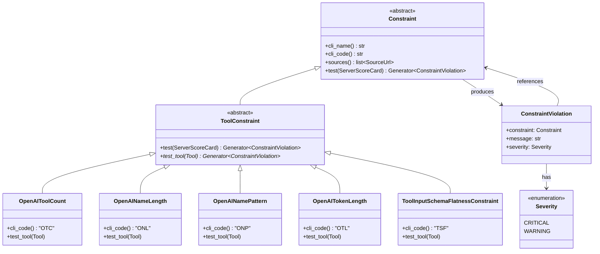
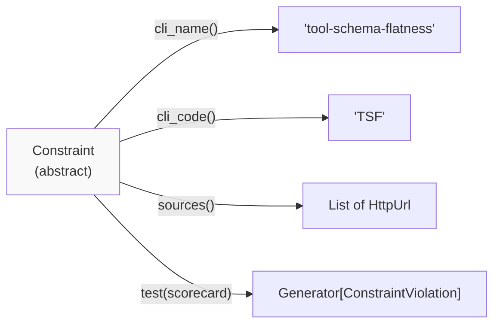
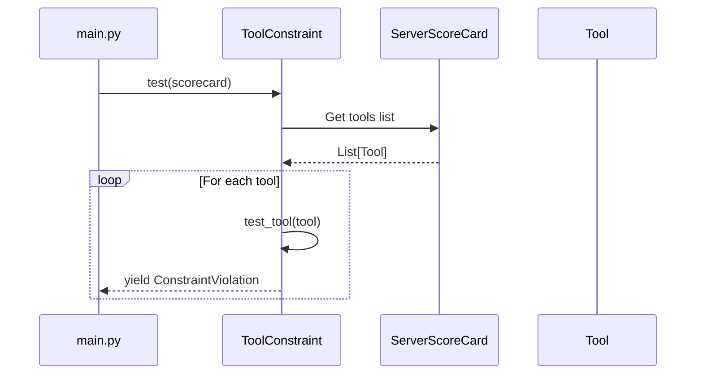
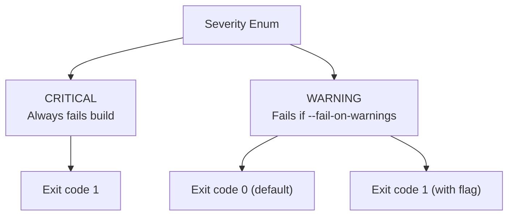
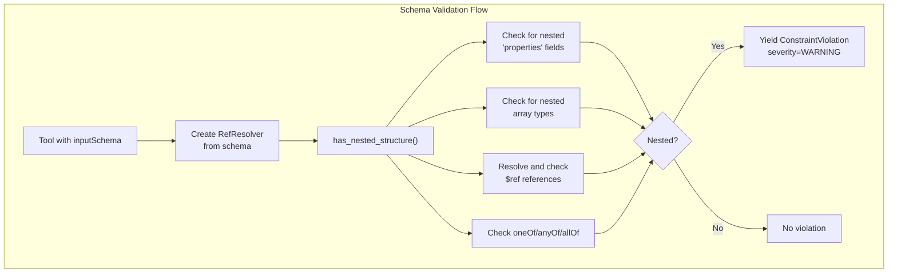
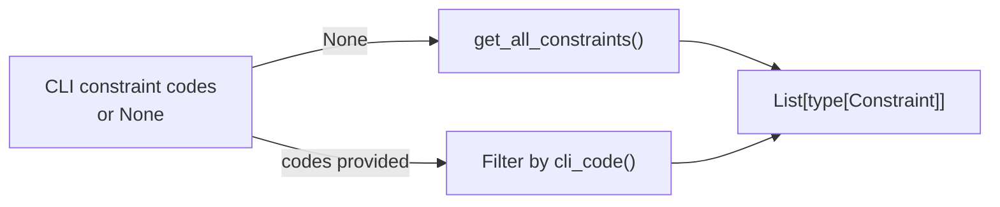
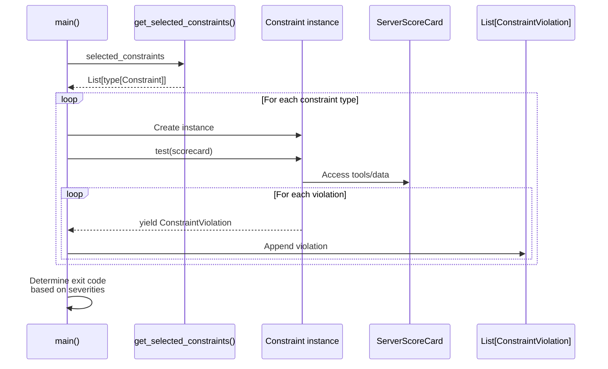
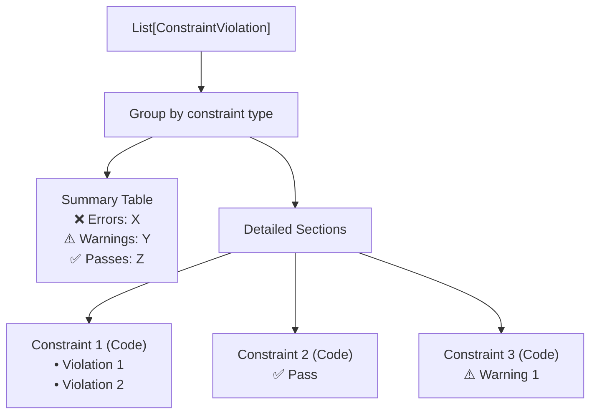

<!-- source: DeepWiki mcp.deepwiki.com · repo microsoft/mcp-interviewer · page 4.4 Constraint System · fetched 2026-10-26 -->

# Constraint System

<details>
<summary>Relevant source files</summary>

The following files were used as context for generating this wiki page:

- [src/mcp_interviewer/constraints/tool_schema_flatness.py](src/mcp_interviewer/constraints/tool_schema_flatness.py)
- [src/mcp_interviewer/reports/interviewer/constraint_violations.py](src/mcp_interviewer/reports/interviewer/constraint_violations.py)
- [tests/constraints/test_tool_schema_flatness.py](tests/constraints/test_tool_schema_flatness.py)
- [uv.lock](uv.lock)

</details>


## Purpose and Scope

This document explains the constraint validation system architecture in mcp-interviewer. The constraint system provides a plugin-based framework for validating MCP server compliance against various standards and best practices. It defines how constraints are implemented, tested against server data, and how violations are collected and reported.

For usage information on running constraint checks, see [Constraint Checking](#3.4). For a complete list of available constraints, see [Constraint Types Reference](#6.3). For information on how violations are displayed, see [Report Generation Pipeline](#4.5).

---

## Architecture Overview

The constraint system uses an abstract base class pattern that enables extensible validation rules. Constraints can be selectively enabled via CLI codes and produce violations of varying severity levels.



**Sources:** [src/mcp_interviewer/constraints/base.py:1-100](), [src/mcp_interviewer/constraints/tool_schema_flatness.py:1-139]()

---

## Base Constraint Classes

### Constraint Base Class

The `Constraint` abstract base class defines the interface that all constraints must implement. Each constraint provides CLI identification, documentation sources, and a test method.

| Method | Return Type | Purpose |
|--------|-------------|---------|
| `cli_name()` | `str` | Human-readable constraint name for CLI display |
| `cli_code()` | `str` | Short code for CLI selection (e.g., "TSF", "OTC") |
| `sources()` | `list[SourceUrl]` | Documentation URLs explaining the constraint rationale |
| `test(scorecard)` | `Generator[ConstraintViolation]` | Validates a `ServerScoreCard` and yields violations |



**Sources:** [src/mcp_interviewer/constraints/base.py:1-50]()

### ToolConstraint Specialization

The `ToolConstraint` class extends `Constraint` for tool-specific validations. It implements the `test()` method by iterating over all tools in the scorecard and delegating to the abstract `test_tool()` method.



The `test_tool()` method must be implemented by concrete constraint classes to define tool-specific validation logic.

**Sources:** [src/mcp_interviewer/constraints/base.py:50-100]()

---

## Violation Model

### ConstraintViolation Structure

Each violation produced by a constraint contains three components:

| Field | Type | Description |
|-------|------|-------------|
| `constraint` | `Constraint` | Reference to the constraint that produced the violation |
| `message` | `str` | Detailed explanation of what failed |
| `severity` | `Severity` | Either `CRITICAL` or `WARNING` |

### Severity Levels



The severity level determines the build outcome:
- **CRITICAL**: The build always fails (exit code 1)
- **WARNING**: The build fails only if `--fail-on-warnings` is enabled; otherwise it succeeds with warnings displayed

**Sources:** [src/mcp_interviewer/constraints/base.py:1-30]()

---

## Example: ToolInputSchemaFlatnessConstraint

The `ToolInputSchemaFlatnessConstraint` validates that tool input schemas do not contain nested objects or arrays, as these make tools harder to use with LLM function calling.



### Key Implementation Details

The constraint uses a recursive algorithm with the following features:

| Feature | Purpose |
|---------|---------|
| Depth tracking | Distinguishes top-level properties from nested ones |
| Array context | Detects nested arrays (arrays of arrays) |
| Reference resolution | Follows `$ref` pointers using `jsonschema.RefResolver` |
| Circular reference detection | Maintains a `visited` set to prevent infinite loops |

**Example violations:**

```python
# ❌ Nested properties (depth > 0 with "properties" field)
{
    "properties": {
        "user": {
            "type": "object",
            "properties": {  # Nested!
                "name": {"type": "string"}
            }
        }
    }
}

# ❌ Nested arrays
{
    "properties": {
        "data": {
            "type": "array",
            "items": {
                "type": "array",  # Nested array!
                "items": {"type": "string"}
            }
        }
    }
}

# ✅ Flat schema with array of primitives
{
    "properties": {
        "tags": {
            "type": "array",
            "items": {"type": "string"}
        }
    }
}
```

**Sources:** [src/mcp_interviewer/constraints/tool_schema_flatness.py:1-139](), [tests/constraints/test_tool_schema_flatness.py:1-394]()

---

## Constraint Selection and Testing

### Selection Mechanism

The `get_selected_constraints()` function in the main orchestrator filters constraints based on CLI input:



When no codes are provided, all constraints are selected. When codes are provided (e.g., `["TSF", "OTC"]`), only matching constraints are included.

### Testing Flow

The constraint testing process occurs in Phase 4 of the interview execution:



The violations are collected and passed to the report generation system.

**Sources:** [src/mcp_interviewer/main.py:1-200](), [src/mcp_interviewer/constraints/base.py:1-100]()

---

## Integration with Reporting

### Violation Grouping

The `ConstraintViolationsReport` groups violations by constraint type for organized display:



### Report Structure

The report maintains consistent ordering based on CLI codes and includes documentation links:

| Section | Content |
|---------|---------|
| Summary Table | Count of errors, warnings, and passes with emoji indicators |
| Details (collapsible) | Per-constraint sections sorted by CLI code |
| Constraint Header | Format: `{cli_name()} ({cli_code()}) [1] [2]` with numbered source links |
| Violations | Prefixed with ❌ for CRITICAL, ⚠️ for WARNING, ✅ for pass |

**Sources:** [src/mcp_interviewer/reports/interviewer/constraint_violations.py:1-86]()

---

## Extension Points

To add a new constraint to the system:

1. **Create constraint class**: Inherit from `Constraint` or `ToolConstraint`
2. **Implement required methods**:
   - `cli_name()`: Return descriptive name
   - `cli_code()`: Return unique 2-4 letter code
   - `sources()`: Return list of documentation URLs
   - `test()` or `test_tool()`: Implement validation logic
3. **Add to constraint registry**: The constraint is automatically discovered via class hierarchy
4. **Write tests**: Create test file in `tests/constraints/`
5. **Document**: Add entry to constraint types reference

Example skeleton:

```python
class MyNewConstraint(ToolConstraint):
    @classmethod
    def cli_name(cls) -> str:
        return "my-constraint"
    
    @classmethod
    def cli_code(cls) -> str:
        return "MC"
    
    @classmethod
    def sources(cls) -> list[SourceUrl]:
        return [HttpUrl("https://example.com/docs")]
    
    def test_tool(self, tool: Tool) -> Generator[ConstraintViolation, None, None]:
        if self._check_fails(tool):
            yield ConstraintViolation(
                self,
                f"Tool '{tool.name}': specific issue description",
                severity=Severity.WARNING
            )
```

**Sources:** [src/mcp_interviewer/constraints/base.py:1-100](), [src/mcp_interviewer/constraints/tool_schema_flatness.py:1-139]()

---

