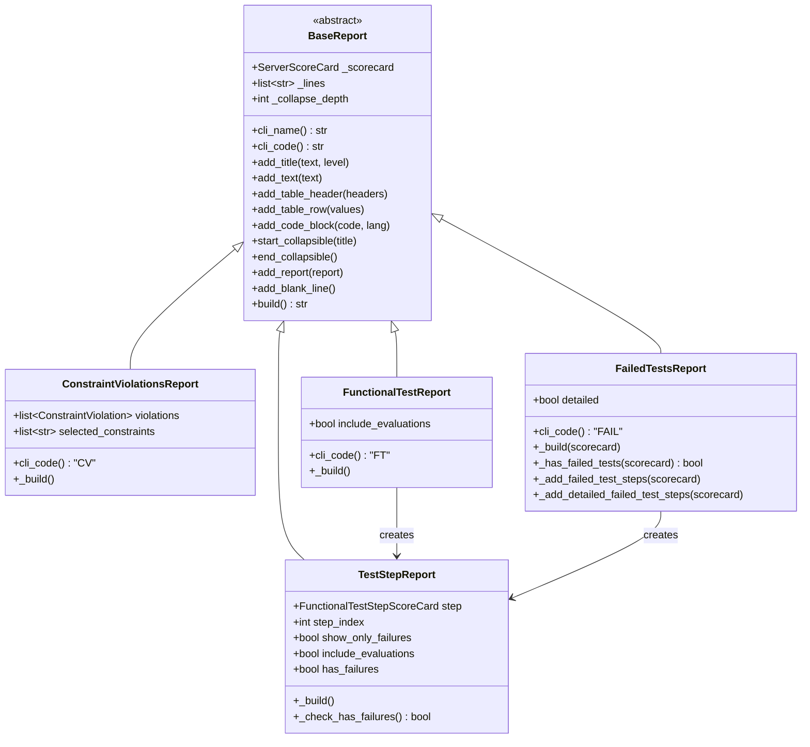
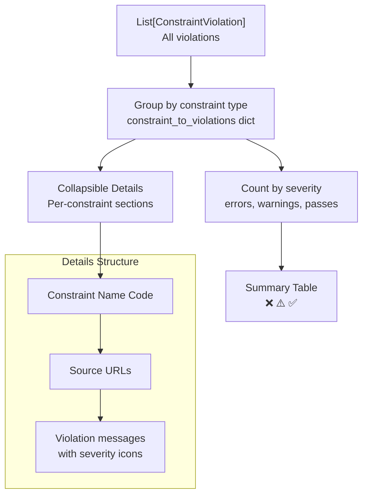
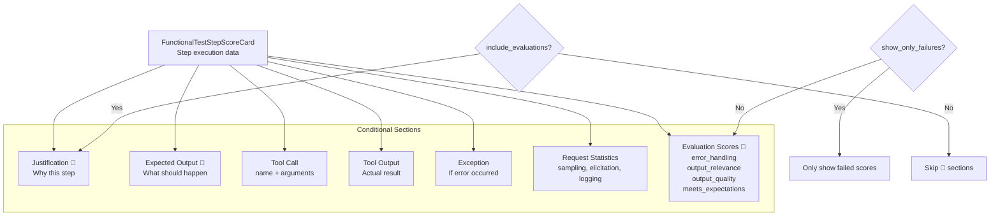
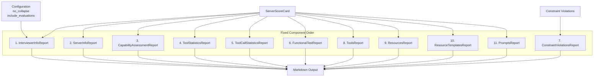
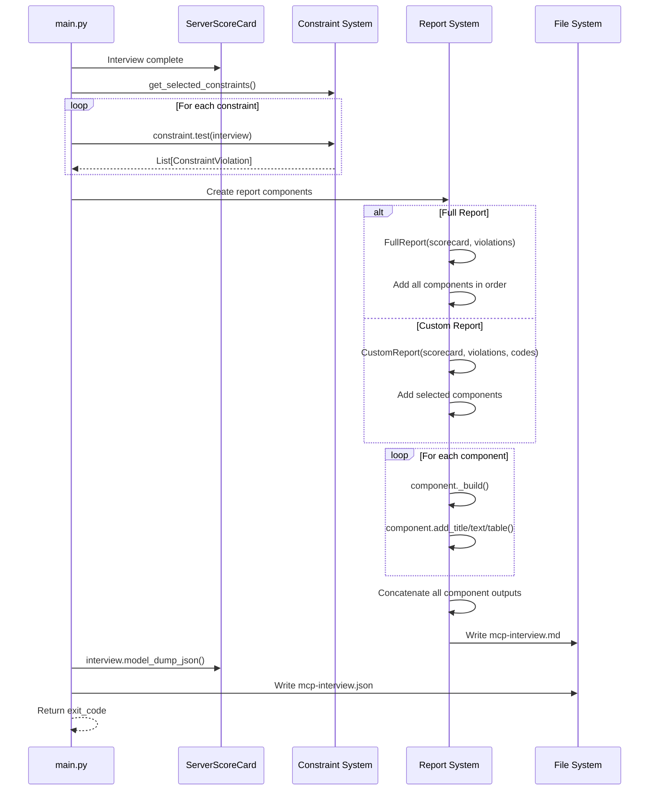

<!-- source: DeepWiki mcp.deepwiki.com · repo microsoft/mcp-interviewer · page 4.5 Report Generation Pipeline · fetched 2026-10-26 -->

# Report Generation Pipeline

Relevant source files

The following files were used as context for generating this wiki page:

- [README.md](README.md)
- [src/mcp_interviewer/constraints/tool_schema_flatness.py](src/mcp_interviewer/constraints/tool_schema_flatness.py)
- [src/mcp_interviewer/reports/functional_test/failed_tests.py](src/mcp_interviewer/reports/functional_test/failed_tests.py)
- [src/mcp_interviewer/reports/functional_test/test.py](src/mcp_interviewer/reports/functional_test/test.py)
- [src/mcp_interviewer/reports/interviewer/constraint_violations.py](src/mcp_interviewer/reports/interviewer/constraint_violations.py)

## Purpose and Scope

The report generation pipeline transforms evaluation results from the interview process into human-readable Markdown and machine-readable JSON formats. This document describes the architecture of the report generation system, including report components, assembly logic, and output formatting.

For information about using the generated reports, see [Understanding Reports](#3.7). For the data models that feed into reports, see [Data Models](#4.3). For the interview execution that produces these data models, see [Interview Execution Flow](#4.2).

---

## System Architecture

The report generation pipeline consists of modular components that consume a `ServerScoreCard` and produce formatted output files.

```mermaid
graph TB
    subgraph "Input Layer"
        SSC["ServerScoreCard<br/>All evaluation data"]
        Violations["List[ConstraintViolation]<br/>Validation failures"]
        Config["Report Configuration<br/>custom_reports<br/>no_collapse<br/>include_evaluations"]
    end
    
    subgraph "Report Component Layer"
        BaseReport["BaseReport<br/>Abstract base class"]
        
        InterviewerInfo["InterviewerInfoReport<br/>cli_code: II"]
        ServerInfo["ServerInfoReport<br/>cli_code: SI"]
        CapAssess["CapabilityAssessmentReport<br/>cli_code: CAP"]
        ToolStats["ToolStatisticsReport<br/>cli_code: TS"]
        CallStats["ToolCallStatisticsReport<br/>cli_code: TCS"]
        FuncTest["FunctionalTestReport<br/>cli_code: FT"]
        ConstViol["ConstraintViolationsReport<br/>cli_code: CV"]
        Tools["ToolsReport<br/>cli_code: T"]
        Resources["ResourcesReport<br/>cli_code: R"]
        ResourceTemplates["ResourceTemplatesReport<br/>cli_code: RT"]
        Prompts["PromptsReport<br/>cli_code: P"]
    end
    
    subgraph "Report Assembler Layer"
        FullReport["FullReport<br/>All components in order"]
        CustomReport["CustomReport<br/>User-selected components"]
    end
    
    subgraph "Specialized Reports"
        ViolationReport["ConstraintViolationsReport<br/>Grouped by constraint"]
        TestReport["FunctionalTestReport<br/>Detailed test results"]
        FailedReport["FailedTestsReport<br/>Only failures"]
        TestStepReport["TestStepReport<br/>Individual step details"]
    end
    
    subgraph "Output Layer"
        MarkdownBuilder["Markdown string builder<br/>Sections, collapsibles, tables"]
        JSONSerializer["JSON serializer<br/>model_dump_json"]
        MDFile["mcp-interview.md"]
        JSONFile["mcp-interview.json"]
    end
    
    SSC --> BaseReport
    Violations --> ConstViol
    Config --> FullReport
    Config --> CustomReport
    
    BaseReport --> InterviewerInfo
    BaseReport --> ServerInfo
    BaseReport --> CapAssess
    BaseReport --> ToolStats
    BaseReport --> CallStats
    BaseReport --> FuncTest
    BaseReport --> ConstViol
    BaseReport --> Tools
    BaseReport --> Resources
    BaseReport --> ResourceTemplates
    BaseReport --> Prompts
    
    InterviewerInfo --> FullReport
    ServerInfo --> FullReport
    CapAssess --> FullReport
    ToolStats --> FullReport
    CallStats --> FullReport
    FuncTest --> FullReport
    ConstViol --> FullReport
    Tools --> FullReport
    Resources --> FullReport
    ResourceTemplates --> FullReport
    Prompts --> FullReport
    
    InterviewerInfo --> CustomReport
    ServerInfo --> CustomReport
    CapAssess --> CustomReport
    ToolStats --> CustomReport
    CallStats --> CustomReport
    FuncTest --> CustomReport
    ConstViol --> CustomReport
    Tools --> CustomReport
    Resources --> CustomReport
    ResourceTemplates --> CustomReport
    Prompts --> CustomReport
    
    FuncTest --> TestReport
    TestReport --> TestStepReport
    FuncTest --> FailedReport
    FailedReport --> TestStepReport
    
    FullReport --> MarkdownBuilder
    CustomReport --> MarkdownBuilder
    ViolationReport --> MarkdownBuilder
    TestReport --> MarkdownBuilder
    FailedReport --> MarkdownBuilder
    
    MarkdownBuilder --> MDFile
    SSC --> JSONSerializer
    JSONSerializer --> JSONFile
```

**Sources:** [README.md:68-91](), [src/mcp_interviewer/reports/interviewer/constraint_violations.py:1-86](), [src/mcp_interviewer/reports/functional_test/test.py:1-80]()

---

## Input Data Flow

The report generation pipeline receives two primary inputs from the interview execution phase:

### ServerScoreCard

The `ServerScoreCard` is the central data structure containing all evaluation results. It extends the `Server` class and includes:

| Field | Type | Description |
|-------|------|-------------|
| `model` | `str` | LLM model identifier used for evaluation |
| `tool_scorecards` | `list[ToolScoreCard]` | Per-tool quality assessments |
| `functional_test_scorecard` | `FunctionalTestScoreCard \| None` | Test execution results and evaluations |
| `initialize_result` | `InitializeResult` | Server capabilities from MCP handshake |
| `tools` | `list[Tool]` | Available tools with schemas |
| `resources` | `list[Resource]` | Available resources |
| `prompts` | `list[Prompt]` | Available prompts |

### Constraint Violations

A separate list of `ConstraintViolation` objects produced by the constraint checking phase. Each violation contains:

| Field | Type | Description |
|-------|------|-------------|
| `constraint` | `Constraint` | The constraint that was violated |
| `message` | `str` | Human-readable violation description |
| `severity` | `Severity` | `CRITICAL` or `WARNING` level |

**Sources:** [src/mcp_interviewer/reports/interviewer/constraint_violations.py:20-30]()

---

## Report Component Architecture

All report components inherit from the `BaseReport` abstract base class and implement a standardized interface.

**Sources:** [src/mcp_interviewer/reports/interviewer/constraint_violations.py:9-31](), [src/mcp_interviewer/reports/functional_test/test.py:9-31](), [src/mcp_interviewer/reports/functional_test/failed_tests.py:8-23]()

### BaseReport Interface

Each report component implements two class methods for identification:

- `cli_name()`: Returns a human-readable name (e.g., `"constraint-violations"`)
- `cli_code()`: Returns a short code for CLI selection (e.g., `"CV"`)

The `BaseReport` class provides builder methods for constructing Markdown content:

| Method | Purpose |
|--------|---------|
| `add_title(text, level)` | Add a heading (level 1-6) |
| `add_text(text)` | Add paragraph text |
| `add_table_header(headers)` | Start a Markdown table |
| `add_table_row(values)` | Add a table row |
| `add_code_block(code, lang)` | Add fenced code block |
| `start_collapsible(title)` | Begin collapsible section |
| `end_collapsible()` | End collapsible section |
| `add_report(report)` | Nest another report |
| `build()` | Generate final Markdown string |

---

## Report Component Implementations

### ConstraintViolationsReport

The `ConstraintViolationsReport` groups violations by constraint type and displays pass/fail/warning statistics.

**Implementation details:**

1. Groups violations by `type(violation.constraint)` to maintain consistent ordering [src/mcp_interviewer/reports/interviewer/constraint_violations.py:38-49]()
2. Counts violations by severity: `CRITICAL` → errors, `WARNING` → warnings [src/mcp_interviewer/reports/interviewer/constraint_violations.py:42-48]()
3. Calculates passes as constraints with zero violations [src/mcp_interviewer/reports/interviewer/constraint_violations.py:51]()
4. Displays summary table with emoji indicators [src/mcp_interviewer/reports/interviewer/constraint_violations.py:53-55]()
5. Creates collapsible section with per-constraint details [src/mcp_interviewer/reports/interviewer/constraint_violations.py:57-85]()
6. Includes source URLs as numbered references [src/mcp_interviewer/reports/interviewer/constraint_violations.py:64-67]()

**Sources:** [src/mcp_interviewer/reports/interviewer/constraint_violations.py:9-86]()

### FunctionalTestReport

The `FunctionalTestReport` displays test execution results with optional LLM-generated evaluations.

**Structure:**

| Section | Content | Conditional |
|---------|---------|-------------|
| Test Plan | LLM-generated test strategy | `include_evaluations=True` |
| Overall Evaluation | Meets expectations assessment | `include_evaluations=True` |
| Error Type | Classification of any errors | If present |
| Test Steps | Detailed step-by-step results | Always |

The report iterates through `functional_test_scorecard.steps` and creates a `TestStepReport` for each [src/mcp_interviewer/reports/functional_test/test.py:66-74]().

**Sources:** [src/mcp_interviewer/reports/functional_test/test.py:9-80]()

### FailedTestsReport

The `FailedTestsReport` filters to show only test steps with failures, supporting two modes:

1. **Summary mode** (`detailed=False`): Lists failed steps with criterion names [src/mcp_interviewer/reports/functional_test/failed_tests.py:50-73]()
2. **Detailed mode** (`detailed=True`): Shows full `TestStepReport` for each failed step [src/mcp_interviewer/reports/functional_test/failed_tests.py:75-92]()

The report determines failures by checking if any evaluation field has `score == "fail"` [src/mcp_interviewer/reports/functional_test/failed_tests.py:31-35]().

**Sources:** [src/mcp_interviewer/reports/functional_test/failed_tests.py:8-93]()

### TestStepReport

The `TestStepReport` provides detailed information about a single functional test step execution:

The `show_only_failures` flag controls whether to build the report only when failures exist [src/mcp_interviewer/reports/functional_test/test_step.py]() (file not provided but referenced).

**Sources:** [src/mcp_interviewer/reports/functional_test/test.py:67-74](), [src/mcp_interviewer/reports/functional_test/failed_tests.py:82-90]()

---

## Report Assembly Process

The report assembly process combines individual components into complete reports based on configuration.

### Full Report Assembly

The `FullReport` class assembles all standard components in a fixed order:

The `no_collapse` flag controls whether sections use collapsible HTML details elements. When `no_collapse=True`, all content is displayed expanded.

**Sources:** [README.md:76-89]()

### Custom Report Assembly

The `CustomReport` class allows users to select specific components via CLI codes:

| CLI Code | Component | Content |
|----------|-----------|---------|
| `II` | InterviewerInfoReport | Model and parameters |
| `SI` | ServerInfoReport | Server name, version, capabilities |
| `CAP` | CapabilityAssessmentReport | Supported features |
| `TS` | ToolStatisticsReport | Tool counts and patterns |
| `TCS` | ToolCallStatisticsReport | Performance metrics |
| `FT` | FunctionalTestReport | Test execution results |
| `CV` | ConstraintViolationsReport | Validation failures |
| `T` | ToolsReport | Detailed tool schemas |
| `R` | ResourcesReport | Available resources |
| `RT` | ResourceTemplatesReport | Resource templates |
| `P` | PromptsReport | Available prompts |

Users specify components via the `--reports` CLI flag: `--reports SI TS FT CV` [README.md:183-184]().

**Sources:** [README.md:74-91]()

---

## Output Generation

The report generation pipeline produces two output files in the current working directory:

### Markdown Output: mcp-interview.md

The Markdown file is generated by concatenating all report component outputs using the `BaseReport.build()` method. The file includes:

- GitHub-flavored Markdown (GFM) syntax
- Collapsible `
` sections (unless `no_collapse=True`)
- Tables for structured data
- Code blocks with syntax highlighting
- Emoji indicators (❌, ⚠️, ✅, 🤖)

The 🤖 emoji marks LLM-generated content, allowing users to distinguish between observed facts and AI interpretations.

### JSON Output: mcp-interview.json

The JSON file is generated by serializing the `ServerScoreCard` using Pydantic's `model_dump_json()` method. This provides:

- Complete evaluation data in machine-readable format
- All tool scorecards with numeric scores
- Functional test execution details
- Request statistics and timing information

The JSON output enables programmatic analysis and integration with other tools.

**Sources:** [README.md:69](), [README.md:137]()

---

## Configuration Options

The report generation pipeline accepts three primary configuration options:

### no_collapse

Controls whether Markdown sections are wrapped in collapsible `
` elements.

- **Default:** `False` (sections are collapsible)
- **Effect:** When `True`, all content is displayed expanded
- **Use case:** Generating reports for platforms that don't support HTML details elements

### include_evaluations

Controls whether LLM-generated evaluation content is included in reports.

- **Default:** `True`
- **Effect:** When `False`, hides all sections marked with 🤖, except tool call arguments
- **Use case:** Focusing on observed behavior rather than AI interpretations

Applied in `FunctionalTestReport` [src/mcp_interviewer/reports/functional_test/test.py:20-29]() and propagated to `TestStepReport` [src/mcp_interviewer/reports/functional_test/test.py:72]().

### custom_reports

List of CLI codes specifying which report components to include.

- **Type:** `list[str] | None`
- **Default:** `None` (all components included)
- **Effect:** When set, only specified components are assembled
- **Example:** `["SI", "TS", "FT", "CV"]` includes only server info, tool statistics, functional tests, and constraint violations

**Sources:** [src/mcp_interviewer/reports/functional_test/test.py:20-29](), [README.md:74-91]()

---

## Report Generation Flow

The complete report generation flow from interview completion to file output:

The exit code is determined by constraint violations:
- `0`: No critical violations (or only warnings without `--fail-on-warnings`)
- `1`: Critical violations present (or warnings with `--fail-on-warnings`)

**Sources:** [README.md:137-149](), [src/mcp_interviewer/reports/interviewer/constraint_violations.py:32-85]()

---

