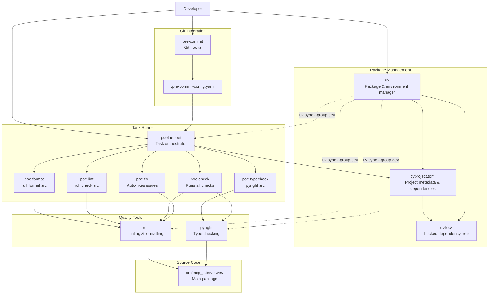
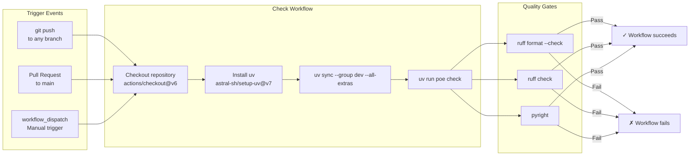
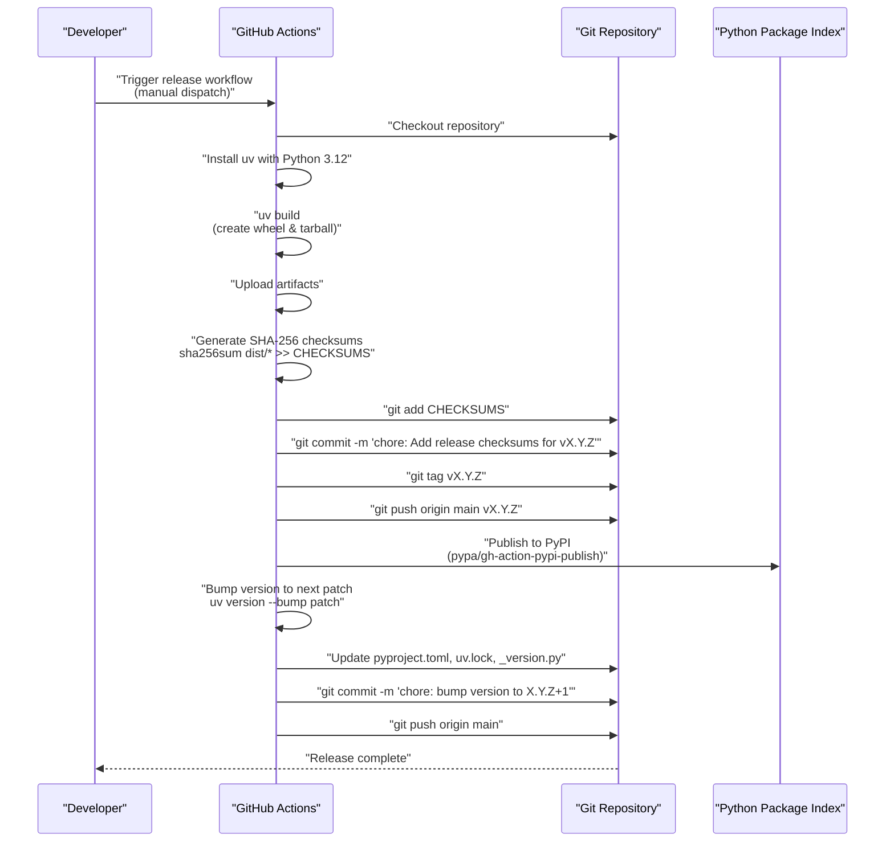

<!-- source: DeepWiki mcp.deepwiki.com · repo microsoft/mcp-interviewer · page 5 Development Guide · fetched 2026-10-26 -->

# Development Guide

<details>
<summary>Relevant source files</summary>

The following files were used as context for generating this wiki page:

- [.github/workflows/check.yml](.github/workflows/check.yml)
- [.github/workflows/release.yml](.github/workflows/release.yml)
- [.pre-commit-config.yaml](.pre-commit-config.yaml)
- [pyproject.toml](pyproject.toml)

</details>


This page provides guidance for developers who want to contribute to or modify mcp-interviewer. It covers the development environment, tooling, workflows, and processes used to maintain code quality and release new versions.

For detailed information about specific aspects of development:
- **Project organization**: See [Project Structure](#5.1) for directory layout and module responsibilities
- **Day-to-day workflows**: See [Development Workflow](#5.2) for using poe tasks
- **Package management**: See [Dependency Management](#5.3) for working with uv and lock files
- **Testing practices**: See [Testing](#5.4) for running and writing tests
- **Automation**: See [CI/CD Pipeline](#5.5) for GitHub Actions and Azure Pipelines
- **Releasing**: See [Release Process](#5.6) for publishing new versions

## Development Environment Overview

The mcp-interviewer project uses modern Python tooling focused on developer experience and reproducibility:

| Tool | Purpose | Configuration |
|------|---------|---------------|
| **uv** | Fast Python package manager | `pyproject.toml`, `uv.lock` |
| **hatchling** | Build backend for creating distributions | [pyproject.toml:26-44]() |
| **ruff** | Linting and formatting | [pyproject.toml:49-53]() |
| **pyright** | Static type checking | [pyproject.toml:18]() |
| **poethepoet** | Task runner for common commands | [pyproject.toml:55-64]() |
| **pytest** | Test framework | [pyproject.toml:20]() |
| **pre-commit** | Git hooks for quality checks | [.pre-commit-config.yaml:1-10]() |

Sources: [pyproject.toml:1-65]()

## Development Tools Architecture



**Development Tools Interaction Diagram**

This diagram shows how development tools interact. The `uv` package manager reads `pyproject.toml` and creates/maintains `uv.lock` for reproducible environments. The `poethepoet` task runner provides convenient commands that invoke `ruff` and `pyright` against the source code. Pre-commit hooks integrate with poe tasks to enforce quality standards before commits.

Sources: [pyproject.toml:1-65](), [.pre-commit-config.yaml:1-10]()

## Setting Up the Development Environment

### Prerequisites

- Python 3.11 or higher ([pyproject.toml:6]())
- `uv` package manager (install from https://github.com/astral-sh/uv)

### Installation Steps

1. **Clone the repository**:
   ```bash
   git clone https://github.com/microsoft/mcp-interviewer
   cd mcp-interviewer
   ```

2. **Install dependencies with dev group**:
   ```bash
   uv sync --group dev --all-extras
   ```
   
   This installs:
   - Runtime dependencies: `mcp`, `openai`, `tiktoken`, `jsonschema` ([pyproject.toml:7-12]())
   - Development dependencies: `ruff`, `pre-commit`, `pyright`, `poethepoet`, `pytest` ([pyproject.toml:15-21]())

3. **Set up pre-commit hooks**:
   ```bash
   uv run pre-commit install
   ```
   
   This configures Git to run `poe precommit` before each commit ([.pre-commit-config.yaml:4-9]())

Sources: [pyproject.toml:6-21](), [.pre-commit-config.yaml:1-10]()

## Common Development Tasks

The project uses `poethepoet` (invoked as `poe`) to provide convenient task commands defined in [pyproject.toml:55-64]():

| Task | Command | Purpose |
|------|---------|---------|
| `poe format` | `ruff format src` | Format code with ruff |
| `poe formatcheck` | `ruff format --check src` | Check formatting without changes |
| `poe lint` | `ruff check src` | Run linting checks |
| `poe lintfix` | `ruff check --fix src` | Auto-fix linting issues |
| `poe typecheck` | `pyright src` | Run static type checking |
| `poe check` | Runs: `formatcheck`, `lint`, `typecheck` | Run all quality checks |
| `poe precommit` | Runs: `formatcheck`, `lint` | Pre-commit hook checks |
| `poe fix` | Runs: `format`, `lintfix` | Auto-fix all fixable issues |
| `poe example` | `mcp-interviewer --test --model gpt-4.1 ...` | Run example interview |

**Recommended workflow**:
1. Make code changes
2. Run `uv run poe fix` to auto-format and fix linting issues
3. Run `uv run poe check` to verify all checks pass
4. Commit (pre-commit hooks will run automatically)

Sources: [pyproject.toml:55-64]()

## Code Quality Standards

### Ruff Configuration

Ruff is configured to target Python 3.11+ with specific linting rules ([pyproject.toml:49-53]()):

- **F**: Pyflakes (error detection)
- **I**: isort (import sorting)
- **UP**: pyupgrade (modern Python idioms)

### Type Checking

The project uses `pyright` for static type analysis. All code in `src/` should have proper type annotations. Run `uv run poe typecheck` to verify.

### Pre-commit Hooks

Pre-commit hooks enforce quality standards before commits are created:

```yaml
hooks:
  - id: poe-check
    name: poe check
    language: system
    entry: "poe"
    args: ["precommit"]
    pass_filenames: false
    always_run: true
```

The hook runs `poe precommit`, which executes `formatcheck` and `lint` ([.pre-commit-config.yaml:4-9]()).

Sources: [pyproject.toml:49-53](), [.pre-commit-config.yaml:1-10]()

## Continuous Integration

### GitHub Actions Check Workflow



**GitHub Actions Check Workflow**

The check workflow runs on:
- Every push to any branch that modifies source files ([.github/workflows/check.yml:6-11]())
- Pull requests to main ([.github/workflows/check.yml:13-17]())
- Manual triggers ([.github/workflows/check.yml:18]())

The workflow installs dependencies and runs `poe check`, which executes formatting checks, linting, and type checking. All must pass for the workflow to succeed.

Sources: [.github/workflows/check.yml:1-35]()

## Build System

The project uses `hatchling` as its build backend ([pyproject.toml:26-28]()):

### Build Configuration

```toml
[build-system]
requires = ["hatchling"]
build-backend = "hatchling.build"

[tool.hatch.build.targets.wheel]
packages = ["src/mcp_interviewer"]

[tool.hatch.build]
include = [
    "src/**/*",
    "LICENSE",
    "README.md",
]
exclude = [
    ".DS_Store",
    "__pycache__",
    "*.pyc",
    "*.pyo",
]
```

### Building Distributions

To build wheel and source distributions:

```bash
uv build
```

This creates:
- `dist/mcp_interviewer-<version>-py3-none-any.whl` (wheel)
- `dist/mcp_interviewer-<version>.tar.gz` (source distribution)

Sources: [pyproject.toml:26-44]()

## Release Workflow



**Release Workflow Sequence**

The release workflow is manually triggered and performs these steps ([.github/workflows/release.yml:1-66]()):

1. **Build**: Creates wheel and source distributions using `uv build`
2. **Checksum**: Generates SHA-256 checksums for all distribution files
3. **Tag**: Commits checksums, creates Git tag `vX.Y.Z`, and pushes
4. **Publish**: Uploads to PyPI using trusted publishing (OIDC)
5. **Bump**: Automatically increments patch version for next development cycle

### Version Management

The project version is defined in three places:
- [pyproject.toml:3]() - Primary version source
- `uv.lock` - Updated automatically by uv
- `src/mcp_interviewer/_version.py` - Updated by release workflow

Sources: [.github/workflows/release.yml:1-66](), [pyproject.toml:3]()

## Entry Point Configuration

The CLI entry point is defined in [pyproject.toml:23-24]():

```toml
[project.scripts]
mcp-interviewer = "mcp_interviewer.cli:cli"
```

This makes the `mcp-interviewer` command available after installation, which invokes the `cli()` function in `mcp_interviewer.cli`.

Sources: [pyproject.toml:23-24]()

## Development Dependencies

The dev dependency group ([pyproject.toml:14-21]()) includes:

| Package | Version Constraint | Purpose |
|---------|-------------------|---------|
| `ruff` | `>=0.1.0` | Fast linter and formatter |
| `pre-commit` | `>=4.3.0` | Git hook management |
| `pyright` | `>=1.1.403` | Static type checker |
| `poethepoet` | `>=0.37.0` | Task runner |
| `pytest` | `>=8.4.2` | Test framework |

Install with: `uv sync --group dev`

Sources: [pyproject.toml:14-21]()

## Project Metadata

Key project metadata from [pyproject.toml:1-12]():

| Field | Value |
|-------|-------|
| **Name** | `mcp-interviewer` |
| **Version** | `0.0.13` |
| **Python** | `>=3.11` |
| **Runtime Dependencies** | `mcp>=1.10.1`, `openai>=1.93.3`, `tiktoken>=0.11.0`, `jsonschema>=4.0.0` |

The project uses modern Python features and requires Python 3.11 or higher.

Sources: [pyproject.toml:1-12]()

---

