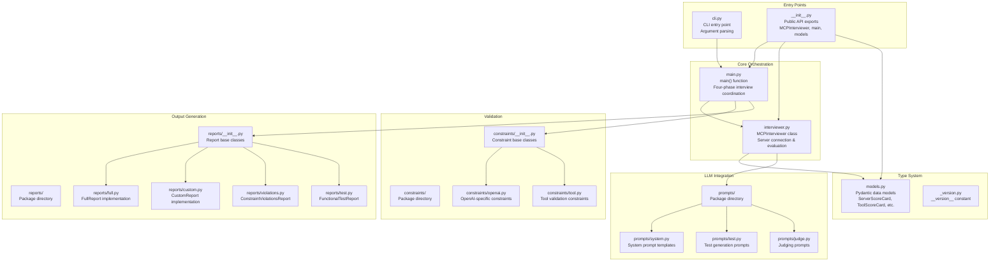
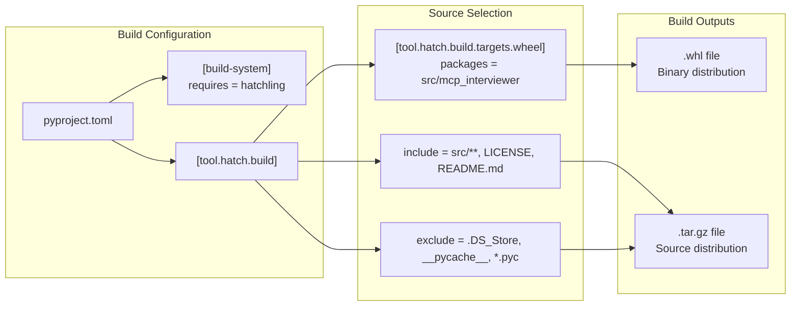
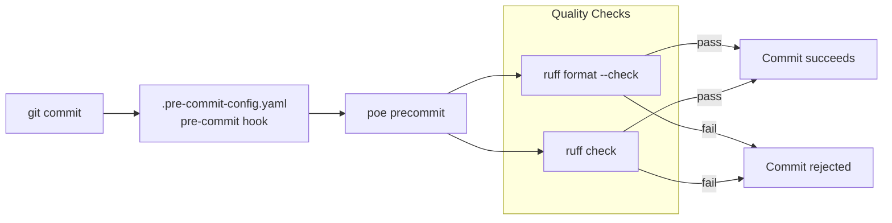
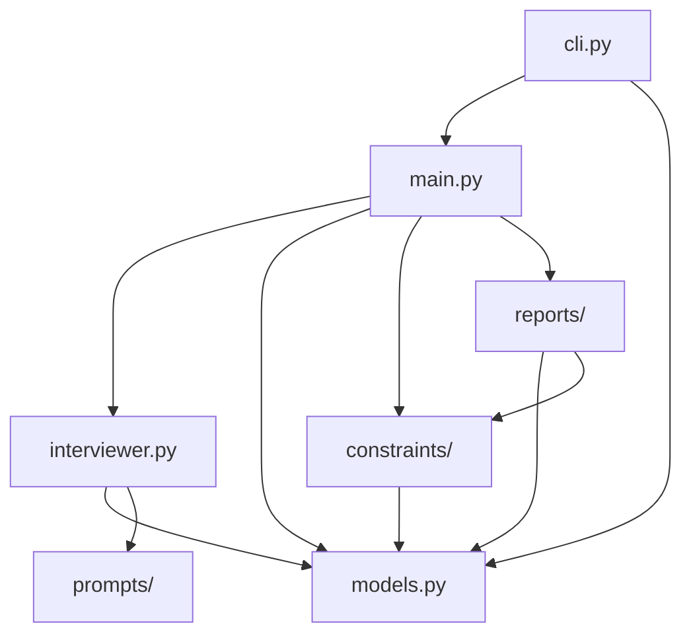

<!-- source: DeepWiki mcp.deepwiki.com · repo microsoft/mcp-interviewer · page 5.1 Project Structure · fetched 2026-10-26 -->

# Project Structure

<details>
<summary>Relevant source files</summary>

The following files were used as context for generating this wiki page:

- [.pre-commit-config.yaml](.pre-commit-config.yaml)
- [pyproject.toml](pyproject.toml)
- [src/mcp_interviewer/__init__.py](src/mcp_interviewer/__init__.py)

</details>


This page documents the directory layout, package organization, and module responsibilities of the mcp-interviewer codebase. It is intended for developers who need to navigate the source code and understand how the system is organized.

For information about development workflows and tooling, see [Development Workflow](#5.2). For build and distribution configuration details, see [CI/CD Pipeline](#5.5).

---

## Package Organization

The mcp-interviewer project follows a modern Python package structure using the `src/` layout pattern. All source code resides under `src/mcp_interviewer/`, with configuration and tooling files at the repository root.

```
mcp-interviewer/
├── .github/
│   └── workflows/              # GitHub Actions CI/CD workflows
├── .azure-pipelines/           # Azure Pipelines configuration
├── src/
│   └── mcp_interviewer/        # Main package source
│       ├── __init__.py         # Package exports
│       ├── _version.py         # Version constant
│       ├── cli.py              # Command-line interface
│       ├── main.py             # Main orchestration logic
│       ├── interviewer.py      # MCPInterviewer class
│       ├── models.py           # Data models and types
│       ├── constraints/        # Constraint validation system
│       ├── reports/            # Report generation modules
│       └── prompts/            # LLM prompt templates
├── pyproject.toml              # Project metadata and dependencies
├── uv.lock                     # Locked dependency versions
├── README.md                   # Project documentation
├── LICENSE                     # License file
└── .pre-commit-config.yaml     # Pre-commit hook configuration
```

**Sources:** Inferred from [pyproject.toml:30-44](), [src/mcp_interviewer/__init__.py:1-13](), repository structure from high-level diagrams

---

## Core Module Responsibilities

The following diagram maps the high-level system components to their corresponding source code modules:



**Sources:** [src/mcp_interviewer/__init__.py:1-13](), [pyproject.toml:23-24](), inferred from high-level architecture diagrams

---

## Package Entry Points

### CLI Entry Point

The package defines a single command-line entry point via the `project.scripts` section in `pyproject.toml`:

| Entry Point | Target Function | Description |
|-------------|----------------|-------------|
| `mcp-interviewer` | `mcp_interviewer.cli:cli` | Main CLI command |

When users run `mcp-interviewer` from the command line, Python invokes the `cli()` function in [src/mcp_interviewer/cli.py]().

**Sources:** [pyproject.toml:23-24]()

### Python API Entry Point

The package exports its public API through `__init__.py`:

| Export | Module | Type | Purpose |
|--------|--------|------|---------|
| `__version__` | `_version` | `str` | Package version constant |
| `MCPInterviewer` | `interviewer` | `class` | Main interviewer class |
| `main` | `main` | `function` | Orchestration function |
| `Client` | `models` | `type` | OpenAI client type |
| `ServerParameters` | `models` | `type` | Server connection parameters |
| `ServerScoreCard` | `models` | `type` | Interview results data model |

These exports constitute the stable public API for programmatic usage. All other modules are considered internal implementation details.

**Sources:** [src/mcp_interviewer/__init__.py:1-13]()

---

## Build System Configuration

The project uses `hatchling` as its build backend, configured in `pyproject.toml`:



**Key configuration details:**

- **Build backend:** `hatchling` ([pyproject.toml:26-28]())
- **Package location:** `src/mcp_interviewer` ([pyproject.toml:30-31]())
- **Included files:** Source code, LICENSE, README.md ([pyproject.toml:34-38]())
- **Excluded patterns:** `.DS_Store`, `__pycache__`, compiled Python files ([pyproject.toml:39-44]())

**Sources:** [pyproject.toml:26-44]()

---

## Dependency Configuration

Dependencies are organized into two categories:

### Runtime Dependencies

Core dependencies required for package execution:

| Dependency | Version Constraint | Purpose |
|-----------|-------------------|---------|
| `mcp` | `>=1.10.1` | MCP protocol implementation |
| `openai` | `>=1.93.3` | OpenAI API client for LLM features |
| `tiktoken` | `>=0.11.0` | Token counting for OpenAI constraints |
| `jsonschema` | `>=4.0.0` | JSON schema validation |

**Sources:** [pyproject.toml:7-12]()

### Development Dependencies

Development-only dependencies defined in the `[dependency-groups]` section:

| Dependency | Version Constraint | Purpose |
|-----------|-------------------|---------|
| `ruff` | `>=0.1.0` | Linting and formatting |
| `pre-commit` | `>=4.3.0` | Git hook automation |
| `pyright` | `>=1.1.403` | Type checking |
| `poethepoet` | `>=0.37.0` | Task runner (`poe` commands) |
| `pytest` | `>=8.4.2` | Testing framework |

These dependencies are not included when users install `mcp-interviewer` as a package. They are only installed in development environments.

**Sources:** [pyproject.toml:14-21]()

For detailed information about dependency management with `uv` and lock files, see [Dependency Management](#5.3).

---

## Pre-Commit Configuration

The project uses `pre-commit` to enforce code quality standards before commits. The configuration runs the `poe precommit` task:



The hook runs two checks:
1. **Format validation:** Ensures code follows formatting standards ([pyproject.toml:57]())
2. **Linting:** Checks for code quality issues ([pyproject.toml:58]())

**Sources:** [.pre-commit-config.yaml:1-10](), [pyproject.toml:55-63]()

---

## Module Dependency Graph

The following diagram shows the import relationships between core modules:



**Key observations:**

- **`models.py`** is a foundational module with no dependencies on other package modules (only external dependencies)
- **`cli.py`** and **`main.py`** orchestrate the system but don't depend on each other
- **`interviewer.py`** focuses on server interaction and relies on `models` and `prompts`
- **`constraints/`** and **`reports/`** both consume `models` but are independent of each other

**Sources:** [src/mcp_interviewer/__init__.py:1-13](), inferred from architecture diagrams

---

## Code Organization Principles

The codebase follows several organizational principles:

1. **Separation of concerns:** Entry points (`cli.py`), orchestration (`main.py`), and server interaction (`interviewer.py`) are distinct modules
2. **Type-first design:** All data structures are defined in `models.py` using Pydantic
3. **Pluggable validation:** Constraints are modular and can be extended via the `constraints/` package
4. **Flexible reporting:** Multiple report types are supported through the `reports/` package
5. **Prompt isolation:** LLM prompts are centralized in the `prompts/` package for easy maintenance

**Sources:** Inferred from [src/mcp_interviewer/__init__.py:1-13](), [pyproject.toml:30-31](), architecture diagrams

---

