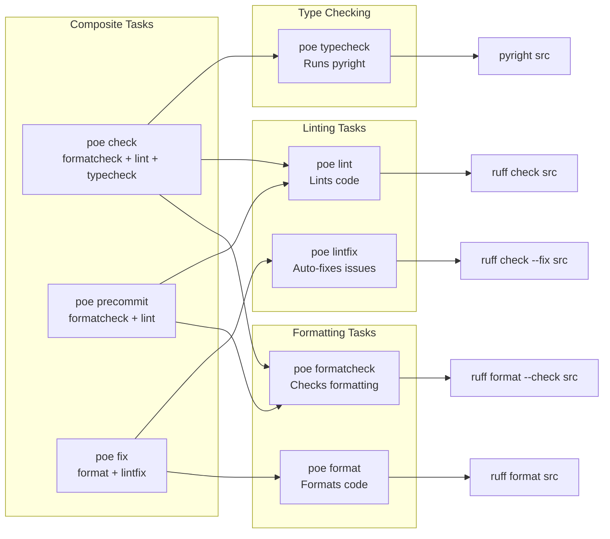
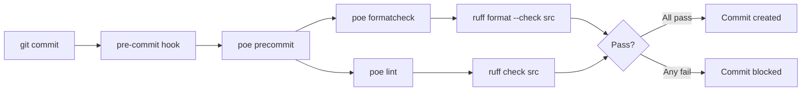
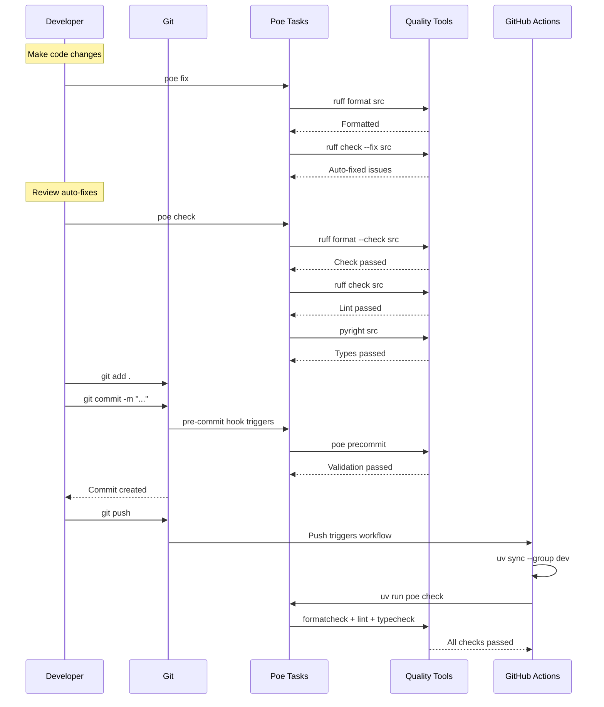

<!-- source: DeepWiki mcp.deepwiki.com · repo microsoft/mcp-interviewer · page 5.2 Development Workflow · fetched 2026-10-26 -->

# Development Workflow

<details>
<summary>Relevant source files</summary>

The following files were used as context for generating this wiki page:

- [.github/workflows/check.yml](.github/workflows/check.yml)
- [.github/workflows/release.yml](.github/workflows/release.yml)
- [.pre-commit-config.yaml](.pre-commit-config.yaml)
- [pyproject.toml](pyproject.toml)

</details>


This page documents the daily development workflow for contributors to mcp-interviewer. It covers the poe task runner, code quality tools, pre-commit hooks, and how local development integrates with CI/CD validation. For information about the CI/CD pipeline infrastructure and automated workflows, see [CI/CD Pipeline](#5.5). For dependency management practices, see [Dependency Management](#5.3).

## Overview

The mcp-interviewer project uses a standardized development workflow centered around three core tools:

| Tool | Purpose | Configuration |
|------|---------|---------------|
| **poethepoet** | Task runner orchestrating all development commands | [pyproject.toml:55-64]() |
| **ruff** | Combined linter and formatter for code quality | [pyproject.toml:49-53]() |
| **pyright** | Static type checker for Python code | [pyproject.toml:18]() |

All development tasks are exposed through `poe` commands, eliminating the need to remember specific tool invocations or flags.

**Sources:** [pyproject.toml:14-21](), [pyproject.toml:55-64]()

## Poe Task Reference

The following tasks are available through the poethepoet task runner:

### Code Quality Tasks



**Task Definitions**

| Task | Command | Purpose |
|------|---------|---------|
| `poe format` | `ruff format src` | Formats all code in `src/` directory using ruff |
| `poe formatcheck` | `ruff format --check src` | Checks if code is formatted without modifying files |
| `poe lint` | `ruff check src` | Runs linter on `src/` directory |
| `poe lintfix` | `ruff check --fix src` | Runs linter and auto-fixes issues where possible |
| `poe typecheck` | `pyright src` | Runs static type checking |
| `poe check` | Composite: `formatcheck`, `lint`, `typecheck` | Runs all validation checks (used in CI) |
| `poe precommit` | Composite: `formatcheck`, `lint` | Runs pre-commit validation (excludes typecheck for speed) |
| `poe fix` | Composite: `format`, `lintfix` | Auto-fixes all auto-fixable issues |

**Sources:** [pyproject.toml:55-64]()

### Example Task

```bash
# Line 64 defines an example command for testing the interviewer
poe example
```

This task runs a complete interview against the `@modelcontextprotocol/server-everything` server using Docker, serving as both a development test and documentation example.

**Sources:** [pyproject.toml:64]()

## Pre-Commit Hooks

Pre-commit hooks provide automatic validation before commits are created. The hook configuration delegates to the `poe precommit` task.

### Pre-Commit Configuration



The pre-commit configuration is minimal, delegating all logic to poe:

```yaml
repos:
  - repo: local
    hooks:
      - id: poe-check
        name: poe check
        language: system
        entry: "poe"
        args: ["precommit"]
        pass_filenames: false
        always_run: true
```

**Key Characteristics:**
- **Local hook**: Runs using the system Python/tools rather than creating isolated environments
- **No file filtering**: `pass_filenames: false` means the hook doesn't receive specific changed files
- **Always runs**: `always_run: true` ensures validation happens even if no Python files changed
- **Excludes typecheck**: Uses `poe precommit` instead of `poe check` for faster feedback

**Installation:**
```bash
# Install pre-commit hooks after cloning
uv run pre-commit install
```

**Sources:** [.pre-commit-config.yaml:1-10](), [pyproject.toml:62]()

## Local Development Workflow

The typical development workflow follows this pattern:



### Step-by-Step Workflow

1. **Make changes** to code in `src/mcp_interviewer/`

2. **Auto-fix issues** using the fix task:
   ```bash
   uv run poe fix
   ```
   This runs `ruff format` and `ruff check --fix` to automatically correct formatting and fixable lint issues.

3. **Verify all checks pass** before committing:
   ```bash
   uv run poe check
   ```
   This runs the full validation suite: formatting check, linting, and type checking.

4. **Commit changes**:
   ```bash
   git add .
   git commit -m "feat: add new feature"
   ```
   Pre-commit hooks automatically run `poe precommit` to validate the commit.

5. **Push to GitHub**:
   ```bash
   git push origin feature-branch
   ```
   GitHub Actions runs `poe check` on the server to validate the build.

**Sources:** [.github/workflows/check.yml:30-34](), [.pre-commit-config.yaml:1-10]()

## Code Quality Tools

### Ruff Configuration

Ruff serves as both the code formatter and linter. Configuration is minimal, relying on ruff's defaults:

| Setting | Value | Purpose |
|---------|-------|---------|
| `target-version` | `py311` | Ensures compatibility with Python 3.11+ |
| `select` | `["F", "I", "UP"]` | Enables Pyflakes (F), import sorting (I), and pyupgrade (UP) rules |

**Rule Categories:**
- **F (Pyflakes)**: Catches common Python errors like undefined variables, unused imports
- **I (isort)**: Enforces consistent import ordering and grouping
- **UP (pyupgrade)**: Suggests modern Python syntax (e.g., type hints, f-strings)

**Sources:** [pyproject.toml:49-53]()

### Pyright Configuration

Pyright performs static type analysis to catch type errors before runtime. The tool is invoked directly without project-specific configuration:

```bash
pyright src
```

Pyright analyzes:
- Type annotations in function signatures
- Variable type inference
- Type compatibility in assignments and function calls
- Generic type parameters
- Protocol implementations

The project uses Python 3.11+ type hints throughout, particularly in the data models using Pydantic.

**Sources:** [pyproject.toml:60]()

## Integration with CI/CD

The local development workflow mirrors the CI validation process, ensuring that code passing locally will pass in CI.

### CI Check Workflow

The GitHub Actions check workflow validates every push and pull request:

```yaml
# .github/workflows/check.yml
jobs:
  check:
    runs-on: ubuntu-latest
    steps:
      - uses: actions/checkout@v6
      - uses: astral-sh/setup-uv@v7
      - run: uv sync --group dev --all-extras
      - run: uv run poe check
```

**Workflow Characteristics:**
- **Triggered on**: Push to any branch, pull requests to main
- **Path filters**: Only runs when `src/**`, `pyproject.toml`, or `uv.lock` change
- **Validation**: Runs identical `poe check` command as local development
- **Fast feedback**: Typical runtime under 2 minutes

**Sources:** [.github/workflows/check.yml:1-35]()

### Workflow Parity

| Validation | Local Command | CI Command | Match |
|------------|---------------|------------|-------|
| Format check | `poe formatcheck` | `poe check` → `formatcheck` | ✅ |
| Lint check | `poe lint` | `poe check` → `lint` | ✅ |
| Type check | `poe typecheck` | `poe check` → `typecheck` | ✅ |
| Pre-commit | `poe precommit` | N/A (not run in CI) | - |

The pre-commit task (`poe precommit`) intentionally excludes `typecheck` for faster local feedback, while CI always runs the complete `poe check` suite including type checking.

**Sources:** [.github/workflows/check.yml:30-34](), [pyproject.toml:61-62]()

## Troubleshooting

### Common Issues

**Pre-commit hook fails but `poe check` passes locally:**
- Pre-commit uses `poe precommit` which excludes type checking
- Run `poe check` to see the full validation including types
- The pre-commit hook may have stale cache; reinstall with `pre-commit uninstall && pre-commit install`

**Ruff formatting conflicts:**
- Run `poe format` to apply formatting
- Ruff format is deterministic; conflicts usually indicate stale branches
- Rebase on main to resolve

**Type errors in CI but not locally:**
- Ensure pyright version matches between local and CI (defined in dev dependencies)
- Clear pyright cache: `rm -rf .pyright`
- Verify Python version matches (3.11+)

**Import order issues:**
- Ruff handles import sorting automatically
- Run `poe fix` to auto-fix import ordering
- Manual fixes only needed for circular imports or complex cases

**Sources:** [pyproject.toml:14-21](), [pyproject.toml:55-64]()

---

