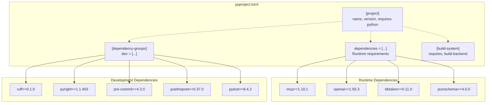
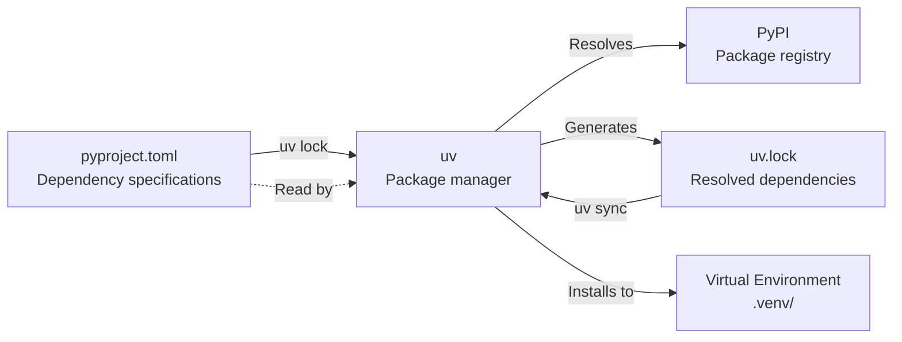
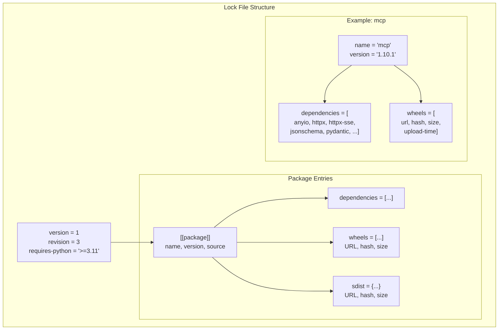
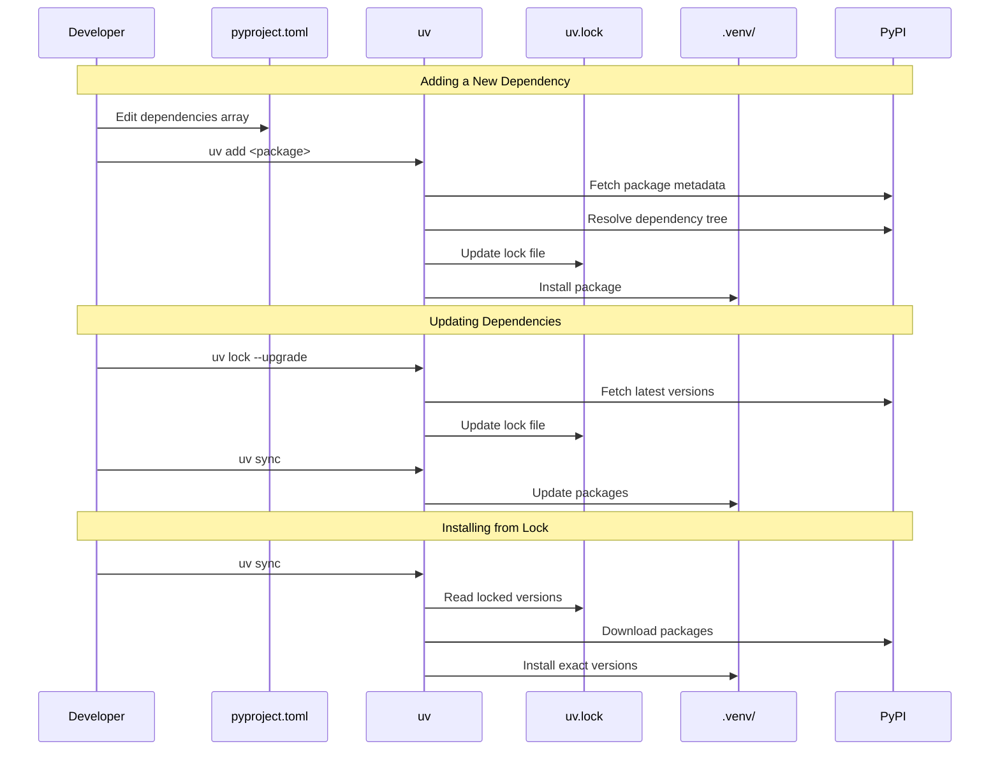
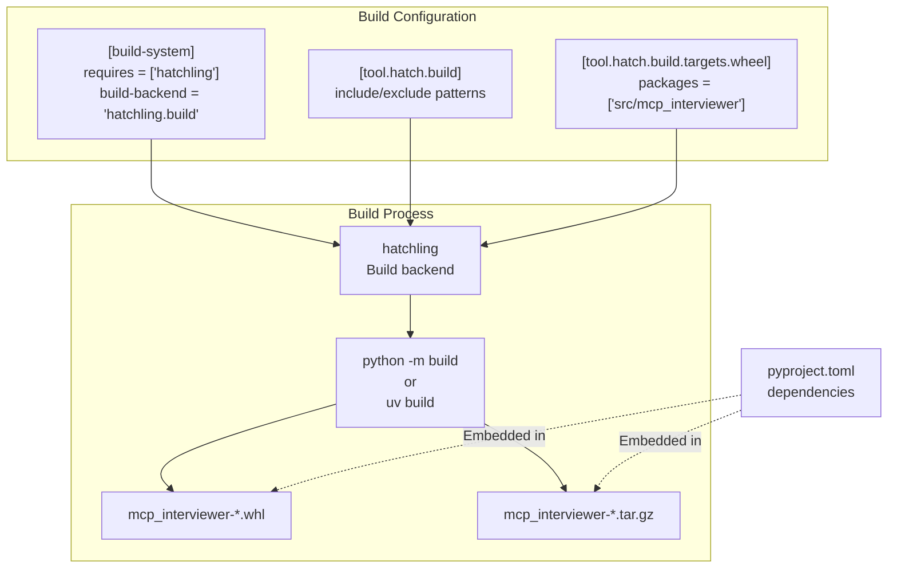
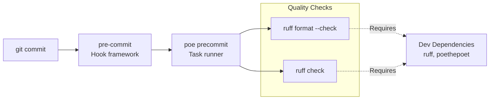

<!-- source: DeepWiki mcp.deepwiki.com · repo microsoft/mcp-interviewer · page 5.3 Dependency Management · fetched 2026-10-26 -->

# Dependency Management

<details>
<summary>Relevant source files</summary>

The following files were used as context for generating this wiki page:

- [.pre-commit-config.yaml](.pre-commit-config.yaml)
- [pyproject.toml](pyproject.toml)
- [tests/constraints/test_tool_schema_flatness.py](tests/constraints/test_tool_schema_flatness.py)
- [uv.lock](uv.lock)

</details>


This page documents how mcp-interviewer manages its dependencies using `uv` as the primary package manager. It covers dependency declaration, lock file management, and workflows for adding or updating dependencies. For information about the development workflow and poe tasks, see [Development Workflow](#5.2). For build and distribution processes, see [Release Process](#5.6).

---

## Dependency Declaration Structure

Dependencies are declared in `pyproject.toml` following PEP 621 standards. The project separates runtime dependencies from development-only dependencies using dependency groups.



**Sources:** [pyproject.toml:1-65]()

### Production Dependencies

Production dependencies are defined in the `dependencies` array and are required for the package to function at runtime:

| Dependency | Version Constraint | Purpose |
|------------|-------------------|---------|
| `mcp` | `>=1.10.1` | Model Context Protocol SDK for server communication |
| `openai` | `>=1.93.3` | OpenAI client for LLM-based evaluation features |
| `tiktoken` | `>=0.11.0` | Token counting for OpenAI constraints |
| `jsonschema` | `>=4.0.0` | JSON Schema validation for tool schemas |

**Sources:** [pyproject.toml:7-12]()

### Development Dependency Groups

Development dependencies are organized in the `[dependency-groups]` section. These are only required for development, testing, and CI/CD:

| Dependency | Version Constraint | Purpose |
|------------|-------------------|---------|
| `ruff` | `>=0.1.0` | Linting and code formatting |
| `pyright` | `>=1.1.403` | Static type checking |
| `pre-commit` | `>=4.3.0` | Git hooks for automated checks |
| `poethepoet` | `>=0.37.0` | Task runner for poe tasks |
| `pytest` | `>=8.4.2` | Test framework |

**Sources:** [pyproject.toml:14-21]()

---

## The uv Package Manager

mcp-interviewer uses `uv` as its primary package and dependency manager. `uv` is a fast Python package installer and resolver written in Rust that provides deterministic dependency resolution and lock file management.



**Sources:** [pyproject.toml:1-65](), [uv.lock:1-3]()

### Key Features

- **Fast dependency resolution**: Written in Rust for performance
- **Reproducible builds**: Lock file ensures identical installations across environments
- **Dependency groups**: Native support for optional dependency groups
- **PEP 621 compatible**: Works with standard `pyproject.toml` format

---

## Lock File Management

The `uv.lock` file contains the complete dependency tree with exact versions and hashes for all direct and transitive dependencies. This ensures reproducible installations across different environments and machines.



**Sources:** [uv.lock:1-1000]()

### Lock File Contents

The lock file contains:

1. **Metadata**: Format version, revision number, Python version requirement
2. **Package entries**: One per package in the dependency tree
3. **Version information**: Exact version for each package
4. **Source information**: Registry URL or git repository
5. **Distribution artifacts**: Wheel and source distribution URLs with SHA256 hashes
6. **Transitive dependencies**: Complete dependency graph

Example package entry structure:

```
[[package]]
name = "mcp"
version = "1.10.1"
source = { registry = "https://pypi.org/simple" }
dependencies = [
    { name = "anyio" },
    { name = "httpx" },
    { name = "jsonschema" },
    ...
]
sdist = { url = "...", hash = "sha256:...", size = 392969 }
wheels = [
    { url = "...", hash = "sha256:...", size = 150878 }
]
```

**Sources:** [uv.lock:312-330]()

### Reproducibility Guarantees

The lock file provides several guarantees:

- **Exact versions**: No semver resolution at install time
- **Cryptographic hashes**: Verifies package integrity
- **Platform-specific wheels**: Multiple wheel entries for different platforms
- **Transitive closure**: All indirect dependencies are locked

**Sources:** [uv.lock:1-1000]()

---

## Dependency Workflow



**Sources:** [pyproject.toml:7-21](), [uv.lock:1-3]()

### Adding Dependencies

To add a new production dependency:

```bash
# Add to pyproject.toml and update lock file
uv add <package>

# Or manually edit pyproject.toml, then:
uv lock
uv sync
```

To add a development dependency:

```bash
# Add to dev dependency group
uv add --group dev <package>

# Or manually edit [dependency-groups] section, then:
uv lock
uv sync --group dev
```

**Sources:** [pyproject.toml:7-21]()

### Updating Dependencies

To update all dependencies to their latest compatible versions:

```bash
# Update lock file with latest versions
uv lock --upgrade

# Sync environment with new versions
uv sync
```

To update a specific package:

```bash
# Update specific package
uv lock --upgrade-package <package>
uv sync
```

### Syncing the Environment

To ensure your virtual environment matches the lock file:

```bash
# Install all dependencies including dev
uv sync

# Install only production dependencies
uv sync --no-dev

# Install specific dependency group
uv sync --group dev
```

---

## Integration with Build System

The build system configuration in `pyproject.toml` defines how the package is built for distribution. This is separate from but related to dependency management.



**Sources:** [pyproject.toml:26-44]()

### Build System Dependencies

The `[build-system]` section specifies dependencies required to build the package:

```toml
[build-system]
requires = ["hatchling"]
build-backend = "hatchling.build"
```

- **`requires`**: Build dependencies (hatchling in this case)
- **`build-backend`**: Python module that implements PEP 517 build interface

**Sources:** [pyproject.toml:26-28]()

### Hatchling Configuration

Hatchling is configured to:

1. **Include specific files**: Source code, LICENSE, README
2. **Exclude patterns**: Cache files, compiled Python files
3. **Package location**: `src/mcp_interviewer` directory

```toml
[tool.hatch.build.targets.wheel]
packages = ["src/mcp_interviewer"]

[tool.hatch.build]
include = [
    "src/**/*",
    "LICENSE",
    "README.md",
]
exclude = [
    ".DS_Store",
    "__pycache__",
    "*.pyc",
    "*.pyo",
]
```

**Sources:** [pyproject.toml:30-44]()

### Metadata Configuration

The `[tool.hatch.metadata]` section controls how dependencies are resolved during builds:

```toml
[tool.hatch.metadata]
allow-direct-references = true
```

This allows direct references (e.g., git URLs) in dependencies, though mcp-interviewer currently only uses PyPI packages.

**Sources:** [pyproject.toml:46-47]()

---

## Dependency Version Constraints

The project uses minimum version constraints with `>=` specifiers, allowing dependency updates within compatibility bounds:

| Package | Constraint | Rationale |
|---------|-----------|-----------|
| `mcp>=1.10.1` | Minimum 1.10.1 | Requires specific MCP protocol features |
| `openai>=1.93.3` | Minimum 1.93.3 | Requires recent API features |
| `tiktoken>=0.11.0` | Minimum 0.11.0 | Token counting compatibility |
| `jsonschema>=4.0.0` | Minimum 4.0.0 | Modern JSON Schema support |
| `ruff>=0.1.0` | Minimum 0.1.0 | Stable ruff API |

This strategy balances:
- **Compatibility**: Allows users to satisfy constraints with existing packages
- **Features**: Ensures minimum required functionality is available
- **Flexibility**: Permits updates for bug fixes and improvements
- **Reproducibility**: Lock file pins exact versions for development

**Sources:** [pyproject.toml:7-21]()

---

## Pre-commit Integration

The project uses pre-commit hooks that depend on development dependencies being installed. The configuration ensures code quality checks run before commits.



**Sources:** [.pre-commit-config.yaml:1-10](), [pyproject.toml:55-63]()

The pre-commit hook executes `poe precommit`, which runs:
- `ruff format --check` - Verifies code formatting
- `ruff check` - Runs linting checks

Both commands require `ruff` from the dev dependency group to be installed.

**Sources:** [.pre-commit-config.yaml:1-10](), [pyproject.toml:62]()

---

## Python Version Requirement

The project requires Python 3.11 or later, declared in both the project metadata and lock file:

```toml
[project]
requires-python = ">=3.11"
```

```
# uv.lock
version = 1
revision = 3
requires-python = ">=3.11"
```

This requirement ensures:
- Access to Python 3.11+ features and type system improvements
- Compatibility with all dependency packages
- Consistent behavior across development and production environments

**Sources:** [pyproject.toml:6](), [uv.lock:3]()

---

