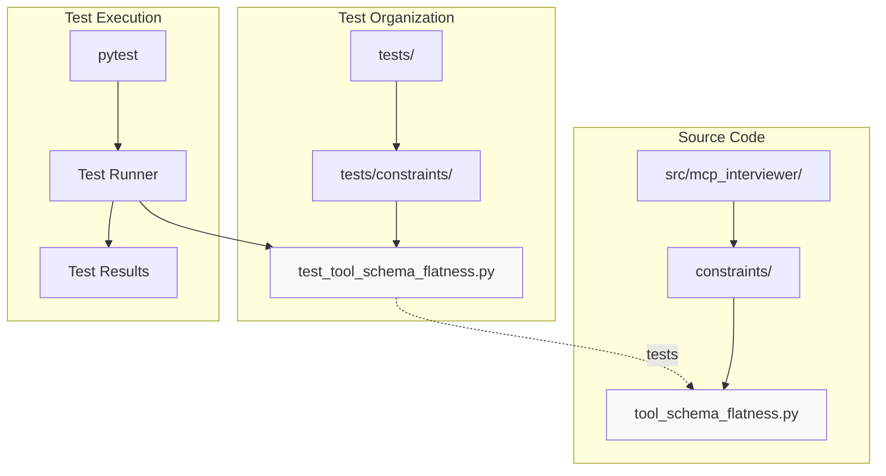
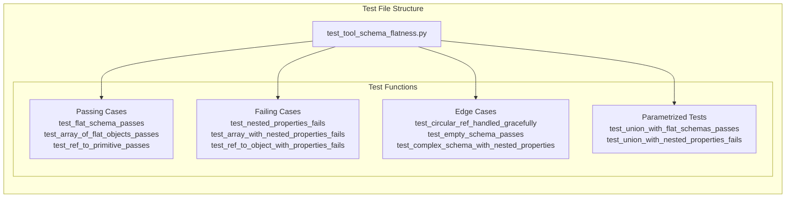
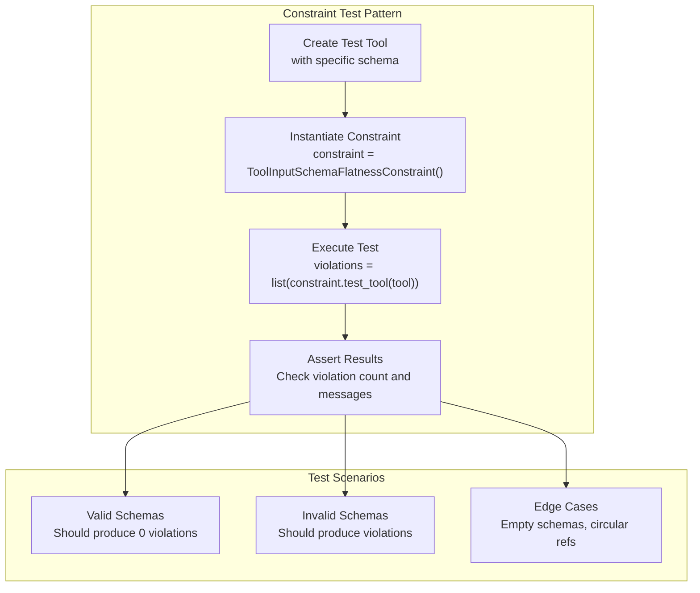
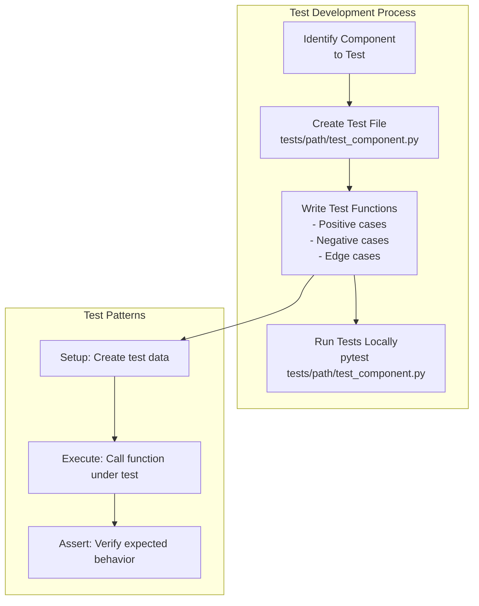
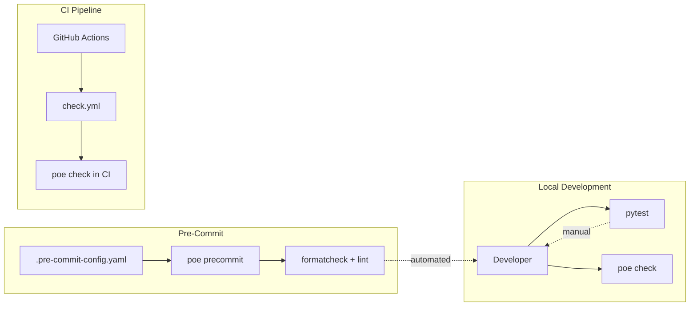
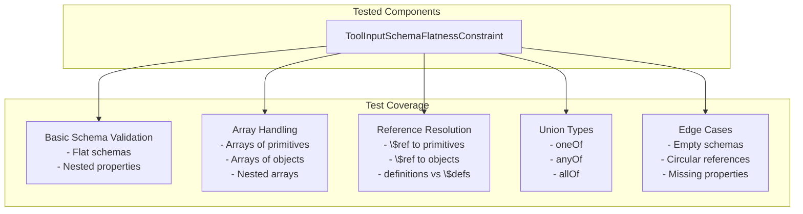

<!-- source: DeepWiki mcp.deepwiki.com · repo microsoft/mcp-interviewer · page 5.4 Testing · fetched 2026-10-26 -->

# Testing

<details>
<summary>Relevant source files</summary>

The following files were used as context for generating this wiki page:

- [.pre-commit-config.yaml](.pre-commit-config.yaml)
- [pyproject.toml](pyproject.toml)
- [tests/constraints/test_tool_schema_flatness.py](tests/constraints/test_tool_schema_flatness.py)
- [uv.lock](uv.lock)

</details>


This page covers the testing infrastructure and practices for mcp-interviewer. It explains how to run tests locally, the organization of test files, and patterns for writing new tests. For information about CI/CD automation of tests, see [CI/CD Pipeline](#5.5). For development workflow commands including code quality checks, see [Development Workflow](#5.2).

## Test Infrastructure

The mcp-interviewer project uses `pytest` as its test framework. Tests are organized in the `tests/` directory and mirror the structure of the source code.

**Test Framework Configuration:**

| Component | Purpose |
|-----------|---------|
| `pytest` | Primary test runner and assertion framework |
| Test fixtures | Reusable test data and setup |
| Parametrized tests | Run same test logic with multiple inputs |

**Sources:** [pyproject.toml:20]()



**Sources:** [tests/constraints/test_tool_schema_flatness.py:1-394]()

## Running Tests

Tests are executed using pytest directly. There is no dedicated poe task for running tests, but pytest can be invoked from the command line.

**Basic Test Execution:**

```bash
# Run all tests
pytest

# Run tests with verbose output
pytest -v

# Run specific test file
pytest tests/constraints/test_tool_schema_flatness.py

# Run specific test function
pytest tests/constraints/test_tool_schema_flatness.py::test_flat_schema_passes

# Run tests matching pattern
pytest -k "nested"
```

**Test Output Interpretation:**

| Symbol | Meaning |
|--------|---------|
| `.` | Test passed |
| `F` | Test failed |
| `E` | Test raised an error |
| `s` | Test skipped |
| `x` | Expected failure (xfail) |

**Sources:** [pyproject.toml:20]()

## Test Structure

The test suite is organized by the components being tested. Each test file contains multiple test functions that validate specific behaviors.



**Test Function Naming Convention:**

Test functions follow a clear naming pattern:
- `test_<scenario>_<expected_result>` (e.g., `test_flat_schema_passes`)
- Descriptive docstrings explain the specific behavior being tested

**Sources:** [tests/constraints/test_tool_schema_flatness.py:1-394]()

## Constraint Testing

The primary type of test in the current codebase is constraint validation testing. These tests verify that constraint implementations correctly identify violations and allow valid configurations.



**Sources:** [tests/constraints/test_tool_schema_flatness.py:11-28](), [tests/constraints/test_tool_schema_flatness.py:31-53]()

### Example: Testing Schema Flatness

The `test_tool_schema_flatness.py` file demonstrates comprehensive constraint testing:

**Testing Valid Cases:**
```python
# Test that flat schemas pass validation
tool = Tool(
    name="test_tool",
    description="A test tool",
    inputSchema={
        "type": "object",
        "properties": {
            "name": {"type": "string"},
            "age": {"type": "integer"},
        },
    },
)

constraint = ToolInputSchemaFlatnessConstraint()
violations = list(constraint.test_tool(tool))
assert len(violations) == 0
```

**Testing Invalid Cases:**
```python
# Test that nested schemas fail validation
tool = Tool(
    name="test_tool",
    description="A test tool",
    inputSchema={
        "type": "object",
        "properties": {
            "user": {
                "type": "object",
                "properties": {
                    "name": {"type": "string"},
                },
            },
        },
    },
)

constraint = ToolInputSchemaFlatnessConstraint()
violations = list(constraint.test_tool(tool))
assert len(violations) == 1
assert "nested structures" in violations[0].message
```

**Sources:** [tests/constraints/test_tool_schema_flatness.py:11-28](), [tests/constraints/test_tool_schema_flatness.py:31-53]()

## Parametrized Testing

The test suite uses `pytest.mark.parametrize` to run the same test logic with multiple inputs, reducing code duplication and improving coverage.

**Example:**
```python
@pytest.mark.parametrize("union_keyword", ["oneOf", "anyOf", "allOf"])
def test_union_with_flat_schemas_passes(union_keyword):
    """Test that unions (oneOf/anyOf/allOf) with flat schemas pass."""
    tool = Tool(
        name="test_tool",
        description="A test tool",
        inputSchema={
            "type": "object",
            "properties": {
                "value": {
                    union_keyword: [
                        {"type": "string"},
                        {"type": "integer"},
                    ],
                },
            },
        },
    )
    
    constraint = ToolInputSchemaFlatnessConstraint()
    violations = list(constraint.test_tool(tool))
    assert len(violations) == 0
```

This single test function runs three times with different union keywords, validating all union types efficiently.

**Sources:** [tests/constraints/test_tool_schema_flatness.py:222-243]()

## Test Categories

The existing test suite covers the following categories:

| Category | Description | Example Tests |
|----------|-------------|---------------|
| **Positive Tests** | Valid inputs that should pass | `test_flat_schema_passes` |
| **Negative Tests** | Invalid inputs that should fail | `test_nested_properties_fails` |
| **Edge Cases** | Boundary conditions and special cases | `test_empty_schema_passes`, `test_circular_ref_handled_gracefully` |
| **Complex Scenarios** | Real-world-like test cases | `test_complex_schema_with_nested_properties` |
| **Reference Resolution** | JSON Schema `$ref` handling | `test_ref_to_object_with_properties_fails` |

**Sources:** [tests/constraints/test_tool_schema_flatness.py:11-394]()

## Writing New Tests

When adding new tests to mcp-interviewer, follow these patterns:



**Test File Template:**

```python
"""Tests for ComponentName."""

import pytest
from mcp_interviewer.module import ComponentUnderTest


def test_basic_functionality_passes():
    """Test that basic functionality works as expected."""
    # Setup
    component = ComponentUnderTest()
    
    # Execute
    result = component.method()
    
    # Assert
    assert result.is_valid
    assert len(result.errors) == 0


def test_invalid_input_fails():
    """Test that invalid input produces expected errors."""
    # Setup
    component = ComponentUnderTest()
    invalid_input = create_invalid_data()
    
    # Execute
    result = component.method(invalid_input)
    
    # Assert
    assert not result.is_valid
    assert len(result.errors) > 0
    assert "expected error message" in result.errors[0]


@pytest.mark.parametrize("param_value", ["value1", "value2", "value3"])
def test_parametrized_behavior(param_value):
    """Test behavior with multiple parameter values."""
    component = ComponentUnderTest()
    result = component.method(param_value)
    assert result.is_valid
```

**Sources:** [tests/constraints/test_tool_schema_flatness.py:1-394]()

## Test Data Construction

Tests in mcp-interviewer construct data objects directly using the imported classes. For constraint tests, this means creating `Tool` objects with specific schema configurations.

**Test Data Pattern:**

```python
from mcp import Tool

# Construct test tool with inline schema
tool = Tool(
    name="test_tool_name",
    description="Description of the test tool",
    inputSchema={
        "type": "object",
        "properties": {
            "param1": {"type": "string"},
            "param2": {"type": "integer"},
        },
    },
)
```

This approach keeps test data close to the test logic and makes test intent clear.

**Sources:** [tests/constraints/test_tool_schema_flatness.py:13-24]()

## Integration with Development Workflow

Tests integrate with the development workflow through several mechanisms:



**Note:** The current `poe check` task ([pyproject.toml:61]()) runs format checking, linting, and type checking, but does not include pytest execution. Tests must be run separately using `pytest` directly.

**Sources:** [pyproject.toml:55-64](), [.pre-commit-config.yaml:1-10]()

## Test Assertions

Tests use standard pytest assertions with descriptive failure messages:

| Assertion Pattern | Purpose |
|-------------------|---------|
| `assert len(violations) == 0` | Verify no violations found |
| `assert len(violations) == 1` | Verify specific violation count |
| `assert "text" in message` | Check error message content |
| `assert result.is_valid` | Verify validation passed |

**Assertion Best Practices:**
1. Use specific assertions that clearly indicate what failed
2. Include violation message checks to ensure correct error reporting
3. Test both the count and content of violations

**Sources:** [tests/constraints/test_tool_schema_flatness.py:28](), [tests/constraints/test_tool_schema_flatness.py:52-53]()

## Test Coverage Areas

Current test coverage focuses on constraint validation:



**Future Testing Opportunities:**

Areas that could benefit from additional test coverage:
- Functional test generation logic
- Report generation
- LLM interaction mocking
- Server connection handling
- Other constraint implementations

**Sources:** [tests/constraints/test_tool_schema_flatness.py:1-394]()

---

