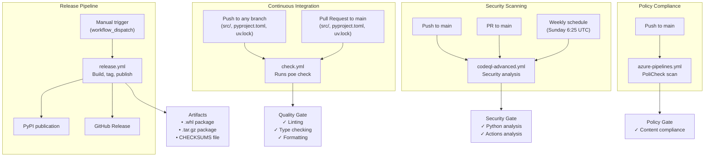
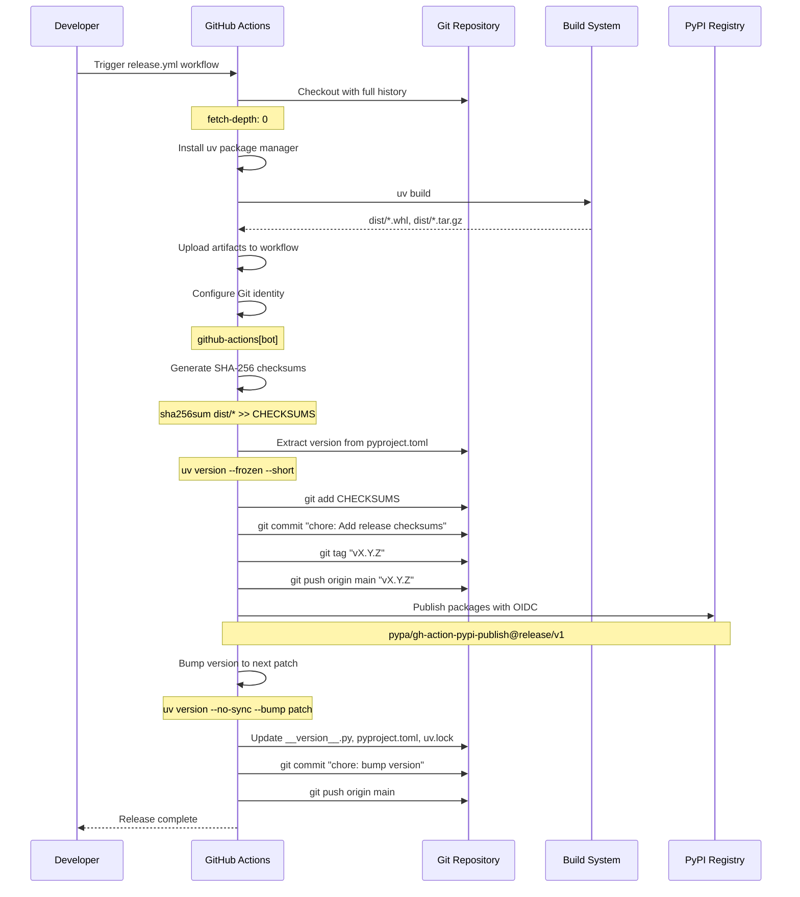
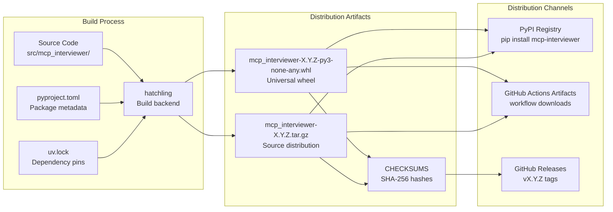
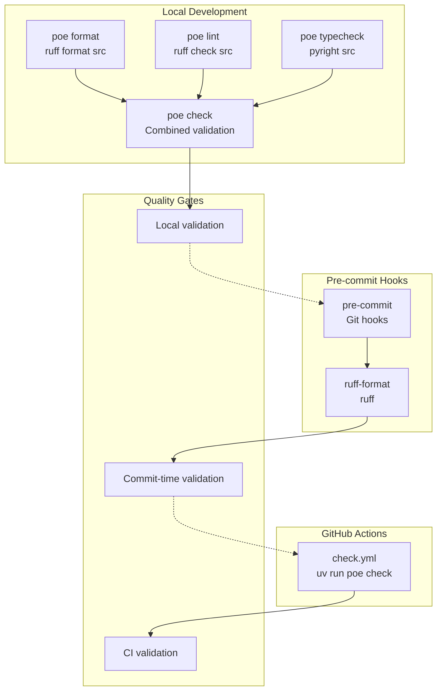

<!-- source: DeepWiki mcp.deepwiki.com · repo microsoft/mcp-interviewer · page 5.5 CI/CD Pipeline · fetched 2026-10-26 -->

# CI/CD Pipeline

<details>
<summary>Relevant source files</summary>

The following files were used as context for generating this wiki page:

- [.github/workflows/check.yml](.github/workflows/check.yml)
- [.github/workflows/codeql-advanced.yml](.github/workflows/codeql-advanced.yml)
- [.github/workflows/codeql.yml](.github/workflows/codeql.yml)
- [.github/workflows/release.yml](.github/workflows/release.yml)
- [CHECKSUMS](CHECKSUMS)
- [azure-pipelines.yml](azure-pipelines.yml)

</details>


## Purpose and Scope

This page documents the automated continuous integration and continuous deployment (CI/CD) infrastructure for the mcp-interviewer project. It covers all automated workflows that run on code changes, releases, and scheduled intervals.

The CI/CD pipeline consists of GitHub Actions workflows for quality checks, security scanning, and release management, plus Azure Pipelines for policy compliance. For details on the manual release process and versioning, see [Release Process](#5.6). For information about local development tasks, see [Development Workflow](#5.2).

## Workflow Architecture

The CI/CD pipeline consists of five primary workflows that execute at different stages of the development lifecycle:



**Sources:** [.github/workflows/check.yml](), [.github/workflows/release.yml](), [.github/workflows/codeql-advanced.yml](), [azure-pipelines.yml]()

## GitHub Actions Workflows

### Check Workflow

The `check` workflow enforces code quality standards on every push and pull request.

**File:** [.github/workflows/check.yml:1-35]()

**Trigger Conditions:**
- Pushes to any branch affecting `src/`, `pyproject.toml`, or `uv.lock` [.github/workflows/check.yml:5-11]()
- Pull requests to `main` affecting the same paths [.github/workflows/check.yml:12-17]()
- Manual dispatch [.github/workflows/check.yml:18]()

**Execution Steps:**

| Step | Action | Purpose |
|------|--------|---------|
| Checkout | `actions/checkout@v6` | Retrieves repository code [.github/workflows/check.yml:24-25]() |
| Install uv | `astral-sh/setup-uv@v7` | Sets up the uv package manager [.github/workflows/check.yml:27-28]() |
| Install dependencies | `uv sync --group dev --all-extras` | Installs all dependencies including dev tools [.github/workflows/check.yml:30-31]() |
| Run checks | `uv run poe check` | Executes the unified check task [.github/workflows/check.yml:33-34]() |

The `poe check` command runs three validators in sequence:
1. `ruff check` - Linting
2. `ruff format --check` - Format verification
3. `pyright` - Static type checking

**Permissions:** Read-only access to repository contents [.github/workflows/check.yml:2-3]()

**Runner:** `ubuntu-latest` [.github/workflows/check.yml:22]()

**Sources:** [.github/workflows/check.yml]()

### Release Workflow

The `release` workflow orchestrates the complete release process including building, tagging, publishing, and version bumping.

**File:** [.github/workflows/release.yml:1-66]()

**Trigger:** Manual dispatch only (`workflow_dispatch`) [.github/workflows/release.yml:7-8]()

**Permissions:**
- `contents: write` - Modify repository (commits, tags) [.github/workflows/release.yml:4]()
- `id-token: write` - OIDC token for PyPI publication [.github/workflows/release.yml:5]()



**Release Steps in Detail:**

1. **Build Phase** [.github/workflows/release.yml:27-35]()
   - Executes `uv build` to create wheel (`.whl`) and source distribution (`.tar.gz`)
   - Uploads both artifacts to workflow storage using `actions/upload-artifact@v5`

2. **Git Configuration** [.github/workflows/release.yml:37-40]()
   - Configures Git identity as `github-actions[bot]@users.noreply.github.com`
   - Required for automated commits

3. **Checksum Generation** [.github/workflows/release.yml:42-46]()
   - Generates SHA-256 checksums for all distribution files
   - Appends checksums to `CHECKSUMS` file at repository root
   - Example format: `<hash>  dist/mcp_interviewer-0.0.12-py3-none-any.whl`

4. **Tagging and Push** [.github/workflows/release.yml:48-54]()
   - Extracts current version using `uv version --frozen --short`
   - Creates Git commit with checksums
   - Creates annotated tag with format `vX.Y.Z`
   - Pushes both commit and tag to `main` branch

5. **PyPI Publication** [.github/workflows/release.yml:56-57]()
   - Uses trusted publisher authentication (OIDC)
   - Publishes both wheel and source distribution to PyPI
   - No API token required due to OIDC configuration

6. **Version Bump** [.github/workflows/release.yml:59-65]()
   - Bumps patch version using `uv version --no-sync --bump patch`
   - Updates three files:
     - `src/mcp_interviewer/_version.py` with new `__version__` string
     - `pyproject.toml` project version
     - `uv.lock` dependency lock file
   - Commits and pushes changes to `main`

**Sources:** [.github/workflows/release.yml]()

### CodeQL Security Analysis

Two CodeQL workflows provide automated security scanning for vulnerabilities and code quality issues.

**Primary Workflow:** [.github/workflows/codeql-advanced.yml:1-101]()

**Trigger Conditions:**
- Push to `main` branch [.github/workflows/codeql-advanced.yml:15-16]()
- Pull requests to `main` [.github/workflows/codeql-advanced.yml:17-18]()
- Weekly schedule: Sundays at 6:25 UTC [.github/workflows/codeql-advanced.yml:19-20]()

**Languages Analyzed:**
The workflow uses a matrix strategy to analyze two languages in parallel [.github/workflows/codeql-advanced.yml:42-49]():

| Language | Build Mode | Purpose |
|----------|------------|---------|
| `actions` | `none` | Analyzes GitHub Actions workflow files |
| `python` | `none` | Analyzes Python source code |

**Execution Steps:**

1. **Repository Checkout** [.github/workflows/codeql-advanced.yml:59-60]()
   - Uses `actions/checkout@v6`

2. **CodeQL Initialization** [.github/workflows/codeql-advanced.yml:69-73]()
   - Uses `github/codeql-action/init@v4`
   - Configures language and build mode from matrix

3. **CodeQL Analysis** [.github/workflows/codeql-advanced.yml:97-100]()
   - Uses `github/codeql-action/analyze@v4`
   - Results categorized by language

**Permissions Required:**
- `security-events: write` - Submit security findings [.github/workflows/codeql-advanced.yml:33]()
- `packages: read` - Access private CodeQL packs [.github/workflows/codeql-advanced.yml:36]()
- `actions: read`, `contents: read` - Repository access [.github/workflows/codeql-advanced.yml:39-40]()

**Runner:** Language-specific (`ubuntu-latest` for Python and Actions) [.github/workflows/codeql-advanced.yml:30]()

**Sources:** [.github/workflows/codeql-advanced.yml](), [.github/workflows/codeql.yml]()

## Azure Pipelines

### PoliCheck Policy Compliance

The Azure Pipeline runs Microsoft's PoliCheck tool to scan for policy-violating content.

**File:** [azure-pipelines.yml:1-21]()

**Trigger:** Pushes to `main` branch [azure-pipelines.yml:3-5]()

**Platform:** Windows (`windows-latest` VM image) [azure-pipelines.yml:7-8]()

**Steps:**

1. **Repository Checkout** [azure-pipelines.yml:11]()
   - Standard `checkout: self`

2. **PoliCheck Scan** [azure-pipelines.yml:12-15]()
   - Task: `PoliCheck@2`
   - Target: Full source directory (`$(Build.SourcesDirectory)`)
   - Scans all files recursively

3. **Post-Analysis** [azure-pipelines.yml:17-21]()
   - Task: `PostAnalysis@2`
   - Configuration:
     - General tools: Do not break build (`GdnBreakAllTools: false`)
     - PoliCheck: Break on warnings (`GdnBreakGdnToolPoliCheck: true`)
     - Severity threshold: Warning level (`GdnBreakGdnToolPoliCheckSeverity: 'Warning'`)

The pipeline fails if PoliCheck detects any policy violations at warning level or above.

**Sources:** [azure-pipelines.yml]()

## Workflow Trigger Matrix

The following table summarizes when each workflow executes:

| Workflow | Push (Any Branch) | Push (Main) | PR to Main | Schedule | Manual |
|----------|-------------------|-------------|------------|----------|--------|
| `check.yml` | ✓ (src changes) | ✓ (src changes) | ✓ (src changes) | - | ✓ |
| `codeql-advanced.yml` | - | ✓ | ✓ | ✓ (Weekly) | - |
| `release.yml` | - | - | - | - | ✓ |
| `azure-pipelines.yml` | - | ✓ | - | - | - |

**Path Filters for check.yml:**
- `src/**`
- `pyproject.toml`
- `uv.lock`

Changes to other files (e.g., documentation, examples) do not trigger the check workflow.

**Sources:** [.github/workflows/check.yml:8-17](), [.github/workflows/codeql-advanced.yml:14-20](), [.github/workflows/release.yml:7-8](), [azure-pipelines.yml:3-5]()

## Build Artifacts and Distribution

The release workflow generates three types of artifacts:



### Artifact Types

**1. Wheel Distribution** (`.whl`)
- Universal Python 3 wheel (`py3-none-any`)
- Platform-independent binary distribution
- Preferred installation format for pip
- Example: `mcp_interviewer-0.0.12-py3-none-any.whl`

**2. Source Distribution** (`.tar.gz`)
- Complete source code archive
- Includes `pyproject.toml`, source files, and metadata
- Used for installations from source
- Example: `mcp_interviewer-0.0.12.tar.gz`

**3. Checksums File**
- Repository file: `CHECKSUMS` [CHECKSUMS:1-9]()
- Contains SHA-256 hashes for integrity verification
- Format: `<sha256_hash>  <filename>`
- Accumulates hashes across releases
- Committed to repository with each release

### Checksum Verification Example

Users can verify download integrity using the checksums:

```bash
# Download wheel
pip download mcp-interviewer==0.0.12

# Verify checksum
sha256sum mcp_interviewer-0.0.12-py3-none-any.whl
# Should match: bc107085f60f72f4aadb9219e6454a6b1a013dc996fa5c56a3183c828cbe8ec1
```

**Sources:** [.github/workflows/release.yml:27-35](), [.github/workflows/release.yml:42-46](), [CHECKSUMS:7-8]()

## Integration with Development Workflow

The CI/CD pipeline integrates with local development tasks defined in `pyproject.toml`:



Developers run the same checks locally (`poe check`) that GitHub Actions executes in CI, ensuring consistency between local and remote validation.

**Sources:** [.github/workflows/check.yml:33-34]()

## Failure Handling

Each workflow implements specific failure behaviors:

| Workflow | Failure Condition | Build Status | Remediation |
|----------|-------------------|--------------|-------------|
| `check.yml` | Linting errors, type errors, format violations | ❌ Fails | Run `poe fix` or `poe check` locally |
| `codeql-advanced.yml` | Security vulnerabilities, code quality issues | ⚠️ Warning (security alerts) | Review Security tab in GitHub |
| `release.yml` | Build errors, PyPI upload failures, Git conflicts | ❌ Fails | Check workflow logs, verify permissions |
| `azure-pipelines.yml` | Policy violations (PoliCheck warnings/errors) | ❌ Fails | Review PoliCheck report, remediate content |

The `check` workflow has read-only permissions and cannot modify the repository, ensuring failed checks do not corrupt the codebase.

**Sources:** [.github/workflows/check.yml:2-3](), [azure-pipelines.yml:19-21]()

## Workflow Credentials and Secrets

### GitHub Actions

**Check Workflow:**
- No secrets required
- Uses `GITHUB_TOKEN` (automatic) for checkout

**Release Workflow:**
- Uses `GITHUB_TOKEN` for repository modifications [.github/workflows/release.yml:19]()
- PyPI publication uses OIDC trusted publishing (no manual API token) [.github/workflows/release.yml:56-57]()
- OIDC requires `id-token: write` permission [.github/workflows/release.yml:5]()

**CodeQL Workflow:**
- Uses `GITHUB_TOKEN` (automatic) for security event submission
- No manual secrets required

### Azure Pipelines

**PoliCheck Workflow:**
- Uses Azure DevOps service connection (configured in project settings)
- No explicit secrets in workflow file
- Authenticates via Azure Pipelines service principal

**Sources:** [.github/workflows/release.yml:3-6](), [.github/workflows/release.yml:19](), [.github/workflows/release.yml:56-57]()

---

