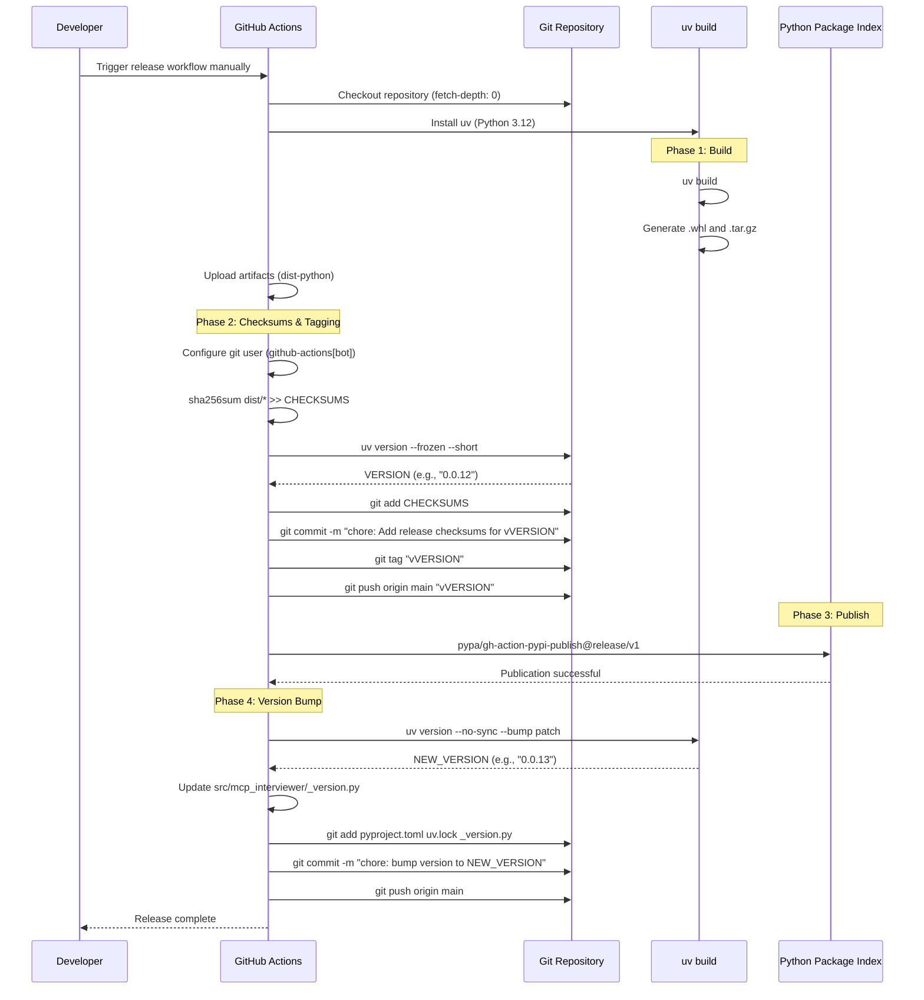
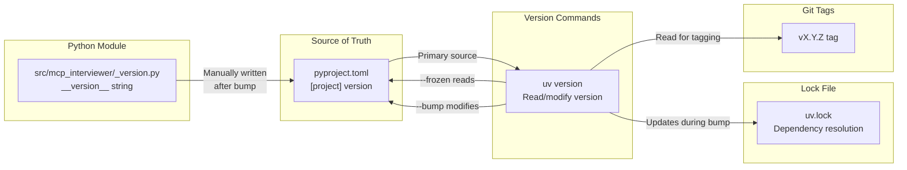
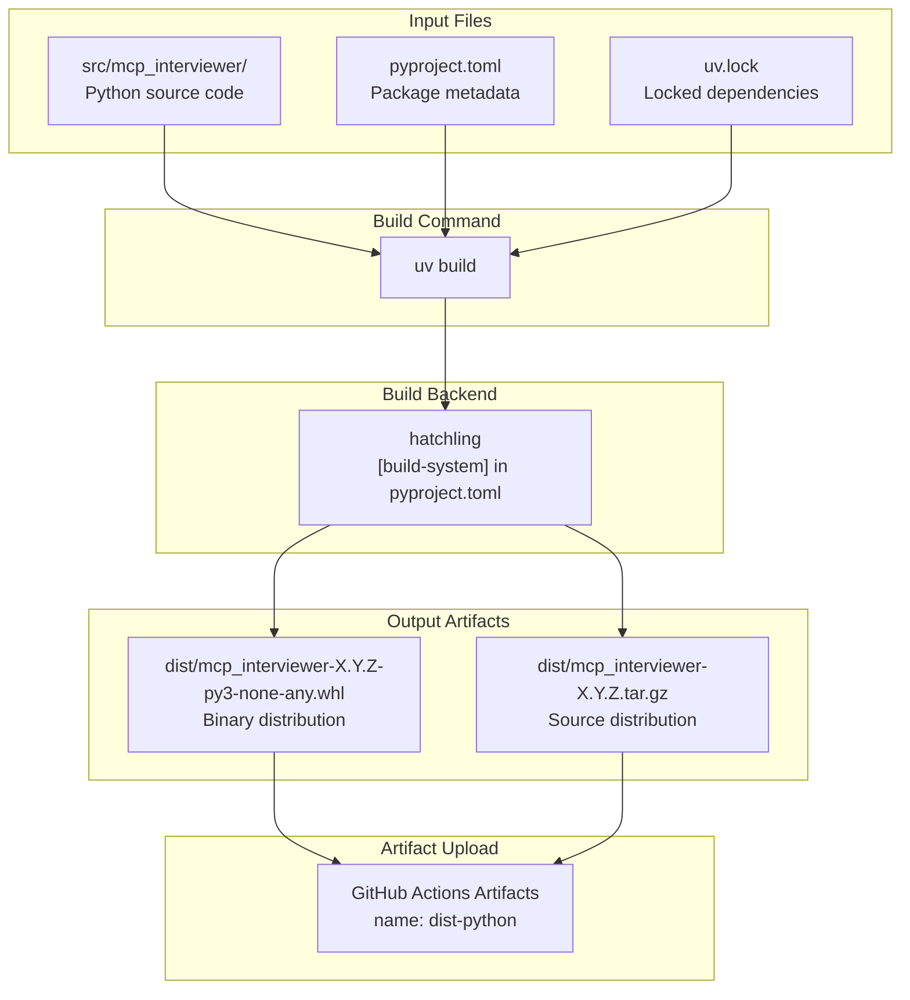
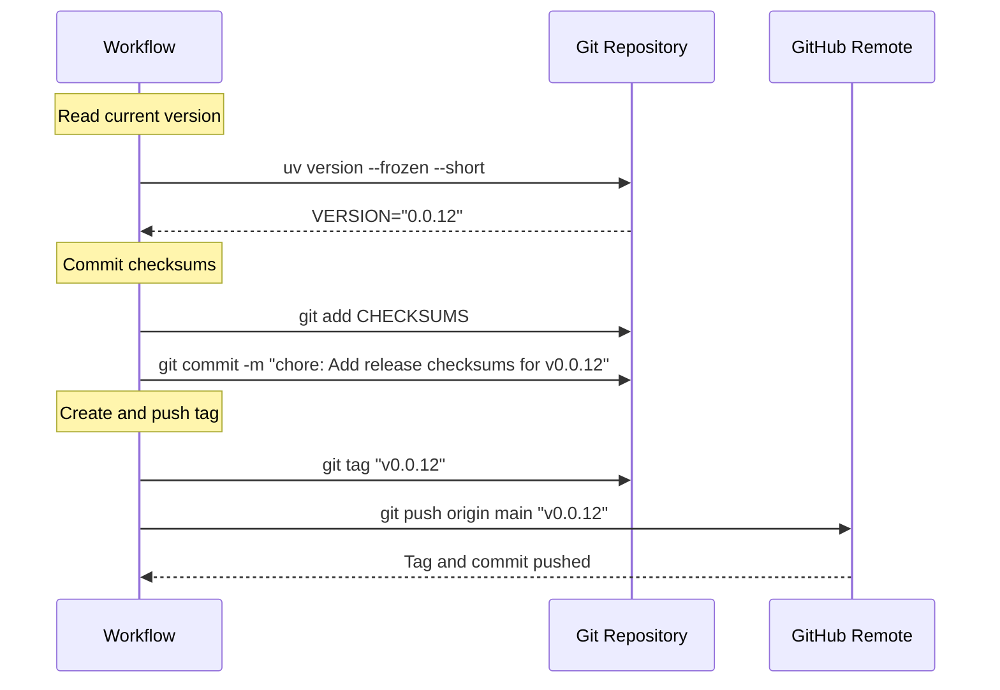
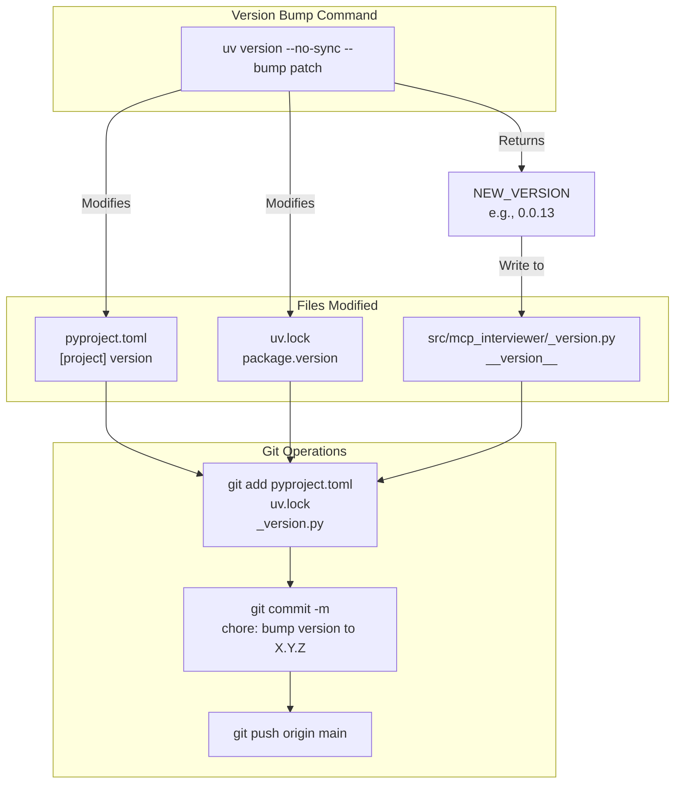

<!-- source: DeepWiki mcp.deepwiki.com · repo microsoft/mcp-interviewer · page 5.6 Release Process · fetched 2026-10-26 -->

# Release Process

<details>
<summary>Relevant source files</summary>

The following files were used as context for generating this wiki page:

- [.github/workflows/check.yml](.github/workflows/check.yml)
- [.github/workflows/release.yml](.github/workflows/release.yml)
- [CHECKSUMS](CHECKSUMS)
- [src/mcp_interviewer/_version.py](src/mcp_interviewer/_version.py)

</details>


## Purpose and Scope

This document explains the release process for mcp-interviewer, including how to trigger releases, how versions are managed, and how packages are published to PyPI. This covers the manual release workflow that creates versioned distributions, generates checksums, and publishes to the Python Package Index.

For information about automated CI/CD checks that run on every commit, see [CI/CD Pipeline](#5.5). For general development workflows including testing and linting, see [Development Workflow](#5.2).

---

## Release Workflow Overview

The release process is implemented as a GitHub Actions workflow that is triggered manually and performs the following operations:

1. Build distributable packages (wheel and source tarball)
2. Generate SHA-256 checksums for verification
3. Create and push a version tag
4. Publish to PyPI
5. Automatically bump version for next development cycle

**Release Workflow Sequence**



**Sources:** [.github/workflows/release.yml:1-66]()

---

## Triggering a Release

The release workflow is triggered manually through the GitHub Actions interface using the `workflow_dispatch` event. It is not automatically triggered by commits or tags.

### Steps to Trigger a Release

1. Navigate to the GitHub repository's "Actions" tab
2. Select the "Release" workflow from the left sidebar
3. Click "Run workflow" on the right side
4. Select the branch (typically `main`)
5. Click the green "Run workflow" button

### Permissions Required

The workflow requires the following permissions configured in [.github/workflows/release.yml:3-5]():

| Permission | Level | Purpose |
|------------|-------|---------|
| `contents` | `write` | Create commits, tags, and push changes |
| `id-token` | `write` | Authenticate with PyPI using trusted publishing |

**Sources:** [.github/workflows/release.yml:7-8]()

---

## Version Management

Version management in mcp-interviewer follows a dual-location strategy with automatic synchronization.

**Version Storage Locations**



### Version File Format

The version is stored in [src/mcp_interviewer/_version.py:1]() as:

```python
__version__ = "0.0.13"
```

This file is automatically updated by the release workflow after each release to prepare for the next development cycle.

### Version Reading

During the release workflow, the current version is read using:

```bash
VERSION=$(uv version --frozen --short)
```

The `--frozen` flag ensures the version is read from `pyproject.toml` without modifying `uv.lock`.

**Sources:** [.github/workflows/release.yml:50](), [src/mcp_interviewer/_version.py:1]()

---

## Build Process

The build process creates two distributable package formats using `uv build`.

**Build Artifact Generation**



### Build Command

The build is executed in [.github/workflows/release.yml:28-29]():

```bash
uv build
```

This command:
- Reads package configuration from `pyproject.toml`
- Invokes the `hatchling` build backend
- Creates both wheel (`.whl`) and source distribution (`.tar.gz`) formats
- Outputs to the `dist/` directory

### Artifact Storage

Build artifacts are uploaded to GitHub Actions for reference using [.github/workflows/release.yml:31-35]():

```yaml
uses: actions/upload-artifact@v5
with:
  name: dist-python
  path: dist/*
```

**Sources:** [.github/workflows/release.yml:28-35]()

---

## Tagging and Checksums

After building, the workflow generates integrity checksums and creates a version tag.

### Checksum Generation

SHA-256 checksums are generated for all files in `dist/` and appended to the `CHECKSUMS` file in the repository root:

```bash
shopt -s nullglob
sha256sum dist/* >> CHECKSUMS
```

The `CHECKSUMS` file accumulates checksums across releases. Example content from [CHECKSUMS:1-8]():

```
d2cf46120eb35082c661b07dd02c545d584618e278d0c332a5df5e53433a845f  dist/mcp_interviewer-0.0.9-py3-none-any.whl
3f1e6c76a8c5e55aa920466d5f4497d7147af444e58f3076ac55da8f161c7f09  dist/mcp_interviewer-0.0.9.tar.gz
ecf44fb6f11d72ba5702c25e0887c072d410b0903dbe2c9bd6e52f33f7546eab  dist/mcp_interviewer-0.0.10-py3-none-any.whl
155efd66f04c9a1b8f68f9a094a83154399c910f1ca3a60c2ddebdeeff6c7ab4  dist/mcp_interviewer-0.0.10.tar.gz
```

### Git Configuration

The workflow configures git to use the GitHub Actions bot identity in [.github/workflows/release.yml:37-40]():

```bash
git config --local user.email "github-actions[bot]@users.noreply.github.com"
git config --local user.name "github-actions[bot]"
```

### Tagging Process

**Git Operations Sequence**



The tagging commands in [.github/workflows/release.yml:48-54]():

```bash
VERSION=$(uv version --frozen --short)
git add CHECKSUMS
git commit -m "chore: Add release checksums for v$VERSION"
git tag "v$VERSION"
git push origin main "v$VERSION"
```

### Tag Format

Tags follow the format `vX.Y.Z`, where:
- `v` is a literal prefix
- `X.Y.Z` is the semantic version from `pyproject.toml`

**Sources:** [.github/workflows/release.yml:37-54](), [CHECKSUMS:1-8]()

---

## PyPI Publication

After tagging, the package is published to the Python Package Index using GitHub's trusted publisher mechanism.

### Publication Action

The workflow uses the official PyPI publish action in [.github/workflows/release.yml:56-57]():

```yaml
- name: Release to PyPi
  uses: pypa/gh-action-pypi-publish@release/v1
```

### Trusted Publishing

Authentication to PyPI uses OpenID Connect (OIDC) trusted publishing rather than API tokens. This requires:

1. The `id-token: write` permission in [.github/workflows/release.yml:5]()
2. Configuration of the trusted publisher on PyPI for the `mcp-interviewer` project
3. No explicit token or password in the workflow

### Published Artifacts

The action publishes both files from `dist/`:
- `mcp_interviewer-X.Y.Z-py3-none-any.whl` (wheel)
- `mcp_interviewer-X.Y.Z.tar.gz` (source distribution)

These become available at `https://pypi.org/project/mcp-interviewer/X.Y.Z/` and can be installed via:

```bash
pip install mcp-interviewer==X.Y.Z
```

**Sources:** [.github/workflows/release.yml:56-57]()

---

## Post-Release Version Bump

After successful publication, the workflow automatically bumps the version number to prepare for the next development cycle.

**Version Bump Process**



### Version Bump Command

The version is incremented using [.github/workflows/release.yml:60-61]():

```bash
NEW_VERSION=$(uv version --no-sync --bump patch)
```

The `--no-sync` flag prevents automatic `uv.lock` updates, though the lock file is still modified by the bump operation. The `--bump patch` flag increments the patch version (e.g., `0.0.12` → `0.0.13`).

### Version File Update

The `_version.py` file is rewritten with the new version in [.github/workflows/release.yml:62]():

```bash
echo "__version__ = \"$NEW_VERSION\"" > src/mcp_interviewer/_version.py
```

### Commit and Push

The version bump is committed and pushed in [.github/workflows/release.yml:63-65]():

```bash
git add pyproject.toml uv.lock src/mcp_interviewer/_version.py
git commit -m "chore: bump version to $NEW_VERSION"
git push origin main
```

### Version Bump Strategy

The workflow uses **patch version bumping** exclusively. For minor or major version changes, manual intervention is required:

1. Manually edit `pyproject.toml` to set the desired version
2. Run `uv sync` to update `uv.lock`
3. Update `src/mcp_interviewer/_version.py` to match
4. Commit and push the changes
5. Trigger the release workflow

**Sources:** [.github/workflows/release.yml:59-65]()

---

## Release Workflow Summary

The complete release process follows this sequence:

| Phase | Steps | Commands | Commits |
|-------|-------|----------|---------|
| **1. Build** | Install dependencies, build packages | `uv build` | None |
| **2. Checksum** | Generate SHA-256 hashes | `sha256sum dist/*` | Checksum commit |
| **3. Tag** | Create version tag | `git tag "vX.Y.Z"` | Tag pushed |
| **4. Publish** | Upload to PyPI | `pypa/gh-action-pypi-publish` | None |
| **5. Bump** | Increment patch version | `uv version --bump patch` | Version bump commit |

### Release Artifacts

Each release produces:

1. **Git Tag:** `vX.Y.Z` pointing to the checksum commit
2. **PyPI Package:** `mcp-interviewer==X.Y.Z` available for installation
3. **Checksums:** SHA-256 hashes appended to `CHECKSUMS` file
4. **GitHub Artifacts:** Build outputs stored in Actions (30-day retention)
5. **Version Bump Commit:** Prepares repository for next development cycle

### Automatic vs Manual Steps

| Operation | Automatic | Manual |
|-----------|-----------|--------|
| Triggering release | No | Yes (workflow_dispatch) |
| Building packages | Yes | No |
| Generating checksums | Yes | No |
| Creating tag | Yes | No |
| Publishing to PyPI | Yes | No |
| Bumping patch version | Yes | No |
| Bumping minor/major version | No | Yes |

**Sources:** [.github/workflows/release.yml:1-66]()

---

## Troubleshooting

### Common Issues

**Build Failures**

If `uv build` fails, check:
- Dependencies are correctly specified in `pyproject.toml`
- Lock file is up-to-date (`uv lock`)
- No syntax errors in source code

**Checksum Generation Errors**

The `shopt -s nullglob` command in [.github/workflows/release.yml:45]() prevents errors when `dist/` is empty. If checksums are not generated:
- Verify build step completed successfully
- Check that `dist/` directory contains `.whl` and `.tar.gz` files

**PyPI Publication Failures**

Common causes:
- Version already exists on PyPI (cannot republish)
- Trusted publisher not configured correctly
- `id-token: write` permission missing

**Version Bump Issues**

If version bump fails:
- Ensure `uv.lock` is not corrupted
- Verify write permissions to repository
- Check that git is properly configured

### Recovery Procedures

**Failed Release Mid-Workflow**

If the workflow fails after tagging but before PyPI publication:

1. Delete the local tag: `git tag -d vX.Y.Z`
2. Delete the remote tag: `git push origin :refs/tags/vX.Y.Z`
3. Revert the checksum commit if pushed
4. Fix the underlying issue
5. Re-run the release workflow

**Missing Version Bump**

If the version bump commit is missing after a release:

1. Manually run the bump commands:
   ```bash
   NEW_VERSION=$(uv version --no-sync --bump patch)
   echo "__version__ = \"$NEW_VERSION\"" > src/mcp_interviewer/_version.py
   git add pyproject.toml uv.lock src/mcp_interviewer/_version.py
   git commit -m "chore: bump version to $NEW_VERSION"
   git push origin main
   ```

**Sources:** [.github/workflows/release.yml:42-65]()

---

