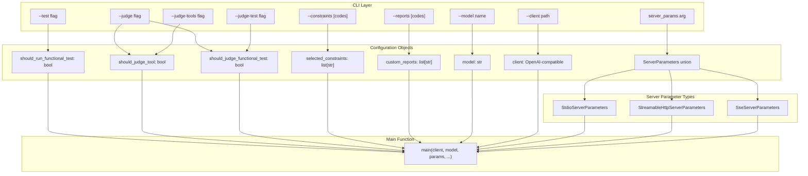
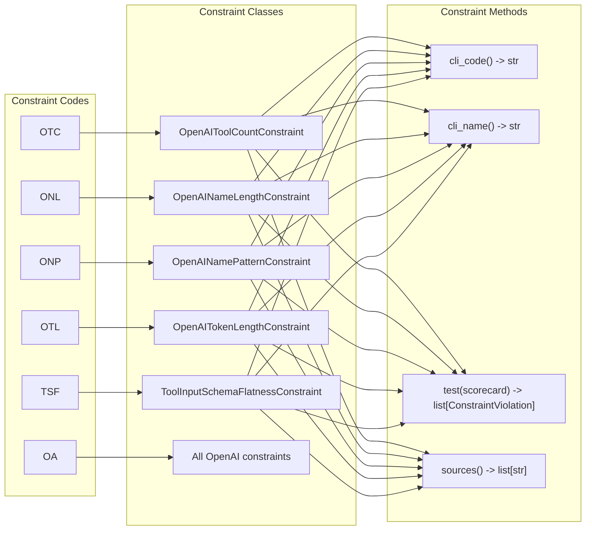
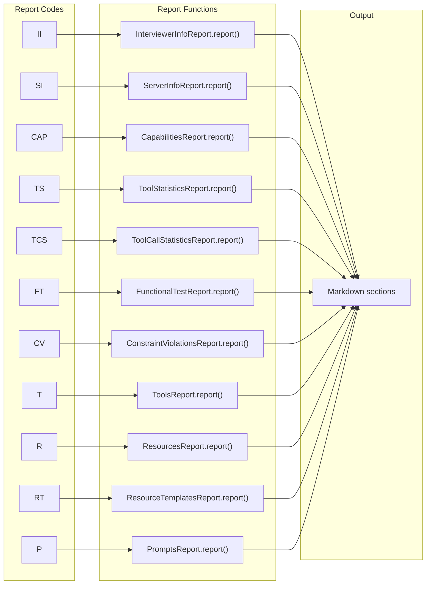
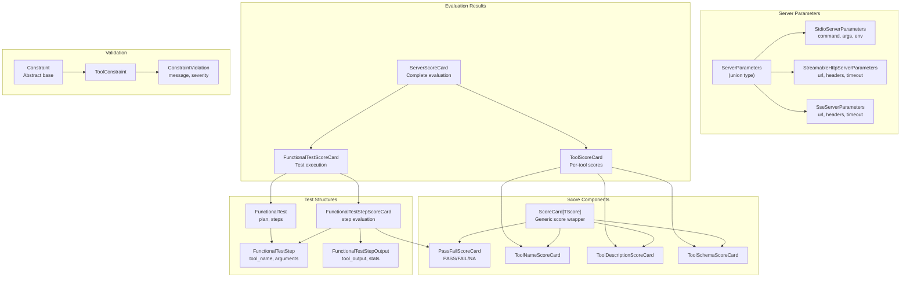

<!-- source: DeepWiki mcp.deepwiki.com · repo microsoft/mcp-interviewer · page 6 Reference · fetched 2026-10-26 -->

# Reference

Relevant source files

The following files were used as context for generating this wiki page:

- [README.md](README.md)
- [src/mcp_interviewer/cli.py](src/mcp_interviewer/cli.py)

This page provides comprehensive reference documentation for mcp-interviewer's configuration options, data models, constraints, and report components. Use this section for quick lookup of codes, flags, and model structures.

For step-by-step usage instructions, see the [User Guide](#3). For architectural details about how these components work together, see [Architecture](#4).

## Purpose and Scope

This reference section covers:

- **CLI Options**: All command-line flags and their parameters ([6.1](#6.1))
- **Data Models**: Pydantic models used throughout the system ([6.2](#6.2))
- **Constraint Types**: Available validation constraints with codes ([6.3](#6.3))
- **Report Components**: Report sections with their codes ([6.4](#6.4))
- **Example Analysis**: Complete walkthrough of an analysis ([6.5](#6.5))

## Quick Reference Tables

### Constraint Codes

| Code | Constraint | Description |
|------|-----------|-------------|
| `OTC` | OpenAI Tool Count | Maximum 128 tools per request |
| `ONL` | OpenAI Name Length | Tool names ≤64 characters |
| `ONP` | OpenAI Name Pattern | Tool names match `[a-zA-Z0-9_-]+` |
| `OTL` | OpenAI Token Length | Tool definitions within token limits |
| `TSF` | Tool Schema Flatness | No nested objects/arrays in input schemas |
| `OA` | OpenAI All | All OpenAI constraints combined |

Sources: [README.md:46-53]()

### Report Component Codes

| Code | Component | Description |
|------|----------|-------------|
| `II` | Interviewer Info | Model and parameters used |
| `SI` | Server Info | Name, version, capabilities |
| `CAP` | Capabilities | Supported MCP features |
| `TS` | Tool Statistics | Tool counts and patterns |
| `TCS` | Tool Call Statistics | Performance metrics |
| `FT` | Functional Tests | Test execution results |
| `CV` | Constraint Violations | Validation failures |
| `T` | Tools | Complete tool definitions |
| `R` | Resources | Available resources |
| `RT` | Resource Templates | Resource templates |
| `P` | Prompts | Available prompts |

Sources: [README.md:76-89]()

### Common CLI Flags

| Flag | Type | Description |
|------|------|-------------|
| `--model` | string | Model name for LLM features |
| `--test` | boolean | Enable functional testing |
| `--judge` | boolean | Enable all LLM evaluation |
| `--judge-tools` | boolean | Enable tool evaluation only |
| `--judge-test` | boolean | Enable test evaluation only |
| `--constraints` | list | Constraint codes to check |
| `--reports` | list | Report codes to include |
| `--fail-on-warnings` | boolean | Non-zero exit on warnings |
| `--accept-risk` | boolean | Skip test risk confirmation |
| `--no-collapse` | boolean | Disable collapsible sections |

For complete flag documentation, see [CLI Options Reference](#6.1).

Sources: [src/mcp_interviewer/cli.py:1-219]()

## Reference Architecture

### CLI to Configuration Mapping

**CLI to Configuration Mapping Diagram**

This diagram shows how CLI arguments are parsed and transformed into configuration objects that are passed to the `main()` function. Boolean flags control feature enablement, while string flags provide model names and codes. The server parameters undergo conditional parsing based on whether they represent a URL or command.

Sources: [src/mcp_interviewer/cli.py:1-219]()

### Code to Constraint Mapping

**Constraint Code to Class Mapping Diagram**

This diagram shows how constraint codes (used in `--constraints` flag) map to concrete constraint classes. Each constraint class implements standard methods: `cli_code()` returns the code, `cli_name()` returns the full name, `test()` performs validation, and `sources()` provides documentation URLs.

Sources: [README.md:46-53]()

### Report Code to Component Mapping

**Report Code to Component Mapping Diagram**

This diagram shows how report codes (used in `--reports` flag) map to report component classes. Each report class has a `report()` method that generates a Markdown section from the `ServerScoreCard` data.

Sources: [README.md:76-89]()

## Data Model Hierarchy

**Data Model Hierarchy Diagram**

This diagram shows the relationship between major data model types. `ServerParameters` is a union type representing different connection methods. `ServerScoreCard` aggregates all evaluation results. Score components use a generic `ScoreCard[TScore]` pattern for type safety. Functional tests have nested structures tracking plans, steps, outputs, and evaluations.

Sources: [README.md:1-305](), [src/mcp_interviewer/cli.py:101-150]()

## Navigating This Section

### [CLI Options Reference](#6.1)
Complete documentation of all command-line flags, including:
- Flag syntax and types
- Default values
- Required vs optional flags
- Flag interactions (e.g., `--judge` implies `--judge-tools` and `--judge-test`)
- Example usage patterns

### [Data Models Reference](#6.2)
Comprehensive documentation of Pydantic models:
- Field names and types
- Validation rules
- Default values
- Model hierarchies
- JSON serialization format

### [Constraint Types Reference](#6.3)
Detailed constraint documentation:
- Full constraint names
- CLI codes
- Validation logic
- Severity levels
- Documentation sources
- Example violations

### [Report Components Reference](#6.4)
Report section specifications:
- Component codes and full names
- Section content description
- Required data fields
- Conditional inclusion logic
- Formatting options

### [Example Server Analysis](#6.5)
Complete walkthrough analyzing `@modelcontextprotocol/server-everything`:
- Command used
- Generated report sections
- Constraint violations found
- Functional test results
- Interpretation guidance

Sources: [README.md:1-305]()

## Reference Conventions

### Code Notation
- **CLI Codes**: Uppercase acronyms (e.g., `OTC`, `II`, `CAP`)
- **Full Names**: Kebab-case (e.g., `openai-tool-count`, `interviewer-info`)
- **Boolean Flags**: Prefixed with `--` (e.g., `--test`, `--judge`)
- **Value Flags**: Followed by arguments (e.g., `--model gpt-4.1`)
- **List Flags**: Accept multiple values (e.g., `--constraints OTC ONL`)

### Model Notation
- **Classes**: PascalCase (e.g., `ServerScoreCard`, `ToolConstraint`)
- **Fields**: snake_case (e.g., `tool_name`, `should_judge_tool`)
- **Types**: Python type hints (e.g., `list[str]`, `Optional[bool]`)
- **Unions**: Pipe notation (e.g., `StdioServerParameters | HttpServerParameters`)

### Severity Levels
Constraint violations use two severity levels:
- **CRITICAL**: Always causes non-zero exit code
- **WARNING**: Causes non-zero exit code only with `--fail-on-warnings`

### Exit Codes
- **0**: Success (no critical violations)
- **1**: Failure (critical violations or warnings with `--fail-on-warnings`)

Sources: [src/mcp_interviewer/cli.py:1-219]()

---

