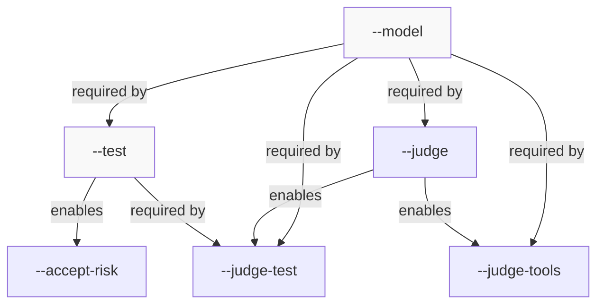

<!-- source: DeepWiki mcp.deepwiki.com · repo microsoft/mcp-interviewer · page 6.1 CLI Options Reference · fetched 2026-10-26 -->

# CLI Options Reference

<details>
<summary>Relevant source files</summary>

The following files were used as context for generating this wiki page:

- [README.md](README.md)
- [src/mcp_interviewer/cli.py](src/mcp_interviewer/cli.py)

</details>


This page provides a complete alphabetical reference of all command-line interface options available in `mcp-interviewer`. Each option includes its type, default value, description, and usage examples.

For general CLI usage patterns and workflows, see [CLI Usage](#3.1). For information about using mcp-interviewer as a Python library, see [Python API](#3.2).

## Overview

The `mcp-interviewer` CLI accepts a single positional argument (the server command or URL) and various optional flags to customize the evaluation process. Options are organized into several functional categories: server connection, LLM configuration, evaluation control, output customization, and constraint validation.

## Option Categories

The following diagram shows how CLI options map to internal system components:

```mermaid
graph TB
    subgraph "CLI Arguments"
        ServerParam["server_params<br/>(positional)"]
        RemoteType["--remote-connection-type"]
        Headers["--headers"]
        Timeout["--timeout"]
        SSETimeout["--sse-read-timeout"]
        
        Model["--model"]
        Client["--client"]
        ClientKwargs["--client-kwargs"]
        
        Test["--test"]
        AcceptRisk["--accept-risk"]
        JudgeTools["--judge-tools"]
        JudgeTest["--judge-test"]
        Judge["--judge"]
        
        Reports["--reports"]
        NoCollapse["--no-collapse"]
        Constraints["--constraints"]
        FailWarn["--fail-on-warnings"]
        
        OutDir["--out-dir"]
        LogLevel["--log-level"]
    end
    
    subgraph "ServerParameters Classes"
        StdioParams["StdioServerParameters"]
        HttpParams["StreamableHttpServerParameters"]
        SSEParams["SseServerParameters"]
    end
    
    subgraph "MCPInterviewer Constructor"
        ClientArg["client parameter"]
        ModelArg["model parameter"]
        ShouldJudgeTool["should_judge_tool"]
        ShouldJudgeTest["should_judge_functional_test"]
        ShouldRunTest["should_run_functional_test"]
    end
    
    subgraph "main() Function"
        ParamsArg["params argument"]
        CustomReportsArg["custom_reports"]
        NoCollapseArg["no_collapse"]
        SelectedConstraints["selected_constraints"]
        FailOnWarnings["fail_on_warnings"]
        OutDirArg["out_dir"]
    end
    
    ServerParam --> StdioParams
    ServerParam --> HttpParams
    ServerParam --> SSEParams
    RemoteType --> HttpParams
    RemoteType --> SSEParams
    Headers --> HttpParams
    Headers --> SSEParams
    Timeout --> HttpParams
    Timeout --> SSEParams
    SSETimeout --> SSEParams
    
    Model --> ModelArg
    Client --> ClientArg
    ClientKwargs --> ClientArg
    
    Test --> ShouldRunTest
    JudgeTools --> ShouldJudgeTool
    JudgeTest --> ShouldJudgeTest
    Judge --> ShouldJudgeTool
    Judge --> ShouldJudgeTest
    
    Reports --> CustomReportsArg
    NoCollapse --> NoCollapseArg
    Constraints --> SelectedConstraints
    FailWarn --> FailOnWarnings
    
    OutDir --> OutDirArg
    
    StdioParams --> ParamsArg
    HttpParams --> ParamsArg
    SSEParams --> ParamsArg
    
    ClientArg --> MCPInterviewer["MCPInterviewer instance"]
    ModelArg --> MCPInterviewer
    ShouldJudgeTool --> MCPInterviewer
    ShouldJudgeTest --> MCPInterviewer
    ShouldRunTest --> MCPInterviewer
    
    ParamsArg --> main
    CustomReportsArg --> main
    NoCollapseArg --> main
    SelectedConstraints --> main
    FailOnWarnings --> main
    OutDirArg --> main
```



Sources: [src/mcp_interviewer/cli.py:1-223]()

## Option Dependencies

Some options have dependencies or互斥 relationships:



Sources: [src/mcp_interviewer/cli.py:152-174]()

## Complete Options Table

| Option | Type | Default | Required | Description |
|--------|------|---------|----------|-------------|
| `server_params` | string | - | Yes | Server command or URL |
| `--accept-risk` | flag | `False` | No | Bypass functional test risk confirmation |
| `--client` | string | `"openai.OpenAI"` | No | Import path to OpenAI-compatible client |
| `--client-kwargs` | list | `[]` | No | Keyword arguments for client constructor |
| `--constraints` | list | all | No | Constraint codes to check |
| `--fail-on-warnings` | flag | `False` | No | Exit non-zero on constraint warnings |
| `--headers` | list | `None` | No | Remote connection headers (KEY=VALUE) |
| `--judge` | flag | `False` | No | Enable all LLM judging |
| `--judge-test` | flag | `False` | No | Enable LLM test judging |
| `--judge-tools` | flag | `False` | No | Enable LLM tool judging |
| `--log-level` | choice | `"INFO"` | No | Logging verbosity level |
| `--model` | string | `None` | Conditional | LLM model name |
| `--no-collapse` | flag | `False` | No | Disable collapsible report sections |
| `--out-dir` / `-o` | string | `"."` | No | Output directory for reports |
| `--remote-connection-type` | choice | `"streamable_http"` | No | Remote connection protocol |
| `--reports` | list | all | No | Report section codes to include |
| `--sse-read-timeout` | int | `5` | No | SSE connection read timeout |
| `--test` | flag | `False` | No | Enable functional testing |
| `--timeout` | int | `5` | No | Remote connection timeout |

Sources: [src/mcp_interviewer/cli.py:6-94]()

## Positional Arguments

### `server_params`

**Type:** String (positional, required)

**Description:** Specifies either the shell command to execute a local MCP server via stdio, or the URL to connect to a remote MCP server via HTTP/SSE.

**Parsing Logic:**
- If the value starts with `http://` or `https://`, it is treated as a remote server URL
- Otherwise, it is parsed as a shell command using `shlex.split()` to handle quoted arguments
- For local commands, the first token becomes `command` and remaining tokens become `args` in `StdioServerParameters`
- For remote URLs, the value is used with either `StreamableHttpServerParameters` or `SseServerParameters`

**Examples:**

```bash
# Local server via stdio
mcp-interviewer "uvx mcp-server-fetch"

# Local server with complex args
mcp-interviewer "docker run -i --rm node:lts npx -y @modelcontextprotocol/server-everything"

# Remote server via HTTP
mcp-interviewer "https://my-mcp-server.com/mcp"

# Remote server via SSE
mcp-interviewer --remote-connection-type sse "https://my-mcp-server.com/sse"
```

Sources: [src/mcp_interviewer/cli.py:8-11](), [src/mcp_interviewer/cli.py:107-151]()

## Connection Options

### `--remote-connection-type`

**Type:** Choice (`"sse"` | `"streamable_http"`)  
**Default:** `"streamable_http"`  
**Applies to:** Remote servers only

**Description:** Specifies the protocol to use when connecting to remote MCP servers. This option only applies when `server_params` is a URL.

**Values:**
- `streamable_http`: Uses the streamable HTTP transport protocol, creating a `StreamableHttpServerParameters` instance
- `sse`: Uses Server-Sent Events protocol, creating a `SseServerParameters` instance

**Examples:**

```bash
# Use streamable HTTP (default)
mcp-interviewer "https://example.com/mcp"

# Use SSE explicitly
mcp-interviewer --remote-connection-type sse "https://example.com/sse"
```

Sources: [src/mcp_interviewer/cli.py:13-17](), [src/mcp_interviewer/cli.py:128-141]()

### `--headers`

**Type:** List of strings in `KEY=VALUE` format  
**Default:** `None`  
**Applies to:** Remote servers only

**Description:** Specifies HTTP headers to include in remote MCP server connections. Each header must be in `KEY=VALUE` format. Multiple headers can be specified by repeating the format.

**Parsing:** Headers are split on the first `=` character, with the left side as the key and the right side as the value. Invalid formats raise a `ValueError`.

**Examples:**

```bash
# Single header
mcp-interviewer --headers "Authorization=Bearer token123" "https://example.com/mcp"

# Multiple headers
mcp-interviewer \
  --headers "Authorization=Bearer token123" "X-Custom-Header=value" \
  "https://example.com/mcp"
```

Sources: [src/mcp_interviewer/cli.py:38-39](), [src/mcp_interviewer/cli.py:115-126]()

### `--timeout`

**Type:** Integer (seconds)  
**Default:** `5`  
**Applies to:** Remote servers only

**Description:** Connection timeout in seconds for remote MCP servers. This timeout applies to establishing the initial connection.

**Examples:**

```bash
# Use default 5 second timeout
mcp-interviewer "https://example.com/mcp"

# Increase timeout for slow connections
mcp-interviewer --timeout 30 "https://example.com/mcp"
```

Sources: [src/mcp_interviewer/cli.py:40-42]()

### `--sse-read-timeout`

**Type:** Integer (seconds)  
**Default:** `5`  
**Applies to:** SSE remote servers only

**Description:** Read timeout in seconds for Server-Sent Events connections. This timeout applies to reading data from the SSE stream after connection is established.

**Examples:**

```bash
# Default read timeout
mcp-interviewer --remote-connection-type sse "https://example.com/sse"

# Increase read timeout for slow responses
mcp-interviewer \
  --remote-connection-type sse \
  --sse-read-timeout 30 \
  "https://example.com/sse"
```

Sources: [src/mcp_interviewer/cli.py:43-48]()

## LLM Configuration Options

### `--model`

**Type:** String  
**Default:** `None`  
**Required when:** Using `--test`, `--judge`, `--judge-tools`, or `--judge-test`

**Description:** Specifies the LLM model name to use for test generation and evaluation. The model name is passed to the client's chat completions API. Required for any LLM-dependent features.

**Validation:** The CLI enforces that `--model` must be provided if any LLM features are enabled, otherwise it exits with an error.

**Examples:**

```bash
# OpenAI model
mcp-interviewer --model gpt-4.1 --test "uvx mcp-server-fetch"

# Azure OpenAI model
mcp-interviewer \
  --client "my_client.azure_client" \
  --model "gpt-4.1_2024-11-20" \
  --test "uvx mcp-server-fetch"

# Local Ollama model
mcp-interviewer \
  --client-kwargs "base_url=http://localhost:11434/v1" "api_key=ollama" \
  --model "gpt-oss:20b" \
  --test "uvx mcp-server-fetch"
```

Sources: [src/mcp_interviewer/cli.py:18-21](), [src/mcp_interviewer/cli.py:156-162]()

### `--client`

**Type:** String (import path)  
**Default:** `"openai.OpenAI"`

**Description:** Import path to a callable that returns an OpenAI-compatible client object. The path should be in the format `module.callable` where `callable` is a function or class that takes keyword arguments and returns a client with a chat completions API.

**Parsing:** The path is split on the last `.` to separate module and callable name. The module is imported via `importlib.import_module()` and the callable is retrieved via `getattr()`.

**Examples:**

```bash
# Default OpenAI client
mcp-interviewer --model gpt-4.1 --test "uvx mcp-server-fetch"

# Custom Azure client
mcp-interviewer \
  --client "my_module.azure_client" \
  --model "gpt-4" \
  --test "uvx mcp-server-fetch"

# Custom client from package
mcp-interviewer \
  --client "my_package.clients.custom_client" \
  --model "model-name" \
  --test "uvx mcp-server-fetch"
```

Sources: [src/mcp_interviewer/cli.py:23-26](), [src/mcp_interviewer/cli.py:176-182]()

### `--client-kwargs`

**Type:** List of strings in `key=value` format  
**Default:** `[]` (empty list)

**Description:** Keyword arguments to pass to the client constructor. Each argument must be in `key=value` format. Values are automatically type-converted: `"true"`/`"false"` become booleans, digits become integers, decimal numbers become floats, and everything else remains a string.

**Type Conversion Rules:**
- `"true"` or `"false"` (case-insensitive) → boolean
- All digits → integer
- Digits with single decimal point → float
- Everything else → string

**Examples:**

```bash
# Ollama configuration
mcp-interviewer \
  --client-kwargs "base_url=http://localhost:11434/v1" "api_key=ollama" \
  --model "gpt-oss:20b" \
  --test "uvx mcp-server-fetch"

# Azure configuration with multiple args
mcp-interviewer \
  --client-kwargs \
    "azure_endpoint=https://my-resource.openai.azure.com" \
    "api_version=2024-02-15-preview" \
    "timeout=30" \
  --model "gpt-4" \
  --test "uvx mcp-server-fetch"
```

Sources: [src/mcp_interviewer/cli.py:27-32](), [src/mcp_interviewer/cli.py:183-197]()

## Evaluation Control Options

### `--test`

**Type:** Flag (boolean)  
**Default:** `False`  
**Requires:** `--model`

**Description:** Enables functional testing of the MCP server. When enabled, the interviewer generates a test plan using the LLM, executes tool calls according to the plan, and collects statistics about tool behavior.

**Security Warning:** This option causes mcp-interviewer to invoke the server's tools, which may result in irreversible actions (e.g., file deletion, API calls). The CLI prompts for user confirmation unless `--accept-risk` is provided.

**Examples:**

```bash
# Enable functional testing
mcp-interviewer --model gpt-4.1 --test "uvx mcp-server-fetch"

# With risk acceptance (no prompt)
mcp-interviewer --model gpt-4.1 --test --accept-risk "uvx mcp-server-fetch"
```

Sources: [src/mcp_interviewer/cli.py:80-83](), [src/mcp_interviewer/cli.py:163-174]()

### `--accept-risk`

**Type:** Flag (boolean)  
**Default:** `False`  
**Applies to:** `--test` option

**Description:** Bypasses the interactive user confirmation prompt when using `--test`. Without this flag, the user must manually confirm they accept the risks of functional testing. Useful for CI/CD pipelines or automated scripts.

**Risk Confirmation Prompt:**
```
🚨 MCP Interviewer will make tool call requests to your MCP server. 
Depending on the server's capabilities this can lead to irreversible 
outcomes (e.g. deleting files).
Do you accept this risk? (y|[n]):
```

**Examples:**

```bash
# Interactive mode (prompts user)
mcp-interviewer --model gpt-4.1 --test "uvx mcp-server-fetch"

# Automated mode (no prompt)
mcp-interviewer --model gpt-4.1 --test --accept-risk "uvx mcp-server-fetch"
```

Sources: [src/mcp_interviewer/cli.py:85-88](), [src/mcp_interviewer/cli.py:163-174]()

### `--judge-tools`

**Type:** Flag (boolean)  
**Default:** `False`  
**Requires:** `--model`  
**Experimental:** Yes

**Description:** Enables LLM-based evaluation of tool quality. When enabled, the interviewer uses the LLM to generate structured scores and justifications for each tool's name, description, and input/output schemas.

**Note:** This is an experimental feature. All LLM-generated evaluations should be manually inspected for errors.

**Sets:** `should_judge_tool=True` in `MCPInterviewer` constructor

**Examples:**

```bash
# Enable tool judging only
mcp-interviewer --model gpt-4.1 --judge-tools "uvx mcp-server-fetch"

# Combine with functional testing
mcp-interviewer --model gpt-4.1 --test --judge-tools "uvx mcp-server-fetch"
```

Sources: [src/mcp_interviewer/cli.py:49-53](), [src/mcp_interviewer/cli.py:153-154]()

### `--judge-test`

**Type:** Flag (boolean)  
**Default:** `False`  
**Requires:** `--model` and `--test`  
**Experimental:** Yes

**Description:** Enables LLM-based evaluation of functional test results. When enabled, the interviewer uses the LLM to assess whether test outputs meet expectations, handle errors properly, and are relevant and high-quality.

**Note:** This is an experimental feature. All LLM-generated evaluations should be manually inspected for errors. This option requires `--test` because there must be functional tests to evaluate.

**Sets:** `should_judge_functional_test=True` in `MCPInterviewer` constructor

**Examples:**

```bash
# Enable test judging (requires --test)
mcp-interviewer --model gpt-4.1 --test --judge-test "uvx mcp-server-fetch"
```

Sources: [src/mcp_interviewer/cli.py:54-58](), [src/mcp_interviewer/cli.py:153-154]()

### `--judge`

**Type:** Flag (boolean)  
**Default:** `False`  
**Requires:** `--model`, and `--test` for test judging  
**Experimental:** Yes  
**Equivalent to:** `--judge-tools --judge-test`

**Description:** Convenience flag that enables all experimental LLM judging operations. This is equivalent to specifying both `--judge-tools` and `--judge-test`.

**Sets:**
- `should_judge_tool=True`
- `should_judge_functional_test=True`

**Examples:**

```bash
# Enable all judging features
mcp-interviewer --model gpt-4.1 --test --judge "uvx mcp-server-fetch"

# Equivalent to:
mcp-interviewer --model gpt-4.1 --test --judge-tools --judge-test "uvx mcp-server-fetch"
```

Sources: [src/mcp_interviewer/cli.py:59-63](), [src/mcp_interviewer/cli.py:153-154]()

## Output Customization Options

### `--out-dir` / `-o`

**Type:** String (directory path)  
**Default:** `"."` (current directory)

**Description:** Specifies the output directory for generated reports. The interviewer creates two files in this directory:
- `mcp-interview.md` - Human-readable Markdown report
- `mcp-interview.json` - Machine-readable JSON data

**Examples:**

```bash
# Output to current directory (default)
mcp-interviewer "uvx mcp-server-fetch"

# Output to specific directory
mcp-interviewer --out-dir ./reports "uvx mcp-server-fetch"

# Short form
mcp-interviewer -o ./reports "uvx mcp-server-fetch"
```

Sources: [src/mcp_interviewer/cli.py:33]()

### `--reports`

**Type:** List of strings (report codes or names)  
**Default:** All report sections included

**Description:** Specifies which report sections to include in the output, and in what order. Accepts either full report names (e.g., `interviewer-info`, `server-info`) or shorthand codes (e.g., `II`, `SI`). When specified, only the listed sections appear in the custom report.

**Available Codes:**
- `II` - Interviewer Info (model, parameters)
- `SI` - Server Info (name, version, capabilities)
- `CAP` - Capabilities Assessment
- `TS` - Tool Statistics
- `TCS` - Tool Call Statistics
- `FT` - Functional Tests
- `CV` - Constraint Violations
- `T` - Tools (detailed schemas)
- `R` - Resources
- `RT` - Resource Templates
- `P` - Prompts

**Examples:**

```bash
# Include only specific sections
mcp-interviewer --reports SI TS FT CV "uvx mcp-server-fetch"

# Use full names
mcp-interviewer --reports server-info tool-statistics "uvx mcp-server-fetch"

# Custom order
mcp-interviewer --reports CV FT TS "uvx mcp-server-fetch"
```

Sources: [src/mcp_interviewer/cli.py:65-68](), [README.md:74-91]()

### `--no-collapse`

**Type:** Flag (boolean)  
**Default:** `False`

**Description:** Disables collapsible sections in the Markdown report. By default, many report sections use HTML `<details>` tags to create collapsible content. This flag removes those tags, making all content visible by default.

**Use Cases:**
- Reports that will be converted to other formats where HTML details tags aren't supported
- Printing or archiving reports where collapsed content might be missed
- Automated parsing where collapsed sections cause issues

**Examples:**

```bash
# Default (collapsible sections)
mcp-interviewer "uvx mcp-server-fetch"

# All sections expanded
mcp-interviewer --no-collapse "uvx mcp-server-fetch"
```

Sources: [src/mcp_interviewer/cli.py:69-73]()

## Constraint Validation Options

### `--constraints`

**Type:** List of strings (constraint codes or names)  
**Default:** All constraints enabled

**Description:** Specifies which constraint violations to check. By default, all constraints are enabled. When specified, only the listed constraints are validated. Accepts either full constraint names (e.g., `openai-tool-count`) or shorthand codes (e.g., `OTC`).

**Available Codes:**
- `OTC` - OpenAI Tool Count (≤128 tools)
- `ONL` - OpenAI Name Length (≤64 characters)
- `ONP` - OpenAI Name Pattern (a-zA-Z0-9_- only)
- `OTL` - OpenAI Token Length (token limit)
- `TSF` - Tool Input Schema Flatness (no nested objects/arrays)
- `OA` - All OpenAI constraints (equivalent to `OTC ONL ONP OTL`)

**Examples:**

```bash
# Check only OpenAI tool count and name length
mcp-interviewer --constraints OTC ONL "uvx mcp-server-fetch"

# Check all OpenAI constraints
mcp-interviewer --constraints OA "uvx mcp-server-fetch"

# Use full constraint names
mcp-interviewer --constraints openai-tool-count tool-schema-flatness "uvx mcp-server-fetch"
```

Sources: [src/mcp_interviewer/cli.py:74-78](), [README.md:40-54]()

### `--fail-on-warnings`

**Type:** Flag (boolean)  
**Default:** `False`

**Description:** Changes the exit code behavior for constraint violations with `WARNING` severity. By default, only `CRITICAL` severity violations cause a non-zero exit code. With this flag enabled, both `CRITICAL` and `WARNING` violations cause exit code 1.

**Exit Code Behavior:**

| Constraint Result | Default Exit | With `--fail-on-warnings` |
|------------------|--------------|---------------------------|
| All pass | 0 | 0 |
| Warnings only | 0 | 1 |
| Critical errors | 1 | 1 |

**Use Case:** Ideal for CI/CD pipelines that enforce stricter validation by treating warnings as failures.

**Examples:**

```bash
# Default (warnings don't fail build)
mcp-interviewer "uvx mcp-server-fetch"

# Strict mode (warnings fail build)
mcp-interviewer --fail-on-warnings "uvx mcp-server-fetch"
```

Sources: [src/mcp_interviewer/cli.py:89-93]()

## Logging Options

### `--log-level`

**Type:** Choice (`"DEBUG"` | `"INFO"` | `"WARN"` | `"ERROR"`)  
**Default:** `"INFO"`

**Description:** Controls the verbosity of logging output to console. Uses Python's standard logging levels.

**Logging Levels:**
- `DEBUG` - Detailed diagnostic information, including internal state
- `INFO` - General informational messages about progress
- `WARN` - Warning messages about potential issues
- `ERROR` - Error messages for serious problems

**Examples:**

```bash
# Default info level
mcp-interviewer "uvx mcp-server-fetch"

# Debug output for troubleshooting
mcp-interviewer --log-level DEBUG "uvx mcp-server-fetch"

# Quiet mode (errors only)
mcp-interviewer --log-level ERROR "uvx mcp-server-fetch"
```

Sources: [src/mcp_interviewer/cli.py:35-36](), [src/mcp_interviewer/cli.py:97-99]()

## Complete CLI Syntax

The complete CLI syntax with all options:

```bash
mcp-interviewer [OPTIONS] <server_params>

Positional:
  server_params                Server command or URL

Connection Options:
  --remote-connection-type    {sse,streamable_http} (default: streamable_http)
  --headers                   KEY=VALUE headers for remote connections
  --timeout                   Connection timeout in seconds (default: 5)
  --sse-read-timeout          SSE read timeout in seconds (default: 5)

LLM Configuration:
  --model                     Model name for LLM features
  --client                    Import path to client callable (default: openai.OpenAI)
  --client-kwargs             key=value kwargs for client constructor

Evaluation Control:
  --test                      Enable functional testing
  --accept-risk               Skip functional test risk confirmation
  --judge                     Enable all LLM judging (experimental)
  --judge-tools               Enable LLM tool judging (experimental)
  --judge-test                Enable LLM test judging (experimental, requires --test)

Output Customization:
  --out-dir, -o               Output directory (default: .)
  --reports                   Report section codes to include
  --no-collapse               Disable collapsible sections

Constraint Validation:
  --constraints               Constraint codes to check
  --fail-on-warnings          Exit non-zero on warnings

Logging:
  --log-level                 {DEBUG,INFO,WARN,ERROR} (default: INFO)
```

Sources: [src/mcp_interviewer/cli.py:6-94]()

## Common Usage Patterns

The following table shows common combinations of options:

| Use Case | Options | Notes |
|----------|---------|-------|
| Basic inspection | `server_params` | No LLM needed |
| With constraint checking | `server_params --constraints OTC ONL` | No LLM needed |
| Functional testing | `--model gpt-4.1 --test server_params` | Requires LLM |
| Full evaluation | `--model gpt-4.1 --test --judge server_params` | Requires LLM, experimental |
| Custom report | `--reports SI TS CV server_params` | Select specific sections |
| CI/CD pipeline | `--fail-on-warnings --accept-risk server_params` | Strict validation, no prompts |
| Remote server | `"https://example.com/mcp" --headers "Auth=token"` | HTTP or SSE connection |
| Custom LLM | `--client my.client --client-kwargs "base_url=..." --model name` | Alternative LLM provider |

Sources: [README.md:152-194]()

---

