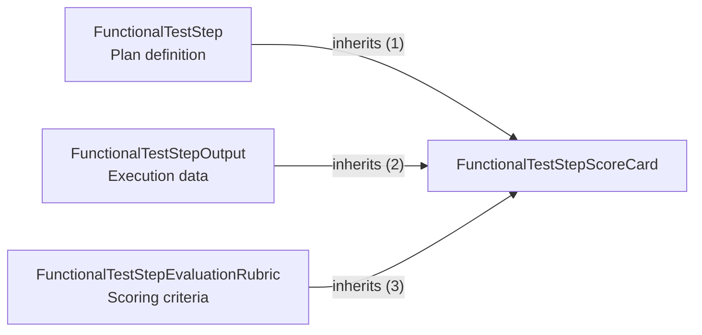
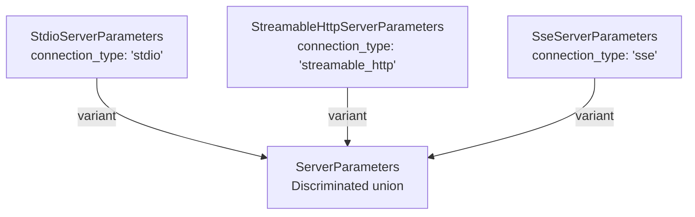

<!-- source: DeepWiki mcp.deepwiki.com · repo microsoft/mcp-interviewer · page 6.2 Data Models Reference · fetched 2026-10-26 -->

# Data Models Reference

<details>
<summary>Relevant source files</summary>

The following files were used as context for generating this wiki page:

- [src/mcp_interviewer/models.py](src/mcp_interviewer/models.py)
- [src/mcp_interviewer/reports/functional_test/test_step.py](src/mcp_interviewer/reports/functional_test/test_step.py)

</details>


This page provides a complete reference for all Pydantic data models used in mcp-interviewer. These models define the structure of evaluation results, test plans, server configurations, and scoring rubrics.

For information about how these models are used during the interview process, see [Interview Execution Flow](#4.2). For architectural context on the data model hierarchy, see [Data Models](#4.3).

## Model Hierarchy Overview

The data models are organized into several categories based on their purpose in the evaluation pipeline:

```mermaid
graph TB
    subgraph "Scoring Base Classes"
        ScoreCard["ScoreCard&lt;TScore&gt;<br/>Generic scoring container"]
        PassFailScoreCard["PassFailScoreCard<br/>Pass/Fail/N/A scoring"]
    end
    
    subgraph "Tool Evaluation Models"
        ToolNameScoreCard["ToolNameScoreCard<br/>length, uniqueness, descriptiveness"]
        ToolDescriptionScoreCard["ToolDescriptionScoreCard<br/>length, parameters, examples"]
        ToolSchemaScoreCard["ToolSchemaScoreCard<br/>complexity, parameters, optionals, constraints"]
        ToolScoreCard["ToolScoreCard<br/>Aggregates name, description, schemas"]
    end
    
    subgraph "Functional Test Models"
        FunctionalTestStep["FunctionalTestStep<br/>justification, tool_name, tool_arguments"]
        FunctionalTestStepOutput["FunctionalTestStepOutput<br/>tool_output, exception, request_counts"]
        FunctionalTestStepEvaluationRubric["FunctionalTestStepEvaluationRubric<br/>error_handling, output_quality, etc."]
        FunctionalTestStepScoreCard["FunctionalTestStepScoreCard<br/>Combines step + output + evaluation"]
        FunctionalTest["FunctionalTest&lt;TFunctionalTestStep&gt;<br/>plan, steps[]"]
        FunctionalTestOutput["FunctionalTestOutput<br/>request_counts"]
        FunctionalTestEvaluationRubric["FunctionalTestEvaluationRubric<br/>meets_expectations, error_type"]
        FunctionalTestScoreCard["FunctionalTestScoreCard<br/>Combines test + output + evaluation"]
    end
    
    subgraph "Server Connection Models"
        StdioServerParameters["StdioServerParameters<br/>command, args, env"]
        StreamableHttpServerParameters["StreamableHttpServerParameters<br/>url, headers, timeout"]
        SseServerParameters["SseServerParameters<br/>url, headers, timeout"]
        ServerParameters["ServerParameters<br/>Union with discriminator"]
    end
    
    subgraph "Server Models"
        Server["Server<br/>parameters, tools, resources, prompts"]
        ServerScoreCard["ServerScoreCard<br/>Extends Server with scorecards"]
    end
    
    ScoreCard -.->|inherits| PassFailScoreCard
    PassFailScoreCard -.->|used in| ToolNameScoreCard
    PassFailScoreCard -.->|used in| ToolDescriptionScoreCard
    PassFailScoreCard -.->|used in| ToolSchemaScoreCard
    PassFailScoreCard -.->|used in| FunctionalTestStepEvaluationRubric
    PassFailScoreCard -.->|used in| FunctionalTestEvaluationRubric
    ScoreCard -.->|used in| FunctionalTestStepEvaluationRubric
    ScoreCard -.->|used in| FunctionalTestEvaluationRubric
    
    ToolNameScoreCard -->|composes| ToolScoreCard
    ToolDescriptionScoreCard -->|composes| ToolScoreCard
    ToolSchemaScoreCard -->|composes| ToolScoreCard
    
    FunctionalTestStep -.->|inherits| FunctionalTestStepScoreCard
    FunctionalTestStepOutput -.->|inherits| FunctionalTestStepScoreCard
    FunctionalTestStepEvaluationRubric -.->|inherits| FunctionalTestStepScoreCard
    
    FunctionalTest -.->|inherits| FunctionalTestScoreCard
    FunctionalTestOutput -.->|inherits| FunctionalTestScoreCard
    FunctionalTestEvaluationRubric -.->|inherits| FunctionalTestScoreCard
    
    FunctionalTestStep -->|contained in| FunctionalTest
    FunctionalTestStepScoreCard -->|contained in| FunctionalTestScoreCard
    
    StdioServerParameters -->|variant of| ServerParameters
    StreamableHttpServerParameters -->|variant of| ServerParameters
    SseServerParameters -->|variant of| ServerParameters
    
    ServerParameters -->|used in| Server
    Server -.->|inherits| ServerScoreCard
    ToolScoreCard -->|list in| ServerScoreCard
    FunctionalTestScoreCard -->|optional in| ServerScoreCard
```



**Sources:** [src/mcp_interviewer/models.py:1-210]()

## Core Scoring Models

### ScoreCard[TScore]

Generic base class for all scoring models. Uses a type parameter to allow different score types.

| Field | Type | Description |
|-------|------|-------------|
| `justification` | `str` | Brief justification of the assigned score |
| `score` | `TScore` | The score value (type determined by generic parameter) |

**Example instantiation:**
```python
from mcp_interviewer.models import ScoreCard

# With string score
name_score = ScoreCard[str](
    justification="Name is clear and descriptive",
    score="excellent"
)

# With custom enum
error_score = ScoreCard[ErrorType](
    justification="Connection failed during request",
    score="Connection Error"
)
```

**Sources:** [src/mcp_interviewer/models.py:20-24]()

### PassFailScoreCard

Specialized `ScoreCard` using the `PassFailNA` literal type (`"pass"` | `"fail"` | `"N/A"`).

| Field | Type | Description |
|-------|------|-------------|
| `justification` | `str` | Brief justification of the assigned score |
| `score` | `PassFailNA` | One of: `"pass"`, `"fail"`, or `"N/A"` |

This is the most commonly used scoring model throughout the evaluation system. The `"N/A"` value indicates that scoring was not applicable for this criterion.

**Sources:** [src/mcp_interviewer/models.py:27-30]()

## Tool Evaluation Models

These models are generated by an LLM as structured output during the tool quality assessment phase. Each model evaluates a different aspect of a tool's definition.

### ToolNameScoreCard

Evaluates the quality of a tool's name.

| Field | Type | Description |
|-------|------|-------------|
| `length` | `PassFailScoreCard` | **Pass**: Optimal length (e.g., "getWeatherForecast")<br/>**Fail**: Too short ("q") or excessively long ("retrieve_information_about_weather...") |
| `uniqueness` | `PassFailScoreCard` | **Pass**: Clearly unique across the server<br/>**Fail**: Generic or duplicate names (e.g., multiple "search" tools) |
| `descriptiveness` | `PassFailScoreCard` | **Pass**: Function immediately clear from name (e.g., "convertJsonToCsv")<br/>**Fail**: Unclear functionality (e.g., "process" or "handle") |

**Sources:** [src/mcp_interviewer/models.py:34-40]()

### ToolDescriptionScoreCard

Evaluates the quality of a tool's description.

| Field | Type | Description |
|-------|------|-------------|
| `length` | `PassFailScoreCard` | **Pass**: Adequate information without verbosity<br/>**Fail**: Too brief ("Gets data") or verbose (three paragraphs for simple concept) |
| `parameters` | `PassFailScoreCard` | **Pass**: Clear explanation of all parameters with types and requirements<br/>**Fail**: Missing parameter explanations (e.g., "location: string" with no context) |
| `examples` | `PassFailScoreCard` | **Pass**: Helpful, realistic examples showing usage patterns<br/>**Fail**: No examples provided or only trivial examples |

**Sources:** [src/mcp_interviewer/models.py:44-50]()

### ToolSchemaScoreCard

Evaluates the quality of a tool's input or output schema.

| Field | Type | Description |
|-------|------|-------------|
| `complexity` | `PassFailScoreCard` | **Pass**: Simple, intuitive structure (flat with clear property names)<br/>**Fail**: Overly complex, deeply nested (5+ levels of nesting) |
| `parameters` | `PassFailScoreCard` | **Pass**: Minimal necessary parameters (1-3 core parameters)<br/>**Fail**: Too many parameters (10+ parameters for simple function) |
| `optionals` | `PassFailScoreCard` | **Pass**: Well-balanced required vs. optional parameters<br/>**Fail**: Too many optional fields with unclear defaults |
| `constraints` | `PassFailScoreCard` | **Pass**: Clear, helpful constraints (e.g., date format specifications)<br/>**Fail**: Missing constraints or validation info |

**Sources:** [src/mcp_interviewer/models.py:54-62]()

### ToolScoreCard

Aggregates all quality evaluations for a single tool.

| Field | Type | Description |
|-------|------|-------------|
| `tool_name` | `ToolNameScoreCard` | Name quality evaluation |
| `tool_description` | `ToolDescriptionScoreCard` | Description quality evaluation |
| `tool_input_schema` | `ToolSchemaScoreCard` | Input schema quality evaluation |
| `tool_output_schema` | `ToolSchemaScoreCard` | Output schema quality evaluation (all scores set to N/A if no output schema exists) |

**Sources:** [src/mcp_interviewer/models.py:66-72]()

## Functional Testing Models

These models define test plans, execution results, and evaluations. The functional testing system uses multiple inheritance to compose complete scorecards.



**Sources:** [src/mcp_interviewer/models.py:76-166]()

### FunctionalTestStep

Defines a single step in a functional test plan. Generated by an LLM.

| Field | Type | Description |
|-------|------|-------------|
| `justification` | `str` | Why this step is a good test for this tool |
| `expected_output` | `str` | The expected output from the tool call |
| `tool_name` | `str` | The name of the tool to call |
| `tool_arguments` | `dict[str, Any]` | Realistic arguments to call the tool with |

**Sources:** [src/mcp_interviewer/models.py:76-84]()

### FunctionalTestStepOutput

Captures execution data from running a test step.

| Field | Type | Default | Description |
|-------|------|---------|-------------|
| `tool_output` | `CallToolResult \| None` | - | The actual output from the tool call (MCP type) |
| `exception` | `str \| None` | - | Exception message if the call raised an error |
| `sampling_requests` | `int` | 0 | Count of sampling/createMessage requests during this step |
| `elicitation_requests` | `int` | 0 | Count of elicitation/request calls during this step |
| `list_roots_requests` | `int` | 0 | Count of roots/list requests during this step |
| `logging_requests` | `int` | 0 | Count of logging/setLevel requests during this step |

**Sources:** [src/mcp_interviewer/models.py:87-93]()

### FunctionalTestStepEvaluationRubric

LLM-generated evaluation of a test step's execution. Contains seven scoring criteria.

| Field | Type | Description |
|-------|------|-------------|
| `error_handling` | `PassFailScoreCard` | **N/A**: No error occurred<br/>**Pass**: Detailed, actionable error message<br/>**Fail**: No error message or uninformative |
| `error_type` | `ScoreCard[ErrorType]` | Categorizes the error: Authorization, Connection, Internal Server, Bad Request, or N/A |
| `no_silent_error` | `PassFailScoreCard` | **N/A**: No error occurred<br/>**Pass**: isError is true when error content present<br/>**Fail**: isError is false but content indicates error |
| `output_relevance` | `PassFailScoreCard` | **Pass**: Output directly addresses input<br/>**Fail**: Output unrelated to input |
| `output_quality` | `PassFailScoreCard` | **Pass**: Comprehensive, accurate, and helpful<br/>**Fail**: Incorrect or misleading |
| `schema_compliance` | `PassFailScoreCard` | **Pass**: Output perfectly matches schema<br/>**Fail**: Missing fields or incorrect types |
| `meets_expectations` | `PassFailScoreCard` | **Pass**: Output matches expected behavior<br/>**Fail**: Differs significantly from expectations |

**ErrorType values:** `"Authorization Error"`, `"Connection Error"`, `"Internal Server Error"`, `"Bad Request"`, `"N/A"`

**Sources:** [src/mcp_interviewer/models.py:96-120]()

### FunctionalTestStepScoreCard

Complete record of a test step including plan, execution, and evaluation. Uses multiple inheritance.

```python
class FunctionalTestStepScoreCard(
    FunctionalTestStep,           # Plan: justification, expected_output, tool_name, tool_arguments
    FunctionalTestStepOutput,     # Execution: tool_output, exception, request counts
    FunctionalTestStepEvaluationRubric  # Evaluation: 7 scoring criteria
): ...
```

This model contains all fields from its three parent classes, providing a complete audit trail for each test step.

**Sources:** [src/mcp_interviewer/models.py:123-125]()

### FunctionalTest[TFunctionalTestStep]

Generic test plan container. Generated by an LLM.

| Field | Type | Description |
|-------|------|-------------|
| `plan` | `str` | 2-3 sentence overview of testing approach and strategy |
| `steps` | `list[TFunctionalTestStep]` | The steps of this plan (generic to allow specialization) |

The type parameter allows this to contain either `FunctionalTestStep` (during planning) or `FunctionalTestStepScoreCard` (after execution).

**Sources:** [src/mcp_interviewer/models.py:132-138]()

### FunctionalTestOutput

Aggregate statistics for all test execution.

| Field | Type | Default | Description |
|-------|------|---------|-------------|
| `sampling_requests` | `int` | 0 | Total sampling/createMessage requests across all steps |
| `elicitation_requests` | `int` | 0 | Total elicitation/request calls across all steps |
| `list_roots_requests` | `int` | 0 | Total roots/list requests across all steps |
| `logging_requests` | `int` | 0 | Total logging/setLevel requests across all steps |

**Sources:** [src/mcp_interviewer/models.py:141-145]()

### FunctionalTestEvaluationRubric

LLM-generated overall evaluation of the test suite.

| Field | Type | Description |
|-------|------|-------------|
| `meets_expectations` | `PassFailScoreCard` | Whether the server's behavior across all steps meets expectations |
| `error_type` | `ScoreCard[ErrorType]` | Overall error categorization if test suite encountered errors |

**ErrorType values:** Same as in `FunctionalTestStepEvaluationRubric`

**Sources:** [src/mcp_interviewer/models.py:149-159]()

### FunctionalTestScoreCard

Complete test results including plan, execution, and evaluation.

```python
class FunctionalTestScoreCard(
    FunctionalTest[FunctionalTestStepScoreCard],  # Plan with scored steps
    FunctionalTestOutput,                         # Aggregate request counts
    FunctionalTestEvaluationRubric               # Overall evaluation
): ...
```

This model extends `FunctionalTest` with `FunctionalTestStepScoreCard` as the step type, then adds aggregate statistics and overall evaluation.

**Sources:** [src/mcp_interviewer/models.py:162-166]()

## Server Connection Models

These models define the three supported connection types for MCP servers. They use Pydantic's discriminated union for type-safe connection parameters.



**Sources:** [src/mcp_interviewer/models.py:169-194]()

### StdioServerParameters

Connection parameters for stdio-based MCP servers (local process).

| Field | Type | Default | Description |
|-------|------|---------|-------------|
| `connection_type` | `Literal["stdio"]` | `"stdio"` | Discriminator field |
| `command` | `str` | - | Executable command to run |
| `args` | `list[str]` | - | Command-line arguments |
| `env` | `dict[str, str] \| None` | - | Environment variables |

Inherits from `mcp.client.stdio.StdioServerParameters` from the MCP SDK.

**Sources:** [src/mcp_interviewer/models.py:187-188]()

### StreamableHttpServerParameters

Connection parameters for HTTP streaming MCP servers.

| Field | Type | Default | Description |
|-------|------|---------|-------------|
| `connection_type` | `Literal["streamable_http"]` | `"streamable_http"` | Discriminator field |
| `url` | `str` | - | HTTP endpoint URL |
| `headers` | `dict[str, Any] \| None` | `None` | HTTP headers to include |
| `timeout` | `float` | 5 | Connection timeout in seconds |
| `sse_read_timeout` | `float` | 300 | SSE read timeout in seconds (5 minutes) |

**Sources:** [src/mcp_interviewer/models.py:178-184]()

### SseServerParameters

Connection parameters for Server-Sent Events (SSE) MCP servers.

| Field | Type | Default | Description |
|-------|------|---------|-------------|
| `connection_type` | `Literal["sse"]` | `"sse"` | Discriminator field |
| `url` | `str` | - | SSE endpoint URL |
| `headers` | `dict[str, Any] \| None` | `None` | HTTP headers to include |
| `timeout` | `float` | 5 | Connection timeout in seconds |
| `sse_read_timeout` | `float` | 300 | SSE read timeout in seconds (5 minutes) |

**Sources:** [src/mcp_interviewer/models.py:169-175]()

### ServerParameters

Discriminated union of all connection types. Pydantic uses the `connection_type` field to determine which variant to parse.

```python
ServerParameters = Annotated[
    StdioServerParameters | StreamableHttpServerParameters | SseServerParameters,
    Field(discriminator="connection_type"),
]
```

**Example usage:**
```python
# Pydantic will automatically detect the correct type
stdio_params = ServerParameters.model_validate({
    "connection_type": "stdio",
    "command": "python",
    "args": ["-m", "my_server"]
})  # Returns StdioServerParameters

http_params = ServerParameters.model_validate({
    "connection_type": "streamable_http",
    "url": "http://localhost:8000"
})  # Returns StreamableHttpServerParameters
```

**Sources:** [src/mcp_interviewer/models.py:191-194]()

## Server Models

These models represent MCP servers and their evaluation results.

### Server

Base model containing server information discovered during initialization.

| Field | Type | Description |
|-------|------|-------------|
| `parameters` | `ServerParameters` | Connection parameters used to reach the server |
| `initialize_result` | `InitializeResult` | Server capabilities and metadata from initialization (MCP type) |
| `tools` | `list[Tool]` | List of tools exposed by the server (MCP type) |
| `resources` | `list[Resource]` | List of resources exposed by the server (MCP type) |
| `resource_templates` | `list[ResourceTemplate]` | List of resource templates exposed by the server (MCP type) |
| `prompts` | `list[Prompt]` | List of prompts exposed by the server (MCP type) |

**Sources:** [src/mcp_interviewer/models.py:197-203]()

### ServerScoreCard

Complete evaluation results for a server. Extends `Server` with evaluation data.

| Field | Type | Description |
|-------|------|-------------|
| *(inherits all Server fields)* | - | All base server information |
| `model` | `str` | LLM model used for evaluation (e.g., "gpt-4o") |
| `tool_scorecards` | `list[ToolScoreCard]` | Quality evaluations for each tool |
| `functional_test_scorecard` | `FunctionalTestScoreCard \| None` | Functional test results (None if `--test` not used) |

This is the primary output model of the interview process. It contains complete server information plus all evaluation results.

**Sources:** [src/mcp_interviewer/models.py:206-209]()

## Type Definitions

### Client

Type alias for OpenAI client types.

```python
Client = OpenAI | AsyncOpenAI
```

Used to accept either synchronous or asynchronous OpenAI clients for LLM interactions.

**Sources:** [src/mcp_interviewer/models.py:15]()

### PassFailNA

Literal type for pass/fail/not-applicable scoring.

```python
PassFailNA = Literal["pass", "fail", "N/A"]
```

The most common scoring type used throughout the system. `"N/A"` indicates that scoring was not applicable (e.g., evaluating output schema when tool has no output schema defined).

**Sources:** [src/mcp_interviewer/models.py:27]()

### ErrorType

Literal type for categorizing errors encountered during functional testing.

```python
ErrorType = Literal[
    "Authorization Error",
    "Connection Error",
    "Internal Server Error",
    "Bad Request",
    "N/A",
]
```

Used in `FunctionalTestStepEvaluationRubric` and `FunctionalTestEvaluationRubric` to classify errors.

**Sources:** [src/mcp_interviewer/models.py:96-102]()

### Type Variables

Generic type parameters used in the models.

| Name | Constraint | Usage |
|------|------------|-------|
| `TScore` | None | Generic score type in `ScoreCard[TScore]` |
| `TFunctionalTestStep` | `bound=FunctionalTestStep` | Generic step type in `FunctionalTest[TFunctionalTestStep]` |

**Sources:** [src/mcp_interviewer/models.py:17](), [src/mcp_interviewer/models.py:128]()

## Model Serialization

All models inherit from Pydantic's `BaseModel`, providing automatic serialization:

```python
from mcp_interviewer.models import ServerScoreCard

# Load from JSON file
with open("mcp-interview.json") as f:
    scorecard = ServerScoreCard.model_validate_json(f.read())

# Convert to dict
data = scorecard.model_dump()

# Convert to JSON string
json_str = scorecard.model_dump_json(indent=2)
```

The CLI automatically saves `ServerScoreCard` to `mcp-interview.json` after each interview.

**Sources:** [src/mcp_interviewer/models.py:1-210]()

---

