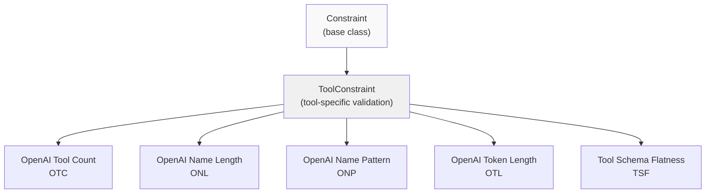
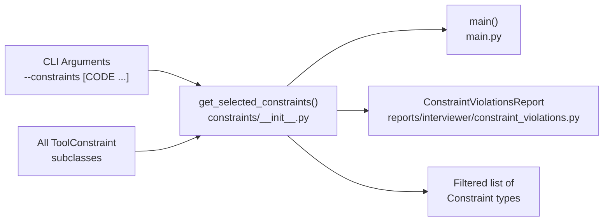
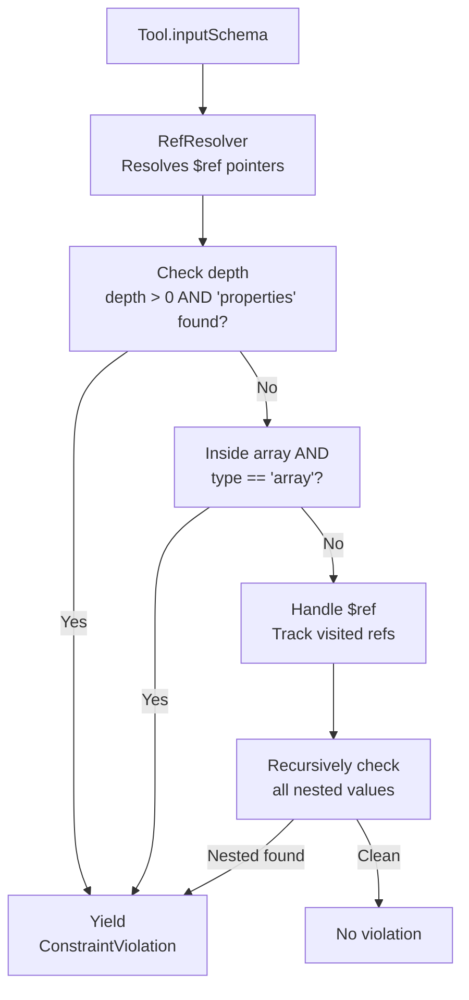
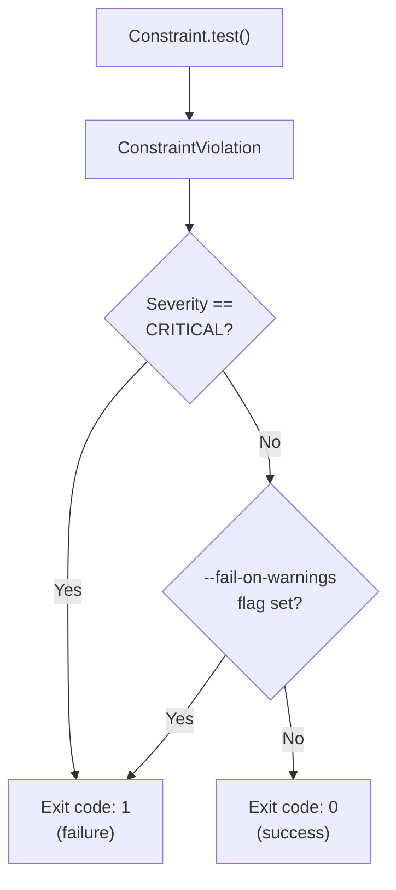
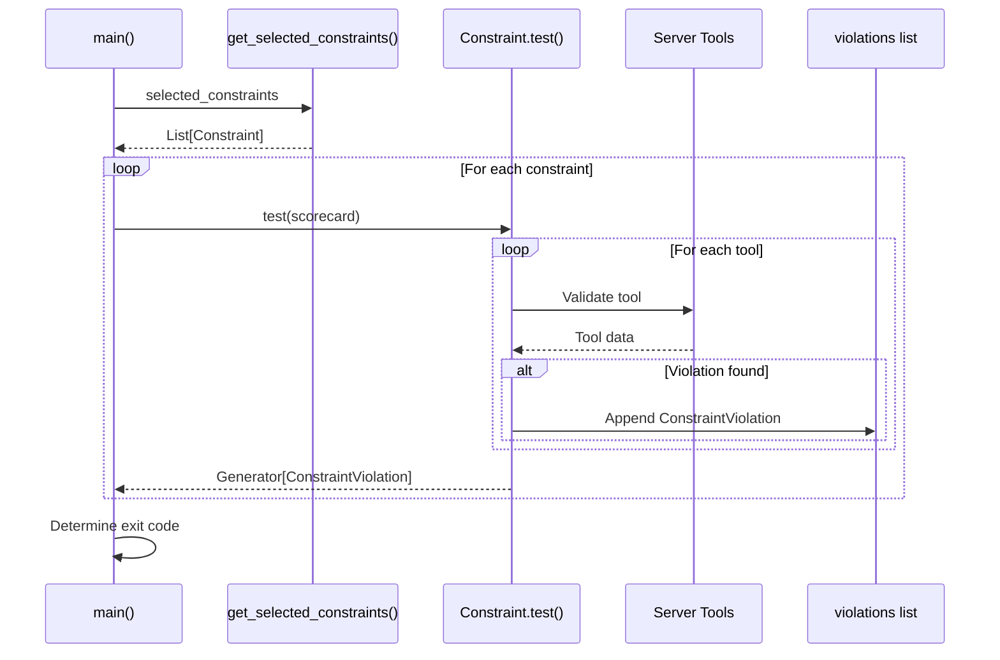
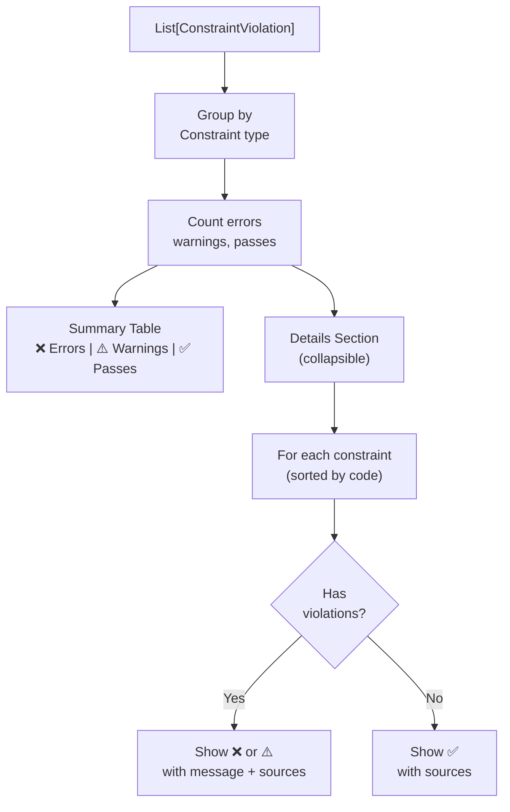

<!-- source: DeepWiki mcp.deepwiki.com · repo microsoft/mcp-interviewer · page 6.3 Constraint Types Reference · fetched 2026-10-26 -->

# Constraint Types Reference

<details>
<summary>Relevant source files</summary>

The following files were used as context for generating this wiki page:

- [README.md](README.md)
- [src/mcp_interviewer/constraints/tool_schema_flatness.py](src/mcp_interviewer/constraints/tool_schema_flatness.py)
- [src/mcp_interviewer/reports/interviewer/constraint_violations.py](src/mcp_interviewer/reports/interviewer/constraint_violations.py)
- [tests/constraints/test_tool_schema_flatness.py](tests/constraints/test_tool_schema_flatness.py)
- [uv.lock](uv.lock)

</details>


This page provides a complete reference for all constraint types available in mcp-interviewer. Constraints validate MCP servers against hard requirements and recommended practices from various LLM providers and API specifications.

For information about the constraint validation architecture, see [Constraint System](#4.4). For details on interpreting constraint violations in reports, see [Understanding Reports](#3.7).

## Overview

Constraints are validation rules that test MCP servers for compliance with provider-specific requirements. Each constraint has:
- A unique code (e.g., `OTC`, `TSF`)
- A human-readable name
- One or more documentation sources
- A severity level (`CRITICAL` or `WARNING`)



**Sources:** [src/mcp_interviewer/constraints/base.py:1-50](), [src/mcp_interviewer/constraints/tool_schema_flatness.py:10-38]()

## Constraint Code System

Each constraint has a short code used for CLI selection. Users can specify constraints using the `--constraints` flag:

```bash
# Check specific constraints
mcp-interviewer --constraints OTC ONL server-command

# Check all OpenAI constraints
mcp-interviewer --constraints OA server-command

# Check all constraints (default behavior)
mcp-interviewer server-command
```

The `OA` code is a meta-code that expands to all OpenAI-related constraints (`OTC`, `ONL`, `ONP`, `OTL`).

**Sources:** [README.md:44-53](), [src/mcp_interviewer/constraints/__init__.py:1-50]()

## Complete Constraint Reference

| Code | Name | Description | Severity | Provider |
|------|------|-------------|----------|----------|
| `OTC` | OpenAI Tool Count | Validates tool count ≤128 (hard limit) | CRITICAL | OpenAI |
| `ONL` | OpenAI Name Length | Validates tool name length ≤64 characters | CRITICAL | OpenAI |
| `ONP` | OpenAI Name Pattern | Validates tool name matches pattern `^[a-zA-Z0-9_-]+$` | CRITICAL | OpenAI |
| `OTL` | OpenAI Token Length | Validates tool definition token length within limits | WARNING/CRITICAL | OpenAI |
| `TSF` | Tool Schema Flatness | Validates input schemas are flat (no nested objects/arrays) | WARNING | Best Practice |

**Sources:** [README.md:46-52](), [src/mcp_interviewer/constraints/tool_schema_flatness.py:13-38]()

## Constraint Selection

The constraint system uses the `get_selected_constraints()` function to determine which constraints to test. This function is called from multiple locations:



**Sources:** [src/mcp_interviewer/constraints/__init__.py:1-50](), [src/mcp_interviewer/reports/interviewer/constraint_violations.py:29](), [src/mcp_interviewer/main.py:1-200]()

## OpenAI Constraints

OpenAI imposes specific limits on function calling that must be respected when using MCP servers with their API.

### OTC: OpenAI Tool Count

**Validates:** Total number of tools ≤128

**Severity:** CRITICAL

**Rationale:** OpenAI's API has a hard limit of 128 tools in a single chat completion request. Exceeding this limit causes API errors.

**Documentation:**
- [OpenAI Function Calling Documentation](https://platform.openai.com/docs/guides/function-calling)

### ONL: OpenAI Name Length

**Validates:** Tool name length ≤64 characters

**Severity:** CRITICAL

**Rationale:** OpenAI requires function names to be at most 64 characters. Longer names are rejected by the API.

**Documentation:**
- [OpenAI Function Calling Documentation](https://platform.openai.com/docs/guides/function-calling)

### ONP: OpenAI Name Pattern

**Validates:** Tool name matches `^[a-zA-Z0-9_-]+$`

**Severity:** CRITICAL

**Rationale:** OpenAI only accepts function names containing alphanumeric characters, underscores, and hyphens. Other characters cause API errors.

**Documentation:**
- [OpenAI Function Calling Documentation](https://platform.openai.com/docs/guides/function-calling)

### OTL: OpenAI Token Length

**Validates:** Tool definition total token count within limits

**Severity:** CRITICAL for hard limits, WARNING for recommendations

**Rationale:** OpenAI counts tool definitions against the context window. Excessively large tool definitions can consume significant tokens, leaving less room for actual conversation.

**Documentation:**
- [OpenAI Function Calling Documentation](https://platform.openai.com/docs/guides/function-calling)

**Sources:** [README.md:38-53]()

## Best Practice Constraints

These constraints enforce recommended patterns that improve tool usability and reliability, though they may not be enforced by specific APIs.

### TSF: Tool Schema Flatness

**Validates:** Input schemas contain no nested objects or nested arrays

**Severity:** WARNING

**Rationale:** Deeply nested schemas are harder for LLMs to understand and use correctly. Flat schemas with all parameters at the top level are easier to reason about and less prone to errors.

**Allowed:**
- Top-level properties with primitive types
- Arrays of primitives (e.g., `array<string>`)
- Union types (`oneOf`, `anyOf`, `allOf`)
- References to primitive type definitions

**Disallowed:**
- Nested objects (objects within objects)
- Nested arrays (arrays of arrays)
- References to definitions with nested properties

**Implementation Details:**

The constraint uses JSON Schema reference resolution to handle `$ref` pointers and prevents infinite loops on circular references:



**Example Violations:**

```json
// VIOLATION: Nested object
{
  "type": "object",
  "properties": {
    "user": {
      "type": "object",
      "properties": {
        "name": {"type": "string"}
      }
    }
  }
}

// VIOLATION: Nested array
{
  "type": "object",
  "properties": {
    "matrix": {
      "type": "array",
      "items": {
        "type": "array",
        "items": {"type": "number"}
      }
    }
  }
}
```

**Example Valid Schemas:**

```json
// VALID: Flat properties
{
  "type": "object",
  "properties": {
    "name": {"type": "string"},
    "age": {"type": "integer"}
  }
}

// VALID: Array of primitives
{
  "type": "object",
  "properties": {
    "tags": {
      "type": "array",
      "items": {"type": "string"}
    }
  }
}

// VALID: Union types
{
  "type": "object",
  "properties": {
    "value": {
      "oneOf": [
        {"type": "string"},
        {"type": "number"}
      ]
    }
  }
}
```

**Documentation:**
- [Composio Function Calling Best Practices](https://composio.dev/blog/gpt-4-function-calling-example)

**Sources:** [src/mcp_interviewer/constraints/tool_schema_flatness.py:13-139](), [tests/constraints/test_tool_schema_flatness.py:1-394]()

## Severity Levels

Constraints produce violations with two severity levels:

| Severity | Symbol | Meaning | Exit Code Impact |
|----------|--------|---------|------------------|
| `CRITICAL` | ❌ | Hard requirement violation. Always causes failure. | Always exits with code 1 |
| `WARNING` | ⚠️ | Recommended practice violation. | Exits with code 1 only if `--fail-on-warnings` flag is set |



**Sources:** [src/mcp_interviewer/constraints/base.py:20-35](), [README.md:189-190](), [src/mcp_interviewer/reports/interviewer/constraint_violations.py:44-49]()

## Constraint Testing Flow

The constraint validation process follows this sequence:



**Sources:** [src/mcp_interviewer/main.py:1-200](), [src/mcp_interviewer/constraints/base.py:1-100]()

## Constraint Implementation

All constraints inherit from the abstract `Constraint` base class:

```python
class Constraint(ABC):
    @classmethod
    @abstractmethod
    def cli_name(cls) -> str:
        """Human-readable name for CLI display"""
        pass
    
    @classmethod
    @abstractmethod
    def cli_code(cls) -> str:
        """Short code for CLI selection (e.g., 'OTC')"""
        pass
    
    @classmethod
    @abstractmethod
    def sources(cls) -> list[SourceUrl]:
        """Documentation source URLs"""
        pass
    
    @abstractmethod
    def test(self, interview: ServerScoreCard) -> Generator[ConstraintViolation, None, None]:
        """Test the server and yield violations"""
        pass
```

Tool-specific constraints extend `ToolConstraint`, which provides convenience methods:

```python
class ToolConstraint(Constraint):
    def test(self, interview: ServerScoreCard) -> Generator[ConstraintViolation, None, None]:
        for tool in interview.tools:
            yield from self.test_tool(tool)
    
    @abstractmethod
    def test_tool(self, tool: Tool) -> Generator[ConstraintViolation, None, None]:
        """Test a single tool and yield violations"""
        pass
```

**Sources:** [src/mcp_interviewer/constraints/base.py:1-100]()

## Violation Reporting

Constraint violations are collected and reported in the `ConstraintViolationsReport`:



Example report output:

```markdown
## Constraint Violations

| ❌ Errors | ⚠️ Warnings | ✅ Passes |
|-----------|-------------|-----------|
| 2         | 1           | 2         |

<details>
<summary>Details</summary>

❌ OpenAI Name Length (ONL): Tool 'very_long_tool_name_that_exceeds_the_sixty_four_character_limit_imposed_by_openai' exceeds 64 character limit [[1]](https://platform.openai.com/docs/guides/function-calling)

⚠️ Tool Schema Flatness (TSF): Tool 'create_user': inputSchema contains nested structures (nested objects or arrays). Tool parameters should be flat. [[1]](https://composio.dev/blog/gpt-4-function-calling-example)

✅ OpenAI Name Pattern (ONP) [[1]](https://platform.openai.com/docs/guides/function-calling)

✅ OpenAI Tool Count (OTC) [[1]](https://platform.openai.com/docs/guides/function-calling)
</details>
```

**Sources:** [src/mcp_interviewer/reports/interviewer/constraint_violations.py:1-86]()

## Using Constraints Programmatically

When using the Python API, constraints are automatically tested:

```python
from mcp_interviewer import main, StdioServerParameters

params = StdioServerParameters(command="server-command", args=[])

# Test all constraints
exit_code = main(None, None, params)

# Test specific constraints
exit_code = main(None, None, params, selected_constraints=["OTC", "ONL"])

# Fail on warnings
exit_code = main(None, None, params, fail_on_warnings=True)
```

**Sources:** [README.md:270-287](), [src/mcp_interviewer/main.py:1-200]()

---

