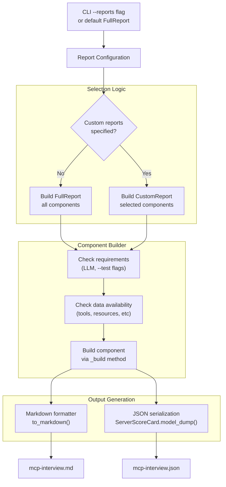

<!-- source: DeepWiki mcp.deepwiki.com · repo microsoft/mcp-interviewer · page 6.4 Report Components Reference · fetched 2026-10-26 -->

# Report Components Reference

<details>
<summary>Relevant source files</summary>

The following files were used as context for generating this wiki page:

- [README.md](README.md)
- [src/mcp_interviewer/reports/functional_test/failed_tests.py](src/mcp_interviewer/reports/functional_test/failed_tests.py)
- [src/mcp_interviewer/reports/functional_test/test.py](src/mcp_interviewer/reports/functional_test/test.py)

</details>


This page provides a complete reference for all report components available in mcp-interviewer. Each component can be included or excluded from generated reports using the `--reports` CLI flag or through programmatic configuration.

For guidance on interpreting report content, see [Understanding Reports](#3.7). For details on the report generation architecture, see [Report Generation Pipeline](#4.5).

---

## Overview

Report components are modular sections that can be combined to create customized Markdown and JSON output. Each component has a unique **CLI code** used for selection and inherits from the `BaseReport` class defined in [src/mcp_interviewer/reports/base.py]().

Components are organized into three categories:
- **Server metadata components**: Information about the server and interview configuration
- **Evaluation components**: Results from constraint checking, testing, and scoring
- **Capability components**: Details about available tools, resources, and prompts

**Sources:** [README.md:72-91](), Diagram 5 (Report Generation System)

---

## Report Component Summary

The following table lists all available report components:

| CLI Code | Component Name | Category | Requires LLM | Description |
|----------|---------------|----------|--------------|-------------|
| `II` | Interviewer Info | Metadata | No | Model name, parameters, and interview configuration |
| `SI` | Server Info | Metadata | No | Server name, version, protocol version, and capabilities |
| `CAP` | Capabilities | Metadata | No | Supported MCP features (tools, resources, prompts, sampling, logging, elicitation) |
| `TS` | Tool Statistics | Evaluation | No | Tool counts, naming patterns, and schema complexity metrics |
| `TCS` | Tool Call Statistics | Evaluation | Yes (--test) | Performance metrics from functional test execution |
| `FT` | Functional Tests | Evaluation | Yes (--test) | Complete test plan, step execution results, and evaluations |
| `CV` | Constraint Violations | Evaluation | No | Validation results grouped by constraint with severity indicators |
| `T` | Tools | Capability | No | Complete tool definitions including input/output schemas |
| `R` | Resources | Capability | No | Available resources with URIs, names, and MIME types |
| `RT` | Resource Templates | Capability | No | Resource URI templates with argument definitions |
| `P` | Prompts | Capability | No | Available prompts with names, descriptions, and arguments |

**Sources:** [README.md:76-90]()

---

## Report Selection

### Default Behavior

When no `--reports` flag is specified, mcp-interviewer generates a **FullReport** containing all components in standard order:

```
1. Interviewer Info (II)
2. Server Info (SI)
3. Capabilities (CAP)
4. Tool Statistics (TS)
5. Tool Call Statistics (TCS) [if --test enabled]
6. Functional Tests (FT) [if --test enabled]
7. Constraint Violations (CV)
8. Tools (T)
9. Resources (R)
10. Resource Templates (RT)
11. Prompts (P)
```

### Custom Selection

Use the `--reports` flag to select specific components:

```bash
# Include only server info, tool statistics, and constraint violations
mcp-interviewer --reports SI TS CV <server_command>

# Focus on testing results
mcp-interviewer --test --reports FT TCS CV <server_command>
```

**Sources:** [README.md:72-91](), Diagram 5 (Report Generation System)

---

## Component Architecture

The following diagram shows how report components are structured and selected:

```mermaid
graph TB
    BaseReport["BaseReport<br/>(base.py)<br/>Abstract base class"]
    
    subgraph "Metadata Components"
        II["InterviewerInfoReport<br/>cli_code: 'II'"]
        SI["ServerInfoReport<br/>cli_code: 'SI'"]
        CAP["CapabilityAssessmentReport<br/>cli_code: 'CAP'"]
    end
    
    subgraph "Evaluation Components"
        TS["ToolStatisticsReport<br/>cli_code: 'TS'"]
        TCS["ToolCallStatisticsReport<br/>cli_code: 'TCS'"]
        FT["FunctionalTestReport<br/>cli_code: 'FT'"]
        CV["ConstraintViolationsReport<br/>cli_code: 'CV'"]
    end
    
    subgraph "Capability Components"
        T["ToolsReport<br/>cli_code: 'T'"]
        R["ResourcesReport<br/>cli_code: 'R'"]
        RT["ResourceTemplatesReport<br/>cli_code: 'RT'"]
        P["PromptsReport<br/>cli_code: 'P'"]
    end
    
    subgraph "Composite Reports"
        FullReport["FullReport<br/>All components in order"]
        CustomReport["CustomReport<br/>User-selected components"]
    end
    
    subgraph "Specialized Reports"
        FailedTests["FailedTestsReport<br/>cli_code: 'FAIL'<br/>Only failed test steps"]
    end
    
    BaseReport --> II
    BaseReport --> SI
    BaseReport --> CAP
    BaseReport --> TS
    BaseReport --> TCS
    BaseReport --> FT
    BaseReport --> CV
    BaseReport --> T
    BaseReport --> R
    BaseReport --> RT
    BaseReport --> P
    
    II --> FullReport
    SI --> FullReport
    CAP --> FullReport
    TS --> FullReport
    TCS --> FullReport
    FT --> FullReport
    CV --> FullReport
    T --> FullReport
    R --> FullReport
    RT --> FullReport
    P --> FullReport
    
    II --> CustomReport
    SI --> CustomReport
    CAP --> CustomReport
    TS --> CustomReport
    TCS --> CustomReport
    FT --> CustomReport
    CV --> CustomReport
    T --> CustomReport
    R --> CustomReport
    RT --> CustomReport
    P --> CustomReport
    
    FT --> FailedTests
```



**Sources:** Diagram 5 (Report Generation System), [src/mcp_interviewer/reports/base.py]()

---

## Detailed Component Reference

### II - Interviewer Info

**Purpose:** Documents the interview configuration and model used for evaluation.

**Contents:**
- Model name (e.g., `gpt-4.1`)
- Interview parameters:
  - `should_judge_tools`: Whether LLM tool evaluation is enabled
  - `should_run_functional_test`: Whether functional testing is enabled
  - `should_judge_functional_test`: Whether LLM test evaluation is enabled
  - `functional_test_strictness`: Risk acceptance level for test generation
  - `functional_test_max_steps`: Maximum test steps to generate

**Always Included:** Yes (in FullReport)

**Example Output:**
```markdown
## Interviewer Info

- Model: gpt-4.1
- Judging Tools: Yes
- Running Functional Tests: Yes
- Judging Functional Tests: Yes
- Functional Test Strictness: medium
- Functional Test Max Steps: 10
```

**Sources:** [README.md:78](), Diagram 5

---

### SI - Server Info

**Purpose:** Provides identifying information about the MCP server being evaluated.

**Contents:**
- Server name
- Server version
- Protocol version
- Server capabilities declaration (from initialization)

**Always Included:** Yes (in FullReport)

**Example Output:**
```markdown
## Server Info

- Name: @modelcontextprotocol/server-everything
- Version: 1.0.0
- Protocol Version: 2024-11-05
```

**Sources:** [README.md:79](), Diagram 5

---

### CAP - Capabilities

**Purpose:** Summarizes which MCP features the server supports.

**Contents:**
- ✅ Supported features: tools, resources, resource templates, prompts
- Server-side features: sampling, logging
- Client-side features: roots, elicitation

**Always Included:** Yes (in FullReport)

**Example Output:**
```markdown
## Capabilities

### Supported Features
- ✅ Tools (12)
- ✅ Resources (3)
- ✅ Prompts (2)
- ✅ Sampling requests
```

**Sources:** [README.md:80](), Diagram 5

---

### TS - Tool Statistics

**Purpose:** Provides quantitative analysis of tool definitions without requiring LLM evaluation.

**Contents:**
- Total tool count
- Naming pattern analysis (valid/invalid patterns)
- Schema complexity metrics:
  - Average properties per tool
  - Nested object detection
  - Required vs optional parameters
- Name length distribution

**Always Included:** Yes (in FullReport)

**Example Output:**
```markdown
## Tool Statistics

- Total Tools: 12
- Valid Names: 12/12
- Average Properties: 2.5
- Tools with Nested Objects: 3
```

**Sources:** [README.md:81](), Diagram 5

---

### TCS - Tool Call Statistics

**Purpose:** Reports performance metrics from functional test execution.

**Contents:**
- Per-tool call counts
- Execution time statistics
- Success/failure rates
- Request type counts:
  - Sampling requests
  - Elicitation requests
  - Logging requests
- Progress notification counts

**Requires:** `--test` flag enabled

**Example Output:**
```markdown
## Tool Call Statistics

| Tool Name | Calls | Avg Time (ms) | Success Rate |
|-----------|-------|---------------|--------------|
| echo | 3 | 45.2 | 100% |
| add | 2 | 32.1 | 100% |
```

**Sources:** [README.md:82](), Diagram 5

---

### FT - Functional Tests

**Purpose:** Documents complete functional test execution including plan, steps, and evaluations.

**Contents:**
- Test plan (🤖 LLM-generated)
- Overall evaluation (if `--judge-test` enabled)
- Individual test steps:
  - Step justification (🤖)
  - Expected output (🤖)
  - Tool name and arguments
  - Actual tool output
  - Request statistics
  - Step evaluations (if `--judge-test` enabled):
    - Error handling
    - Output relevance
    - Output quality
    - Meets expectations

**Requires:** `--test` flag enabled

**Configuration:**
- `--include-evaluations`: Shows/hides LLM-generated content (default: true)
- `--judge-test`: Enables LLM evaluation of test results

**Example Structure:**
```markdown
## Functional Test Results

**Test Plan (🤖):**
Test the echo tool, then test arithmetic operations...

**Overall Evaluation (🤖):**
- ✅ **Meets Expectations**: All tools functioned correctly

### Test Steps

#### Step 1: echo

**Justification (🤖):** Test basic echoing functionality
**Expected Output (🤖):** Returns the same message

**Tool Call:**
- Tool: echo
- Arguments: {"message": "hello"}

**Tool Output:**
{"content": [{"type": "text", "text": "hello"}]}

**Statistics:**
- Sampling Requests: 0
- Elicitation Requests: 0
```

**Sources:** [README.md:83](), [src/mcp_interviewer/reports/functional_test/test.py:1-80]()

---

### CV - Constraint Violations

**Purpose:** Reports validation results for all checked constraints with severity indicators.

**Contents:**
- Summary statistics (errors, warnings, passes)
- Per-constraint sections:
  - ❌ CRITICAL violations (always fail build)
  - ⚠️ WARNING violations (fail if `--fail-on-warnings`)
  - ✅ PASS indicators
  - Violation details with specific tool/resource names
  - Documentation source links

**Always Included:** Yes (in FullReport)

**Example Output:**
```markdown
## Constraint Violations

**Summary:**
- ❌ Errors: 0
- ⚠️ Warnings: 1
- ✅ Passes: 4

### OTC - OpenAI Tool Count
✅ **PASS**: 12 tools (limit: 128)

### ONL - OpenAI Name Length
⚠️ **WARNING**: 1 tool exceeds recommended limit
- `very_long_tool_name_that_exceeds_limit` (45 chars, recommended: ≤40)
```

**Sources:** [README.md:84](), Diagram 6 (Constraint Validation System)

---

### T - Tools

**Purpose:** Provides complete tool definitions for inspection and debugging.

**Contents:**
- Tool name
- Description
- Input schema (JSON Schema)
- Output schema (if defined)
- LLM evaluations (if `--judge-tools` enabled):
  - Name quality score
  - Description quality score
  - Input schema quality score
  - Output schema quality score

**Always Included:** Yes (in FullReport)

**Example Output:**
```markdown
## Tools

### echo

**Description:** Echoes back the input message

**Input Schema:**
```json
{
  "type": "object",
  "properties": {
    "message": {
      "type": "string",
      "description": "Message to echo"
    }
  },
  "required": ["message"]
}
```
```

**Sources:** [README.md:85](), Diagram 5

---

### R - Resources

**Purpose:** Lists available resources with their metadata.

**Contents:**
- Resource URI
- Resource name
- Description
- MIME type
- Annotations (if any)

**Always Included:** Yes (in FullReport)

**Conditional:** Only appears if server supports resources

**Example Output:**
```markdown
## Resources

### file:///example.txt

**Name:** example.txt
**Description:** An example text file
**MIME Type:** text/plain
```

**Sources:** [README.md:86](), Diagram 5

---

### RT - Resource Templates

**Purpose:** Documents URI templates for dynamic resource access.

**Contents:**
- Template URI pattern
- Template name
- Description
- Argument definitions
- MIME type
- Annotations (if any)

**Always Included:** Yes (in FullReport)

**Conditional:** Only appears if server supports resource templates

**Example Output:**
```markdown
## Resource Templates

### file:///{path}

**Name:** File System
**Description:** Access files by path
**Arguments:**
- `path` (string, required): File system path
**MIME Type:** application/octet-stream
```

**Sources:** [README.md:87](), Diagram 5

---

### P - Prompts

**Purpose:** Lists available prompts with their metadata.

**Contents:**
- Prompt name
- Description
- Argument definitions (name, type, required/optional)

**Always Included:** Yes (in FullReport)

**Conditional:** Only appears if server supports prompts

**Example Output:**
```markdown
## Prompts

### code-review

**Description:** Review code for issues and improvements
**Arguments:**
- `code` (string, required): Code to review
- `language` (string, optional): Programming language
```

**Sources:** [README.md:88](), Diagram 5

---

## Specialized Report Components

### FAIL - Failed Tests Report

**Purpose:** Filters functional test results to show only failed test steps, useful for quick issue identification.

**Contents:**
- Summary of failed steps with failure types
- Detailed mode: Complete test step information for failures only

**Usage:**
```bash
# Not typically used with --reports flag
# Instead, view failures in the FT component output
```

**Note:** This is a specialized report component used internally but not exposed via the standard `--reports` flag. Failed tests are highlighted within the FT component output.

**Sources:** [src/mcp_interviewer/reports/functional_test/failed_tests.py:1-93]()

---

## Report Output Formats

### Markdown Output

Generated as `mcp-interview.md` (or custom filename with `--output`).

**Features:**
- Human-readable formatting
- Collapsible sections (controlled by `--no-collapse`)
- Syntax highlighting for JSON schemas
- Emoji indicators (🤖 for LLM-generated content)
- Tables for statistics
- Links to documentation sources

### JSON Output

Generated as `mcp-interview.json` (or custom filename with `--output-json`).

**Structure:**
```json
{
  "model": "gpt-4.1",
  "initialize_result": {...},
  "tools": [...],
  "resources": [...],
  "prompts": [...],
  "tool_scorecards": [...],
  "functional_test_scorecard": {...}
}
```

This file contains the raw `ServerScoreCard` data in JSON format for programmatic processing.

**Sources:** Diagram 5 (Report Generation System)

---

## Component Selection Flow

The following diagram shows how components are selected and built:



**Sources:** Diagram 5 (Report Generation System), [src/mcp_interviewer/reports/]()

---

## Component Class Structure

Each report component implements the following interface:

```python
class BaseReport:
    @classmethod
    def cli_name(cls) -> str:
        """Full name for display"""
        
    @classmethod
    def cli_code(cls) -> str:
        """Short code for --reports flag"""
        
    def _build(self):
        """Build component content"""
        
    def to_markdown(self) -> str:
        """Render as Markdown"""
```

**Key Methods:**
- `cli_code()`: Returns the short code (e.g., "FT", "CV")
- `cli_name()`: Returns the full name (e.g., "functional-tests")
- `_build()`: Constructs the component content from `ServerScoreCard`
- Helper methods: `add_title()`, `add_text()`, `add_table()`, `start_collapsible()`, etc.

**Sources:** [src/mcp_interviewer/reports/base.py]()

---

## Configuration Options

The following options affect report generation:

| Option | Type | Effect |
|--------|------|--------|
| `--reports [CODES...]` | List of CLI codes | Selects which components to include |
| `--no-collapse` | Boolean flag | Disables collapsible sections in Markdown |
| `--include-evaluations` | Boolean flag | Shows/hides LLM-generated content in FT |
| `--output <path>` | String | Custom Markdown output path |
| `--output-json <path>` | String | Custom JSON output path |

**Sources:** [README.md:74](), [README.md:183-184]()

---

## Usage Examples

### Minimal Report

```bash
# Only server info and constraint violations
mcp-interviewer --reports SI CV <server_command>
```

### Testing-Focused Report

```bash
# Server info, test results, and tool call statistics
mcp-interviewer --test --reports SI FT TCS <server_command>
```

### Comprehensive Development Report

```bash
# All components with evaluations
mcp-interviewer --test --judge --reports II SI CAP TS TCS FT CV T R P <server_command>
```

### Debugging Report

```bash
# Tools and resources only for inspection
mcp-interviewer --reports T R RT <server_command>
```

**Sources:** [README.md:183-194]()

---

