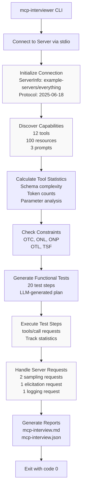
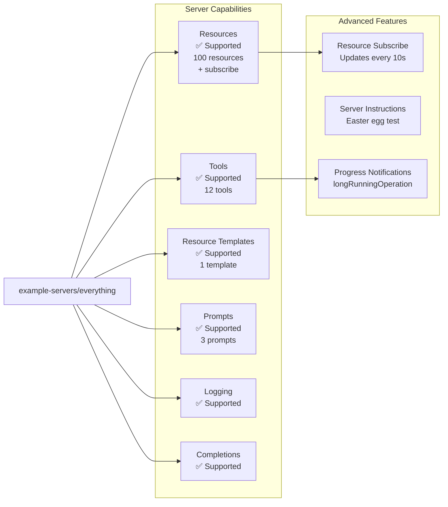
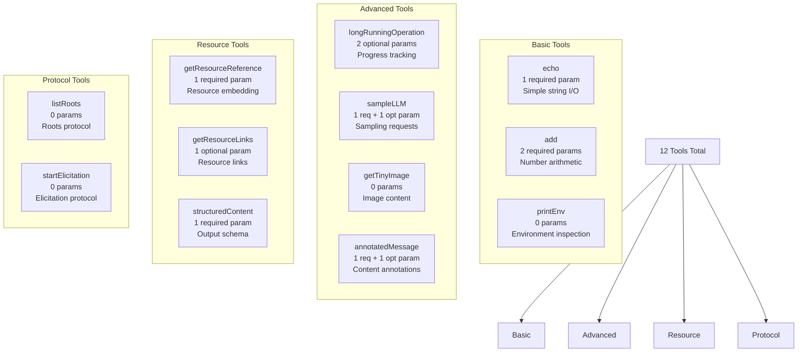
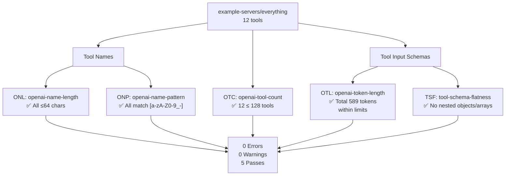
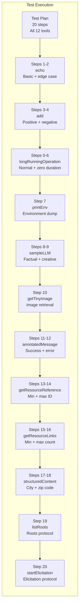
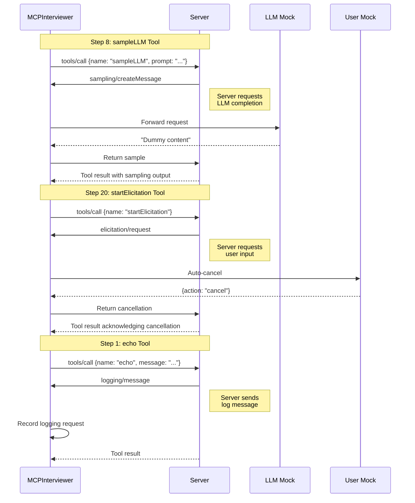

<!-- source: DeepWiki mcp.deepwiki.com · repo microsoft/mcp-interviewer · page 6.5 Example Server Analysis · fetched 2026-10-26 -->

# Example Server Analysis

<details>
<summary>Relevant source files</summary>

The following files were used as context for generating this wiki page:

- [mcp-interview.json](mcp-interview.json)
- [mcp-interview.md](mcp-interview.md)

</details>


This page provides a complete walkthrough of analyzing the `@modelcontextprotocol/server-everything` example server using mcp-interviewer. This comprehensive example demonstrates all major features of the tool, including server inspection, constraint validation, functional testing, and report generation. For information on interpreting report components in general, see [Understanding Reports](#3.7). For details on the constraint validation system, see [Constraint System](#4.4).

## Overview

The `@modelcontextprotocol/server-everything` server is a demonstration MCP server that implements all protocol features. It provides 12 tools, 100 resources, 3 prompts, and supports logging, resource subscriptions, and completions. This analysis was performed using functional testing enabled but without LLM-based tool judging, producing both machine-readable JSON and human-readable Markdown outputs.

Sources: [mcp-interview.json:1-43](), [mcp-interview.md:1-71]()

## Running the Analysis

The server was analyzed using this command:

```bash
mcp-interviewer --test --model gpt-4.1 docker run -i --rm node:lts npx -y @modelcontextprotocol/server-everything
```

This command configuration specifies:
- `--test`: Enable functional test generation and execution
- `--model gpt-4.1`: Use GPT-4.1 for test generation (not for tool judging, which was disabled)
- Server launched via Docker running Node.js LTS with `npx`

The server connects via stdio (standard input/output), as indicated in the connection parameters.

Sources: [mcp-interview.json:2-18](), [mcp-interview.md:59-70]()

## Analysis Workflow



**Analysis Phases for @modelcontextprotocol/server-everything**

This diagram shows the specific execution flow for this server, including the actual counts discovered and requests handled during testing.

Sources: [mcp-interview.json:19-44](), [mcp-interview.md:4-82]()

## Server Capabilities Assessment

### Connection and Initialization

The server initializes with comprehensive capability support:

| Field | Value |
|-------|-------|
| Server Name | `example-servers/everything` |
| Server Version | `1.0.0` |
| Protocol Version | `2025-06-18` |
| Connection Type | `stdio` |



**Server Capabilities and Feature Support**

Sources: [mcp-interview.json:19-44](), [mcp-interview.md:4-81]()

### Server Instructions

The server includes detailed instructions that explain its behavior patterns:

- Resources 1-100 follow a pattern: even IDs contain text, odd IDs contain binary blobs
- Resources are paginated at 10 items per page with cursor-based navigation
- Progress notifications require `_meta.progressToken` in tool calls
- Server generates automatic log messages every 20 seconds
- Server generates resource update notifications every 10 seconds for active subscriptions

Sources: [mcp-interview.json:42]()

## Tool Analysis

### Tool Statistics Summary

The tool analysis provides quantitative metrics about the server's tool definitions:

| Metric | Total | Average | Min | Max |
|--------|-------|---------|-----|-----|
| Input schema lengths (gpt-4o tokens) | 589 | 49.1 | 29 | 76 |
| Input parameters per tool | - | 1.0 | 0 | 2 |
| Required parameters per tool | - | 0.6 | 0 | 2 |
| Optional parameters per tool | - | 0.4 | 0 | 2 |
| Input schema max depth | - | 1.4 | 0 | 3 |

These statistics indicate a well-designed tool set with relatively simple, flat schemas (average depth 1.4) and concise parameter definitions (average 49.1 tokens per schema).

Sources: [mcp-interview.md:83-92]()

### Tool Inventory



**Tool Categories in @modelcontextprotocol/server-everything**

Each tool is categorized by complexity and feature demonstration purpose.

Sources: [mcp-interview.json:45-339](), [mcp-interview.md:946-1340]()

### Example Tool Schemas

The `echo` tool demonstrates the simplest case:

```json
{
  "type": "object",
  "properties": {
    "message": {
      "type": "string",
      "description": "Message to echo"
    }
  },
  "required": ["message"],
  "additionalProperties": false,
  "$schema": "http://json-schema.org/draft-07/schema#"
}
```

The `structuredContent` tool includes an output schema for validation:

```json
{
  "type": "object",
  "properties": {
    "temperature": {
      "type": "number",
      "description": "Temperature in celsius"
    },
    "conditions": {
      "type": "string",
      "description": "Weather conditions description"
    },
    "humidity": {
      "type": "number",
      "description": "Humidity percentage"
    }
  },
  "required": ["temperature", "conditions", "humidity"],
  "additionalProperties": false,
  "$schema": "http://json-schema.org/draft-07/schema#"
}
```

This is one of the few tools in the server that defines expected output structure.

Sources: [mcp-interview.json:50-67](), [mcp-interview.json:281-307]()

## Constraint Validation

### Validation Results

All constraint checks passed for this server:

| Constraint Code | Name | Result |
|-----------------|------|--------|
| ONL | openai-name-length | ✅ Pass |
| ONP | openai-name-pattern | ✅ Pass |
| OTC | openai-tool-count | ✅ Pass |
| OTL | openai-token-length | ✅ Pass |
| TSF | tool-schema-flatness | ✅ Pass |



**Constraint Validation Results**

The server passes all OpenAI compatibility and best practice constraints, making it suitable for use with LLM-based tool calling systems.

Sources: [mcp-interview.md:109-128]()

### Schema Flatness Analysis

The TSF (tool-schema-flatness) constraint checks for nested objects or arrays in parameter definitions. All tools in this server use flat schemas:

- `echo`: Single string parameter
- `add`: Two number parameters
- `longRunningOperation`: Two number parameters with defaults
- `sampleLLM`: One string + one number parameter
- `annotatedMessage`: One enum string + one boolean
- `getResourceReference`: One number with min/max constraints
- `structuredContent`: Single string parameter with minLength

Only tools with zero parameters (`printEnv`, `getTinyImage`, `listRoots`, `startElicitation`) have empty schemas. None use nested structures.

Sources: [mcp-interview.json:45-339]()

## Functional Testing

### Test Plan Overview

The LLM generated a comprehensive 20-step test plan:

> "This testing plan systematically exercises all 12 MCP server tools, starting with foundational, stateless tools and progressing to those demonstrating advanced features or requiring more complex input. Tools are grouped and ordered to build understanding, with dependencies and logical relationships considered."



**Functional Test Execution Order**

Tests progress from simple to complex, exercising basic operations before advanced protocol features.

Sources: [mcp-interview.json:2405](), [mcp-interview.md:130-943]()

### Test Execution Statistics

| Metric | Total | Average | Min | Max |
|--------|-------|---------|-----|-----|
| Tool calls attempted | 20 | - | - | - |
| Tool calls returned output | 20 | - | - | - |
| Outputs with no error | 20 | - | - | - |
| Outputs with error | 0 | - | - | - |
| Exceptions calling tools | 0 | - | - | - |
| Output lengths (gpt-4o tokens) | 736 | 36.8 | 3 | 407 |
| Text output blocks | 24 | 6.0 | 1 | 2 |
| Resource_Link output blocks | 11 | 2.8 | 0 | 10 |
| Image output blocks | 2 | 0.5 | 0 | 1 |
| Resource output blocks | 2 | 0.5 | 0 | 1 |
| Sampling requests | 2 | 0.1 | 0 | 1 |
| Elicitation requests | 1 | 0.1 | 0 | 1 |
| Logging requests | 1 | 0.1 | 0 | 1 |

All 20 test steps executed successfully with no errors or exceptions. The server handled multiple content types (text, images, resources) and bidirectional protocol requests (sampling, elicitation, logging).

Sources: [mcp-interview.md:93-108]()

### Example Test: echo Tool

**Test Step 1:**

```json
{
  "tool_name": "echo",
  "tool_arguments": {
    "message": "Hello, MCP!"
  }
}
```

**Expected Output (LLM):** Should return the exact message sent: 'Hello, MCP!'

**Actual Output:**

```
Echo: Hello, MCP!
```

**Result:** ✅ No Error

This step also triggered 1 logging request from the server.

Sources: [mcp-interview.json:2437-2459](), [mcp-interview.md:138-175]()

### Example Test: sampleLLM Tool

**Test Step 8:**

```json
{
  "tool_name": "sampleLLM",
  "tool_arguments": {
    "prompt": "What is the capital of France?",
    "maxTokens": 10
  }
}
```

This test demonstrates the sampling protocol where the server requests LLM completions from the client. The interviewer intercepts this request and returns mock content:

**Actual Output:**

```
LLM sampling result: Dummy content
```

**Statistics:**
- Sampling requests: 1
- Text token count: 7

The server successfully exercised the sampling protocol, showing it can request and process LLM responses from the client.

Sources: [mcp-interview.json:2788-2841](), [mcp-interview.md:392-430]()

### Example Test: getResourceLinks Tool

**Test Step 16:**

```json
{
  "tool_name": "getResourceLinks",
  "tool_arguments": {
    "count": 10
  }
}
```

This test produces 11 content blocks (1 text + 10 resource links):

```
Here are 10 resource links to resources available in this server...
```

Followed by 10 resource link blocks like:

```
[Resource Link: test://static/resource/1]
	MIME type: text/plain
	Description: Resource 1: plaintext resource
```

This demonstrates the server's ability to return structured resource references that clients can use to fetch actual resource content.

Sources: [mcp-interview.json:3627-3787](), [mcp-interview.md:706-788]()

### Example Test: startElicitation Tool

**Test Step 20:**

```json
{
  "tool_name": "startElicitation",
  "tool_arguments": {}
}
```

This test demonstrates the elicitation protocol where the server requests information from the user. The interviewer auto-cancelled the elicitation dialog, resulting in:

**Actual Output:**

```
⚠️ User cancelled the elicitation dialog.

Raw result: {
  "action": "cancel"
}
```

**Statistics:**
- Elicitation requests: 1

The server correctly handled the cancellation and returned appropriate output.

Sources: [mcp-interview.json:3914-3940](), [mcp-interview.md:900-941]()

## Protocol Request Handling



**Bidirectional Protocol Interactions**

The server demonstrates three types of server-initiated requests: sampling (2 times), elicitation (1 time), and logging (1 time).

Sources: [mcp-interview.json:2401-2404]()

## Resources and Prompts

### Resource Organization

The server exposes 100 resources following a consistent pattern:

- **Even IDs (2, 4, 6, ..., 100):** Binary blobs with `application/octet-stream` MIME type
- **Odd IDs (1, 3, 5, ..., 99):** Text resources with `text/plain` MIME type

All resources follow the URI pattern `test://static/resource/{id}`.

### Resource Template

One resource template is defined:

```json
{
  "name": "Static Resource",
  "uriTemplate": "test://static/resource/{id}",
  "description": "A static resource with a numeric ID"
}
```

This template enables dynamic URI construction for resource IDs 1-100.

Sources: [mcp-interview.json:340-1553](), [mcp-interview.md:1343-2547]()

### Prompt Definitions

Three prompts are available:

1. **simple_prompt:** No arguments, basic prompt
2. **complex_prompt:** Two arguments (`temperature` required, `style` optional), includes image content
3. **resource_prompt:** One required argument (`resourceId`), embeds resource content

The prompts demonstrate different argument patterns and multi-modal content embedding.

Sources: [mcp-interview.json:1554-1596](), [mcp-interview.md:2569-2614]()

## Report Output Structure

```mermaid
graph TB
    subgraph "Machine-Readable Output"
        JSON["mcp-interview.json"]
        JSON --> JSONParams["parameters<br/>Connection details"]
        JSON --> JSONInit["initialize_result<br/>Server info + capabilities"]
        JSON --> JSONTools["tools[]<br/>Complete schemas"]
        JSON --> JSONResources["resources[]<br/>100 resource objects"]
        JSON --> JSONTemplates["resource_templates[]"]
        JSON --> JSONPrompts["prompts[]"]
        JSON --> JSONModel["model: gpt-4.1"]
        JSON --> JSONScores["tool_scorecards[]<br/>N/A (not judged)"]
        JSON --> JSONFuncTest["functional_test_scorecard<br/>Plan + 20 steps"]
    end
    
    subgraph "Human-Readable Output"
        MD["mcp-interview.md"]
        MD --> MDInfo["Server Information<br/>+ Interviewer Parameters"]
        MD --> MDCaps["Server Capabilities<br/>Feature support table"]
        MD --> MDStats["Tool Statistics<br/>+ Call Statistics"]
        MD --> MDConstraints["Constraint Violations<br/>0 errors, 5 passes"]
        MD --> MDTests["Functional Test Results<br/>20 step details"]
        MD --> MDTools["Tools<br/>Complete schemas"]
        MD --> MDResources["Resources + Templates"]
        MD --> MDPrompts["Available Prompts"]
    end
    
    Analysis["Analysis Execution"] --> JSON
    Analysis --> MD
```



**Output File Structure**

Both formats contain the complete analysis but serve different purposes: JSON for programmatic access, Markdown for human review.

Sources: [mcp-interview.json:1-3940](), [mcp-interview.md:1-2620]()

## Key Findings

This analysis of `@modelcontextprotocol/server-everything` reveals:

1. **Comprehensive Protocol Support:** All major MCP features are implemented, including bidirectional requests (sampling, elicitation, logging)

2. **Clean Schema Design:** All tools use flat, simple parameter schemas that pass all constraint checks, demonstrating best practices

3. **Robust Error Handling:** 20/20 test steps completed successfully with no errors or exceptions

4. **Multi-Modal Content:** Server handles text, images, and resource references across different tools

5. **Resource Management:** 100 resources with consistent naming and typing patterns, plus template support for dynamic URIs

6. **Protocol Features:** Demonstrates progress notifications, resource subscriptions, argument completion, and multi-modal prompt content

The server serves as an excellent reference implementation and testing target for MCP clients and evaluation tools.

Sources: [mcp-interview.json:1-3940](), [mcp-interview.md:1-2620]()