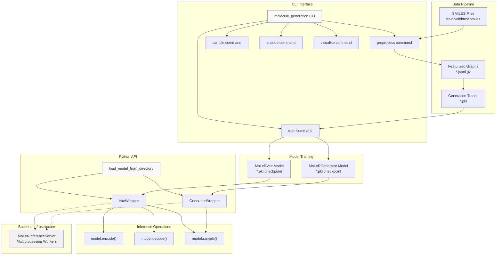
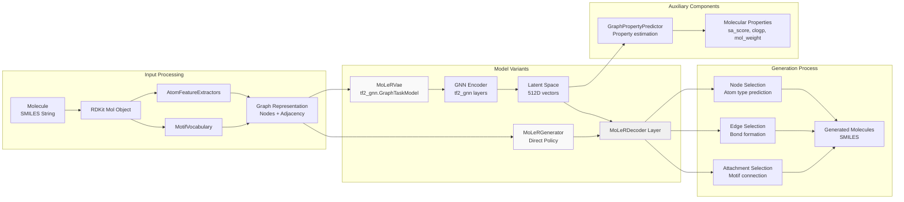

<!-- source: DeepWiki mcp.deepwiki.com · repo microsoft/molecule-generation · page 1 Overview · fetched 2026-10-26 -->

# Overview

Relevant source files

The following files were used as context for generating this wiki page:

- [CHANGELOG.md](CHANGELOG.md)
- [README.md](README.md)
- [setup.py](setup.py)

This document provides a high-level overview of the `molecule_generation` repository, a deep learning system for generating molecular structures using the MoLeR (Molecule Learning Representation) model. The system transforms SMILES molecular representations through graph neural networks to enable molecule generation, encoding, and property prediction.

For detailed installation instructions, see [Installation & Environment Setup](#2.1). For step-by-step usage tutorials, see [Quick Start Tutorial](#2.2). For in-depth model architecture details, see [Model Architecture](#4).

## System Purpose and Capabilities

The `molecule_generation` system provides a complete pipeline for:

- **Data Processing**: Converting SMILES strings into graph representations and generation traces
- **Model Training**: Training variational autoencoders and autoregressive generators for molecules  
- **Inference**: Encoding molecules to latent vectors, decoding latents to molecules, and sampling new structures
- **Visualization**: Understanding generation processes through interactive HTML and CLI visualizers
- **Fine-tuning**: Adapting pre-trained models to new molecular datasets

## High-Level System Architecture

**System Architecture Overview**

**Sources:** [README.md:11-12](), [README.md:53-60](), [README.md:192-195](), [setup.py:32]()

## Core Model Components

**MoLeR Model Architecture Components**

**Sources:** [README.md:9](), [README.md:242-243](), [CHANGELOG.md:49](), [CHANGELOG.md:66-67]()

## Key Workflows

### Data Processing Workflow

| Stage | Input | Process | Output |
|-------|--------|---------|--------|
| **Raw Data** | SMILES files (`train.smiles`, `valid.smiles`, `test.smiles`) | GuacaMol format validation | Validated molecular strings |
| **Featurization** | SMILES strings | `AtomFeatureExtractors`, `MotifVocabulary` extraction | Graph representations (`*.jsonl.gz`) |
| **Trace Generation** | Featurized graphs | Generation order algorithms (BFS/Random) | Training traces (`*.pkl`) |
| **Dataset Creation** | Generation traces | `JSONLMoLeRTraceDataset` | TensorFlow-ready batches |

### Model Training Workflow

| Component | Function | Configuration |
|-----------|----------|---------------|
| **MoLeRVae** | Variational autoencoder for latent space learning | Encoder GNN + Decoder + KL divergence |
| **MoLeRGenerator** | Direct autoregressive generation | Decoder-only architecture |
| **Training Loop** | Minimize reconstruction + auxiliary losses | Property prediction, generation losses |
| **Checkpointing** | Save best model based on validation metrics | `*.pkl` format with metadata |

### Inference Workflow

| Operation | API Method | CLI Command | Function |
|-----------|------------|-------------|----------|
| **Encoding** | `model.encode(smiles)` | `molecule_generation encode` | SMILES → latent vectors |
| **Decoding** | `model.decode(latents)` | N/A | Latent vectors → SMILES |
| **Sampling** | `model.sample(num_samples)` | `molecule_generation sample` | Generate new molecules |
| **Visualization** | N/A | `molecule_generation visualise` | Debug generation traces |

**Sources:** [README.md:62-70](), [README.md:102-106](), [README.md:144-157](), [README.md:159-189]()

## Model Variants and Capabilities

### MoLeRVae Capabilities
- **Encoding**: Convert SMILES to 512-dimensional latent vectors via `VaeWrapper.encode()`
- **Decoding**: Generate molecules from latent vectors via `VaeWrapper.decode()`
- **Scaffold Constraint**: Support scaffold-constrained generation
- **Property Prediction**: Predict molecular properties from latent space

### MoLeRGenerator Capabilities  
- **Direct Sampling**: Generate molecules without explicit latent space via `GeneratorWrapper.sample()`
- **Autoregressive**: Step-by-step molecule construction
- **No Encoding**: Cannot encode existing molecules to latent vectors

### Infrastructure Features
- **Multiprocessing**: `MoLeRInferenceServer` for parallel processing
- **Model Loading**: Automatic wrapper selection via `load_model_from_directory()`
- **Fine-tuning**: Adapt pre-trained models to new datasets
- **Visualization**: HTML and CLI generation trace inspection

**Sources:** [README.md:193-194](), [CHANGELOG.md:49](), [CHANGELOG.md:50](), [README.md:223-237]()

## System Dependencies and Environment

The system requires:
- **Python**: >=3.7 with TensorFlow >=2.1.0, <2.10
- **Chemistry**: RDKit >=2020.09.1 for molecular operations  
- **Deep Learning**: tf2-gnn >=2.13.0 for graph neural networks
- **Utilities**: dpu-utils, scikit-learn, numpy for data processing

Installation uses conda for RDKit and CUDA dependencies, with pip for the Python package itself.

**Sources:** [setup.py:19-28](), [README.md:13-27]()

---

