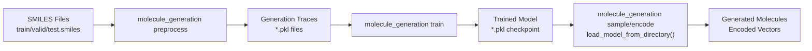
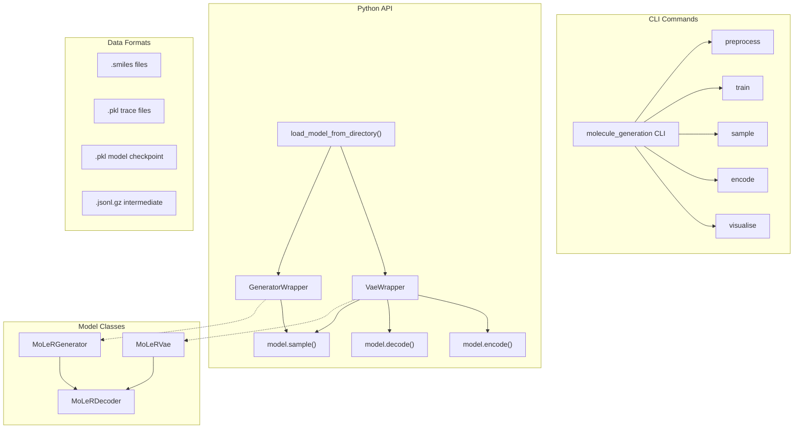

<!-- source: DeepWiki mcp.deepwiki.com · repo microsoft/molecule-generation · page 2 Getting Started · fetched 2026-10-26 -->

# Getting Started

<details>
<summary>Relevant source files</summary>

The following files were used as context for generating this wiki page:

- [README.md](README.md)
- [environment.yml](environment.yml)
- [setup.py](setup.py)

</details>


This document provides a practical introduction to using the MoLeR molecule generation system. It covers initial setup, basic workflows, and essential concepts needed to start generating molecules. For detailed information about specific components, see [Installation & Environment Setup](#2.1) for comprehensive setup instructions, [Quick Start Tutorial](#2.2) for hands-on examples, and [Data Processing Pipeline](#3) for understanding the data flow.

## System Overview

The MoLeR system operates through a four-stage pipeline that transforms SMILES strings into trained models capable of generating new molecules:

**MoLeR Workflow Overview**


Sources: [README.md:53-60](), [README.md:11-35]()

The system provides both command-line tools and a Python API for each stage. The core architectural components map to specific code entities:

**Core Code Entity Architecture**


Sources: [README.md:159-196](), [setup.py:32]()

## Prerequisites

Before using MoLeR, ensure you have:

| Requirement | Version | Purpose |
|-------------|---------|---------|
| Python | ≥3.7 | Core runtime |
| RDKit | ≥2020.09.1 | Molecular processing |
| TensorFlow | ≥2.1.0, <2.10 | Model training/inference |
| CUDA | Compatible with TF | GPU acceleration (optional) |

Sources: [README.md:20](), [setup.py:19-28]()

## Quick Installation

The fastest way to get started is using the provided conda environment:

```bash
# Clone and setup environment
git clone https://github.com/microsoft/molecule-generation.git
cd molecule-generation
conda env create -f environment.yml
conda activate moler-env

# Install the package
pip install molecule-generation
```

Alternatively, install the latest development version:
```bash
pip install -e .
```

Sources: [README.md:13-27](), [environment.yml:1-12]()

## Immediate Usage with Pre-trained Model

To quickly test the system, use the provided pre-trained checkpoint:

```bash
# Download and setup checkpoint
mkdir /tmp/MoLeR_checkpoint
cd /tmp/MoLeR_checkpoint
# Download from: https://figshare.com/ndownloader/files/34642724
# Rename to: GNN_Edge_MLP_MoLeR__2022-02-24_07-16-23_best.pkl

# Generate 10 molecules
molecule_generation sample /tmp/MoLeR_checkpoint 10
```

Expected output format:
```
C1=CC=C(C=C1)C2=CC=C(C=C2)C3=CC=CC=C3
CC(C)NC(=O)C1=CC=C(C=C1)F
...
```

Sources: [README.md:29-35]()

## Essential Workflows

### Command Line Interface

The `molecule_generation` CLI provides the primary interface for all operations:

| Command | Purpose | Input | Output |
|---------|---------|-------|--------|
| `preprocess` | Convert SMILES to training data | `INPUT_DIR` with `.smiles` files | Trace files in `TRACE_DIR` |
| `train` | Train MoLeR model | `TRACE_DIR` with preprocessed data | Model checkpoint `.pkl` |
| `sample` | Generate new molecules | `MODEL_DIR` + number of samples | SMILES strings |
| `encode` | Convert SMILES to latent vectors | `MODEL_DIR` + `SMILES_PATH` | Latent embeddings |
| `visualise` | Inspect generation process | `MODEL_DIR` + molecules | HTML/CLI visualization |

Sources: [README.md:63-67](), [README.md:102-106](), [README.md:144-154]()

### Python API Usage

For programmatic access, use the `load_model_from_directory` context manager:

```python
from molecule_generation import load_model_from_directory

model_dir = "./example_model_directory"
example_smiles = ["c1ccccc1", "CNC=O"]

with load_model_from_directory(model_dir) as model:
    # Encode SMILES to latent vectors
    embeddings = model.encode(example_smiles)
    
    # Decode latent vectors back to SMILES  
    decoded = model.decode(embeddings)
    
    # Generate new molecules
    new_molecules = model.sample(num_samples=5)
    
    # Decode with scaffold constraints
    scaffolds = ["CN", "CCC"]
    constrained = model.decode(embeddings, scaffolds=scaffolds)
```

The context manager automatically:
- Detects model type (`MoLeRVae` vs `MoLeRGenerator`)
- Spawns parallel worker processes
- Provides appropriate wrapper (`VaeWrapper` or `GeneratorWrapper`)

Sources: [README.md:159-196]()

## Data Requirements

MoLeR expects input data in GuacaMol format:

```
INPUT_DIR/
├── train.smiles    # Training SMILES, one per line
├── valid.smiles    # Validation SMILES  
└── test.smiles     # Test SMILES
```

Example SMILES format:
```
c1ccccc1
CNC=O
CC(C)C(=O)O
```

Sources: [README.md:63]()

## Next Steps

After completing basic setup:

1. **For custom data**: See [Data Processing Pipeline](#3) to preprocess your SMILES datasets
2. **For model training**: See [Training Models](#5) for detailed training procedures  
3. **For advanced inference**: See [Inference & Generation](#6) for batch processing and server deployment
4. **For visualization**: See [Visualization & Analysis](#7) to understand model behavior

Common troubleshooting scenarios:
- **TensorFlow GPU issues**: Refer to [TensorFlow installation guide](https://www.tensorflow.org/install)
- **Dependency conflicts**: Use pinned environments from `environment-py*.yml` files
- **China access issues**: Alternative checkpoint link available in README

Sources: [README.md:37-49]()

---

