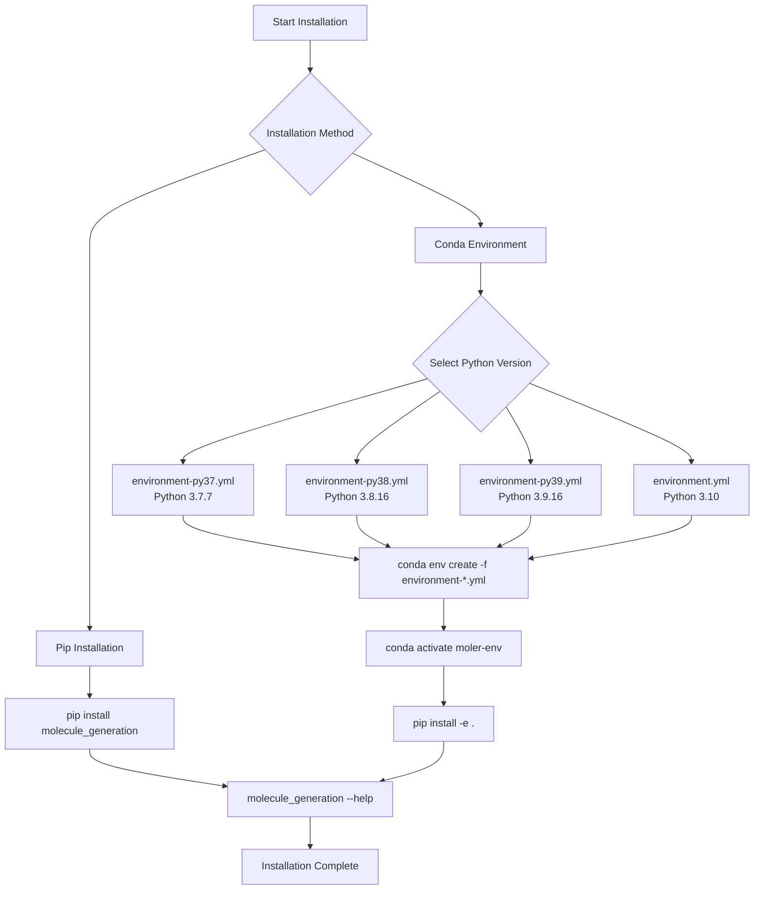
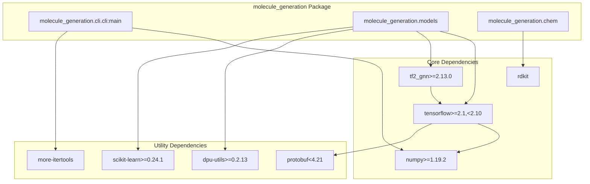

<!-- source: DeepWiki mcp.deepwiki.com · repo microsoft/molecule-generation · page 2.1 Installation & Environment Setup · fetched 2026-10-26 -->

# Installation & Environment Setup

<details>
<summary>Relevant source files</summary>

The following files were used as context for generating this wiki page:

- [environment-py37.yml](environment-py37.yml)
- [environment-py38.yml](environment-py38.yml)
- [environment-py39.yml](environment-py39.yml)
- [environment.yml](environment.yml)
- [setup.py](setup.py)

</details>


This document provides comprehensive instructions for installing the molecule-generation package and setting up the required environment. It covers dependency management, environment configuration, and verification steps to ensure the system is properly configured for molecule generation tasks.

For information about running your first training job after installation, see [Quick Start Tutorial](#2.2). For development environment setup and contributing guidelines, see [Development Environment](#9.1).

## Prerequisites

The molecule-generation system requires Python 3.7 or higher and depends on several scientific computing libraries. The system has been tested on Python versions 3.7 through 3.10 as specified in [setup.py:37-40]().

### System Requirements

| Component | Requirement | Notes |
|-----------|-------------|-------|
| Python | 3.7 - 3.10 | Specified in [setup.py:19]() |
| TensorFlow | 2.1 - 2.9.x | Version constraint in [setup.py:26]() |
| RDKit | 2020.09+ | Required for molecular processing |
| Memory | 8GB+ RAM | Recommended for training |
| Storage | 2GB+ free | For models and datasets |

**Installation Workflow**



Sources: [setup.py:19](), [environment.yml:1-12](), [environment-py37.yml:1-12](), [environment-py38.yml:1-12](), [environment-py39.yml:1-12]()

## Installation Methods

### Method 1: Conda Environment (Recommended)

The recommended installation method uses conda environments to manage dependencies. The repository provides environment files for different Python versions.

#### Step 1: Choose Environment File

Select the appropriate environment file based on your Python version preference:

| Python Version | Environment File | TensorFlow | RDKit |
|----------------|------------------|------------|-------|
| 3.7.7 | `environment-py37.yml` | 2.1.0 | 2020.09.1.0 |
| 3.8.16 | `environment-py38.yml` | 2.6.2 | 2021.09.1 |
| 3.9.16 | `environment-py39.yml` | 2.9.1 | 2022.09.1 |
| 3.10 | `environment.yml` | <2.10 | latest |

#### Step 2: Create Conda Environment

```bash
# For Python 3.10 (recommended)
conda env create -f environment.yml

# Or for specific Python versions
conda env create -f environment-py39.yml
```

#### Step 3: Activate Environment

```bash
conda activate moler-env
```

The environment name `moler-env` is defined in [environment.yml:1]() and all version-specific files.

#### Step 4: Install Package

```bash
# Development installation
pip install -e .

# Or standard installation
pip install .
```

Sources: [environment.yml:1-12](), [environment-py37.yml:1-12](), [environment-py38.yml:1-12](), [environment-py39.yml:1-12]()

### Method 2: Pip Installation

For environments where conda is not available, you can install using pip directly.

#### Step 1: Install Dependencies

```bash
pip install tensorflow>=2.1,<2.10
pip install rdkit
```

#### Step 2: Install Package

```bash
pip install molecule_generation
```

**Note**: This method requires manual dependency management and may encounter version conflicts.

Sources: [setup.py:20-28]()

## Dependency Overview

The molecule-generation package has several key dependencies managed through [setup.py:20-28]():

**Core Dependencies Architecture**



Sources: [setup.py:20-28]()

### Critical Dependencies

#### TensorFlow
- **Version**: 2.1 to 2.9.x (constraint: `<2.10`)
- **Purpose**: Neural network training and inference
- **Note**: Versions 2.10+ have memory leaks as noted in [setup.py:26]()

#### RDKit
- **Purpose**: Molecular structure processing and SMILES handling
- **Integration**: Used throughout `molecule_generation.chem` module

#### tf2_gnn
- **Version**: >=2.13.0
- **Purpose**: Graph neural network layers for molecular graphs
- **Requirement**: Specified in [setup.py:27]()

#### dpu-utils
- **Version**: >=0.2.13
- **Purpose**: Deep learning utilities and data processing helpers

Sources: [setup.py:20-28]()

## Verification

After installation, verify the setup using the command-line interface:

### Basic Verification

```bash
# Test CLI availability
molecule_generation --help

# Test Python import
python -c "import molecule_generation; print('Success')"
```

The CLI entry point is defined in [setup.py:32]() as `molecule_generation = molecule_generation.cli.cli:main`.

### Dependency Verification

```bash
# Check TensorFlow
python -c "import tensorflow as tf; print(f'TensorFlow: {tf.__version__}')"

# Check RDKit
python -c "import rdkit; print(f'RDKit: {rdkit.__version__}')"

# Check tf2_gnn
python -c "import tf2_gnn; print('tf2_gnn: OK')"
```

### Full System Test

```bash
# Run basic preprocessing test (requires test data)
molecule_generation preprocess --help
```

Sources: [setup.py:32]()

## Troubleshooting

### Common Issues

#### TensorFlow Version Conflicts

**Problem**: Memory leaks with TensorFlow 2.10+
**Solution**: Ensure TensorFlow version is <2.10 as specified in [setup.py:26]()

```bash
pip install "tensorflow>=2.1,<2.10"
```

#### Protobuf Compatibility

**Problem**: Breaking changes in protobuf 4.21.0
**Solution**: Install compatible version as constrained in [setup.py:24]()

```bash
pip install "protobuf<4.21"
```

#### RDKit Installation Issues

**Problem**: RDKit not found with pip installation
**Solution**: Use conda for RDKit installation

```bash
conda install -c rdkit rdkit
```

#### Python Version Support

The package supports Python 3.7-3.10 as specified in [setup.py:37-40](). Ensure your Python version is within this range.

### Environment Conflicts

If experiencing dependency conflicts:

1. Create a fresh conda environment
2. Use the provided environment files
3. Avoid mixing conda and pip for core dependencies

Sources: [setup.py:24](), [setup.py:26](), [setup.py:37-40]()

---

