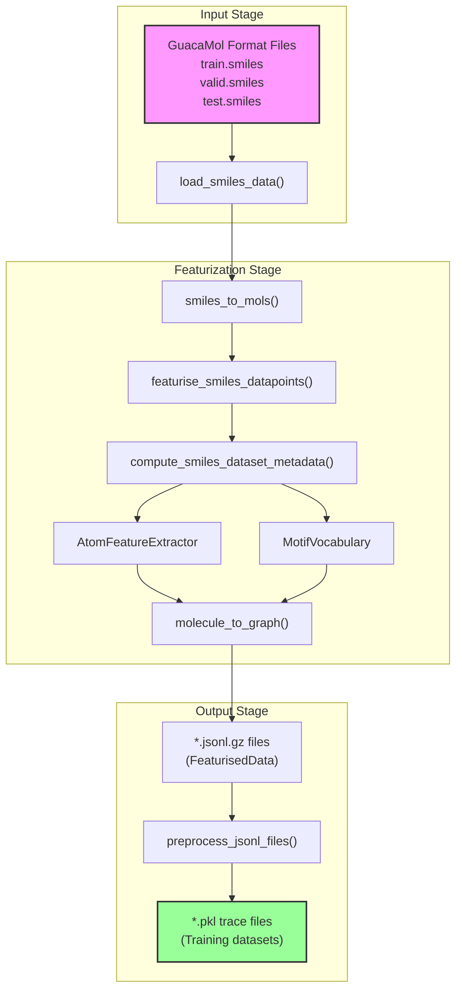
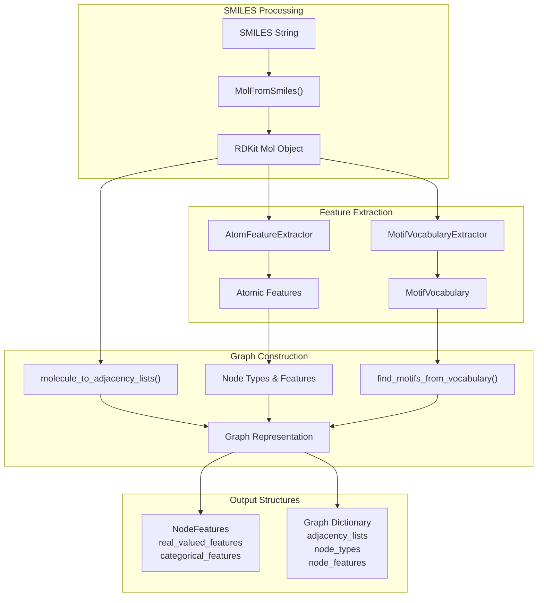
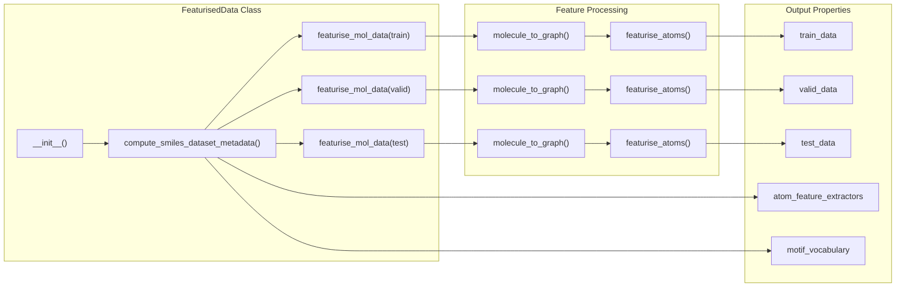
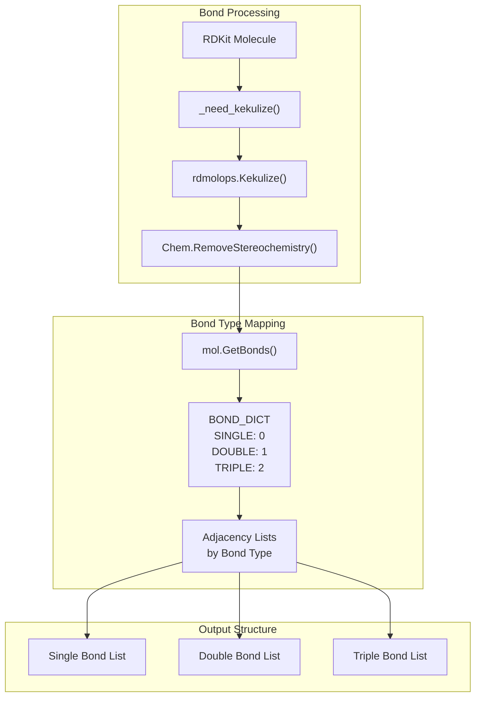
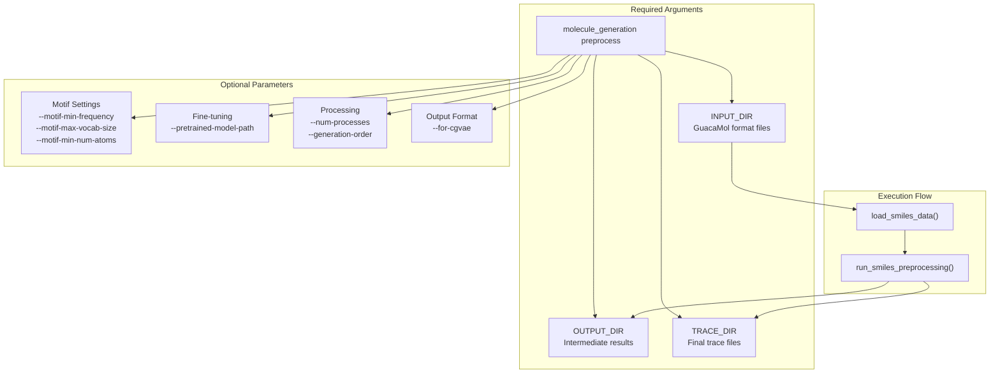
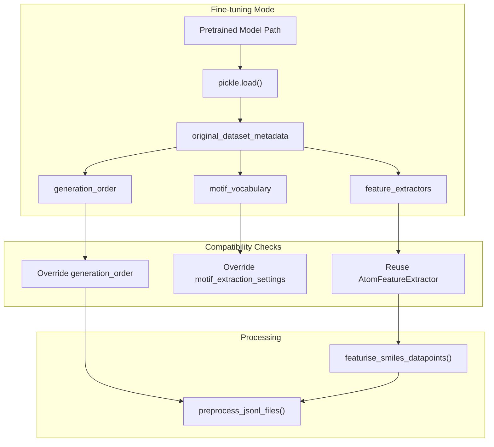

<!-- source: DeepWiki mcp.deepwiki.com · repo microsoft/molecule-generation · page 3 Data Processing Pipeline · fetched 2026-10-26 -->

# Data Processing Pipeline

Relevant source files

The following files were used as context for generating this wiki page:

- [README.md](README.md)
- [molecule_generation/chem/molecule_dataset_utils.py](molecule_generation/chem/molecule_dataset_utils.py)
- [molecule_generation/cli/preprocess.py](molecule_generation/cli/preprocess.py)

The data processing pipeline transforms raw molecular data into training-ready datasets for MoLeR models. This comprehensive system converts SMILES strings through multiple stages of featurization, graph conversion, and trace generation to produce the structured data required for training and inference.

For information about training models with processed data, see [Training Models](#5). For details about the model architectures that consume this processed data, see [Model Architecture](#4).

## Pipeline Overview

The data processing pipeline consists of three main stages: input data loading, molecular featurization, and trace generation. The entire pipeline is orchestrated through the CLI command `molecule_generation preprocess` and can handle both initial preprocessing and fine-tuning scenarios.

### High-Level Data Flow

**Core Data Processing Pipeline**

Sources: [molecule_generation/cli/preprocess.py:208-331](), [molecule_generation/chem/molecule_dataset_utils.py:242-346]()

### Pipeline Stages and File Formats

| Stage | Input Format | Output Format | Key Components |
|-------|-------------|---------------|----------------|
| Input Loading | `.smiles` files | Python dictionaries | `load_smiles_data()`, `DatasetPath` |
| Molecular Featurization | SMILES strings | Graph representations | `featurise_smiles_datapoints()`, `molecule_to_graph()` |
| Trace Generation | `.jsonl.gz` files | `.pkl` training files | `preprocess_jsonl_files()` |

Sources: [molecule_generation/cli/preprocess.py:42-48](), [molecule_generation/chem/molecule_dataset_utils.py:156-240]()

## Molecular Featurization Process

The featurization process transforms SMILES strings into rich graph representations containing atomic features, bond information, and optional motif annotations. This stage is handled primarily by the `FeaturisedData` class and supporting functions.

### Featurization Components

**Molecular Featurization Components**

Sources: [molecule_generation/chem/molecule_dataset_utils.py:385-516](), [molecule_generation/chem/molecule_dataset_utils.py:48-54]()

### Core Featurization Functions

The `featurise_smiles_datapoints()` function serves as the main entry point for molecular featurization, coordinating between atom feature extraction and motif processing:

**FeaturisedData Class Structure**

Sources: [molecule_generation/chem/molecule_dataset_utils.py:167-240](), [molecule_generation/chem/molecule_dataset_utils.py:125-154]()

## Graph Representation and Data Structures

The pipeline converts molecular structures into standardized graph representations suitable for graph neural networks. The core data structures include adjacency lists, node features, and optional categorical labels.

### Graph Construction Process

The `molecule_to_graph()` function creates the final graph representation by combining structural and feature information:

| Component | Function | Output Structure |
|-----------|----------|------------------|
| Bond Information | `molecule_to_adjacency_lists()` | `List[List[Tuple[int, int]]]` |
| Atom Features | `featurise_atoms()` | `NodeFeatures` (real + categorical) |
| Node Types | `get_atom_symbol()` | List of atom symbols |
| Motif Annotations | `find_motifs_from_vocabulary()` | `List[MotifAnnotation]` |

Sources: [molecule_generation/chem/molecule_dataset_utils.py:453-516](), [molecule_generation/chem/molecule_dataset_utils.py:356-382]()

### Bond Type Processing

The system handles molecular bonds through a standardized dictionary mapping and Kekulization process:

**Bond Type Processing and Adjacency List Generation**

Sources: [molecule_generation/chem/molecule_dataset_utils.py:45-46](), [molecule_generation/chem/molecule_dataset_utils.py:356-382]()

## CLI Preprocessing Interface

The preprocessing pipeline is primarily accessed through the `molecule_generation preprocess` command, which provides comprehensive options for customizing the featurization process.

### Command Structure and Arguments

The preprocessing CLI accepts three main directory arguments and numerous optional parameters for fine-tuning the process:

**CLI Preprocessing Interface and Options**

Sources: [molecule_generation/cli/preprocess.py:112-198](), [molecule_generation/cli/preprocess.py:208-331]()

### Generation Orders and Processing Options

The pipeline supports multiple generation order strategies through the `GENERATION_ORDER_CLS` mapping:

| Order Type | Class | Description |
|------------|-------|-------------|
| `bfs` | `BFSOrder` | Breadth-first search ordering |
| `bfs-random` | `BFSOrderRandom` | Randomized BFS (default) |
| `canonical` | `CanonicalOrder` | Canonical atom ordering |
| `random` | `RandomOrder` | Random atom ordering |
| `loop-closing` | `LoopClosingOrder` | Prioritizes loop-closing bonds |

Sources: [molecule_generation/cli/preprocess.py:33-39]()

## Fine-tuning and Model Compatibility

The preprocessing pipeline supports fine-tuning scenarios where new data must be compatible with existing trained models. This process reuses atom feature extractors and motif vocabularies from pretrained models.

### Fine-tuning Data Flow

**Fine-tuning Compatibility Process**

Sources: [molecule_generation/cli/preprocess.py:243-267](), [molecule_generation/cli/preprocess.py:292-299]()

---

