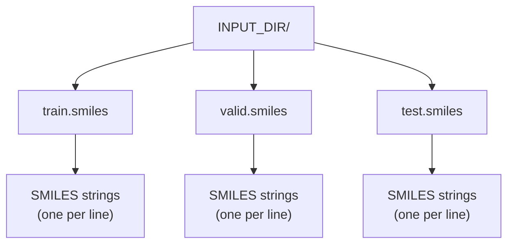
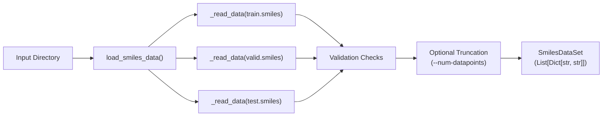
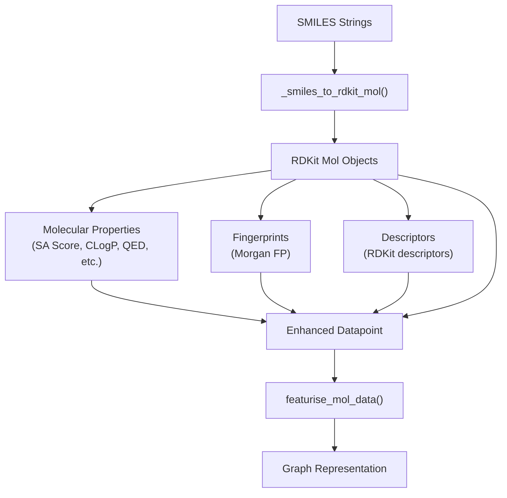
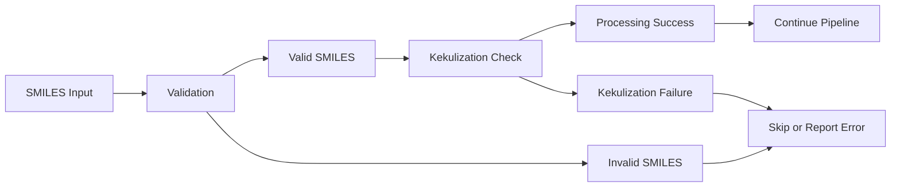
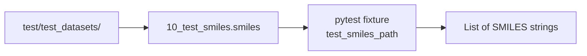

<!-- source: DeepWiki mcp.deepwiki.com · repo microsoft/molecule-generation · page 3.1 Input Data Formats · fetched 2026-10-26 -->

# Input Data Formats

<details>
<summary>Relevant source files</summary>

The following files were used as context for generating this wiki page:

- [molecule_generation/chem/molecule_dataset_utils.py](molecule_generation/chem/molecule_dataset_utils.py)
- [molecule_generation/cli/preprocess.py](molecule_generation/cli/preprocess.py)
- [molecule_generation/test/conftest.py](molecule_generation/test/conftest.py)

</details>


This document describes the input data formats supported by the molecule generation system, focusing on the SMILES-based datasets used for training and evaluation. For information about the preprocessing pipeline that transforms these inputs, see [Preprocessing Pipeline](#3.2). For details about dataset creation and internal representations, see [Dataset Creation](#3.3).

## Overview

The molecule generation system primarily accepts molecular data in SMILES (Simplified Molecular Input Line Entry System) format. The system expects datasets to follow the GuacaMol benchmark format with separate train/validation/test splits. All input processing is handled through the preprocessing pipeline, which converts SMILES strings into featurized graph representations suitable for training MoLeR models.

## Dataset Directory Structure

The system expects input datasets to be organized in a specific directory structure with three required files:



**Dataset File Structure and Loading**

Sources: [molecule_generation/cli/preprocess.py:42-48](), [molecule_generation/cli/preprocess.py:64-109]()

### File Naming Convention

The required file names are defined in the `DatasetPath` enum:

| File | Purpose | Content |
|------|---------|---------|
| `train.smiles` | Training data | SMILES strings for model training |
| `valid.smiles` | Validation data | SMILES strings for validation during training |
| `test.smiles` | Test data | SMILES strings for final evaluation |

### SMILES File Format

Each `.smiles` file contains one SMILES string per line. The system processes these using the `_read_data` function which creates dictionaries with a `"SMILES"` key:

```
CCO
CCN
C1CCCCC1
CCCCCCCC
```

Each line is converted to: `{"SMILES": "CCO"}`, `{"SMILES": "CCN"}`, etc.

Sources: [molecule_generation/cli/preprocess.py:50-55]()

## Data Loading and Validation



**SMILES Data Loading Process**

The `load_smiles_data` function handles dataset loading with optional truncation:

- Reads all three split files from the input directory
- Validates that validation and test sets are non-empty
- Optionally truncates datasets proportionally when `--num-datapoints` is specified
- Returns three `SmilesDataSet` objects (lists of dictionaries)

Sources: [molecule_generation/cli/preprocess.py:64-109]()

## SMILES to Molecular Objects Pipeline



**SMILES Processing Pipeline**

The system converts SMILES strings through several stages:

1. **SMILES to RDKit**: `MolFromSmiles` converts strings to `Mol` objects
2. **Property Calculation**: Computes molecular properties including:
   - SA (Synthetic Accessibility) score
   - CLogP (lipophilicity)
   - Molecular weight
   - QED (drug-likeness)
   - Bertz complexity index
3. **Fingerprint Generation**: Creates Morgan fingerprints for similarity calculations
4. **Descriptor Computation**: Extracts all available RDKit molecular descriptors

Sources: [molecule_generation/chem/molecule_dataset_utils.py:627-703]()

## Data Point Structure

Each processed data point follows this structure:

| Key | Type | Description |
|-----|------|-------------|
| `"SMILES"` | `str` | Original SMILES string |
| `"mol"` | `rdkit.Mol` | RDKit molecule object |
| `"properties"` | `Dict` | Calculated molecular properties |
| `"fingerprints"` | `np.ndarray` | Morgan fingerprint vector |
| `"descriptors"` | `List[float]` | RDKit molecular descriptors |
| `"graph"` | `Dict` | Featurized graph representation |
| `"motifs"` | `List` | Extracted molecular motifs (if enabled) |

Sources: [molecule_generation/chem/molecule_dataset_utils.py:627-703](), [molecule_generation/chem/molecule_dataset_utils.py:125-154]()

## Preprocessing Command Line Interface

The preprocessing is initiated through the CLI command:

```bash
molecule_generation preprocess INPUT_DIR OUTPUT_DIR TRACE_DIR [options]
```

### Key Arguments

| Argument | Purpose | Default |
|----------|---------|---------|
| `INPUT_DIR` | Directory containing SMILES files | Required |
| `OUTPUT_DIR` | Directory for featurized data | Required |
| `TRACE_DIR` | Directory for generation traces | Required |
| `--num-datapoints` | Limit training examples | All data |
| `--num-processes` | Parallel workers | CPU count |
| `--motif-min-frequency` | Motif vocabulary threshold | None |

Sources: [molecule_generation/cli/preprocess.py:112-198]()

## Error Handling and Data Validation



**Error Handling in SMILES Processing**

The system includes robust error handling for invalid molecular inputs:

- **SMILES Parsing**: Invalid SMILES strings are caught during `MolFromSmiles` conversion
- **Kekulization**: Aromatic molecules that cannot be kekulized are rejected
- **Stereo Information**: Stereochemistry is removed for consistency
- **Filtering Options**: `--filter-failed` flag allows dropping invalid molecules

The `_smiles_to_rdkit_mol` function includes error recovery with `report_fail_as_none` option for graceful handling of processing failures.

Sources: [molecule_generation/chem/molecule_dataset_utils.py:349-354](), [molecule_generation/chem/molecule_dataset_utils.py:474-489]()

## Test Dataset Format

The system includes test datasets in the expected format:



**Test Data Structure**

Test datasets follow the same format as production data, with small example files for testing the preprocessing pipeline.

Sources: [molecule_generation/test/conftest.py:7-16]()

---

